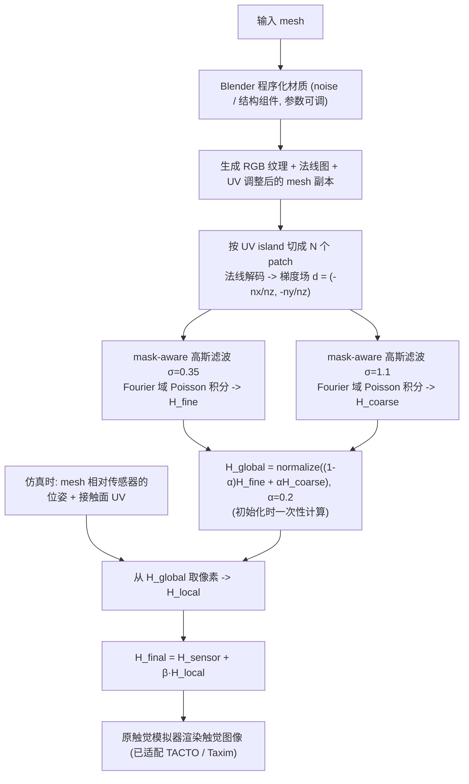

# Norm2Tex（arXiv:2609.25398）

**Norm2Tex**（*Norm2Tex: Augmenting Visuo-Tactile Simulations with Texture*，[arXiv:2609.25398](https://arxiv.org/abs/2609.25398)，[项目页](https://utn-air.github.io/norm2tex)，[代码](https://github.com/utn-air/norm2tex)）来自 [具身智能小站 2026-10-18 盘点](../../sources/blogs/wechat_embodied_station_26_papers_embodiedswe_2026-10-18.md)，属「灵巧与触觉」组。

## 一句话定义

**把法线纹理转成高度信息，在触觉渲染前修改深度图，为现有模拟器增加高频表面细节。**

## 英文缩写速查

| 缩写 | 英文全称 | 简要说明 |
|------|----------|----------|
| Visuo-tactile | Vision-based Tactile | 视觉型触觉传感 |

## 为什么重要

- 现有视触觉模拟器缺高频表面纹理，影响材料分类等任务的迁移。
- 开源结论：**待发布**（步骤 2.5，2026-10-18）。项目页链接的 github.com/utn-air/norm2tex 经 git ls-remote 不可读（仓库不存在或未公开），暂按待发布处理。
- 同期同组工作见 [编程智能体造数据与 VLA 闭环评测：具身智能小站 10-18 期 26 篇阅读坐标](../overview/embodied-station-2026-10-18-26-papers-technology-map.md)。

## 流程总览

图依据：论文 §III-A–D / Fig.2

## 核心机制

| 项 | 内容 |
|----|------|
| **arXiv** | [2609.25398](https://arxiv.org/abs/2609.25398) |
| **开源** | **待发布** |
| **要点** | 法线纹理 → 高度信息 → 修改深度图 → 触觉渲染。 |
| **文内指标** | 公众号称通过材料分类与控制任务检查纹理信息能否迁移到真机；未给具体数字。 |

## 源码运行时序图

**不适用（待发布）** — 项目页链接的 github.com/utn-air/norm2tex 经 git ls-remote 不可读（仓库不存在或未公开），暂按待发布处理。 不编造运行脚本；代码公开后再补。

## 实验与评测

- 公众号称通过材料分类与控制任务检查纹理信息能否迁移到真机；未给具体数字。
- **读法：** 本页为索引级摘要，依据公众号转述的官方摘要与仓库信息整理；逐项数字与 baseline 以原文 PDF 为准。

## 与其他工作对比

- 横向索引见 [编程智能体造数据与 VLA 闭环评测：具身智能小站 10-18 期 26 篇阅读坐标](../overview/embodied-station-2026-10-18-26-papers-technology-map.md)；同 arXiv 不重复造页。

## 结论

**在深度图层面补纹理是不改模拟器内核的低成本增强。**

1. 开源边界：**待发布** — 项目页链接的 github.com/utn-air/norm2tex 经 git ls-remote 不可读（仓库不存在或未公开），暂按待发布处理。
2. 核心机制：法线纹理 → 高度信息 → 修改深度图 → 触觉渲染。
3. 复现与选型前核对任务协议、硬件与基准口径，勿直接横比公众号摘录数字。

## 关联页面

- [tactile-sensing](../concepts/tactile-sensing.md)
- [sim2real](../concepts/sim2real.md)
- [embodied-station-2026-10-18-26-papers-technology-map](../overview/embodied-station-2026-10-18-26-papers-technology-map.md)

## 参考来源

- [norm2tex_arxiv_2609_25398.md](../../sources/papers/norm2tex_arxiv_2609_25398.md)
- [wechat_embodied_station_26_papers_embodiedswe_2026-10-18.md](../../sources/blogs/wechat_embodied_station_26_papers_embodiedswe_2026-10-18.md)
- [arXiv:2609.25398](https://arxiv.org/abs/2609.25398)
- [arXiv PDF](https://arxiv.org/pdf/2609.25398)：已通读方法部分（实验与附录以略读为准）：§I 引言、§III Method（III-A–III-D）、§IV-A 适用性与性能；§IV-B/C 略读

## 推荐继续阅读

- [arXiv PDF](https://arxiv.org/pdf/2609.25398)
- [项目页](https://utn-air.github.io/norm2tex)
- [https://github.com/utn-air/norm2tex](https://github.com/utn-air/norm2tex)
