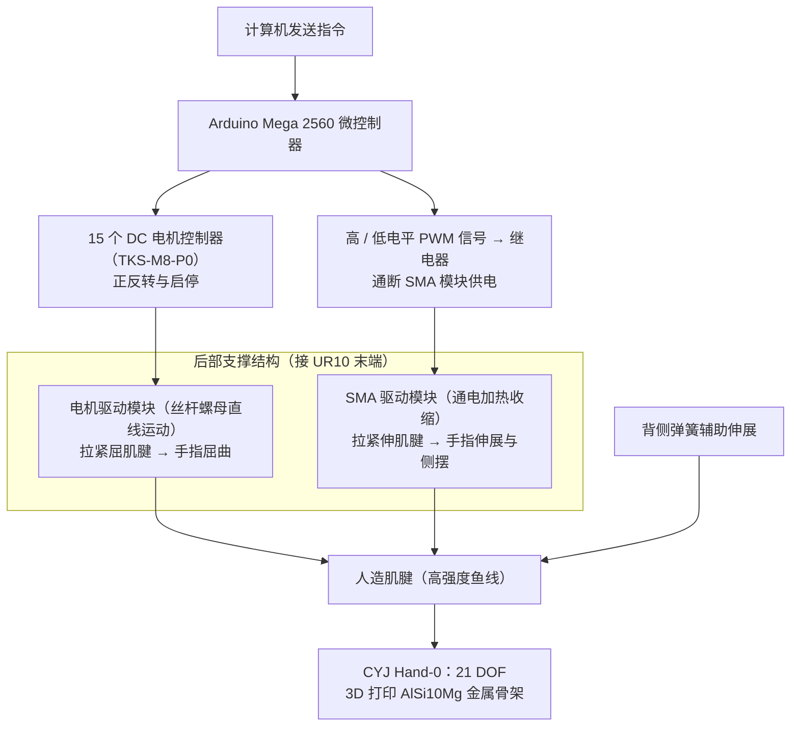

# A 21-DOF Humanoid Dexterous Hand with Hybrid SMA-Motor Actuation

**A 21-DOF Humanoid Dexterous Hand with Hybrid SMA-Motor Actuation: CYJ Hand-0** 已列入 [Robot Learning Paper Notebooks](https://imchong.github.io/Robot_Learning_Paper_Notebooks/index.html) 的 **PROGRESS.md 待深读** 清单（分类：12_Hardware_Design）。本页 **还没有深读笔记**：只给出这篇论文的分类位置与原文入口，方法细节与数据请直接看原文。

## 一句话定义

A 21-DOF Humanoid Dexterous Hand with Hybrid SMA-Motor Actuation 的人形机器人学习论文条目，当前处于 Paper Notebooks 阅读进度（待深读）阶段。

## 英文缩写速查

| 缩写 | 英文全称 | 简要说明 |
|------|----------|----------|
| RL | Reinforcement Learning | 通过与环境交互最大化长期回报来学习策略 |
| WBC | Whole-Body Control | 协调全身关节满足多任务/约束的控制基础设施 |
| Sim2Real | Simulation to Real | 把仿真中学到的策略迁移落地真机的工程主线 |

## 为什么重要

- 这篇已排进 Paper Notebooks 的待读清单，可以从 [机器人学习论文笔记总索引](../overview/humanoid-paper-notebooks-index.md) 与分类页找到同一批工作。
- 在笔记写出来之前，这里只保留分类位置与原文入口；驱动与控制流程见上方「流程总览」（依据论文方法部分，非深读笔记）。

## 流程总览

图依据：论文 §III（Fig.12–15）与摘要

## 核心信息

| 字段 | 内容 |
|------|------|
| 分类 | 12_Hardware_Design |
| 深读状态 | 待撰写（[PROGRESS.md](https://github.com/ImChong/Robot_Learning_Paper_Notebooks/blob/main/papers/PROGRESS.md)） |
| 计划文件夹 | `papers/12_Hardware_Design/a-21-dof-humanoid-dexterous-hand-with-hybrid-sma` |
| arXiv | <https://arxiv.org/abs/2507.14538> |

## 实验与评测

- 深读笔记尚未完成；量化 benchmark、消融与实机指标待笔记撰写后补充。

## 结论

**本页是一条待读记录，不是对 CYJ Hand-0 的技术判断——它当前只锁定了「这篇论文归 12_Hardware_Design、尚待深读」这一条事实。**

- 可依赖的信息仅限分类、计划文件夹路径与 arXiv 入口（<https://arxiv.org/abs/2507.14538>）；驱动与控制流程见「流程总览」，指标、消融一律待深读笔记补齐。
- 适用边界：可用于按分类检索，**不可**作为该论文结论的引用来源。
- 深读笔记完成后，本页会补上笔记链接与实质要点。

## 与其他页面的关系

- 分类页：[paper-notebook-category-12-hardware-design](../overview/paper-notebook-category-12-hardware-design.md)
- 总索引：[humanoid-paper-notebooks-index.md](../overview/humanoid-paper-notebooks-index.md)

## 参考来源

- [humanoid_pnb_a-21-dof-humanoid-dexterous-hand-with-hybrid-sma.md](../../sources/papers/humanoid_pnb_a-21-dof-humanoid-dexterous-hand-with-hybrid-sma.md)
- [Robot Learning Paper Notebooks · PROGRESS.md](https://github.com/ImChong/Robot_Learning_Paper_Notebooks/blob/main/papers/PROGRESS.md)
- 论文：<https://arxiv.org/abs/2507.14538>
- [arXiv PDF](https://arxiv.org/pdf/2507.14538)：已通读方法部分（实验与附录以略读为准）：§III Design and Construction of the Drive System（含 D 控制系统）、§II 结构设计；§IV 实验以略读为准

## 推荐继续阅读

- [Paper Notebooks 阅读进度（PROGRESS.md）](https://github.com/ImChong/Robot_Learning_Paper_Notebooks/blob/main/papers/PROGRESS.md)
