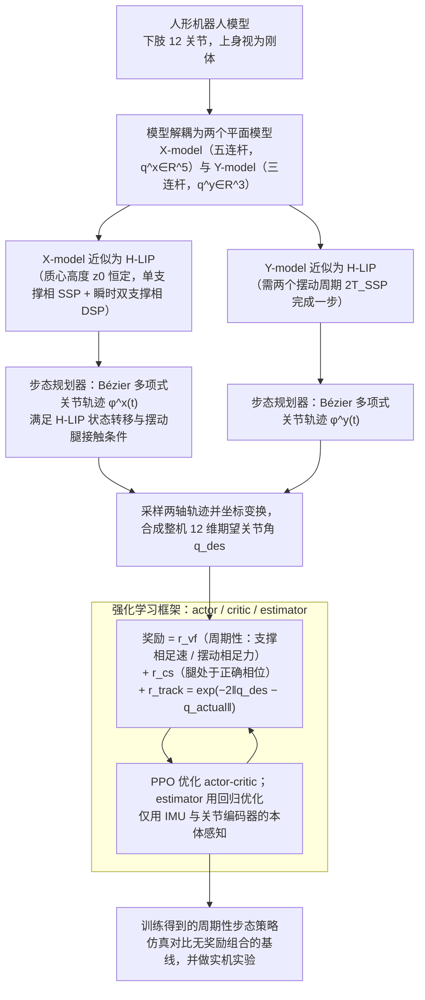

# A Gait Driven RL Framework for Humanoid Robots

**A Gait Driven RL Framework for Humanoid Robots** 已列入 [Robot Learning Paper Notebooks](https://imchong.github.io/Robot_Learning_Paper_Notebooks/index.html) 的 **PROGRESS.md 待深读** 清单（分类：05_Locomotion）。本页 **还没有深读笔记**：只给出这篇论文的分类位置与原文入口，方法细节与数据请直接看原文。

## 一句话定义

A Gait Driven RL Framework for Humanoid Robots 的人形机器人学习论文条目，当前处于 Paper Notebooks 阅读进度（待深读）阶段。

## 英文缩写速查

| 缩写 | 英文全称 | 简要说明 |
|------|----------|----------|
| RL | Reinforcement Learning | 通过与环境交互最大化长期回报来学习策略 |
| WBC | Whole-Body Control | 协调全身关节满足多任务/约束的控制基础设施 |
| Sim2Real | Simulation to Real | 把仿真中学到的策略迁移落地真机的工程主线 |

## 为什么重要

- 这篇已排进 Paper Notebooks 的待读清单，可以从 [机器人学习论文笔记总索引](../overview/humanoid-paper-notebooks-index.md) 与分类页找到同一批工作。
- 在笔记写出来之前，这里只保留分类位置与原文入口，不给方法结论；论文自述的方法流程见下方「流程总览」。

## 流程总览

图依据：论文 §II、§III（Fig. 2、Fig. 3、Fig. 4）、§IV（步态规划器）、§V（学习框架 / Fig. 7）。

## 核心信息

| 字段 | 内容 |
|------|------|
| 分类 | 05_Locomotion |
| 深读状态 | 待撰写（[PROGRESS.md](https://github.com/ImChong/Robot_Learning_Paper_Notebooks/blob/main/papers/PROGRESS.md)） |
| 计划文件夹 | `papers/05_Locomotion/a-gait-driven-rl-framework-for-humanoid-robots` |
| arXiv | <https://arxiv.org/abs/2506.08416> |

## 实验与评测

- 深读笔记尚未完成；量化 benchmark、消融与实机指标待笔记撰写后补充。

## 结论

**本页当前是一条待读记录，而不是对这篇工作的评价——它只登记了分类位置，等深读笔记写完再补成完整摘要。**

- 现状：列入 Paper Notebooks 的 **PROGRESS.md 待深读** 清单，分类 05_Locomotion，深读笔记尚未撰写。
- 方法流程见「流程总览」；本页 **不含任何量化结论**：benchmark、消融与实机指标要等笔记完成后补充，不要据此判断方法优劣。
- 可用之处只有检索：经 [分类页](../overview/paper-notebook-category-05-locomotion.md) 与 [总索引](../overview/humanoid-paper-notebooks-index.md) 交叉定位，原文入口为 arXiv 2506.08416。

## 与其他页面的关系

- 分类页：[paper-notebook-category-05-locomotion](../overview/paper-notebook-category-05-locomotion.md)
- 总索引：[humanoid-paper-notebooks-index.md](../overview/humanoid-paper-notebooks-index.md)

## 参考来源

- [humanoid_pnb_a-gait-driven-rl-framework-for-humanoid-robots.md](../../sources/papers/humanoid_pnb_a-gait-driven-rl-framework-for-humanoid-robots.md)
- [Robot Learning Paper Notebooks · PROGRESS.md](https://github.com/ImChong/Robot_Learning_Paper_Notebooks/blob/main/papers/PROGRESS.md)
- 论文：<https://arxiv.org/abs/2506.08416>
- [arXiv PDF](https://arxiv.org/pdf/2506.08416)：已通读方法部分（实验与附录以略读为准）：§I 引言、§II 预备、§III 建模、§IV 步态规划器（定理与算法仅读结构）、§V 学习框架与奖励；本次读取的是 v2（2026-02-02）。

## 推荐继续阅读

- [Paper Notebooks 阅读进度（PROGRESS.md）](https://github.com/ImChong/Robot_Learning_Paper_Notebooks/blob/main/papers/PROGRESS.md)
