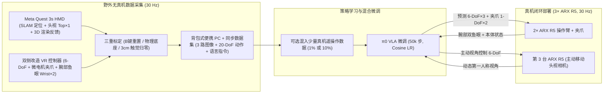

# ActiveUMI

**ActiveUMI: Robotic Manipulation with Active Perception from Robot‑Free Human Demonstrations**（arXiv:2510.01607v1，2025 年 10 月）已列入 [Robot Learning Paper Notebooks](https://imchong.github.io/Robot_Learning_Paper_Notebooks/index.html) 的 **PROGRESS.md** 清单（分类：06_Manipulation）。本页基于原文全文核对补全核心机制、方法流程图、实测指标与局限（保留 `status: stub` 待深读笔记归档）。

## 一句话定义

ActiveUMI 是一个无需真机在场的便携式双臂灵巧操作数据采集与策略学习框架，通过改造 Meta Quest 3s 控制器与头显（HMD）同步记录双手 6-DoF 位姿、夹爪开合与操作员头部主动视角移动，使策略在真机部署时能够自主控制第三条机械臂的头视相机以解决遮挡、长程与高精度操作难题。

## 英文缩写速查

| 缩写 | 英文全称 | 简要说明 |
|------|----------|----------|
| ActiveUMI | Universal Manipulation Interface with Active Perception | 本文框架：引入头显主动第一人称视角的无真机示教采集与策略学习系统 |
| UMI | Universal Manipulation Interface | 通用操作接口，传统手持式示教采集框架（主要依赖腕部相机） |
| HMD | Head-Mounted Display | 头戴式显示器（本文采用 Meta Quest 3s，兼具 SLAM 世界定位与动态头视相机） |
| VLA | Vision-Language-Action | 视觉-语言-动作基础模型（本文基于 $\pi_0$ 微调实现端到端策略学习） |
| 6-DoF | Six Degrees of Freedom | 六自由度位姿（3D 平移 $x,y,z$ 与 3D 旋转 roll, pitch, yaw） |
| RPE | Relative Pose Error | 相对位姿误差（本文用于衡量真机回放夹爪间距相对标尺真值的相对误差） |

## 为什么重要

- **打破传统 UMI 依赖固定/腕部视角的感知瓶颈**：常规手持式采集器仅靠随手臂移动的腕部相机观测，视角受操作约束而非感知需要驱动；ActiveUMI 证明将操作员主动转头/移动视角的动作纳入 20-DoF 策略空间（双臂各 6-DoF + 夹爪各 1-DoF + 头部 6-DoF），能显著克服遮挡与长程状态识别难题。
- **兼具自然动作采集吞吐率与 VR 级定位精度**：相比真机遥操作，ActiveUMI 在 `Rope boxing` 与 `Shirt folding` 上的耗时倍率分别仅为徒手演示的 **2.06×** 与 **1.49×**（遥操作为 **3.27×** 与 **2.63×**），同时相对位姿误差（RPE）仅 **4.0 mm**（比传统 UMI 的 **10.1 mm** 降低约 **2.5×**）。
- **与 [机器人学习论文笔记总索引](../overview/humanoid-paper-notebooks-index.md) 及 [操作分类页](../overview/paper-notebook-category-06-manipulation.md) 衔接**：补足了野外人类示教（in-the-wild human demonstrations）中「主动感知（active perception）」这一关键缺失环节。

## 核心信息

| 字段 | 内容 |
|------|------|
| 分类 | 06_Manipulation |
| 作者 / 机构 | Qiyuan Zeng*、Chengmeng Li、Jude St. John†、Zhongyi Zhou、Junjie Wen、Guorui Feng†、Yichen Zhu*†、Yi Xu（上海大学、Stanford University、美的集团） |
| 论文 | arXiv:2510.01607v1（<https://arxiv.org/abs/2510.01607>） |
| 项目页 | <https://activeumi.github.io> |
| 硬件平台 | Meta Quest 3s HMD + 改造控制器（配微型电机复制夹爪与腕部鱼眼相机）+ 背包式便携 PC 与电池；真机测试床为 3 台 6-DoF **ARX R5** 机械臂 |
| 策略与控制 | 基于 **$\pi_0$** VLA 微调（50k 步，余弦学习率调度）；**30 Hz** 采样与闭环控制（20-DoF 动作：6-DoF × 3 + 夹爪 1-DoF × 2） |
| 深读状态 | 待撰写（[PROGRESS.md](https://github.com/ImChong/Robot_Learning_Paper_Notebooks/blob/main/papers/PROGRESS.md)） |
| 计划文件夹 | `papers/06_Manipulation/activeumi-robotic-manipulation-with-active-perce` |

## 核心机制（归纳）

> 注：以下机制与评测数值均依据 arXiv:2510.01607v1 原文全文核对整理。

1. **便携式 VR 示教硬件与无侵入式夹爪镜像（§3.1）**：
   - **VR 夹爪控制器**：改装商用 Meta Quest 3s 手柄，借助头显的 inside-out SLAM 与控制器红外（IR）LED 图案三角定位，实时获取低延迟、高精度的 **6-DoF** 位姿（$x,y,z$ 及 roll, pitch, yaw）。
   - **无侵入式执行器镜像与腕部感知**：在控制器上集成微型电机驱动与目标机器人**同款复制夹爪**（真机侧无需更换原装夹爪即可直接复用），并加装大视场**腕部鱼眼相机**（Wrist×2）补充近距离手物接触细节。
   - **HMD 双重角色与沉浸式反馈**：Quest 3s 头显同时担任（1）统一世界坐标系 SLAM 定位中枢（同步追踪头显与双手控制器）与（2）动态第一人称**顶视相机（Top×1）**；供电与小型 PC 集成于双肩背包中实现野外自由移动采集，并在 VR 头显内实时渲染与手柄严格对齐的**虚拟双臂 3D 模型**（Fig. 4）以提供操作反馈。
2. **主动第一人称感知与策略耦合（§3.2 & Fig. 3）**：
   - 采集阶段以 **30 Hz** 同步记录左/右腕 6-DoF 位姿、头显 6-DoF 位姿（合计 `6 DoF × 3`）、双夹爪开合（`1 DoF × 2`），以及 2 路腕部鱼眼图像、1 路头视图像和语言指令。
   - 训练阶段在 **$\pi_0$** VLA 上微调（50k 步，余弦学习率调度），使策略同时学习「手部动作」与「视觉注意力转移」之间的强关联；真机部署时，策略除输出双操作臂与夹爪指令外，还实时预测**第三条 6-DoF 机械臂（搭载头视相机）的 6-DoF 目标位姿**，由底层控制器驱动相机主动寻找被遮挡目标或抵消视角偏移。
3. **三重末端标定机制（§3.3）**：
   - 为确保每次野外采集拥有一致的绝对世界坐标系原点（控制器尖端与头显位姿分别 1:1 映射真机双夹爪尖端与头视相机），系统设计了三项标定流程：
     1. **原位环境零点重置（In-Situ setup）**：按手柄 `B` 键即可在任意场地重置 6-DoF 基坐标系原点，并在 VR 画面实时渲染虚拟坐标轴对齐物理桌面；
     2. **物理夹爪底座（Gripper placeholder）**：设计固定相对距离与姿态的物理停靠治具，将双手控制器放入底座按键即可一键标定世界坐标系原点与朝向；
     3. **零点触觉振动反馈（Haptic feedback）**：当任一夹爪进入基座原点 **3 cm** 范围内时触发手柄电机高频振动，使操作员无需低头看数值读数即可确认归零对齐。

### 方法流程图

## 工程实践

- **穿戴式便携配置与端到端标定落地（§3.1, §3.3）**：整套供电与便携 PC 置于双肩背包内，脱离固定桌面电源与工作站；在真实部署前必须先通过 `B` 键重置零点、物理夹爪底座对齐或 **3 cm** 触觉振动归零建立统一世界坐标系，保证控制器尖端与真机夹爪 1:1 映射。
- **双臂 + 主动头视机械臂同步控制（§4.1）**：使用 3 台 6-DoF **ARX R5** 机械臂在 **30 Hz** 下接收 **$\pi_0$** 输出的 `6-DoF × 3 + 夹爪 1-DoF × 2`（共 20-DoF）动作；若目标平台仅有固定相机或纯腕部相机，则只能退化至 14-DoF 并面临显著遮挡损失。
- **低成本混训策略（§4.3, Table 3）**：在拥有野外 ActiveUMI 示教后，仅补充 **1%** 的真机遥操作微调数据即可显著弥补外观/运动学域差（叠衬衫成功率 80% → **95%**）。

## 实验与评测

- **实验平台与基准设置（§4.1–4.2）**：在 3 台 6-DoF **ARX R5** 机械臂平台上评测（2 台负责双臂操作 + 1 台搭载头视相机提供主动视角），所有策略统一以 **$\pi_0$** 为基座微调 **50k 步**；主表每项测试 **10 trials**，混合数据实验（Table 3）每组 **20 trials**。对照基线包括：**UMI**（仅双腕鱼眼相机，14-DoF，按 $\pi_0$ 官方实现补齐缺失第 3 视角 token）与 **UMI w/ Fixed Head Camera**（固定俯拍头相机，14-DoF）。
- **域内任务与跨场景泛化表现（Table 1 & Table 2）**：

| 视角配置（动作维度） | 评测域 | Bottle placing | Rope boxing | Shirt folding | Block disassembly | Take Drink from Bag | 平均成功率 |
|---|---|---|---|---|---|---|---|
| UMI（仅腕视，14-DoF） | 域内（Table 1） | 60% | 20% | 10% | 40% | 0% | **26%** |
| UMI w/ Fixed Head（14-DoF） | 域内（Table 1） | 60% | 40% | 40% | 50% | 20% | **42%** |
| **ActiveUMI（主动头视，20-DoF）** | **域内（Table 1）** | **90%** | **70%** | **80%** | **80%** | **30%** | **70%** |
| UMI（仅腕视，14-DoF） | 新环境/新物体（Table 2） | 30% | 0% | 0% | 0% | 0% | **6%** |
| UMI w/ Fixed Head（14-DoF） | 新环境/新物体（Table 2） | 30% | 10% | 20% | 20% | 0% | **16%** |
| **ActiveUMI（主动头视，20-DoF）** | **新环境/新物体（Table 2）** | **70%** | **50%** | **80%** | **50%** | **30%** | **56%** |

  - 注：原文 §4.1 另述及 `Toolbox cleaning`（工具箱合盖），§4.2 亦提及 `PourWater` 上主动视角比固定顶视高 30%、比纯腕视高 60%，但 Table 1/2 实列以上 5 项任务（Table 2 第 3–4 列表头存在 `Rope boxing` 排版重复，按表内均值验证对应 `Rope boxing / Shirt folding / Block disassembly`）。
- **混合真机遥操作数据配比（Table 3，Shirt folding，20 trials）**：
  - 纯 ActiveUMI 数据（`0%` 遥操作）：**80%**；
  - 混入 `10%` 真机遥操作数据：**90%**；
  - 混入 **`1%` 真机遥操作数据**：**95%**（表明极少量真机对齐数据即可大幅弥合人机外观与运动学差异）。
- **采集效率与位姿精度（§4.5, Fig. 6(d)-(e)）**：
  - **耗时对比（以人类徒手演示时间为 1.00× 基准）**：`Rope boxing` 中 ActiveUMI 耗时倍率为 **2.06×**（传统 VR 遥操作为 **3.27×**）；`Shirt folding` 中 ActiveUMI 为 **1.49×**（传统 VR 遥操作为 **2.63×**）。
  - **相对位姿误差（RPE，100 cm 递减至 10 cm 共 10 个标尺点 × 10 trials）**：ActiveUMI 平均 RPE 为 **4.0 mm**，相比传统 UMI 的 **10.1 mm** 减小约 **2.5×**。

## 与其他工作对比

- **对比 [UMI] / FastUMI / DexUMI**：常规 UMI 类接口把相机固连在手腕上，难以兼顾全局上下文与避遮挡；ActiveUMI 通过 VR 头显把操作员「主动看哪里」显式编码进策略动作空间，并将新环境平均成功率从 6%（纯腕视）拉升至 **56%**，RPE 从 10.1 mm 压低至 **4.0 mm**。
- **对比实验室遥操作（如 Vision-in-Action / 传统 VR Teleop）**：脱离了必须有真机在场的限制，背包穿戴即可在野外以快约 1.6×–1.8× 的速度采集轨迹，且仅需 1% 真机遥操作数据混合即可把叠衬衫成功率推高到 **95%**。

## 结论

**ActiveUMI 证明了「学会怎么看」与「学会怎么动」同等重要：将头显主动视角运动纳入便携 VR 采集与 20-DoF VLA 策略学习，使纯野外示教在域内（70%）和跨场景泛化（56%）上大幅超越纯腕视（26% / 6%）与固定顶视（42% / 16%）基线。**

1. **优先把头部主动视角作为策略显式动作维度**：对存在强遮挡或长程状态校验的双臂任务，主动视角相对固定头视在域内和新环境分别带来 **+28 pp**（42% → 70%）与 **+40 pp**（16% → 56%）的均值提升。
2. **采用「大规模野外采集 + 1% 真机遥操作混合」的高性价比配方**：Table 3 表明只需混入 **1%** 遥操作数据即可把叠衬衫成功率从 80% 提升到 **95%**，显著摊薄真机采集成本。
3. **硬件标定决定野外数据上限**：物理停靠治具 + 原位坐标系重置 + 3 cm 触觉归零将系统相对位姿误差（RPE）控制在 **4.0 mm**（优于传统 UMI 的 10.1 mm）。
4. **文档定位**：本页保留 `stub` 状态并已依据 arXiv:2510.01607v1 全文完成机制与指标核对；待官方深读笔记撰写后可补充更多实现细节。

## 常见误区或局限

1. **硬件平台额外需要第 3 条主动相机臂**：部署 ActiveUMI 策略时，机器人端必须配备可实时响应 6-DoF 头视位姿指令的独立移动相机臂（总控制自由度达 **20-DoF**），在普通固定相机双臂平台上无法直接复现其主动增益。
2. **重度遮挡搜寻与人机形态差仍存天花板**：在需要深入背包搜寻抓取的 `Take Drink from Bag` 任务上，ActiveUMI 域内与新环境成功率均仅为 **30%**；且无真机数据与真机之间仍存在视觉和运动学域差，需借助少量遥操作数据混合补偿。
3. **尚未提供公开可运行源码且部分正文表述有轻微出入**：原文仅给出项目页 `https://activeumi.github.io`，未附验证通过的开源代码仓库；此外引言与摘要提及「6 个任务」及相对固定头视提升 38%，而 Table 1/2 实测列出了 5 个任务且均值差为 28 个百分点（42% vs 70%），引用时需以表内逐项数值为准。

## 关联页面

- [模仿学习](../methods/imitation-learning.md) — 延伸阅读，理解示范数据如何用于策略训练。
- [双臂操作](../tasks/bimanual-manipulation.md) — 延伸阅读，理解双臂协调。
- 分类页：[paper-notebook-category-06-manipulation](../overview/paper-notebook-category-06-manipulation.md)
- 总索引：[humanoid-paper-notebooks-index.md](../overview/humanoid-paper-notebooks-index.md)

## 参考来源

- [humanoid_pnb_activeumi-robotic-manipulation-with-active-perce.md](../../sources/papers/humanoid_pnb_activeumi-robotic-manipulation-with-active-perce.md)
- [Robot Learning Paper Notebooks · PROGRESS.md](https://github.com/ImChong/Robot_Learning_Paper_Notebooks/blob/main/papers/PROGRESS.md)
- 原文（arXiv:2510.01607v1）：<https://arxiv.org/abs/2510.01607>
- 项目页：<https://activeumi.github.io>

## 推荐继续阅读

- [机器人论文阅读笔记：ActiveUMI](https://imchong.github.io/Robot_Learning_Paper_Notebooks/papers/06_Manipulation/ActiveUMI__Robotic_Manipulation_with_Active_Perception_from_Robot-Free_Human_Demonstrations/ActiveUMI__Robotic_Manipulation_with_Active_Perception_from_Robot-Free_Human_Demonstrations.html)
- [Paper Notebooks 阅读进度（PROGRESS.md）](https://github.com/ImChong/Robot_Learning_Paper_Notebooks/blob/main/papers/PROGRESS.md)
