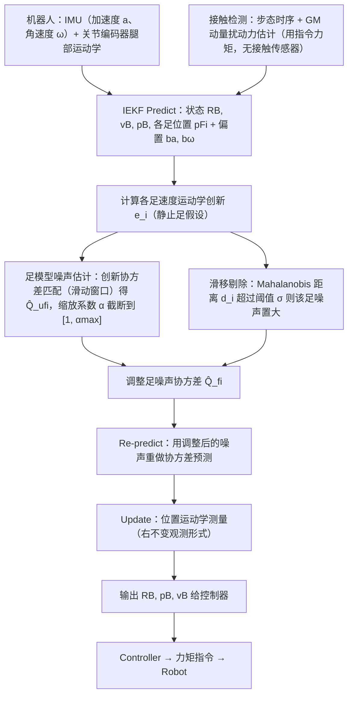

# Adaptive Invariant Extended Kalman Filter for Legged Robot State Estimation

**Adaptive Invariant Extended Kalman Filter for Legged Robot State Estimation** 已列入 [Robot Learning Paper Notebooks](https://imchong.github.io/Robot_Learning_Paper_Notebooks/index.html) 的 **PROGRESS.md 待深读** 清单（分类：09_State_Estimation）。本页 **还没有深读笔记**：只给出这篇论文的分类位置与原文入口，方法细节与数据请直接看原文。

## 一句话定义

Adaptive Invariant Extended Kalman Filter for Legged Robot State Estimation 的人形机器人学习论文条目，当前处于 Paper Notebooks 阅读进度（待深读）阶段。

## 英文缩写速查

| 缩写 | 英文全称 | 简要说明 |
|------|----------|----------|
| RL | Reinforcement Learning | 通过与环境交互最大化长期回报来学习策略 |
| WBC | Whole-Body Control | 协调全身关节满足多任务/约束的控制基础设施 |
| Sim2Real | Simulation to Real | 把仿真中学到的策略迁移落地真机的工程主线 |

## 为什么重要

- 这篇已排进 Paper Notebooks 的待读清单，可以从 [机器人学习论文笔记总索引](../overview/humanoid-paper-notebooks-index.md) 与分类页找到同一批工作。
- 在笔记写出来之前，这里只保留分类位置与原文入口；方法流程见下方「流程总览」，不含实验结论。

## 流程总览

图依据：论文 §III Methodology（A 系统/测量模型、B 接触检测、C 足噪声估计、D 滑移剔除）/ Fig.2（Adaptive IEKF 流程图）

## 核心信息

| 字段 | 内容 |
|------|------|
| 分类 | 09_State_Estimation |
| 深读状态 | 待撰写（[PROGRESS.md](https://github.com/ImChong/Robot_Learning_Paper_Notebooks/blob/main/papers/PROGRESS.md)） |
| 计划文件夹 | `papers/09_State_Estimation/Adaptive_Invariant_Extended_Kalman_Filter_for_Legged_Robot_State_Estimation` |
| arXiv | <https://arxiv.org/abs/2510.16755> |

## 实验与评测

- 深读笔记尚未完成；量化 benchmark、消融与实机指标待笔记撰写后补充。

## 结论

**本页当前提供的是「待读条目」而不是论文解读：它把这条 09_State_Estimation 条目挂进知识库以保持检索连通，实质技术判断要等深读笔记落地。**

- 页面已确认的信息为分类（09_State_Estimation）、arXiv 编号、计划文件夹路径与依据论文方法部分画出的「流程总览」；量化 benchmark 与实机指标尚未记录。
- 适用边界很窄：可用于按分类检索，不能作为该论文技术结论的引用依据。
- 深读笔记完成后，本页会补上笔记链接与实质要点。

## 与其他页面的关系

- 分类页：[paper-notebook-category-09-state-estimation](../overview/paper-notebook-category-09-state-estimation.md)
- 总索引：[humanoid-paper-notebooks-index.md](../overview/humanoid-paper-notebooks-index.md)

## 参考来源

- [humanoid_pnb_adaptive-invariant-extended-kalman-filter-for-le.md](../../sources/papers/humanoid_pnb_adaptive-invariant-extended-kalman-filter-for-le.md)
- [Robot Learning Paper Notebooks · PROGRESS.md](https://github.com/ImChong/Robot_Learning_Paper_Notebooks/blob/main/papers/PROGRESS.md)
- 论文：<https://arxiv.org/abs/2510.16755>
- [arXiv PDF](https://arxiv.org/pdf/2510.16755)：已通读方法部分（实验与附录以略读为准）：§I 引言要点、§III Methodology（A–D）与 Fig.2

## 推荐继续阅读

- [Paper Notebooks 阅读进度（PROGRESS.md）](https://github.com/ImChong/Robot_Learning_Paper_Notebooks/blob/main/papers/PROGRESS.md)
