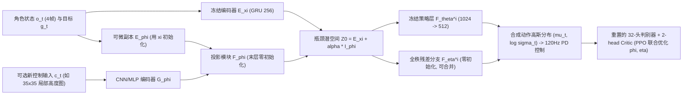

# AdaptNet

**AdaptNet: Policy Adaptation for Physics-Based Character Control**（Pei Xu 等，发表于 **ACM Transactions on Graphics / SIGGRAPH Asia 2023**，arXiv:2310.00239v3）提出一种面向物理仿真角色控制的两级策略适配框架：冻结预训练多目标 RL 策略，通过编辑策略潜空间与追加可合并的全秩残差分支，实现向新运动风格、新形态、低摩擦/崎岖地形及外力扰动的快速迁移。本条目收录于 [Robot Learning Paper Notebooks](https://imchong.github.io/Robot_Learning_Paper_Notebooks/index.html)（分类：13_Physics-Based_Animation）。

## 一句话定义

AdaptNet 通过在预训练策略编码器瓶颈层 $Z^0$ 注入零初始化的状态–条件残差（LSA），并在深层全连接层旁路叠加全秩适配器（IA），将原本需约 26 小时的物理角色控制策略重新训练缩短至 10–30 分钟（简单风格/形态任务）或 1.5–4 小时（复杂地形任务）。

## 英文缩写速查

| 缩写 | 英文全称 | 简要说明 |
|------|----------|----------|
| LSA | Latent Space Adaptation / Injection | 第一级适配：在瓶颈潜空间 $Z^0$ 叠加基于 $s_t$ 与新控制输入 $c_t$ 的潜变量偏移 $I_\phi$ |
| IA | Internal Adaptation | 第二级适配：在预训练策略各 FC 层旁增加零初始化全秩残差分支 $F_\eta^i$，推理时可合并 |
| GRU | Gated Recurrent Unit | 状态编码器 $E_\xi$ 核心结构（隐藏维 256），用于编码连续 4 帧角色本体历史状态 |
| LoRA | Low-Rank Adaptation | 大模型低秩微调对比基线，文中实验表明在 512/1024 维小策略网络上不如全秩 IA |
| PNet | Progressive Neural Networks | 冻结旧网络并侧向连接新网络的迁移基线，无法零初始化且推理参数量翻倍 |

## 为什么重要

- 基于多目标对抗模仿学习（GAN-like RL）训练物理模拟人形运动策略通常需要约 **26 小时** 与 $4\times 10^8$ 样本；若仅需切换步态风格、调整肢体长度或适应冰面/地形变化就从头训练，代价极高。
- 直接微调（FT）在模仿参考动作极短（1–2 个步态周期）时极易发生灾难性遗忘（忘记目标导航转向），而 LoRA 与 Progressive Nets 在小规模控制网络上或欠拟合或推理冗余。
- AdaptNet 揭示了「瓶颈潜空间 $Z^0$ 具备连续语义流形结构」与「零初始化全秩残差可合并」两项关键设计，已成为物理角色控制与人形全身策略迁移（如本库中的 `Learning to Ball`、`NAP-Control`）的重要基础参考。

## 核心信息

| 字段 | 内容 |
|------|------|
| 分类 | 13_Physics-Based_Animation |
| 发表出处 | ACM Trans. Graph. 42, 6, Article 112.1522（December 2023），DOI: `10.1145/3618375` |
| 作者与机构 | Pei Xu, Kaixiang Xie, Sheldon Andrews, Paul G. Kry, Michael Neff, Morgan McGuire, Ioannis Karamouzas, Victor Zordan（Clemson, McGill, ÉTS, UC Davis, UC Riverside, Roblox 等） |
| 论文与代码 | arXiv:2310.00239v3 / <https://motion-lab.github.io/AdaptNet> |
| 深读状态 | 原文已核对（[PROGRESS.md](https://github.com/ImChong/Robot_Learning_Paper_Notebooks/blob/main/papers/PROGRESS.md)） |
| 计划文件夹 | `papers/13_Physics-Based_Animation/adaptnet-policy-adaptation-for-physics-based-cha` |

## 核心机制

1. **多目标对抗强化学习底座（Pre-training Backbone）**：
   - 在 IsaacGym（512 并行环境，15 刚体 28-DoF 人形角色，策略 30 Hz、PD 伺服与物理仿真 120 Hz）中使用 PPO 与 2-head Critic（独立估计模仿回报与目标导向任务回报的优势函数，各自标准化后按 $\omega_k$ 加权）及 **32 个判别器集成**（hinge loss + 梯度惩罚 $\lambda_{GP}=10$）预训练步行（334.07 s LAFAN1 片段）与奔跑（282.87 s）策略。
   - 状态编码器 $E_\xi$ 以 256 维 GRU 处理最近 4 帧本体状态 $o_t$ 并拼接 4 维目标状态 $g_t$，映射为瓶颈潜空间 $Z^0 \in \mathbb{R}^{260}$（输入 $s_t \in \mathbb{R}^{784}$），再经全连接层 $F_\theta^1(1024)$、$F_\theta^2(512)$ 输出高斯动作分布 $(\mu_t, \log\sigma_t)$。
2. **第一级：潜空间注入（LSA, Eq. 4–5）**：
   - 冻结预训练参数 $(\xi, \theta)$，在瓶颈潜空间 $Z^0$ 处施加条件偏移：$z_t^0 = E_\xi(s_t) + I_\phi(s_t, c_t)$，其中 $I_\phi(s_t, c_t) = F_\phi(\text{Concat}(E_\phi(s_t), G_\phi(c_t)))$。
   - $E_\phi$ 复制预训练 $E_\xi$ 权重；$G_\phi$ 为可选新条件编码器（例如地形实验中输入局部 $35\times 35$、覆盖 $3.4\text{ m}\times 3.4\text{ m}$ 范围的高度图，经无池化 3 层 CNN 编码）；$F_\phi$ 最后一层全连接权重与偏置**零初始化**，使适配起点完全等价于原策略。
   - 对注入量施加 L2 正则 $-\beta\|I_\phi(s_t,c_t)\|^2$（默认 $\beta = 0.01$），把新潜变量约束在原策略可安全解码的流形内。
3. **第二级：内部控制层全秩适配（IA, Eq. 7–8）**：
   - 当新任务动力学变化显著时，在每层全连接层旁路叠加全秩适配器：$z_t^i = F_\theta^i(z_t^{i-1}) + F_\eta^i(z_t^{i-1})$，$\eta = \{\Delta W_i, \Delta b_i\}$ 同样**零初始化**并施加正则 $-\kappa\|\eta\|^2$（$\kappa = 0.01$）。
   - 全秩适配器无需像 LoRA 那样引入额外低秩矩阵乘法，且推理时可将 $\Delta W_i, \Delta b_i$ 直接合并回 $F_\theta^i$，不增加推理参数量。
4. **判别器/Critic 重置与运行时潜空间插值**：
   - 适配阶段**丢弃旧判别器与旧 Critic 并从头训练**，防止旧任务模仿偏好误导新动作；
   - 运行时可通过缩放系数 $\alpha \in [0, 1]$ 在原策略与单一风格间插值（Eq. 13），或在线切换融合两个独立训练的 AdaptNet（Eq. 14）。

### 方法流程图

## 实验与评测

1. **小样本运动风格迁移与训练耗时（Section 8.1, Table 1）**：
   - 仅使用 LAFAN1 中 **0.77 s–2.20 s**（1–2 个步态周期）的 12 种短风格片段（Swaggering、Goose Step、Stomp、Kicking、Stoop、Jaunty Skip、Sashay、Limp、Pace、Penguin Walk、Strutting、Joyful Walk），AdaptNet 在 **10–30 分钟** 内即可学会带目标转向的风格化行走（原预训练需 ~26 小时）。
2. **跨形态、低摩擦、崎岖地形与大扰动适配（Section 8.2–8.4）**：
   - **身体形态与关节锁定**：支持 8 种形态变异（如 BigBody 躯干质量增超 300%、SuperLongLegs 身高超 2 m）及 4 种关节锁定（通过裁剪末层对应输出神经元匹配缩减动作维度），无需动作重定向，**15–30 分钟**完成稳定行走/奔跑适配。
   - **极低摩擦冰面**：地面摩擦系数 $\mu$ 从 1 降至 **0.15**（走）与 **0.35**（跑），原策略频繁滑倒，AdaptNet 自发压低重心并通过快步滑行实现稳定转向。
   - **高度图地形与避障**：接入 3 层 CNN 高度图编码器 $G_\phi$ 后，平缓/崎岖地形适配耗时 **1.5–4 小时**，不可穿越障碍物局部避障适配耗时 **22 小时**（仍低于 26 小时从头训练）。
   - **抗大冲量扰动**：躯干随机施加 **1000 N × 0.2 s** 冲量扰动，经约 **5 小时**适配即可通过跨步调整恢复平衡。
3. **基线对比与组件消融（Section 9, Fig. 13 & Table 2）**：
   - 在 8M 样本预算（5 种子）下，AdaptNet 全面超越 **Scratch**（8M 样本内无法收敛）、**FT**（风格迁移中过度模仿短参考导致丧失转向能力）、**FT + Reg**（预训练权重尺度差异大导致难以正则化、性能退化）与 **PNet**（非零初始化起点低、样本效率差且 Penguin Walk 在 5M 样本后遗忘）。
   - **12 种风格模仿误差（Table 2, 单位 m，mean ± std）**：完整版 `AdaptNet (LSA+IA)` 在全部 12 个动作上最低，例如 Swaggering `0.05±0.02`、Sashay `0.06±0.03`、Stoop `0.07±0.02`、Goose Step `0.11±0.08`、Jaunty Skip `0.16±0.09`、Joyful `0.17±0.07`；而 `LSA+LoRA-64` 在难动作上明显更差（Goose Step `0.18±0.08`、Jaunty Skip `0.22±0.10`、Joyful `0.22±0.09`），仅用 `LSA` 为 `0.21` / `0.25` / `0.28`，去掉 $E_\phi$ 退化至 `0.35` / `0.56` / `0.54`，仅用 `IA` 为 `0.36` / `0.61` / `0.59`。
4. **注入层位置与正则敏感性（Section 9.2 & 10）**：
   - 仅在瓶颈层 $Z^0$（260 维）注入产生最平滑可重复的步态；注入越靠近动作输出（$Z^1, Z^2, Z^{0:2}$）越易抖动与训练摔倒。
   - 正则系数 $\beta=0$ 会过拟合参考动作失去导航转向，$\beta=0.1$ 过度拉回原步态，$\beta=0.01$ 能兼顾风格表现与转向能力。

## 与其他工作对比

| 方法 | 能否零初始化起点 | 能否引入新观测 $c_t$ | 推理参数是否可合并 | 小样本风格迁移表现 |
|------|----------------|-------------------|-----------------|-----------------|
| **AdaptNet (LSA+IA)** | 是（$F_\phi, F_\eta$ 零初始化） | 是（通过 $G_\phi$ 注入 $Z^0$） | 是（零额外推理开销） | 最优，10–30 min 兼顾风格与转向 |
| **LSA + LoRA-64** | 是 | 是 | 需额外矩阵乘法或合并 | 512/1024 维网络无低秩冗余，难动作误差高于全秩 IA |
| **直接微调 (FT)** | —（从旧权重起步） | 需改网络结构 | 无额外分支 | 易对短风格参考过拟合而丢失转向 |
| **Progressive Nets (PNet)** | 否 | 可扩展旁路 | 否（推理需双倍网络） | 样本效率低，且易在后期遗忘旧导航能力 |

## 结论

**AdaptNet 的核心发现是：对于中等规模（512–1024 维）的物理控制 RL 策略，应冻结主干并在最窄瓶颈潜空间 $Z^0$ 做零初始化注入，再配合可合并的全秩内部残差与从头重训的 Critic/判别器。**

1. **注入位置选在瓶颈层 $Z^0$** — $Z^0$（260 维）具备良好的连续语义流形结构；往更接近动作输出层（$Z^1/Z^2$）做注入会直接破坏动作平滑度并导致摔倒。
2. **物理控制微调宜用全秩残差而非 LoRA** — 512/1024 维 MLP 策略不像 >12K 维大模型那样具有低内禀秩，LoRA-64 在高难度风格（Goose Step、Jaunty Skip、Joyful）上误差显著高于全秩 IA 且训练计算更慢。
3. **旧任务 Critic 与判别器必须重置** — 复用预训练判别器/Critic 会把原步态的模仿偏置强加给新任务，导致形态变异或新风格适配失败。
4. **$\beta=0.01$ 正则防止导航退化** — 在缺乏长序列参考动作的风格迁移中，对 $I_\phi$ 施加适度 L2 正则可将潜状态留在原策略可解码流形内，保住目标转向能力。

## 常见误区或局限

1. **依赖高质量预训练基座，跨动力学大跃迁会失效**：作者在结论中指出，AdaptNet 无法从零生成完全无关的技能，也难以把「平地行走」策略直接适配为具有长腾空相的「跳跃」动作。
2. **内部适配层介入后插值未必物理连贯**：虽然仅用 LSA 时 $Z^0$ 插值顺滑，但当启用较强 IA 显著改写了动作空间映射时，运行时插值 $\alpha \in (0,1)$ 不总能保证过渡动作完全自然。
3. **复杂视觉/地形输入仍需数小时训练**：虽然风格与形态只需 10–30 分钟，但引入 CNN 高度图编码器 $G_\phi$ 处理局部避障时仍需约 22 小时。

## 关联页面

- [策略优化](../methods/policy-optimization.md) — 延伸阅读，了解策略学习的优化目标。
- [PPO](../methods/ppo.md) — 延伸阅读，了解策略更新的目标与约束。

## 与其他页面的关系

- 分类页：[paper-notebook-category-13-physics-based-animation](../overview/paper-notebook-category-13-physics-based-animation.md)
- 总索引：[humanoid-paper-notebooks-index.md](../overview/humanoid-paper-notebooks-index.md)
- 站内相关应用：[Learning to Ball](paper-notebook-learning-to-ball.md) · [NAP-Control](paper-nap-control.md)

## 参考来源

- [humanoid_pnb_adaptnet-policy-adaptation-for-physics-based-cha.md](../../sources/papers/humanoid_pnb_adaptnet-policy-adaptation-for-physics-based-cha.md)
- [Robot Learning Paper Notebooks · PROGRESS.md](https://github.com/ImChong/Robot_Learning_Paper_Notebooks/blob/main/papers/PROGRESS.md)
- 论文原文：Pei Xu et al., *AdaptNet: Policy Adaptation for Physics-Based Character Control*, ACM Trans. Graph. 42(6), 2023, arXiv:2310.00239v3 (<https://motion-lab.github.io/AdaptNet>)

## 推荐继续阅读

- [Paper Notebooks 阅读进度（PROGRESS.md）](https://github.com/ImChong/Robot_Learning_Paper_Notebooks/blob/main/papers/PROGRESS.md)
- [AdaptNet 项目主页与源码](https://motion-lab.github.io/AdaptNet)
