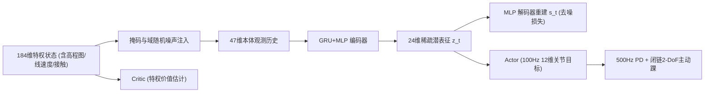

# Denoising World Model Locomotion（HMI P017）

**Advancing Humanoid Locomotion: Mastering Challenging Terrains with Denoising World Model Learning**（[arXiv:2408.14472](https://arxiv.org/abs/2408.14472)）收录于 HMI **P017**，并已在 Paper Notebooks locomotion 分类占位。本页为该 arXiv 的**唯一详情节点**。

## 一句话定义

用去噪世界模型在复杂地形上学习人形运动表征/策略，强调对噪声观测与地形不确定性的鲁棒性。

## 英文缩写速查

| 缩写 | 英文全称 | 简要说明 |
|------|----------|----------|
| WM | World Model | 学习环境/身体动态用于想象或表征 |
| PPO | Proximal Policy Optimization | 策略优化常用算法 |
| Sim2Real | Simulation to Real | 仿真到真机 |
| RL | Reinforcement Learning | 策略学习主线 |

## 为什么重要

- 把「世界模型去噪」接到人形复杂地形 locomotion，而不是只做视频生成。
- 与 DreamPolicy / DreamWaQ 同属世界模型运动线，便于对照「生成状态 vs 隐式地形」。
- HMI 与 Paper Notebooks 双入口共用本页，避免重复节点。

## 核心原理

去噪世界模型（DWL）把仿真到真机的差距统一建模为四类噪声：**环境噪声、动力学噪声、传感噪声与掩码噪声**（真机缺少线速度、接触力与高程图）。算法用递归编码器-解码器从带噪本体观测历史中恢复对控制有用的完整状态：

- **编码器与瓶颈潜空间（Table VI）**：以 47 维本体观测历史为输入，经 `GRU(47 → 256) → Linear(256 → 256) → ELU → Linear(256 → 24)` 输出稀疏潜表征 $z_t \in \mathbb{R}^{24}$。
- **解码器与联合损失（Eq. 2 / Eq. 5）**：解码器 `Linear(24 → 64 → 184)` 重建含 96 维地形高程图、基地线速度、接触掩码与当前步奖励在内的 184 维特权状态 $\tilde{s}_t$。去噪损失 $L_{\text{denoise}} = \|\tilde{s}_t - s_t\|^2 + \lambda_r \|z_t\|_1$（$\lambda_r=0.002$），并与 PPO 非对称 Actor-Critic 联合优化 $L_{\text{DWL}} = L_{\text{denoise}} + \lambda_\pi L_\pi + \lambda_v L_v$（$\lambda_\pi=\lambda_v=5$），Critic 直接读取 184 维 $s_t$，Actor 仅消费 24 维 $z_t$（约 32 万参数）。
- **五次多项式足端轨迹与闭链主动踝**：摆动相采用五次多项式 $f(t)=\sum_{k\le 5} a_k t^k$ 约束触地速度以实现轻柔接触；硬件在 XBot-S（1.2 m / 38 kg）与 XBot-L（1.65 m / 57 kg）上启用闭链 2-DoF 主动踝关节（仿真以虚拟电机代理，部署重映射至实际电机）。

## 方法栈与流程

把核心原理拆成可核对的流水线（依据 `arXiv:2408.14472v1` Section IV 与 Appendix A–C）：

1. **观测与噪声建模**：单帧 47 维本体输入（时钟 $\sin/\cos$、速度指令、$q,\dot{q}$、角速度、欧拉角、上一步动作），结合 Table II 10 项域随机化（0–10 ms 延迟、[-5, 20] kg 载荷、PD 倍率 [80%, 120%]）。
2. **去噪世界模型**：在 12,288 个 Isaac Gym 并行环境中联合训练编码器-解码器与非对称 Actor-Critic（batch $12288 \times 24$，lr $10^{-5}$）。
3. **柔顺接触奖励**：结合周期性站立掩码 $I(t)$ 与五次多项式足端高度/速度轨迹（$T=0.5\text{ s}, h_{\max}=0.1\text{ m}$）替代稀疏接触力奖励。
4. **零样本真机执行**：部署时仅运行编码器与 Actor（100 Hz），输出 12 维腿部关节位置目标经 500 Hz PD 与闭链电机映射控制真机。

## 工程实践

| 检查项 | 原文核对结论 |
|--------|--------------|
| 开源状态 | `roboterax/humanoid-gym@ae46e20` README 收录 DWL 论文，但 `humanoid_dwl` 仍标 `(coming soon)`，官方仓内暂无 DWL 训练/部署源码 |
| 硬件与频控 | 策略 100 Hz / PD 500 Hz；XBot-S 踝关节 $K_p=20, K_d=5$（vs 被动踝 $K_p=0, K_d=10$）；需在仿真虚拟踝电机与真机闭链驱动器间做映射 |
| 与前作衔接 | 继承 [Humanoid-Gym](./humanoid-gym.md) 步态与对称设计，将观测由 15 帧堆叠改为 GRU 递归潜表征并引入 184 维特权重建 |

## 源码运行时序图

**不适用**（`roboterax/humanoid-gym@ae46e20` 中 `humanoid_dwl` 仍标注 `(coming soon)`，尚未发布可运行的 DWL 训练/推理源码与权重）。

## 实验与评测读法

- **室内四类地形（Table III，XBot-S 真机）**：斜坡（0.25 坡度）DWL 100% vs PPO 80% / 被动踝 DWLp 80%；上楼（20×10 cm）100% vs 20% / 20%；下楼 100% vs 60% / 100%；不平路面（高差达 10 cm）100% vs 20% / 40%。
- **户外与载荷鲁棒性**：单策略零样本通过雪地、砖路与泥土；支持行走中加 15 kg 负重、背负 20 kg、手推 60 kg 推车及多向抗推击；XBot-L（1.65 m / 57 kg）亦完成雪地与户外复杂地形部署。
- **状态估计精度**：MuJoCo 60 s 前向速度估计 MSE 0.046、偏航角 MSE 0.074；真机静态 IMU 偏航漂移降低约 **87%**。

## 结论

**DWL 的核心贡献是用 GRU 稀疏潜瓶颈把多源 sim2real 噪声与 184 维特权地形/动力学状态重建耦合到端到端 PPO 中，并证明闭链 2-DoF 主动踝对人形崎岖地形与抗扰动至关重要。**

- 不要把这里的「世界模型」误读为未来视频生成或基于模型的 MPC 规划器——它是从本体历史到当前特权状态的去噪自编码器。
- 上楼梯与不平路面的主要拉分项（20%/40% → 100%）来自主动踝控制与高程图隐式估计的共同作用。
- 论文将当前步奖励也放入特权重建目标 $s_t$，仅在训练阶段计算，不影响部署观测接口。
- 截至 2026-11-21 官方仓库尚未释放 `humanoid_dwl` 代码，复现需自行在 [Humanoid-Gym](./humanoid-gym.md) 上实现 GRU 编码-解码器与五次多项式奖励。

## 局限与风险

- 仅依赖本体传感，无法预见大台阶/坑洞并做主动落脚规划，作者在 Section VII 指出视觉接入为后续方向。
- Isaac Gym 不原生支持闭链连杆，需依靠虚拟电机代理与真机映射，跨本体移植需重新标定运动学映射。
- 官方 `humanoid_dwl` 代码尚未开源，真机实验结果（Table III）依赖 RobotEra XBot-S/L 硬件，暂无第三方独立复测。

## 与其他工作对比

| 维度 | 本工作（去噪 WM Loco / P017） | [DreamPolicy / P018](./paper-notebook-one-policy-but-many-worlds-a-scalable-unified-po.md) | [DreamWaQ](../methods/dreamwaq.md) | [World Action Models](../concepts/world-action-models.md) |
|------|------------------------------|-------------------------------------------------------------------------------------------|------------------------------------|-----------------------------------------------------------|
| 方法族 | 去噪世界模型 + RL 策略 | 自回归扩散世界模型 + goal-conditioned RL | 隐式地形想象（本体编码器）单阶段 RL | 世界-动作模型族（模型视角综述） |
| 世界模型角色 | 从带噪观测**去噪**出潜在动态/表征 | **生成**未来身体状态轨迹作参考 | CENet 从本体历史**推断**隐式地形上下文 | 联合建模世界演化与动作 |
| 关键假设 | 观测噪声/地形不确定性可被显式建模并剥离 | 多地形专家数据可训出可生成的 WM | 盲走：仅本体历史即可支撑鲁棒行走 | 世界预测与动作可耦合学习 |
| 输入/输出 | 带噪本体/地形观测 → 关节目标 | 专家数据 → 未来状态 → 统一跟踪策略 | 本体历史 → 隐式上下文 + 体速 → 关节目标 | 观测/动作 → 未来预测 + 动作 |
| 关系/取舍 | 强调鲁棒表征而非生成 | 强调统一多地形、减少奖励工程 | 无外感知基线，最轻量 | 提供族谱坐标，非单一系统 |

## 关联页面

- [DreamPolicy / One Policy but Many Worlds](./paper-notebook-one-policy-but-many-worlds-a-scalable-unified-po.md)
- [World Action Models](../concepts/world-action-models.md)
- [HMI 论文导读](../queries/hmi-papers-coverage.md)

## 参考来源

- [DWL 论文原文核对（arXiv:2408.14472v1）](../../sources/papers/dwl_arxiv_2408_14472.md)
- [hmi_p017_denoising-world-model-locomotion.md](../../sources/papers/hmi_p017_denoising-world-model-locomotion.md)
- [humanoid_pnb_advancing-humanoid-locomotion-mastering-challeng.md](../../sources/papers/humanoid_pnb_advancing-humanoid-locomotion-mastering-challeng.md)
- [humanoid-motion-intelligence.md](../../sources/repos/humanoid-motion-intelligence.md)

## 推荐继续阅读

- [arXiv:2408.14472](https://arxiv.org/abs/2408.14472)
- [HMI P017](https://github.com/RealXiaoze/humanoid-motion-intelligence/blob/main/%E8%AE%BA%E6%96%87%E4%B8%8E%E9%A1%B9%E7%9B%AE/%E8%AE%BA%E6%96%87%E9%80%90%E7%AF%87%E8%A7%A3%E8%AF%BB/P017.md)
