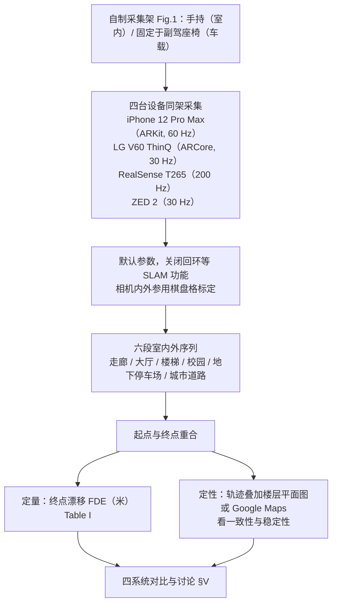

# An Empirical Evaluation of Four Off-the-Shelf Proprietary Visual-Inertial Odometry Systems

**An Empirical Evaluation of Four Off-the-Shelf Proprietary Visual-Inertial Odometry Systems**（Kim 等，Sookmyung Women's University，arXiv:2207.06780v1，2022-07）收录于 [Robot Learning Paper Notebooks](https://imchong.github.io/Robot_Learning_Paper_Notebooks/index.html)（分类：09_State_Estimation）。本页已依据论文 PDF 全文通读完成；深读笔记为第三方入口，未作为事实依据。

## 一句话定义

不是又一篇新算法，而是一篇「实测对比」基准论文：作者用同一套手持 / 车载四传感器采集架，在六段室内外序列（83–3052 m）上对比四款商用闭源 VIO（Apple ARKit、Google ARCore、Intel RealSense T265、Stereolabs ZED 2）的终点漂移（FDE）。结论是 ARKit 在楼梯、地下车库、城市道路三段 FDE 最小，且只有它在高速车载测试中保持稳定；但 ARCore 在走廊、大厅、校园三段 FDE 更小，因此「综合最稳」不等于逐段第一。

## 英文缩写速查

| 缩写 | 英文全称 | 简要说明 |
|------|----------|----------|
| VIO | Visual-Inertial Odometry | 融合相机图像与 IMU 数据、估计 6-DoF 自身位姿的里程计，是本文被测对象的统称 |
| IMU | Inertial Measurement Unit | 惯性测量单元，输出角速度与加速度，与相机联合用于位姿估计 |
| DoF | Degrees of Freedom | 自由度；本文指 6-DoF 位姿（3 个平移 + 3 个旋转） |
| FDE | Final Drift Error | 终点漂移误差：起点与终点在真值中重合时，估计终点相对起点的位置偏差（米） |
| MSCKF | Multi-State Constraint Kalman Filter | 多状态约束卡尔曼滤波，论文用它来描述 ARCore 与 ARKit 所属的滤波类 VIO 风格 |
| SLAM | Simultaneous Localization and Mapping | 同时定位与建图；评测时关闭了 T265 与 ZED 2 中的回环等 SLAM 功能，以比较纯里程计 |

## 为什么重要

- 人形 / 移动机器人与 AR 应用经常直接调用商用 VIO 作为里程计，但闭源产品缺少在真实室内外场景上的同台对比。论文指出，既有比较或只测一两款商用系统，或只在公开数据集、短距室内场景上进行（§I–II）。
- 论文用同一硬件架与同一组轨迹，把四个黑盒放到同一把尺子上，给选型提供可复现的硬证据。
- 列入 Paper Notebooks 策展清单，便于与全库 [机器人学习论文笔记总索引](../overview/humanoid-paper-notebooks-index.md) 及分类父节点交叉检索；与 [状态估计](../concepts/state-estimation.md) 主题直接相关。

## 流程总览

图依据：评测协议流程图（基准评测），论文 §III–IV、Fig.1、Fig.3、Fig.4、Table I。

## 核心信息

| 字段 | 内容 |
|------|------|
| 分类 | 09_State_Estimation |
| 论文类型 | 实测基准 / 商用闭源 VIO 对比（非新算法） |
| 深读笔记 | <https://imchong.github.io/Robot_Learning_Paper_Notebooks/papers/09_State_Estimation/An_Empirical_Evaluation_of_Four_Off-the-Shelf_Proprietary_VIO_Systems/An_Empirical_Evaluation_of_Four_Off-the-Shelf_Proprietary_VIO_Systems.html> |
| arXiv | <https://arxiv.org/abs/2207.06780> |
| 代码 / 数据 | 论文未公开基准评测代码或数据集链接（arXiv 摘要页未列代码与数据链接；数据集发布状态（未核实）） |

## 方法：被测系统与评测协议

### 被测系统

| 系统 | 硬件 / 运行平台 | 位姿输出频率 | 论文中的要点 |
|------|----------------|--------------|--------------|
| Apple ARKit | iPhone 12 Pro Max，iOS 14.7.1 | 60 Hz | 紧耦合滤波式 VIO，论文称与 MSCKF 类似，含滑窗滤波、束调整与边缘化；仅 iOS |
| Google ARCore | LG V60 ThinQ，Android 10，ARCore 1.29 | 30 Hz | MSCKF 风格 VIO 的 COM（concurrent odometry and mapping）变体；仅 Android |
| Intel RealSense T265 | 独立追踪相机，数据连接 Intel NUC | 200 Hz | 立体鱼眼相机 + IMU，位姿在设备 VPU 上计算 |
| Stereolabs ZED 2 | 手持立体相机 + IMU，外接 NVIDIA Jetson Nano | 30 Hz | 论文称其 VIO 算法未公开、描述较笼统；需外接 NVIDIA GPU 完成定位与深度 |

ARKit 与 ARCore 位姿通过作者自制的手机 App 记录（代码仓库见论文脚注）；T265 与 ZED 2 由机载计算机记录。

### 评测协议

- 每套系统保持 **默认参数**，关闭所有 SLAM 相关能力（如回环检测），以保证只比较 VIO 本体。
- 用棋盘格标定所有相机的内外参，使各系统结果处于同一参考坐标系。
- 六段序列 **起点与终点重合**，把起点设为原点，用终点位置误差 FDE 量化漂移。
- 室内序列由人步行携带采集架；车载序列将采集架刚性固定在副驾座椅前（Fig.3）。
- 定性评价：把轨迹叠加到建筑平面图或 Google Maps 上，看形状、楼层高度与闭合情况。

### 数据集

| 序列 | 场景 | 长度 (m) |
|------|------|----------|
| 室内走廊 | 大学楼长走廊（U 形） | 145.21 |
| 室内大厅 | 开阔走廊 / 大厅 | 83.98 |
| 室内楼梯 | 地下二层（B2）至五层（5F），含重复旋转 | 114.13 |
| 室外校园 | 校园内高低起伏、窄路回转 | 513.81 |
| 地下车库 | 光照不足，约 450 m 重复回路，车速 5–15 km/h | 446.26 |
| 城市道路 | 首尔站附近公共道路，车速可超过 60 km/h | 3051.61 |

## 核心原理

论文不提出新的估计机制，核心是 **控制变量的评测设计**：

- **输入**：每套系统自身的相机图像与 IMU 数据；输出为 6-DoF 位姿（平移向量 + 单位四元数，ARKit 以 60 Hz 输出）。
- **FDE 指标**：真值起终点重合，因此只需度量估计终点相对起点的位置偏差。若估计起点为原点、终点估计为 $\hat{p}_N$，则

$$
\mathrm{FDE} = \lVert \hat{p}_N - \hat{p}_0 \rVert_2
$$

  其中 $\hat{p}_0$ 为起点估计（定义为原点）、$\hat{p}_N$ 为终点估计。FDE 越小，闭环闭合越好；它只约束起终点，不能单独描述中间段的轨迹误差，因此论文同时做定性叠图。
- **作者归纳的失效模式**（论文 §IV–V 的解释性描述，未做内部机制实验）：
  - T265 的尺度不一致，作者认为与单目视觉里程计的尺度问题类似；
  - ZED 2 的旋转误差逐步累积，直线运动也难以保持正交与直线；
  - ARCore 在快速运动或光照突变时发散；
  - T265 在车辆过慢（停车）或过快时发散失效。

## 实验与评测

以下数据取自论文 Table I（FDE，单位 m；由 PDF 文本抽取，已与正文数字逐项交叉核对；`×` 表示论文记为失效；每行最小值加粗）：

| 序列 | 长度 (m) | ARKit | ARCore | T265 | ZED 2 |
|------|----------|-------|--------|------|-------|
| 室内走廊 | 145.21 | 0.79 | **0.12** | 1.88 | 1.44 |
| 室内大厅 | 83.98 | 0.14 | **0.09** | 0.61 | 4.58 |
| 室内楼梯 | 114.13 | **0.19** | 3.98 | 1.49 | 4.76 |
| 室外校园 | 513.81 | 2.01 | **0.07** | 4.08 | 206.38 |
| 地下车库 | 446.26 | **0.26** | 1.14 | 9.01 | 10.85 |
| 城市道路 | 3051.61 | **2.68** | 140.08 | × | 409.25 |

定性结果要点（正文 §IV）：

- **走廊 / 大厅**：ARKit 轨迹与平面图最一致，闭合时无明显旋转漂移；ARCore 的 FDE 最小，但轨迹形状与平面图不符；T265 旋转较准但尺度偏大；ZED 2 旋转漂移逐渐累积，最不一致。
- **楼梯**：ARKit 的 xy 平面 FDE 为 0.19 m（论文中 ARCore、T265、ZED 2 分别为 3.98、1.49、4.76 m），楼层高度与建筑蓝图近似一致；ZED 2 在高度方向畸变最严重。
- **校园**：ARKit 与 ARCore 起终点闭合，并与地图道路形状吻合；T265 形状相近但尺度偏小；ZED 2 正交性被破坏。
- **车载（城市道路）**：仅 ARKit 在高速（超过 60 km/h）下保持稳定；ARCore 在车速变化或光照突变时偶发失效；T265 在车辆停车或过快时发散；ZED 2 旋转漂移累积。
- **地下车库**：ARKit 未完全还原真实运动，但重复回路的轨迹最一致；其余三者出现旋转漂移，ZED 2 偏离最严重。

## 对比与讨论

- **总体判断（论文 §V–VI）**：ARKit 在室内外场景中被认为最一致、准确、稳定；ARCore 次之，在室内步行数据上表现好，但快速运动与弱光下退化明显；T265 在室内尚可，但存在尺度不一致与速度敏感问题；ZED 2 在室内外均最不一致。
- **需要注意的对比细节**：按 FDE 逐段看，ARCore 在走廊、大厅、校园三段数值最小，ARKit 在楼梯、车库、道路三段最小。ARKit 的优势更多体现在轨迹形状一致性、闭合质量与高速车载稳定性上，而不只是单个 FDE 数值。
- **与既有工作的关系（论文 §II）**：论文明确不纳入 ROVIO、VINS-Mono、ORB-SLAM、DSO 等开源 VIO / SLAM 方法（参见 [ORB-SLAM3](orb-slam3.md)），只比较商用闭源产品；EuRoC 上的开源 VIO 比较 [16] 与 ADVIO [19] 数据集论文被作为相关工作引用。

## 工程实践

| 项 | 论文做法 / 数值 | 工程含义 |
|----|-----------------|----------|
| 平台限制 | ARKit 仅 iOS；ARCore 仅 Android（论文按 Google 认证设备列表选机） | 选型前先确认产品平台，ROS / Linux 集成需额外适配（论文未评估） |
| 位姿频率 | ARKit 60 Hz，ARCore 30 Hz，T265 200 Hz，ZED 2 30 Hz | 高频控制回路下需考虑插值与延迟；论文未比较时延 |
| 计算位置 | ARKit / ARCore 在手机端；T265 在设备 VPU；ZED 2 依赖外接 NVIDIA GPU（论文用 Jetson Nano） | 资源与功耗需求差异大，ZED 2 不是即插即用的纯传感器 |
| 复现协议 | 默认参数；关闭回环等 SLAM 功能；棋盘格标定；起终点闭合；报告 FDE 并叠加地图 | 若要复现或扩展，应照此协议，否则结果不可比 |
| 车载 / 速度 | 车速超过 60 km/h 时仅 ARKit 稳定；T265 怕停车与过快 | 高速或低速跟车场景需单独验证 |
| 人形应用 | 论文采集为手持与汽车，未涉及人形本体的步态振动与足式冲击 | **未覆盖**：不能直接推论到人形机器人上的表现（未核实） |
| 源码运行时序图 | 论文为实测基准，无可运行的被测方法实现；论文仅引用作者的 iOS 与 Android 数据采集 App 仓库 | **不适用**（基准论文无可运行的方法实现，官方评测代码未核实） |

## 局限与风险

- **样本规模**：论文仅六段序列，正文未报告每段的重复次数与统计方差（未核实）。单次轨迹的 FDE 可能受光照、速度与人为操作影响，不宜把个别数值当作稳定排名。
- **指标单一**：FDE 只衡量起终点闭合误差，无法完整表达中间段的轨迹误差；论文以定性叠图弥补，但叠图依赖平面图或地图的精度。
- **版本时效**：结论绑定 2022 年前后的产品版本（iOS 14.7.1、ARCore 1.29、ZED SDK 3.5 系列等）。闭源产品会持续更新，结论不能外推到新版本。
- **非方法结论**：结论只适用于这四款商用闭源产品，不能推广为 VIO 方法的普适结论。论文关于尺度不一致、旋转正交性破坏的解释属作者推断，未做内部机制实验。
- **计算与系统成本未比较**：论文未比较 CPU / GPU 占用、功耗与延迟；ZED 2 的外接 GPU 与 T265 的板上计算是工程上的重要差异，需另行评估。
- **开源状态**：论文未公开基准评测代码或数据集链接（arXiv 摘要页与正文均未列出），截至本页更新日期未找到官方数据集页（未核实）。
- **常见误读**：不要把 Table I 的最小值当作单一排名；也不要因 ARKit「综合最稳」而忽略它仅支持 iOS 的平台限制。

## 与其他页面的关系

- 分类父节点：[paper-notebook-category-09-state-estimation](../overview/paper-notebook-category-09-state-estimation.md)
- 总索引：[humanoid-paper-notebooks-index.md](../overview/humanoid-paper-notebooks-index.md)
- 主题背景：[状态估计](../concepts/state-estimation.md)；IMU 与相机时间同步见 [IMU 原理与相机同步](../concepts/imu-principles-algorithms-camera-sync.md)
- 开源对照：论文刻意未纳入的开源方法，见 [ORB-SLAM3](orb-slam3.md)

## 结论

**这篇的价值不在算法而在选型证据：把四款闭源商用 VIO 放到同一套硬件、同一组轨迹上测，得出的结论是「综合最稳的是只能跑在 iOS 上的那一个」。**

1. **真正起作用的是控制变量的实验设计**：同一采集架 + 同一组序列 + 关闭 SLAM 回环 + 棋盘格标定，才让黑盒产品之间的比较可复现，这也是它区别于厂商自报指标的地方。
2. **ARKit 的优势在一致性与稳定性**：它在楼梯、地下车库、城市道路三段 FDE 最小，且是唯一在 60 km/h 车载测试中保持稳定的系统；但在走廊、大厅、校园三段 ARCore 的 FDE 更小，所以「最准」应理解为综合判断，不是逐段第一。
3. **平台约束与性能冲突**：ARKit 只能跑 iOS，ARCore 只能跑 Android；若目标是 ROS / Linux 机器人，论文中的两款手机方案需要额外的集成工作，而 T265 与 ZED 2 虽为专用设备，但精度与稳定性在论文中明显较差。
4. **失效模式具体**：T265 的尺度不一致、ZED 2 的旋转误差累积与正交性破坏，都在论文中有可对照的轨迹图；选型时应关注这些故障形态，而不是只看单一指标。
5. **适用边界**：结论绑定在这四款闭源产品的 2022 年前后版本上，不能外推到其他 VIO 方法、新版本或人形本体的步态运动。

## 参考来源

- [humanoid_pnb_an-empirical-evaluation-of-four-off-the-shelf-pr.md](../../sources/papers/humanoid_pnb_an-empirical-evaluation-of-four-off-the-shelf-pr.md)
- 深读笔记：<https://imchong.github.io/Robot_Learning_Paper_Notebooks/papers/09_State_Estimation/An_Empirical_Evaluation_of_Four_Off-the-Shelf_Proprietary_VIO_Systems/An_Empirical_Evaluation_of_Four_Off-the-Shelf_Proprietary_VIO_Systems.html>
- 论文：<https://arxiv.org/abs/2207.06780>
- [arXiv PDF](https://arxiv.org/pdf/2207.06780)：已通读全文（4 页，含 §I–VI、Fig.1–8、Table I 与参考文献）

## 推荐继续阅读

- [arXiv PDF：An Empirical Evaluation of Four Off-the-Shelf Proprietary Visual-Inertial Odometry Systems](https://arxiv.org/pdf/2207.06780)
- [机器人论文阅读笔记：An Empirical Evaluation of Four Off-the-Shelf Proprietary Visual-Inertial Odometry Systems](https://imchong.github.io/Robot_Learning_Paper_Notebooks/papers/09_State_Estimation/An_Empirical_Evaluation_of_Four_Off-the-Shelf_Proprietary_VIO_Systems/An_Empirical_Evaluation_of_Four_Off-the-Shelf_Proprietary_VIO_Systems.html)
- [Apple ARKit 官方文档](https://developer.apple.com/documentation/arkit/)（论文参考 [4]）与 [Google ARCore 官方文档](https://developers.google.com/ar)（论文参考 [5]）
