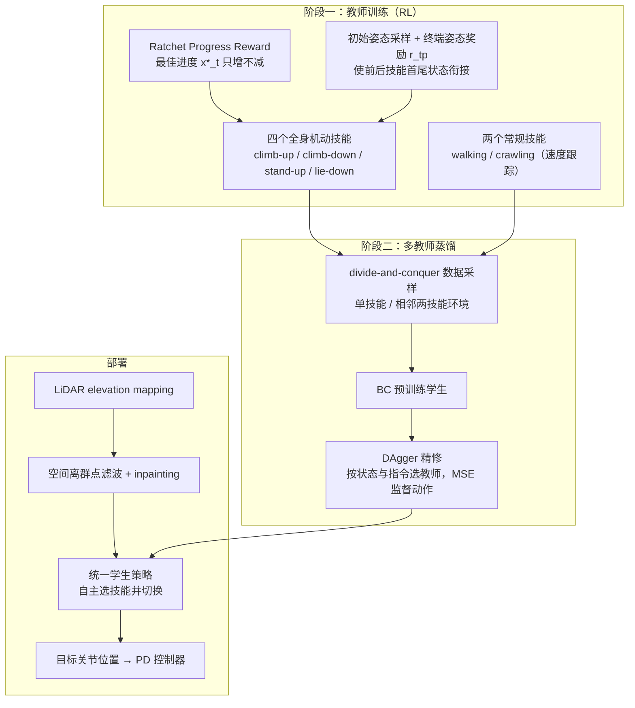

# APEX

**APEX: Learning Adaptive High-Platform Traversal for Humanoid Robots**（arXiv:2602.11143，Carnegie Mellon University 与 Bosch Center for AI）收录于 [Robot Learning Paper Notebooks](https://imchong.github.io/Robot_Learning_Paper_Notebooks/index.html)（分类：05_Locomotion）。本页依据论文原文（arXiv v3 PDF 正文与主要附录）整理；深读笔记页未作为事实来源使用。

## 一句话定义

把"高平台穿越"从起跳式改成攀爬式：用 6 个 *(climb-up · climb-down · walk · crawl · stand-up · lie-down)* 子技能 + 一个把"局部 LiDAR 几何"映射到全身动作的单一策略，配上棘轮式进度奖励（ratchet progress reward）只允许"已最佳进度"被记账、抑制反复试探的伪进步——结果是在 G1 上零样本翻越 0.8 m 高 ≈ 腿长 114% 的台子，全程不靠跳跃。

## 英文缩写速查

| 缩写 | 英文全称 | 简要说明 |
|------|----------|----------|
| DRL | Deep Reinforcement Learning | 用深度网络作为策略的强化学习；本文教师策略均由 DRL 在 IsaacLab 中训练 |
| BC | Behavior Cloning | 用专家动作做监督学习；本文用它预训练学生策略 |
| DAgger | Dataset Aggregation | 在学生自己的 rollout 状态上查询教师动作并聚合数据的模仿学习方法，用于精修学生 |
| MSE | Mean Squared Error | 学生与教师动作之间的均方误差，即蒸馏阶段的监督损失 |
| CoM | Center of Mass | 全身质心；任务状态 $p_{CoM}$ 用于判定攀爬与站立是否完成 |
| PD | Proportional-Derivative（控制器） | 策略输出目标关节位置，由底层 PD 控制器跟踪 |
| LiDAR | Light Detection and Ranging | 头部激光雷达生成局部高程图（elevation map），是唯一的地形感知输入 |
| DoF | Degrees of Freedom | 自由度；Unitree G1 为 29-DoF，策略输出 29 维关节目标 |
| Sim2Real | Simulation to Real | 仿真训练策略零样本迁移到真机；本文同时处理感知层面的 sim-to-real 差距 |

## 为什么重要

- 腿式行走策略通常只靠足端接触，跨越高台依赖全身跳跃，冲击与关节力矩大；论文在引言中指出，跳跃式方法的高度通常低于 63% 腿长（原文 §I、§II-A）。
- 攀爬属于接触丰富、目标导向的全身动作，难以用"跟踪速度 / 周期步态"这类稠密奖励设计，APEX 给出一套不依赖参考轨迹的训练思路。
- 对关心人形机器人**实际上楼、上台阶、跨越障碍**的团队，这篇工作展示了一条"多技能库 + 蒸馏 + 感知 sim-to-real 处理"的工程路线，可对照已有 [奖励设计](../concepts/reward-design.md) 与 [多专家蒸馏](../methods/multi-expert-distillation.md) 页面阅读。
- 深读笔记提供了比摘要更多的阅读入口，但论文 PDF 本身已足以覆盖方法与主要实验。

## 核心原理

### 任务定义与输入输出

每个机动被建模为目标达成任务：定义任务状态 $x_t=\phi(s_t)$，成功判据为 $x_t \ge x_g$（见论文 Tab. II）。例如攀上（climb-up）要求 $p_{LB} > h_{edge}$ 且 $p_{CoM} > x_{edge}$，站起（stand-up）要求头部高度达到站立高度且平衡裕度 $d_{bal}<\delta$。

- **输入**：本体感知 $s^{proprio}_t \in \mathbb{R}^{64}$（重力向量、基座角速度、关节位置与速度）、上一动作 $a_{t-1}\in\mathbb{R}^{29}$、任务状态 $x_t$；攀爬类策略额外输入局部高程图 $m_t\in\mathbb{R}^{441}$（$1\times1$ m、分辨率 0.05 m）。所有策略使用 5 步历史。
- **输出**：29 维目标关节位置 $a_t$，经 PD 控制器跟踪。
- 评论家（critic）额外接收 best-so-far 任务状态 $x^*_t$，因为该量依赖历史、不在瞬时状态中（§III-B1）。

### 棘轮式进度奖励（ratchet progress reward）

记录已达到的最佳任务进度：

$$x^*_t = \max(x_0, x_1, \dots, x_{t-1})$$

二值奖励：

$$r_t = \begin{cases} 0, & x_t > x^*_t \\ -1, & \text{otherwise} \end{cases}$$

只有严格超过历史最佳才不受罚，否则每步 $-1$。与增量奖励 $x_t>x_{t-1}$ 相比，它不能靠前后摇摆刷分（论文称 "retrace" 利用）；与速度跟踪相比，它不鼓励"赶路"，允许策略在接触未稳定前保持支撑（§III-A）。

### 奖励组成

总奖励为五项之和（式 3）：$r = r_{alive} + r_{reg} + r_{force} + r_{task} + r_{tp}$。

- 接触力惩罚 $r_{force} = -(\exp(\alpha \cdot \max(0, F_t - F_{limit})) - 1)$，头部链接的 $F_{limit}$ 设为 0，因为轻微头部接触即可破坏头戴式 LiDAR 的感知。
- 终端姿态奖励 $r_{tp} = \mathbb{I}(t > H-1\,\text{s}) \cdot \mathbb{I}(\text{goal reached}) \cdot \exp(-\beta \|q_t - q_{tar}\|^2)$，只在目标达成后最后 1 秒生效，用于让前一技能的终态接入后一技能的初态。

### 感知：仿真伪影建模 + 真机滤波修补

LiDAR 高程建图在动态机动中会累积定位漂移、被肢体自遮挡产生虚假点簇、视野受限（§III-B3）。论文采用双策略：

- **训练时**：注入每格高斯噪声、空间平移（模拟漂移）、20% 的离群点簇（表 VIII）。
- **部署时**：对原始高程图做空间离群点滤波，并用 inpainting [41] 补全缺失区域。

### 技能组合与蒸馏

- 先用 RL 训练 4 个非周期机动（climb-up / climb-down / stand-up / lie-down）以及 2 个周期技能（walk / crawl，按速度跟踪）。
- 为了让技能可以接续，初始姿态采样覆盖前序技能的终态（标准站姿 $q_{stand}$ 与俯卧姿 $q_{prone}$ 附近扰动），不足时重训后继技能。
- 蒸馏采用 "divide-and-conquer" 数据采样：每个环境只包含一个核心技能，或相邻两个技能的组合（附录 D）。
- 流程：先用 BC 预训练学生，再用 DAgger 精修；按状态与指令选择教师，以 MSE 监督动作（§III-C）。

## 流程总览

图依据：论文 §III-A/B/C、Fig. 2、Fig. 3（学生部署端的 PD 跟踪来自 §III-B 对所有策略输出的描述）

## 工程实践

| 项目 | 论文设定（原文） |
|------|------------------|
| 机器人 | Unitree G1，29-DoF，头部 LiDAR |
| 仿真 | IsaacLab，每个单技能 4096 并行环境；随机化见附录 Tab. VIII |
| 平台高度（训练采样） | 0.55–0.85 m |
| 攀爬初始条件 | climb-up：基座到竖直面距离 0.15–0.35 m、偏航 ±60°；climb-down：0.30–0.45 m、±75° |
| 对称增强 | 采用 symmetric augmentation [40]，减少左右偏置 |
| 真机验证 | 0.8 m 平台（约 114% 腿长）零样本迁移；climb-up 在 0.6 / 0.7 / 0.8 m 与多个接近角上测试 |
| 干扰 | 训练与评测含 LiDAR 退化与状态估计漂移；蒸馏阶段加入动作噪声与对称增强 |
| 调试指标 | 技能成功率、最大接触力（M.C.F.，单位 N）、头部接触、关节力矩；建议同时监控 $x^*_t$ 停滞时长，以识别 "back-and-forth" 局部最优 |
| 复现前提 | 需要 IsaacLab 训练环境、高程建图管线与 G1 底层控制接口；论文未在正文给出学习率等全部超参（完整配置见附录表 IX–X） |

**开源状态（步骤 2.5 核查）**：截至本次入库，arXiv 摘要页与 PDF 正文未给出 GitHub、Hugging Face 等代码或数据链接。PDF 图 1 注明 "project webpage"，但其 URL 未能从 PDF 或 arXiv 页面提取，**项目页内容未核实**。因此本页不判定为"已开源"，也不宣称代码将发布。

**源码运行时序图**：**不适用**（未核实到官方可运行代码仓库；如后续项目页或仓库公开，应补充 `sequenceDiagram` 并在 `code:` 字段写入 URL）。

## 实验与评测

评测分为仿真连续穿越、真机零样本迁移、鲁棒性与奖励消融四部分（§IV，附录 A–E）。

- **连续穿越（仿真）**：三条长程课程（Continuous Traversing / Ascending / Descending），不重置，共 1000 次试验，成功率 **95.4%**（§IV-A）。
- **单技能（仿真，1000 次）**：climb-up 98.8%、climb-down 99.9%、stand-up 99.5%、lie-down 100.0%（表 III）；学生与教师成功率相当（表 V）。
- **单技能（真机）**：climb-up 在 0.6 / 0.7 / 0.8 m 平台、多个接近角上的 5/5 或 4/5 成功（表 III；0.7 m、$[-45^\circ,-15^\circ]$ 一次失败）；climb-down、stand-up、lie-down 各 5/5（文中结论）。
- **分布外测试**：接近角扩展到 $\pm 65^\circ$（训练范围 $\pm 60^\circ$）以及柔软泡沫垫，策略仍能完成攀上（图 5，§IV-B）。
- **扰动下的技能切换**：被从后方重踢至近失败状态后仍能调整步态并完成攀爬（图 4）。
- **真机长程**：在 0.8 m 平台上完成行走→攀上→站起→躺下→下台的连续全程（图 1、附录图 9）。
- 论文称 "The first humanoid traversal policy that achieves real-world traversal over platforms exceeding 114% of leg length"，该首创性声明**未独立核实**。

## 与其他工作对比

- **跳跃式方法**（[3, 4, 5]，如 Humanoid Parkour、GALLANT）：论文称其高度通常低于 63% 腿长，依赖冲击式跳跃；APEX 以攀爬取代跳跃（表 I）。
- **单动作起身方法**（[6, 7, 8]）：论文认为其常用的任务奖励与安全正则冲突，需多阶段或较重的工程设计；本文用单阶段 RL 配合棘轮奖励同时训练多个接触丰富动作。
- **动作跟踪 / 动作生成**（OmniRetarget [9]、PARC [10] 等）：依赖参考轨迹或生成动作，论文指出其对环境几何与初始状态对齐要求高，且生成动作常不满足物理与部署约束；APEX 为 reference-free 策略。
- **奖励消融**（附录 E、图 6–7）：在 climb-up 上对比 6 种替代奖励：
  - Velocity（速度跟踪）：卡在平台边缘，任务未完成；
  - RND（内在奖励探索）：缺少方向性梯度，稀疏奖励下未发现解；
  - Distance（距离最小化）：速度偏置与接触力约束冲突；
  - Distance（减弱正则）：学会"全身跳"，冲击与关节力矩过大；
  - Direction（速度方向）与 Increment（距离增量）：在平台边缘形成前后摆动的局部最优。
  棘轮奖励得到持续的全身协调，峰值接触力显著更低（论文报告）。
- **蒸馏**：相比四足多技能蒸馏 [37, 38]，论文强调人形技能的终态分布差异更大，需要终态覆盖式初始化与 divide-and-conquer 采样。

## 结论

**APEX 的关键判断是「高平台不必靠跳」：把跨越动作重写成攀爬式技能组合，再用一个策略把局部 LiDAR 几何直接映射到全身动作。**

1. **奖励是核心创新** — 棘轮式进度奖励以 best-so-far 状态做参考、只惩罚"没有超过历史最佳"的步骤，不依赖速度或参考轨迹；论文的奖励对比显示它是 climb-up 能够学会的必要条件之一。
2. **技能接续靠状态覆盖而非奖励本身** — 初始姿态采样与终端姿态奖励使前后技能首尾衔接，不足时重训后继技能；这是多技能可切换的工程前提。
3. **感知 sim-to-real 靠两端处理** — 训练时注入噪声、漂移、离群点，部署时滤波与修补高程图；论文未给出单独消融，效果应视为整体系统的一部分。
4. **数字要按条件读** — 95.4% 为仿真多段连续穿越，真机结果为有限次数的单技能试验与一次 0.8 m 全程演示；不要把仿真成功率直接外推到任意地形。
5. **适用边界** — 依赖高质量的局部 LiDAR 高程图与 IsaacLab 训练管线，策略只在训练分布附近有论文证据；接近角超过 $\pm 65^\circ$ 或非标准接触材料时的表现需回到论文图 5 与附录检视。

## 局限与风险

- **感知依赖**：策略仅输入局部高程图（1 m × 1 m），对 LiDAR 退化、定位漂移与视野遮挡敏感；论文靠滤波与修补缓解，但没有给出失效阈值的系统分析。
- **安全与硬件**：攀爬与跌倒相关的接触力、头部接触（头部 LiDAR）风险较高；论文对头部接触设置了零阈值惩罚，但真机长期磨损与安全包络未在文中讨论。
- **测试覆盖**：真机测试以 G1 为唯一平台；单技能真机样本量较小（多为 5 次一组），统计置信度有限。
- **对比公平性**：奖励消融固定其他超参数，但替代奖励是否经过充分调参未在正文说明；附录给出了基线配置，复现时需注意。
- **开源状态未知**：截至入库日未核实到代码或数据，复现仅能依据论文描述，难以逐项对齐训练细节（如完整超参、地形生成器）。
- **常见误读**：把"0.8 m ≈ 114% 腿长"理解为任意高台均可跨越；论文结果是特定机器人（G1）、特定平台尺寸与接近角范围下的结果。

## 核心信息

| 字段 | 内容 |
|------|------|
| 分类 | 05_Locomotion |
| 深读笔记 | <https://imchong.github.io/Robot_Learning_Paper_Notebooks/papers/05_Locomotion/APEX_Learning_Adaptive_High-Platform_Traversal_for_Humanoid_Robots/APEX_Learning_Adaptive_High-Platform_Traversal_for_Humanoid_Robots.html> |
| arXiv | <https://arxiv.org/abs/2602.11143>（v3，PDF 2026-08-13） |
| 机构 | Carnegie Mellon University；Bosch Center for Artificial Intelligence |
| 平台 | Unitree G1（29-DoF） |
| 代码 / 项目页 | 未核实（见「工程实践」开源状态） |

## 与其他页面的关系

- 分类父节点：[paper-notebook-category-05-locomotion](../overview/paper-notebook-category-05-locomotion.md)
- 总索引：[humanoid-paper-notebooks-index.md](../overview/humanoid-paper-notebooks-index.md)
- 奖励设计背景：[reward-design](../concepts/reward-design.md)
- 多技能蒸馏背景：[multi-expert-distillation](../methods/multi-expert-distillation.md)

## 参考来源

- [humanoid_pnb_apex-learning-adaptive-high-platform-traversal-f.md](../../sources/papers/humanoid_pnb_apex-learning-adaptive-high-platform-traversal-f.md)（原始摘录，含深读笔记与 arXiv 链接）
- 论文原文：[arXiv:2602.11143](https://arxiv.org/abs/2602.11143)，PDF 正文与附录已通读（本次 ingest 核对）
- 深读笔记：<https://imchong.github.io/Robot_Learning_Paper_Notebooks/papers/05_Locomotion/APEX_Learning_Adaptive_High-Platform_Traversal_for_Humanoid_Robots/APEX_Learning_Adaptive_High-Platform_Traversal_for_Humanoid_Robots.html>

## 推荐继续阅读

- [arXiv 摘要页：APEX（2602.11143）](https://arxiv.org/abs/2602.11143)
- [机器人论文阅读笔记：APEX](https://imchong.github.io/Robot_Learning_Paper_Notebooks/papers/05_Locomotion/APEX_Learning_Adaptive_High-Platform_Traversal_for_Humanoid_Robots/APEX_Learning_Adaptive_High-Platform_Traversal_for_Humanoid_Robots.html)
