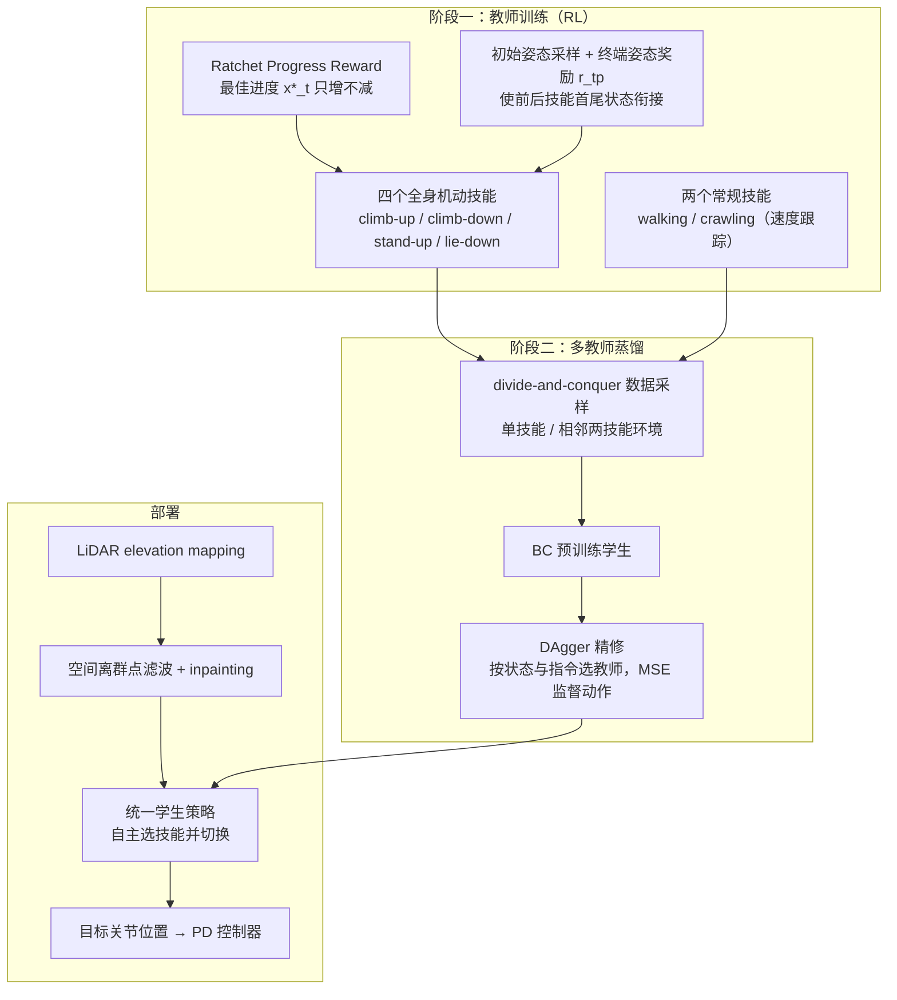

# APEX

**APEX: Learning Adaptive High-Platform Traversal for Humanoid Robots** 收录于 [Robot Learning Paper Notebooks](https://imchong.github.io/Robot_Learning_Paper_Notebooks/index.html)（分类：05_Locomotion）。本页为 **清单索引实体**，链向深读笔记与原始论文；详细机制待从笔记消化后补充。

## 一句话定义

把"高平台穿越"从起跳式改成攀爬式：用 6 个 *(climb-up · climb-down · walk · crawl · stand-up · lie-down)* 子技能 + 一个把"局部 LiDAR 几何"映射到全身动作的单一策略，配上棘轮式进度奖励（ratchet progress reward）只允许"已最佳进度"被记账、抑制反复试探的伪进步——结果是在 G1 上零样本翻越 0.8 m 高 ≈ 腿长 114% 的台子，全程不靠跳跃。

## 英文缩写速查

| 缩写 | 英文全称 | 简要说明 |
|------|----------|----------|
| RL | Reinforcement Learning | 通过与环境交互最大化长期回报来学习策略 |
| WBC | Whole-Body Control | 协调全身关节满足多任务/约束的控制基础设施 |
| Sim2Real | Simulation to Real | 把仿真中学到的策略迁移落地真机的工程主线 |

## 为什么重要

- 列入 Paper Notebooks 策展清单，便于与全库 [机器人学习论文笔记总索引](../overview/humanoid-paper-notebooks-index.md) 及分类父节点交叉检索。
- 深读笔记提供比摘要更贴近实现的阅读路径，适合作为后续 ingest 深化起点。

## 流程总览

图依据：论文 §III-A/B/C、Fig. 2、Fig. 3（学生部署端的 PD 跟踪来自 §III-B 对所有策略输出的描述）

## 核心信息

| 字段 | 内容 |
|------|------|
| 分类 | 05_Locomotion |
| 深读笔记 | <https://imchong.github.io/Robot_Learning_Paper_Notebooks/papers/05_Locomotion/APEX_Learning_Adaptive_High-Platform_Traversal_for_Humanoid_Robots/APEX_Learning_Adaptive_High-Platform_Traversal_for_Humanoid_Robots.html> |
| arXiv | <https://arxiv.org/abs/2602.11143> |

## 实验与评测

- 本页为 **策展清单索引** 摘要；量化 benchmark、消融与实机指标以 **深读笔记与论文 PDF** 为准（链接见 [参考来源](#参考来源)）。

## 结论

**APEX 的关键判断是「高平台不必靠跳」：把跨越动作重写成攀爬式技能组合，再用一个策略把局部 LiDAR 几何直接映射到全身动作。**

- 真正起作用的是两件事：climb-up / climb-down / walk / crawl / stand-up / lie-down 六个子技能构成的动作词表，以及棘轮式进度奖励（ratchet progress reward）——只对「已达到的最佳进度」记账，从而抑制反复试探刷出的伪进步。
- 硬指标是 G1 上零样本翻越 0.8 m（约腿长 114%）的台子且全程不跳跃：难度来自高度与接触序列，而非速度，这也框定了它的适用场景。
- 感知入口是局部 LiDAR 几何而非全局地图，意味着策略依赖近场几何质量，这既是它能零样本迁移的原因，也是可预期的失败面。
- 本页只到清单索引：消融、成功率与失败模式需回到深读笔记与论文 PDF，不要把一句话定义当成完整实验证据。

## 与其他页面的关系

- 分类父节点：[paper-notebook-category-05-locomotion](../overview/paper-notebook-category-05-locomotion.md)
- 总索引：[humanoid-paper-notebooks-index.md](../overview/humanoid-paper-notebooks-index.md)

## 参考来源

- [humanoid_pnb_apex-learning-adaptive-high-platform-traversal-f.md](../../sources/papers/humanoid_pnb_apex-learning-adaptive-high-platform-traversal-f.md)
- 深读笔记：<https://imchong.github.io/Robot_Learning_Paper_Notebooks/papers/05_Locomotion/APEX_Learning_Adaptive_High-Platform_Traversal_for_Humanoid_Robots/APEX_Learning_Adaptive_High-Platform_Traversal_for_Humanoid_Robots.html>
- 论文：<https://arxiv.org/abs/2602.11143>
- [arXiv PDF](https://arxiv.org/pdf/2602.11143)：已通读方法部分（实验与附录以略读为准）：§I Introduction、§II Related Work、§III-A/B/C 方法；§IV 实验仅略读

## 推荐继续阅读

- [机器人论文阅读笔记：APEX](https://imchong.github.io/Robot_Learning_Paper_Notebooks/papers/05_Locomotion/APEX_Learning_Adaptive_High-Platform_Traversal_for_Humanoid_Robots/APEX_Learning_Adaptive_High-Platform_Traversal_for_Humanoid_Robots.html)
