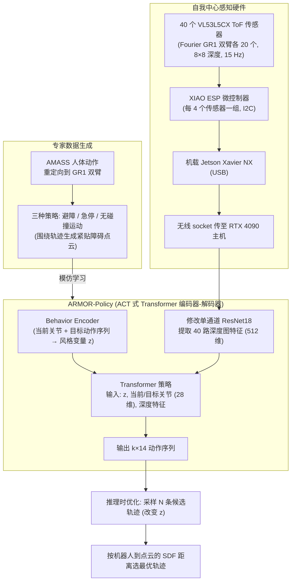

# ARMOR

**ARMOR: Egocentric Perception for Humanoid Robot Collision Avoidance and Motion Planning** 已列入 [Robot Learning Paper Notebooks](https://imchong.github.io/Robot_Learning_Paper_Notebooks/index.html) 的 **PROGRESS.md 待深读** 清单（分类：08_Navigation）。本页 **还没有深读笔记**：只给出这篇论文的分类位置与原文入口，方法细节与数据请直接看原文。

## 一句话定义

ARMOR 的人形机器人学习论文条目，当前处于 Paper Notebooks 阅读进度（待深读）阶段。

## 英文缩写速查

| 缩写 | 英文全称 | 简要说明 |
|------|----------|----------|
| RL | Reinforcement Learning | 通过与环境交互最大化长期回报来学习策略 |
| WBC | Whole-Body Control | 协调全身关节满足多任务/约束的控制基础设施 |
| Sim2Real | Simulation to Real | 把仿真中学到的策略迁移落地真机的工程主线 |

## 为什么重要

- 这篇已排进 Paper Notebooks 的待读清单，可以从 [机器人学习论文笔记总索引](../overview/humanoid-paper-notebooks-index.md) 与分类页找到同一批工作。
- 在笔记写出来之前，这里只保留分类位置与原文入口，不给方法结论（论文方法模块与数据流见下方「流程总览」）。

## 流程总览

图依据：论文 §III-A 硬件 / §III-B ARMOR-Policy（Fig.4）/ §III-C 推理时优化 / §III-D 专家数据生成（Fig.5）。

## 核心信息

| 字段 | 内容 |
|------|------|
| 分类 | 08_Navigation |
| 深读状态 | 待撰写（[PROGRESS.md](https://github.com/ImChong/Robot_Learning_Paper_Notebooks/blob/main/papers/PROGRESS.md)） |
| 计划文件夹 | `papers/08_Navigation/armor-egocentric-perception-for-humanoid-robot-c` |
| arXiv | <https://arxiv.org/abs/2412.00396> |

## 实验与评测

- 深读笔记尚未完成；量化 benchmark、消融与实机指标待笔记撰写后补充。

## 结论

**本页是 ARMOR 的待读条目实体，只登记了它在阅读计划中的位置，尚不构成对其自我中心感知方案的评价。**

- 现状：列入 Paper Notebooks 的 **PROGRESS.md 待深读** 清单，分类 08_Navigation，深读笔记尚未撰写。
- 因此本页 **不含任何量化结论**：benchmark、消融与实机指标待笔记完成后补充。
- 可用之处只有检索：经 [分类页](../overview/paper-notebook-category-08-navigation.md) 与 [总索引](../overview/humanoid-paper-notebooks-index.md) 交叉定位，原文入口为 arXiv 2412.00396。

## 与其他页面的关系

- 分类页：[paper-notebook-category-08-navigation](../overview/paper-notebook-category-08-navigation.md)
- 总索引：[humanoid-paper-notebooks-index.md](../overview/humanoid-paper-notebooks-index.md)

## 参考来源

- [humanoid_pnb_armor-egocentric-perception-for-humanoid-robot-c.md](../../sources/papers/humanoid_pnb_armor-egocentric-perception-for-humanoid-robot-c.md)
- [Robot Learning Paper Notebooks · PROGRESS.md](https://github.com/ImChong/Robot_Learning_Paper_Notebooks/blob/main/papers/PROGRESS.md)
- 论文：<https://arxiv.org/abs/2412.00396>
- [arXiv PDF](https://arxiv.org/pdf/2412.00396)：已通读方法部分（实验与附录以略读为准）：§III Method（A–D）

## 推荐继续阅读

- [机器人论文阅读笔记：ARMOR](https://imchong.github.io/Robot_Learning_Paper_Notebooks/papers/08_Navigation/ARMOR__Egocentric_Perception_for_Humanoid_Robot_Collision_Avoidance/ARMOR__Egocentric_Perception_for_Humanoid_Robot_Collision_Avoidance.html)
- [Paper Notebooks 阅读进度（PROGRESS.md）](https://github.com/ImChong/Robot_Learning_Paper_Notebooks/blob/main/papers/PROGRESS.md)
