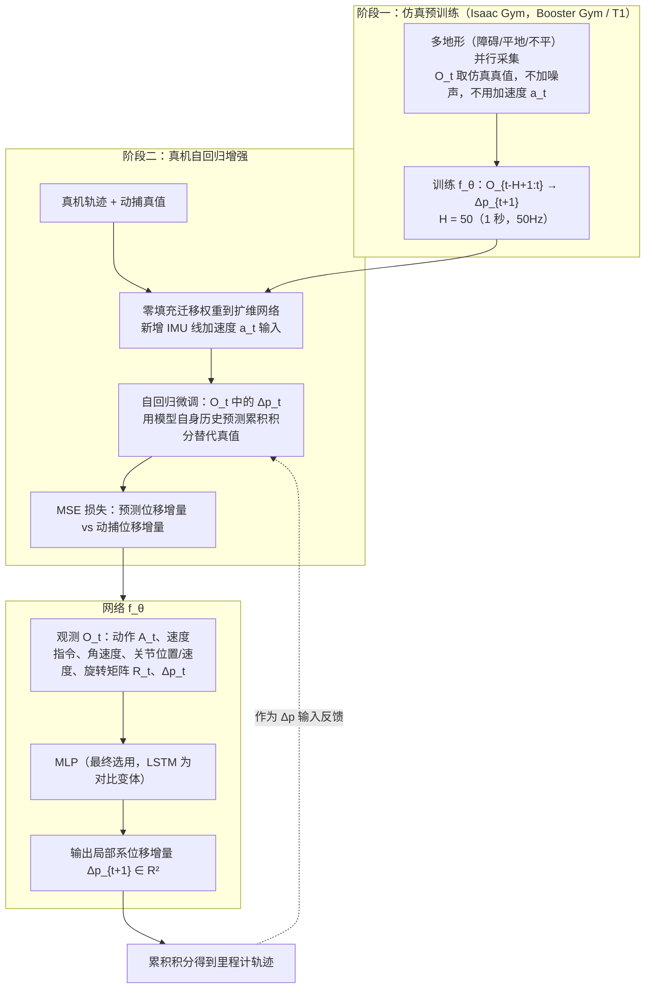

---

type: entity
tags: [paper, humanoid-paper-notebooks, paper-notebook-stub, booster]
status: stub
updated: 2026-09-15
arxiv: "2511.18857"
related:
  - ../overview/paper-notebook-category-09-state-estimation.md
  - ../overview/humanoid-paper-notebooks-index.md
sources:
  - ../../sources/papers/humanoid_pnb_autoodom.md
summary: "AutoOdom 把\"足式机器人本体感知里程计（只用 IMU + 关节传感器）\"这件事纯学习化：第一阶段在大规模仿真里学到非线性动力学和频繁变化的接触状态，第二阶段在少量真机数据上做自回归微调——让模型学着\"喂自己的预测当输入\"，由此自然抑制传感器噪声和累计漂移，在 Booster T1 上把 ATE / RPE 相比 Legolas 砍掉了 36%–59%。"
---

# AutoOdom

**AutoOdom: Learning Auto-regressive Proprioceptive Odometry for Legged Locomotion** 收录于 [Robot Learning Paper Notebooks](https://imchong.github.io/Robot_Learning_Paper_Notebooks/index.html)（分类：09_State_Estimation）。本页为 **清单索引实体**，链向深读笔记与原始论文；详细机制待从笔记消化后补充。

## 一句话定义

AutoOdom 把"足式机器人本体感知里程计（只用 IMU + 关节传感器）"这件事纯学习化：第一阶段在大规模仿真里学到非线性动力学和频繁变化的接触状态，第二阶段在少量真机数据上做自回归微调——让模型学着"喂自己的预测当输入"，由此自然抑制传感器噪声和累计漂移，在 Booster T1 上把 ATE / RPE 相比 Legolas 砍掉了 36%–59%。

## 英文缩写速查

| 缩写 | 英文全称 | 简要说明 |
|------|----------|----------|
| RL | Reinforcement Learning | 通过与环境交互最大化长期回报来学习策略 |
| WBC | Whole-Body Control | 协调全身关节满足多任务/约束的控制基础设施 |
| Sim2Real | Simulation to Real | 把仿真中学到的策略迁移落地真机的工程主线 |

## 为什么重要

- 列入 Paper Notebooks 策展清单，便于与全库 [机器人学习论文笔记总索引](../overview/humanoid-paper-notebooks-index.md) 及分类父节点交叉检索。
- 深读笔记提供比摘要更贴近实现的阅读路径，适合作为后续 ingest 深化起点。

## 流程总览

图依据：论文 §III-A 至 §III-E。

## 核心信息

| 字段 | 内容 |
|------|------|
| 分类 | 09_State_Estimation |
| 深读笔记 | <https://imchong.github.io/Robot_Learning_Paper_Notebooks/papers/09_State_Estimation/AutoOdom__Learning_Auto-regressive_Proprioceptive_Odometry_for_Legged_Locomotio/AutoOdom__Learning_Auto-regressive_Proprioceptive_Odometry_for_Legged_Locomotio.html> |
| arXiv | <https://arxiv.org/abs/2511.18857> |

## 实验与评测

- 本页为 **策展清单索引** 摘要；量化 benchmark、消融与实机指标以 **深读笔记与论文 PDF** 为准（链接见 [参考来源](#参考来源)）。

## 结论

**AutoOdom 的赌注是「里程计可以纯学习化」：把足式机器人频繁变化的接触与非线性动力学交给两阶段训练，而不是靠手工模型与滤波器去补。**

- 真正拉开差距的是**第二阶段的自回归微调**——让模型在少量真机数据上「喂自己的预测当输入」，从而在推理时的误差累积分布里训练，自然抑制传感器噪声与累计漂移；第一阶段的大规模仿真只负责学动力学与接触状态。
- 关键指标是 Booster T1 上 **ATE / RPE 相比 Legolas 下降 36%–59%**，衡量的是轨迹级精度，不是单步速度估计。
- 适用边界：输入只有 IMU + 关节传感器，属本体感知里程计，优点是不受光照/纹理影响，但不替代视觉或激光 SLAM。
- 主要成本在第二阶段依赖真机数据；跨本体、跨步态的迁移性本页未交代。
- 本页为笔记摘要，量化 benchmark 与消融以深读笔记与论文 PDF 为准。

## 与其他页面的关系

- 分类父节点：[paper-notebook-category-09-state-estimation](../overview/paper-notebook-category-09-state-estimation.md)
- 总索引：[humanoid-paper-notebooks-index.md](../overview/humanoid-paper-notebooks-index.md)

## 参考来源

- [humanoid_pnb_autoodom.md](../../sources/papers/humanoid_pnb_autoodom.md)
- 深读笔记：<https://imchong.github.io/Robot_Learning_Paper_Notebooks/papers/09_State_Estimation/AutoOdom__Learning_Auto-regressive_Proprioceptive_Odometry_for_Legged_Locomotio/AutoOdom__Learning_Auto-regressive_Proprioceptive_Odometry_for_Legged_Locomotio.html>
- 论文：<https://arxiv.org/abs/2511.18857>
- [arXiv PDF](https://arxiv.org/pdf/2511.18857)：已通读方法部分（实验与附录以略读为准）：§III-A 至 §III-E

## 推荐继续阅读

- [机器人论文阅读笔记：AutoOdom](https://imchong.github.io/Robot_Learning_Paper_Notebooks/papers/09_State_Estimation/AutoOdom__Learning_Auto-regressive_Proprioceptive_Odometry_for_Legged_Locomotio/AutoOdom__Learning_Auto-regressive_Proprioceptive_Odometry_for_Legged_Locomotio.html)
