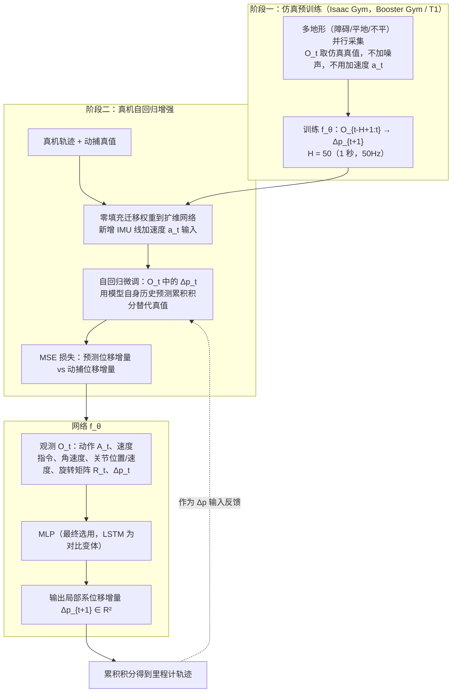

---

type: entity
tags: [paper, humanoid-paper-notebooks, paper-notebook-stub, booster, state-estimation, odometry]
status: complete
updated: 2026-11-06
arxiv: "2511.18857"
related:
  - ../overview/paper-notebook-category-09-state-estimation.md
  - ../overview/humanoid-paper-notebooks-index.md
  - ../concepts/state-estimation.md
  - ../concepts/sim2real.md
  - ../concepts/contact-estimation.md
  - ./paper-notebook-learning-contact-representation-for-leg-odometry.md
  - ./paper-notebook-booster-gym-an-end-to-end-rl-framework-for-human.md
sources:
  - ../../sources/papers/humanoid_pnb_autoodom.md
summary: "AutoOdom 把\"足式机器人本体感知里程计（只用 IMU + 关节传感器）\"这件事纯学习化：第一阶段在大规模仿真里学到非线性动力学和频繁变化的接触状态，第二阶段在少量真机数据上做自回归微调——让模型学着\"喂自己的预测当输入\"，由此自然抑制传感器噪声和累计漂移，在 Booster T1 上把 ATE / RPE 相比 Legolas 砍掉了 36%–59%。"
---

# AutoOdom

**AutoOdom: Learning Auto-regressive Proprioceptive Odometry for Legged Locomotion**（Changsheng Luo、Yushi Wang、Mingguo Zhao，清华大学自动化系；Wenhan Cai，Booster Robotics；arXiv 2025-11-24 提交）收录于 [Robot Learning Paper Notebooks](https://imchong.github.io/Robot_Learning_Paper_Notebooks/index.html)（分类：09_State_Estimation）。本页基于论文原文通读（见 [参考来源](#参考来源)）。

## 一句话定义

AutoOdom 把"足式机器人本体感知里程计（只用 IMU + 关节传感器）"这件事纯学习化：第一阶段在大规模仿真里学到非线性动力学和频繁变化的接触状态，第二阶段在少量真机数据上做自回归微调——让模型学着"喂自己的预测当输入"，由此自然抑制传感器噪声和累计漂移，在 Booster T1 上把 ATE / RPE 相比 Legolas 砍掉了 36%–59%。

## 英文缩写速查

| 缩写 | 英文全称 | 简要说明 |
|------|----------|----------|
| IMU | Inertial Measurement Unit | 惯性测量单元，本文取陀螺角速度 $\omega_t$ 与线加速度 $a_t$ 作为输入 |
| EKF | Extended Kalman Filter | 扩展卡尔曼滤波，论文列为代表性的解析滤波里程计基线（相关工作） |
| MoCap | Motion Capture | 动作捕捉系统，提供真机训练与评测的位移真值（50 Hz） |
| Sim2Real | Simulation to Real | 仿真到真机的迁移鸿沟，本文第二阶段要弥合的问题 |
| MLP | Multi-Layer Perceptron | 多层感知机，本文最终选用的网络结构 |
| LSTM | Long Short-Term Memory | 长短期记忆网络，论文中的对比变体 |
| MSE | Mean Squared Error | 均方误差，训练损失 $L_{\mathrm{MSE}}$ 的形式 |
| ATE | Absolute Trajectory Error | 绝对轨迹误差，衡量全局轨迹对齐误差（$\mathrm{ATE}_o$ 首帧对齐，$\mathrm{ATE}_u$ Umeyama 对齐） |
| RPE | Relative Pose Error | 相对位姿误差，衡量局部增量误差、不随漂移累计 |

## 为什么重要

- 足式机器人在 GPS 拒止、视觉退化场景下需要本体感知里程计。论文指出视觉里程计在跳跃、急转弯、崎岖地形等剧烈运动中，会因运动模糊和光照变化失效（§I）。
- 解析滤波路线（EKF 等）依赖接触与运动学模型，论文引用其累计漂移"typically exceeds 10%"（[10][20]，§II-A，未逐条核实原始数值）。
- 纯学习路线需要大量数据，真机采集成本高；纯仿真训练又有 Sim2Real 鸿沟。AutoOdom 试图用"仿真预训练 + 少量真机自回归微调"同时回避两者的主要缺点。
- 列入 Paper Notebooks 策展清单，便于与全库 [机器人学习论文笔记总索引](../overview/humanoid-paper-notebooks-index.md) 及分类父节点交叉检索。

## 核心信息

| 字段 | 内容 |
|------|------|
| 分类 | 09_State_Estimation |
| 平台 | Booster T1 人形机器人（论文主实验）；仿真基于 Booster Gym |
| 深读笔记 | <https://imchong.github.io/Robot_Learning_Paper_Notebooks/papers/09_State_Estimation/AutoOdom__Learning_Auto-regressive_Proprioceptive_Odometry_for_Legged_Locomotio/AutoOdom__Learning_Auto-regressive_Proprioceptive_Odometry_for_Legged_Locomotio.html> |
| arXiv | <https://arxiv.org/abs/2511.18857>（v1，2025-11-24） |
| 官方代码 / 项目页 | 未在论文或 arXiv 页面中找到（见 [工程实践](#工程实践)，未核实） |

## 流程总览

图依据：论文 §III-A 至 §III-E（文字描述，原图 Fig. 1 未做视觉核对）。

## 核心原理

### 输入、输出与预测形式

观测向量（论文式 1）包含：动作 $A_t\in\mathbb{R}^{11}$（11 个受驱动关节的指令）、速度指令 $v^{cmd}_t\in\mathbb{R}^3$、陀螺角速度 $\omega_t\in\mathbb{R}^3$、线加速度 $a_t\in\mathbb{R}^3$（仅阶段二使用）、12 个关节的位置与速度 $q_t,\dot q_t$、旋转矩阵 $R_t\in\mathbb{R}^{3\times3}$（机体系到世界系），以及历史位移 $\Delta p_t\in\mathbb{R}^2$。输入维度 $d_{in}\in\{32,34,\dots,46\}$，随传感器配置变化。

网络在长度 $H=50$ 的历史窗口（50 Hz 下约 1 秒）上预测下一时刻的局部系位移增量（式 2）：

$$
\Delta p_{t+1} = f_\theta\!\left(O_{t-H+1:t}\right) \in \mathbb{R}^2
$$

其中 $\Delta t = 0.02\,\mathrm{s}$。论文将 $\Delta p_t$ 定义为"当前位置 $p_t$ 到 1 秒前位置 $p_{t-50}$ 的位移"，仿真中取真值、真机中取动捕或模型估计（§III-A）。

### 两阶段训练

- **阶段一（仿真预训练）**：在 Isaac Gym 中并行运行多个机器人实例，覆盖障碍、平地、不平地形与多种步态。观测全部取仿真真值、不加噪声，且**不使用** $a_t$，因为仿真中加速度由数值微分得到，与真实 IMU 差异大（§III-B）。
- **阶段二（真机自回归增强）**：通过零填充（zero-padding）把阶段一参数迁移到扩维网络（新增 $a_t$ 输入），然后用动捕数据微调。关键改动是把观测中的 $\Delta p_t$ 从真值换成**模型自己过去预测的累积积分**，让网络在自身误差分布上训练（§III-C）。

损失为预测增量与动捕增量之间的 MSE（式 3）：

$$
L_{\mathrm{MSE}} = \frac{1}{N}\sum_{j=1}^{N}\left\lVert \Delta p_j - \hat{\Delta p}_j \right\rVert_2^2,\qquad \hat{\Delta p}_j = f_\theta(O_{j-H:j})
$$

论文在 §III-D 中对 $\Delta p_j$ 的表述是"相邻帧位置差 $p_j - p_{j-1}$"，与上面的"1 秒位移"定义在口径上不完全一致（未核实，原文未作说明）。

### 网络结构

论文比较了 MLP（式 4，对展平观测做全连接）与 LSTM（式 5，取最后时刻隐状态再线性映射）两种结构。两者精度差异很小，作者因推理延迟低、显存占用小，最终采用 MLP。参数量约为 $0.5\times10^6$ 到 $2.0\times10^6$。

## 实验与评测

**设置**（§IV-A）：真实机器人在室内足球场采集轨迹，平均时长约 20 秒，覆盖多种行走方向与速度；机器人 50 Hz 运行，动捕（MoCap）系统 50 Hz 提供真值。基线为 Legolas（原为四足机器人设计，论文 [16]），由作者在本数据上复现。

**度量**（式 6–7）：$\mathrm{ATE}_o$（首帧对齐）、$\mathrm{ATE}_u$（Umeyama 对齐）、$\mathrm{RPE}_{rmse}$。论文未给出误差的物理单位（未核实）。

**主结果（表 I，论文原表，行号与原文一致）**：

| 方法 | $\mathrm{ATE}_o$ | $\mathrm{ATE}_u$ | RPE |
|------|------|------|------|
| AutoOdom（完整，MLP） | **0.5630** | **0.2153** | 0.0148 |
| AutoOdom（完整，LSTM） | 0.6196 | 0.2544 | 0.0153 |
| 仅阶段一（MLP） | 0.8176 | 0.2165 | **0.0124** |
| 仅阶段一（LSTM） | 0.9457 | 0.3666 | 0.0221 |
| 仅阶段二（MLP） | 0.8016 | 0.3328 | 0.0185 |
| 仅阶段二（LSTM） | 0.6472 | 0.3404 | 0.0153 |
| 去掉自回归 | 0.7876 | 0.2095 | 0.0141 |
| 去掉加速度 $a_t$ | 0.6861 | 0.2678 | 0.0162 |
| Legolas（基线） | 1.3153 | 0.5281 | 0.0232 |

论文报告的相对 Legolas 的改进：$\mathrm{ATE}_o$ 降 57.2%、$\mathrm{ATE}_u$ 降 59.2%、RPE 降 36.2%。按表中数值复算一致（$1-0.5630/1.3153$、$1-0.2153/0.5281$、$1-0.0148/0.0232$）。

**消融（表 II，仅阶段一，论文原表）**：

| 配置 | $\Delta t$ | $a_t$ | $p_t$ | $A_t$ | $\mathrm{ATE}_o$ | $\mathrm{ATE}_u$ | RPE |
|------|-----|---|---|---|------|------|------|
| 全部输入 | 0.02 | ✓ | ✓ | ✓ | 1.4486 | 0.6577 | 0.0378 |
| 去掉 $a_t$ | 0.02 | × | ✓ | ✓ | 0.8176 | 0.2165 | 0.0124 |
| 去掉 $p_t$ | 0.02 | ✓ | × | ✓ | 1.1113 | 0.4840 | 0.0280 |
| 只保留 $A_t$ | 0.02 | × | × | ✓ | 0.8876 | 0.2195 | 0.0141 |
| 去掉 $A_t$ | 0.02 | ✓ | ✓ | × | 1.9190 | 0.6739 | 0.0439 |
| 预测间隔 1.02 s | 1.02 | ✓ | ✓ | ✓ | 1.0831 | 0.4689 | 0.1551 |

论文的主要读数：阶段一中去掉 $a_t$ 反而明显改善（$\mathrm{ATE}_o$ 从 1.4486 降到 0.8176），$A_t$（动作历史）是最关键的输入之一，0.02 s 的高频预测间隔显著优于 1.02 s。

**读表注意**：论文摘要称"在所有指标上显著优于 SOTA"，但表 I 中"仅阶段一"的 RPE（0.0124）优于完整模型（0.0148），"去掉自回归"的 $\mathrm{ATE}_u$（0.2095）也略优于完整模型（0.2153）。因此"全面领先"应理解为：主轨迹指标（$\mathrm{ATE}_o$）与相对 Legolas 的对比成立，个别子指标并非最优。表 I 的行号从 2 跳到 4，原文未作说明（未核实是否缺行）。论文未报告多次随机种子的方差或置信区间，也未在其他机器人或其他场地上测试。

## 与 Legolas 等方法对比

- 论文把对比基线集中在 **Legolas**（深度腿部惯性里程计，[16]），理由是它在文献中已优于 EKF 类（[9][10]）与 TLIO（[14]）等方法；作者认为"超过 Legolas 即足以说明相对整体方法的有效性"（§IV-A）。因此 EKF、MIPO、TLIO 等在本文中**没有实验对比**，只在相关工作中讨论。
- 论文对 Legolas 的训练细节只给出概述（原为四足机器人设计，论文 [16]），本页未逐条核对 Legolas 的具体训练设定，因此两者差异的归因（例如是否来自阶段二微调）只能依据论文消融表 II 与表 I 中的"去掉自回归"等行，不能由论文直接证明。

## 结论

**AutoOdom 的赌注是「里程计可以纯学习化」：把足式机器人频繁变化的接触与非线性动力学交给两阶段训练，而不是靠手工模型与滤波器去补。**

1. **真正拉开差距的是第二阶段的自回归微调**：让模型在少量真机数据上「喂自己的预测当输入」，使训练分布接近推理时的累积误差；第一阶段大规模仿真只负责学动力学与接触状态。
2. **读数字要看口径**：Booster T1 上 $\mathrm{ATE}_o$ 降 57.2%、$\mathrm{ATE}_u$ 降 59.2%、RPE 降 36.2%，都是相对 Legolas 的单次评测结果，且个别子指标（表 I 中"仅阶段一"的 RPE、"去掉自回归"的 $\mathrm{ATE}_u$）并不差于完整模型。
3. **输入取舍有反直觉之处**：阶段一去掉 $a_t$ 表现更好（仿真加速度与真实 IMU 不一致），阶段二再把 $a_t$ 加回来；动作历史 $A_t$ 对精度影响大。
4. **适用边界**：只用 IMU 与关节传感器，不依赖视觉，因此不受视觉在剧烈运动中的运动模糊和光照变化影响（论文 §I 的动机）；论文只讨论相对运动的里程计，未涉及绝对定位或回环修正；它把"集成不确定性估计用于 SLAM"列为未来工作。
5. **主要成本在真机数据**：第二阶段依赖动捕真值与真机轨迹；跨本体、跨地形、跨步态的迁移性论文未验证。

## 工程实践

| 项目 | 论文设定 / 要点 |
|------|------|
| 控制与采样 | 50 Hz，$\Delta t = 0.02\,\mathrm{s}$，历史窗口 $H=50$（1 秒） |
| 仿真环境 | Isaac Gym，基于 Booster Gym（Booster T1 的 RL 框架，论文 [23]）；并行多实例，多地形；观测无噪声 |
| 真机数据 | Booster T1，室内足球场，单段约 20 s，动捕真值 50 Hz |
| 输入维度 | $d_{in}\in\{32,\dots,46\}$，依赖传感器配置；阶段二新增 $a_t$ |
| 网络 | 最终采用 MLP（$0.5\times10^6$–$2.0\times10^6$ 参数）；LSTM 作对比 |
| 迁移方法 | 阶段一到阶段二通过零填充扩维迁移参数 |
| 调试指标 | $\mathrm{ATE}_o$、$\mathrm{ATE}_u$（全局轨迹）、RPE（局部增量漂移） |
| 复现入口 | 论文未公布训练代码与数据集链接（未核实） |
| 源码开放状态（步骤 2.5） | 未找到独立项目页；arXiv 摘要页仅有第三方代码检索入口，未给出仓库链接。**未核实**是否存在官方仓库 |
| 源码运行时序图 | **不适用**（未找到 AutoOdom 官方可运行代码，无法对齐运行入口） |

## 局限与风险

- **平台与场景单一**：主实验只在 Booster T1、室内足球场上完成，论文自己列为未来工作的"多环境 / 多平台"尚未覆盖。
- **真机数据依赖**：阶段二需要动捕真值，采集成本仍在；若没有动捕，论文给出的增益是否可复现未知。
- **阶段一与阶段二输入不一致**：阶段一没有 $a_t$，阶段二才加入。若只部署阶段一模型，需注意其与阶段二的精度差别（表 I）。
- **指标与基线有限**：只与 Legolas 比较；无多次运行的统计量；ATE 单位未给（未核实）。
- **误读风险**："36%–59%" 是相对 Legolas 的改进比例，不是绝对误差降低量；对绝对精度要看表中数值与单位。
- **定义口径**：$\Delta p_t$ 在 §III-A 与 §III-D 中的定义不完全一致（见上文），复现时需以代码或作者澄清为准（未核实）。
- **长时漂移未充分讨论**：论文强调抑制累计漂移，但未给出长时（分钟级）轨迹的漂移曲线，本页不作外推。

## 关联页面

- 分类父节点：[paper-notebook-category-09-state-estimation](../overview/paper-notebook-category-09-state-estimation.md)
- 总索引：[humanoid-paper-notebooks-index.md](../overview/humanoid-paper-notebooks-index.md)
- 概念：[状态估计](../concepts/state-estimation.md)、[Sim2Real](../concepts/sim2real.md)、[接触估计](../concepts/contact-estimation.md)
- 同类腿式里程计笔记：[paper-notebook-learning-contact-representation-for-leg-odometry](paper-notebook-learning-contact-representation-for-leg-odometry.md)
- 仿真训练框架：[paper-notebook-booster-gym-an-end-to-end-rl-framework-for-human](paper-notebook-booster-gym-an-end-to-end-rl-framework-for-human.md)

## 参考来源

- [humanoid_pnb_autoodom.md](../../sources/papers/humanoid_pnb_autoodom.md)
- 深读笔记：<https://imchong.github.io/Robot_Learning_Paper_Notebooks/papers/09_State_Estimation/AutoOdom__Learning_Auto-regressive_Proprioceptive_Odometry_for_Legged_Locomotio/AutoOdom__Learning_Auto-regressive_Proprioceptive_Odometry_for_Legged_Locomotio.html>
- 论文 arXiv 摘要页：<https://arxiv.org/abs/2511.18857>
- [arXiv PDF](https://arxiv.org/pdf/2511.18857)：已通读全文（6 页，含方法、实验、结论与参考文献；论文无独立附录；图 1–4 未做视觉核对，仅依据正文文字）

## 推荐继续阅读

- [机器人论文阅读笔记：AutoOdom](https://imchong.github.io/Robot_Learning_Paper_Notebooks/papers/09_State_Estimation/AutoOdom__Learning_Auto-regressive_Proprioceptive_Odometry_for_Legged_Locomotio/AutoOdom__Learning_Auto-regressive_Proprioceptive_Odometry_for_Legged_Locomotio.html)
- [AutoOdom 原文（arXiv:2511.18857）](https://arxiv.org/pdf/2511.18857)
