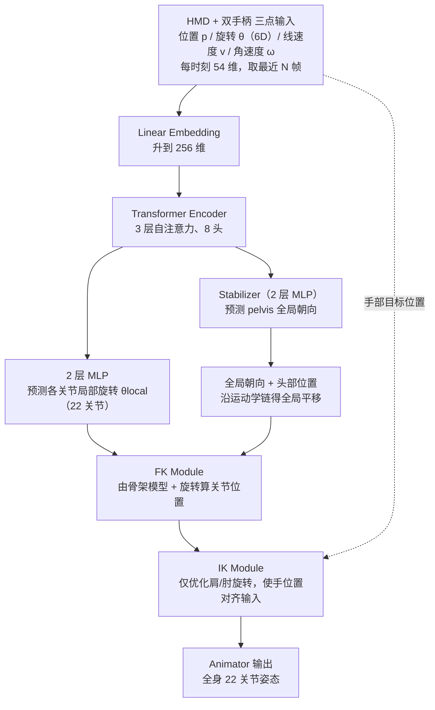
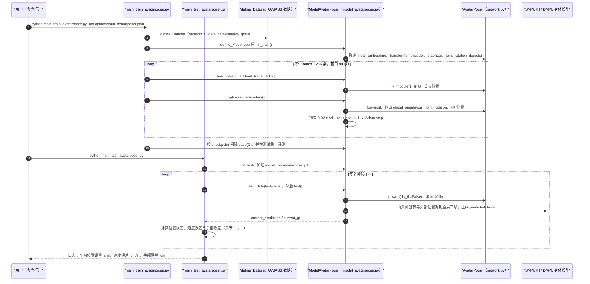

# AvatarPoser

**AvatarPoser: Articulated Full-Body Pose Tracking from Sparse Motion Sensing** 收录于 [Robot Learning Paper Notebooks](https://imchong.github.io/Robot_Learning_Paper_Notebooks/index.html)（分类：14_Human_Motion）。本页依据 **论文全文**（arXiv:2207.13784 v1）与 **官方开源仓库** 核对编写；深读笔记作为补充来源。

## 一句话定义

在 VR/AR 头显平台上驱动关节化化身，通常只能拿到稀疏运动信号——头显（HMD）+ 两个手柄的三点位姿。AvatarPoser 提出从这些稀疏运动感知实时重建全身关节姿态：基于 Transformer 的网络从稀疏输入预测全身关节旋转，并把全局运动与局部姿态解耦（用稳定的全局参考），再用逆运动学（IK）微调手臂，使预测末端精确对齐输入关节。AvatarPoser 在大规模 AMASS 动作数据上达 SOTA，为头显平台的化身驱动奠定基础（ECCV 2022）。

## 英文缩写速查

| 缩写 | 含义 |
|---|---|
| HMD | Head-Mounted Display，头显；输入之一是头显的位姿 |
| IK | Inverse Kinematics，逆运动学；用于微调肩肘使手部对齐输入 |
| FK | Forward Kinematics，正向运动学；由骨架与旋转算出关节位置 |
| SMPL | 参数化人体模型；本文用其前 22 个关节的运动学树 |
| 6D | 6 维旋转表示（旋转矩阵去掉最后一行），用于网络输入输出 |
| MPJPE | Mean Per Joint Position Error，平均关节位置误差（cm） |
| MPJRE | Mean Per Joint Rotation Error，平均关节旋转误差（度） |
| MPJVE | Mean Per Joint Velocity Error，平均关节速度误差（cm/s） |
| AMASS | 统一多套光学动捕数据为 SMPL 表示的大规模人体运动数据库 |

## 核心信息

| 字段 | 内容 |
|------|------|
| 分类 | 14_Human_Motion |
| 深读笔记 | <https://imchong.github.io/Robot_Learning_Paper_Notebooks/papers/14_Human_Motion/AvatarPoser__Articulated_Full-Body_Pose_Tracking_from_Sparse_Motion_Sensing/AvatarPoser__Articulated_Full-Body_Pose_Tracking_from_Sparse_Motion_Sensing.html> |
| arXiv | <https://arxiv.org/abs/2207.13784> |
| 作者 | Jiaxi Jiang、Paul Streli、Huajian Qiu、Andreas Fender、Larissa Laich、Patrick Snape、Christian Holz（ETH Zürich SIPLAB；Laich、Snape 来自 Reality Labs at Meta） |
| 发表 | 2022 年 7 月（arXiv 首版）；ECCV 2022（据官方仓库 README 确认，arXiv 版本本身未标注会议） |
| 项目主页 | [siplab.org/projects/AvatarPoser](https://siplab.org/projects/AvatarPoser) |
| 代码 | [eth-siplab/AvatarPoser](https://github.com/eth-siplab/AvatarPoser)（MIT，已开源） |
| 笔记阅读日期 | 2026-06-21 |

## 为什么重要

- 头显平台只提供头部与双手的**三点稀疏信号**，却要驱动**全身化身**。论文指出，已有方法依赖骨盆或下肢追踪器，会增加设置复杂度，限制移动场景下的应用。
- **全局运动与局部姿态解耦**：论文用 Stabilizer 单独预测骨盆全局朝向，因为头部转动往往与身体其余关节无关，直接由头部朝向推骨盆朝向会产生漂浮的化身（§3.3）。
- **IK 微调末端**：论文指出末端误差沿运动学链累积，手部位置误差会干扰虚拟界面交互；用 IK 硬对齐手部是学习预测与几何约束结合的做法（§3.3，表 3）。
- **与人形机器人的类比（本页作者的类比，论文未讨论机器人）**：「用少量末端与头部信号估计全身状态」与人形状态估计、稀疏输入遥操作的问题相通。

## 解决什么问题

头显平台只有**三点稀疏信号**，却要驱动**全身化身**，难点包括：

- 从极稀疏输入推全身，问题**欠约束**（论文称之为 vastly underdetermined）；
- 需要**实时**推理，且手部要**精确对齐**输入；
- 全局漂移会让化身漂浮或滑动。

论文同时指出已有方法的三类局限：(1) 通用 IK 生成的全身姿态常显得静止、不自然，远离已知末端的关节尤甚；(2) 深度学习方法隐含假设骨盆位姿已知；(3) 即使有骨盆追踪器，下肢也会因追踪器位于腹部而出现抖动与滑动（§1）。

AvatarPoser 要做的是：从三点稀疏输入实时、精确地重建全身 22 个关节的姿态。

## 核心原理

### 输入与输出

- **输入**：每个追踪设备（头显、左右手柄，即 $S=3$）给出位置 $p$、旋转（6D 表示 $\theta$）、线速度与角速度。线速度用后向差分 $v_t = p_t - p_{t-1}$（式 2）；角速度 $\Omega_t = R_{t-1}^{-1} R_t$（式 3）再转为 6D。每个设备 18 维，三个设备共 54 维（式 4）。输入为当前帧与过去 $N-1$ 帧的序列（§3.3）。
- **输出**：SMPL 的 22 个关节局部旋转（其中根节点即骨盆的旋转为全局朝向），共 $22 \times 6 = 132$ 维。

选择 6D 旋转表示的理由是其在神经网络中的连续性（论文引 Zhou et al., 2019）。

### 网络结构

1. **线性嵌入**到 256 维，再经 **Transformer Encoder**（3 层、8 头自注意力）提取时序姿态特征。
2. **Stabilizer**（2 层 MLP，隐层 256）从特征预测骨盆全局朝向。全局平移不直接回归，而是由头部位置沿运动学链推出（论文称直接回归平移效果更差，见 §4.3）。
3. **局部关节解码器**（2 层 MLP）预测各关节相对父关节的局部旋转。
4. **FK 模块**由 SMPL 骨架与预测旋转计算全部关节位置，使训练损失约束的是关节位置而不只是旋转角。
5. **IK 模块**（仅推理时使用，论文 §3.3）固定肩部，只优化肩、肘的旋转，使手部位置误差最小：

$$E(\theta_i) = \left\lVert p^{hand}_{gt} - \mathrm{FK}(\theta_i)_{hand} \right\rVert_2^2, \qquad \theta_{i+1} = \theta_i + \eta \cdot f(\nabla E(\theta_i))$$

论文用 Adam 优化器，学习率 $10^{-3}$，迭代次数固定（推理时取 5 次，见 §4.4）。

### 损失函数

$$L_{total} = \lambda_{ori} L_{ori} + \lambda_{rot} L_{rot} + \lambda_{fk} L_{fk}$$

三项均为 L1 损失，论文取 $\lambda_{ori}=0.05$、$\lambda_{rot}=1$、$\lambda_{fk}=1$。训练时不包含 IK 模块（为加速训练）。开源代码中的写法与论文系数不同，见「局限与风险」。

### 关键机制小结

1. **三点稀疏 → 全身姿态**：从 HMD + 双手柄重建关节化全身。
2. **Transformer + 全局-局部解耦**：骨盆朝向与局部关节分支共享特征，但由独立的 Stabilizer 负责全局运动。
3. **IK 微调手臂**：用几何约束把末端精确对齐到输入。
4. **AMASS 上达 SOTA**：在三个 AMASS 子集上优于 Final IK、CoolMoves、LoBSTr、VAE-HMD（见「实验与评测」）。

### 流程总览



图依据：论文 §3.3 / Fig.2、Fig.3（IK 仅在推理时使用，训练不含 IK Module）。注意：开源代码中 `ik_module` 已定义，但测试路径未调用它，见下文「源码运行时序图」与「局限与风险」。

## 源码运行时序图

官方仓库（MIT 许可）提供训练、测试脚本与预训练权重，判定为 **已开源且含可运行入口**。下图依据仓库 `main_train_avatarposer.py`、`main_test_avatarposer.py`、`models/model_avatarposer.py`、`models/network.py` 与 `options/*.json` 的实际调用关系绘制：



复现路径：下载 AMASS 的 BMLrub、CMU、HDM05 子集与 SMPL+H（含 DMPL）身体模型（模型需放入 `support_data/body_models`，仓库不附带）；运行 `prepare_data.py` 预处理，注意它写出的目录是 `./data_fps60`，而配置文件读取的是 `./data_cameraready_fps60`，需要统一。本页作者未在本地运行训练或测试（未核实复现数值）。

## 工程实践

| 项目 | 内容 |
|---|---|
| 输入设备 | 头显 + 两手柄（$S=3$），每设备 6D 位姿与速度；可选骨盆输入（4 输入设定） |
| 时间窗口与采样 | 配置 `window_size` 为 40 帧；数据统一到 60 Hz |
| 网络规模 | 嵌入 256 维，8 头，3 层 Transformer；Stabilizer 与解码器隐层 256 |
| 训练配置 | Adam，学习率 $10^{-4}$，MultiStepLR（里程碑 60000 起，衰减 0.5），batch 256；论文单卡 GTX 3090 训练约 2 小时 |
| 推理速度 | 论文报告网络推理最高 662 fps（GPU，3090；未在头显端测量）；IK 每迭代约 6 ms、取 5 次，按论文数字推算约 30 ms/帧 |
| 评测指标 | MPJRE（度）、MPJPE（cm）、MPJVE（cm/s）；代码另报告手部误差（关节索引 20、21） |
| 开源状态 | **已开源**（MIT）：训练与测试脚本、配置、预训练权重 `model_zoo/avatarposer.pth`（仓库 release v1.0） |
| 复现前提 | AMASS 数据与 SMPL+H / DMPL 身体模型，二者都需单独获取 |
| 调试建议 | 先用预训练权重跑测试脚本确认误差量级；若手部误差偏大，先确认是否接入了 IK（见下） |

运行命令（来自仓库 README）：

```
python prepare_data.py
python main_train_avatarposer.py -opt options/train_avatarposer.json
python main_test_avatarposer.py
```

## 实验与评测

**数据与设定**：使用 AMASS 中的 CMU、BMLrub、HDM05 三个子集，随机划分 90% 训练 / 10% 测试，统一 60 Hz。对比 3 输入（头显 + 两手柄）与 4 输入（再加骨盆追踪器）两种设定。

**主结果（表 1，AMASS 随机划分测试集）**：

| 方法 | 3 输入 MPJRE | 3 输入 MPJPE | 3 输入 MPJVE | 4 输入 MPJRE | 4 输入 MPJPE | 4 输入 MPJVE |
|---|---|---|---|---|---|---|
| Final IK | 16.77 | 18.09 | 59.24 | 12.39 | 9.54 | 36.73 |
| CoolMoves | 5.20 | 7.83 | 100.54 | 4.58 | 5.55 | 65.28 |
| LoBSTr | 10.69 | 9.02 | 44.97 | 8.09 | 5.56 | 30.12 |
| VAE-HMD | 4.11 | 6.83 | 37.99 | 3.12 | 3.51 | 28.23 |
| **AvatarPoser** | **3.21** | **4.18** | **29.40** | **2.59** | **2.61** | **22.16** |

**跨数据集泛化（表 2，3 输入，三折轮换）**：AvatarPoser 在三个子集上的三项指标均为表中最优。

| 数据集 | AvatarPoser MPJRE / MPJPE / MPJVE | 次优 MPJPE（方法） |
|---|---|---|
| CMU | 5.93 / 8.37 / 35.76 | 12.96（LoBSTr） |
| BMLrub | 4.92 / 7.04 / 43.70 | 9.69（VAE-HMD） |
| HDM05 | 6.39 / 8.05 / 30.85 | 10.21（VAE-HMD） |

**消融（表 3，HDM05 测试集，3 输入）**：

| 配置 | MPJRE | MPJPE 全身（cm） | MPJPE 手部（cm） |
|---|---|---|---|
| 默认 | 6.39 | 8.05 | 1.86 |
| 去掉 Stabilizer | 6.39 | 9.29 | 2.15 |
| 直接回归骨盆位置 | 6.42 | 8.82 | 2.11 |
| 去掉 FK 模块 | 6.24 | 8.41 | 2.04 |
| 去掉 IK 模块 | 6.41 | 8.07 | 3.17 |

**推理时间（图 6）**：论文称网络推理最高 662 fps，在与 VAE-HMD、LoBSTr-GRU、CoolMoves 的单帧耗时比较中处于较好的精度与速度折中。

**真机定性（图 7）**：用 HTC VIVE Pro 头显与两个手柄录制的数据做定性展示，**无定量指标**。

## 结论

**一句话总判：三点稀疏输入下，AvatarPoser 的收益主要来自「骨盆朝向由网络单独预测」与「手部用 IK 硬对齐」两项设计；公开代码的测试路径并未调用 IK，复现手部精度需要自行接入。**

- **精度**：AMASS 随机划分上，3 输入时 MPJPE 为 4.18 cm、MPJRE 为 3.21°，优于表 1 中全部基线（次优 VAE-HMD 为 6.83 cm）。
- **泛化**：三折跨数据集中，MPJPE 为 7.04–8.37 cm，三个子集的三项指标均最优（次优 MPJPE 为 9.69–12.96 cm）。正文对 CMU 上 MPJVE 的描述与表 2 数值不一致，以表为准。
- **IK 的价值在末端**：去掉 IK 后全身 MPJPE 几乎不变（8.05 → 8.07 cm），手部 MPJPE 从 1.86 升到 3.17 cm。若只关心整体姿态，IK 不是关键；若要手部与虚拟界面精确交互，IK 必不可少。
- **解耦的价值**：去掉 Stabilizer 后全身 MPJPE 从 8.05 升至 9.29 cm，支持「全局朝向由网络从整体特征学习」的设计。
- **实时预算**：网络推理远快于 IK 迭代（论文数字：网络最高 662 fps；IK 每迭代约 6 ms）。若要求手部精度又要实时，需在 IK 迭代次数与帧率之间取舍。
- **可复现性**：代码与权重已开源（MIT），但需自备 AMASS 与 SMPL+H / DMPL 模型；公开测试代码中的 IK 步骤与论文描述不一致（见「局限与风险」）。

## 局限与风险

论文没有独立的 Limitations 章节；以下边界来自正文、消融与开源代码的归纳，未在论文中明确声明的部分会注明。

- **欠约束仍然存在**：三点输入不含下肢与骨盆的直接观测，下肢姿态完全依赖学到的动作先验。论文自己的定性示例覆盖了多种动作，但未系统评估对罕见动作的失败模式（未核实）。
- **训练与测试数据范围有限**：只使用 AMASS 的三个子集（CMU、BMLrub、HDM05）；真机只有一套 HTC VIVE 录制的定性展示，没有定量评估。
- **速度数字不代表端到端延迟**：662 fps 是 GPU 上网络前向的时间，不含 IK 后处理，也不含头显 SDK 的采集与渲染延迟。论文未在头显端或移动芯片上测量。
- **开源推理路径未调用 IK**：仓库 `models/network.py` 定义了 `ik_module`，但 `model_avatarposer.py` 的训练与测试路径（`do_fk=False`）均未调用它。因此公开测试代码输出的是网络预测而非 IK 微调后的结果；是否为版本差异未核实。若要复现表 3 中「默认」一行的手部精度，需要自行接入 IK。
- **代码与论文的超参不一致**：全局朝向损失权重，论文为 $\lambda_{ori}=0.05$，代码训练损失为 `0.02 * global_orientation_loss + joint_rotation_loss + joint_position_loss`；IK 学习率，论文为 $10^{-3}$，代码 `ik_module` 默认值为 $10^{-1}$（该函数当前未被调用）。复现时应以论文为准并记录差异。
- **论文内部的表述不一致**：正文称 Final IK 在 CMU 的 MPJVE 略优于 AvatarPoser，而表 2 中 Final IK 为 56.83、AvatarPoser 为 35.76。
- **数据路径需手动统一**：`prepare_data.py` 输出 `./data_fps60`，训练与测试配置读取 `./data_cameraready_fps60`。
- **依赖与许可**：SMPL+H / DMPL 身体模型需从各自官网申请；AMASS 数据使用需遵守其许可条款（具体条款未核实）。
- **作为化身驱动的风险**：若把预测的手部位置直接用于交互判定而未做 IK 对齐，表 3 显示手部误差会升高约 70%（1.86 → 3.17 cm）。

## 与其他工作对比

论文的对比对象均为头显与手柄的稀疏输入方法，且统一在同一训练与测试数据上复现（Final IK 直接在 Unity 中运行）：

| 方法 | 思路 | 是否需要骨盆输入 | 论文指出的主要问题 | 3 输入 MPJPE（表 1） |
|---|---|---|---|---|
| Final IK | 数值 IK（Unity 插件） | 否 | 末端之外的关节显得静止、不自然 | 18.09 cm |
| CoolMoves | 基于 KNN 从小数据集插值 | 否 | 数据规模与多样性下的可扩展性不明 | 7.83 cm |
| LoBSTr | GRU 预测下肢，IK 解上肢 | 是（头、手、骨盆） | 三输入下难以区分大量姿态 | 9.02 cm |
| VAE-HMD | VAE 生成姿态，编码相对骨盆的关节 | 隐含需要（论文认为隐含第四个输入） | 仍未解决仅三输入的欠约束问题 | 6.83 cm |
| AvatarPoser | Transformer + 全局-局部解耦 + IK 微调 | 否 | 见「局限与风险」 | 4.18 cm |

## 关联页面

- 分类父节点：[paper-notebook-category-14-human-motion](../overview/paper-notebook-category-14-human-motion.md)
- 总索引：[humanoid-paper-notebooks-index.md](../overview/humanoid-paper-notebooks-index.md)
- 同团队后续工作（第一视角的头与手位姿估计）：[EgoPoser 实体页](./paper-notebook-egoposer-robust-real-time-egocentric-pose-estima.md)，其官方仓库 README 将其列为 AvatarPoser 的后续工作。
- 训练与评测数据集：[AMASS](./amass.md)

## 参考来源

- [humanoid_pnb_avatarposer.md](../../sources/papers/humanoid_pnb_avatarposer.md)（原始来源归档）
- 论文 arXiv：<https://arxiv.org/abs/2207.13784>；全文 PDF：<https://arxiv.org/pdf/2207.13784>。已通读全文：§1–§5、表 1–3、图 1–7 与参考文献；arXiv v1 中未见附录。
- 官方代码：<https://github.com/eth-siplab/AvatarPoser>（MIT 许可；本页核对的是默认分支浅克隆，HEAD 为 `0f97cb2`；已阅读 `main_train_avatarposer.py`、`main_test_avatarposer.py`、`models/model_avatarposer.py`、`models/network.py`、`options/*.json`、`prepare_data.py`、`README.md`）
- 项目主页：<https://siplab.org/projects/AvatarPoser>（页面中链接至上述 GitHub 仓库）
- 深读笔记：<https://imchong.github.io/Robot_Learning_Paper_Notebooks/papers/14_Human_Motion/AvatarPoser__Articulated_Full-Body_Pose_Tracking_from_Sparse_Motion_Sensing/AvatarPoser__Articulated_Full-Body_Pose_Tracking_from_Sparse_Motion_Sensing.html>

## 推荐继续阅读

- [机器人论文阅读笔记：AvatarPoser](https://imchong.github.io/Robot_Learning_Paper_Notebooks/papers/14_Human_Motion/AvatarPoser__Articulated_Full-Body_Pose_Tracking_from_Sparse_Motion_Sensing/AvatarPoser__Articulated_Full-Body_Pose_Tracking_from_Sparse_Motion_Sensing.html)
- [官方代码仓库 eth-siplab/AvatarPoser](https://github.com/eth-siplab/AvatarPoser)（含预训练权重与运行说明）
- [EgoPoser（arXiv:2308.06493）](https://arxiv.org/abs/2308.06493)：同一团队针对第一视角、间歇手部跟踪的后续工作
