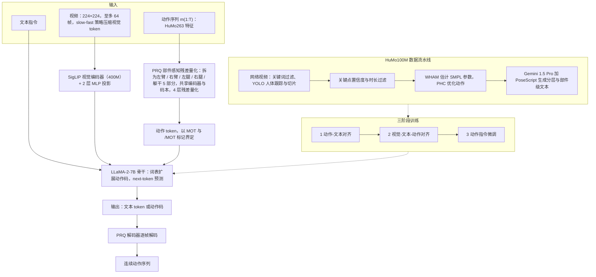

# Being-M0.5

**Being-M0.5: A Real-Time Controllable Vision-Language-Motion Model** 收录于 [Robot Learning Paper Notebooks](https://imchong.github.io/Robot_Learning_Paper_Notebooks/index.html)（分类：14_Human_Motion）。本页已对照 arXiv 原文（v1，2025-08-11）的方法、实验、附录 A/B 编写；深读笔记作为阅读锚点保留。

## 一句话定义

人类动作生成潜力巨大，但现有视觉-语言-动作模型（VLMM）实用部署受限。作者指出可控性是主瓶颈，体现在五方面：对多样人类指令响应不足、姿态初始化能力有限、长序列表现差、对未见场景处理不足、缺乏对各身体部位的细粒度控制。为此提出Being-M0.5，并引入 HuMo100M ——迄今最大最全的人类动作数据集（500 万+ 自采动作序列、1 亿条多任务指令实例、细粒度部位级标注）。方法用部位感知残差量化（part-aware residual quantization）做动作 token 化，实现逐部位的精细控制。模型在多个动作生成基准上达 SOTA，同时保持实时执行效率。

## 英文缩写速查

| 缩写 | 含义 |
|---|---|
| VLMM | Vision-Language-Motion Model，视觉-语言-动作（人体动作）模型 |
| PRQ | Part-aware Residual Quantization，部位感知残差量化（动作 token 化器） |
| RQ / VQ | Residual Quantization（残差量化）/ Vector Quantization（向量量化），PRQ 的对照基线 |
| HuMo100M | 本文构建的大规模人类动作与指令数据集 |
| HuMo263 | 本文基于 SMPL 参数的动作特征，替代需要 IK 的 HM3D263 |
| SMPL | 参数化人体网格模型，HuMo263 直接取其旋转与前向运动学输出 |
| SigLIP | 本文视觉编码器（400M），经 2 层 MLP 投影到 LLM |
| LLM | 大语言模型骨干（LLaMA-2 7B） |
| I2M / I2PM / I2LM / I2U | Instruct-to-Motion / PartMotion / LongMotion / Unseen，论文的四类指令任务 |
| MPI | Motion Prediction and In-between，动作预测与中间帧补全任务 |
| FID | Fréchet Inception Distance，动作分布质量指标（越低越好） |
| R-Precision (R@1/R@3) | 文本-动作检索准确率，衡量语义对齐 |
| MMDist | 文本与动作在共享嵌入空间中的距离（越低越好） |
| MPJPE | Mean Per Joint Position Error，关节位置误差（mm） |

## 为什么重要

- **逐部位细粒度控制**对人形全身动作（上身操作 + 下身行走分控）有借鉴；
- **大规模动作数据 + 量化 token 化**是动作生成模型的主流配方，可迁移到人形动作生成（FRoM-W1、UniAct 等（未核实：本论文未提及这两项））；
- **可控性五维度**是评估动作生成是否实用的好框架；
- 动作生成是人形"语言→动作"上游的关键一环。

## 流程总览

图依据：论文 §3.1 至 §3.3（模型总览、PRQ、实时设计）、§4.1（数据构建）/ Fig. 2、Fig. 3。

## 解决什么问题

VLMM 的**可控性**不足（五大短板）：响应多样指令差、姿态初始化弱、长序列差、未见场景差、**缺逐部位细粒度控制**。论文要：一个**实时、可控**、能逐部位控制的 VLMM，并配足够大的数据。

## 核心原理

**输入 → 机制 → 输出。**

- **输入**：文本指令；可选视频帧（224×224，至多 64 帧）；动作序列（HuMo263：关节相对 6D 旋转 126 维、根节点 4 维、SMPL 前向运动学关节位置 63 维、脚接触 4 维，论文正文列出的分量之和为 197，与名称中的 263 的对应关系正文未说明（未核实））。
- **动作 token 化（PRQ）**：每帧动作特征按 5 个部位拆分（左臂、右臂、左腿、右腿、躯干），部位之间共享骨盆与 spine1–3 等关节（附录 B）。共享编码器以 4 倍时间降采样得到潜变量，每个潜变量在**共享码本**（1024 条、512 维）中做量化，共 4 层残差。各部位独立做残差迭代：

$$b_k = Q(r_k), \qquad r_{k+1} = r_k - b_k, \qquad k = 0, \dots, K$$

  训练损失为各部位与整体的 L1 重建项加上逐层码本嵌入项（论文式 4）。组合直觉：每个部位各自从码本中选码，因此可表示的动作组合数随部位数增长，而非只能用一个整体码。
- **LLM 生成**：动作码以新增特殊 token 进入 LLM 词表，由 `<MOT>` 与 `</MOT>` 界定。模型用标准 next-token 负对数似然训练（论文式 1）：

$$\mathcal{L}(\Theta) = -\sum_{j=1}^{L} \log P_\Theta\left(y_j \mid X_Q, \hat{y}_{1:j-1}\right)$$

- **输出**：文本 token 或动作码；动作码由 PRQ 解码器**逐帧**解码为连续动作序列。与标准 RQ 的逐层生成相比，逐帧解码让输出可以边生成边播放（见 [工程实践](#工程实践)）。

核心贡献概览：

1. **诊断** VLMM 可控性五大短板（指令、姿态初始化、长序列、未见动作、部位控制），并为每项设计一个指令任务；
2. **HuMo100M**：论文称迄今最大的人类动作数据集（500 万+ 动作序列、1 亿指令实例、部位级标注）；
3. **部位感知残差量化**：逐部位细粒度控制；
4. **实时**：论文报告多基准领先且量化后保持实时帧率。

## 核心信息

| 字段 | 内容 |
|------|------|
| 分类 | 14_Human_Motion |
| 深读笔记 | <https://imchong.github.io/Robot_Learning_Paper_Notebooks/papers/14_Human_Motion/Being-M0.5__A_Real-Time_Controllable_Vision-Language-Motion_Model/Being-M0.5__A_Real-Time_Controllable_Vision-Language-Motion_Model.html> |
| arXiv | <https://arxiv.org/abs/2508.07863> |
| 项目页 | <https://beingbeyond.github.io/Being-M0.5> |
| 代码 | 未发布：仓库 README 写明 "We will release our code and part of our dataset soon"（核查日 2026-11-06），见 [工程实践](#工程实践) |
| 作者 | Bin Cao、Sipeng Zheng、Ye Wang、Lujie Xia、Qianshan Wei、Qin Jin、Jing Liu、Zongqing Lu（CASIA、UCAS、BAAI、PKU、RUC、SEU、BeingBeyond） |
| 发表 | arXiv 2025 年 8 月（v1，2025-08-11）；仓库 README 引用为 ICCV 2025 |
| 笔记阅读日期 | 2026-06-21 |

## 工程实践

| 项 | 内容 |
|---|---|
| 模型规模 | 7B 参数：SigLIP 400M 视觉编码器 + 2 层 MLP + LLaMA-2 7B（正文同时出现 "chat" 与非 chat 表述，未核实） |
| tokenizer 训练 | batch 256，学习率 1e-4，30 万 iteration（§5.1.3） |
| VLMM 三阶段训练 | 阶段 1 动作-文本对齐：16×A800，batch 2048，50 epoch，lr 2e-5，全参数微调；阶段 2 视觉-文本-动作对齐：batch 128，5 epoch；阶段 3 动作指令微调：batch 128，1 epoch |
| PRQ 关键参数 | 5 部位、4 层残差、码本 1024 × 512 维、时间降采样 4×；4 层 PRQ 为论文选定的质量-效率折中（层数增加会损害生成，见 Table 6） |
| 视觉输入 | 224×224，至多 64 帧，slow-fast 策略压缩视觉 token |
| 推理加速 | 论文用 llama.cpp 推理，4-bit 量化下各测试 GPU（RTX3090、A6000、A800、RTX4090、A100、H100）均 ≥ 20 FPS，H100 峰值 28.9 FPS（Fig. 5）；维持 20 FPS 约需每秒 100 个 token |
| 解码策略 | 逐帧解码；论文称层级解码（RQ）会带来数十秒级延迟 |
| 动作长序列数据 | 插值拼接：朝向对齐 → 全局平移对齐 → 经中性站姿用 Slerp 过渡；学习式拼接：约 50% 遮挡的预训练 T2M 模型微调做中间帧补全；两者串联 |
| 数据构建 | 网络视频（论文称收集 2000 万+ 视频）→ 关键词过滤 → YOLO 跟踪与切片 → 关键点置信度与时长过滤 → WHAM 估计 SMPL → PHC 优化 → Gemini 1.5 Pro + PoseScript 生成文本（阈值未在正文给出（未核实）） |
| 调试与评测指标 | 生成：FID、R-Precision、MMDist；重建与预测：MPJPE、FID；部位控制：左右互换测试成功率（50 句，论文报告 76%） |
| 机器人应用 | 论文未给出真机结果；动作为人体 SMPL 表示，映射到人形本体需另加重定向与可行性过滤（属于推断，未在论文中验证） |
| 源码运行时序图 | **不适用**（代码与部分数据尚未发布，README 仅有占位说明，无可运行训练 / 推理入口；步骤 2.5 判定为未开源） |

## 实验与评测

论文在 9 类任务上与既有方法比较（§5.1.1），主要新建基准为 HuMo-T2M、HuMo-I2M、HuMo-Unseen、HuMo-I2PM、HuMo-I2LM、HuMo-MPI，均从 HuMo100M 采样。以下数字取自论文表格：

- **文本到动作（HumanML3D，Table 1）**：vanilla VQ 版本（Being-M0.5-VQ1）FID 0.141；换为 PRQ4 后 FID 0.056，R@1 0.535，R@3 0.821，MMDist 2.865。对照：MoMask-RQ6 FID 0.045、R@1 0.521、MMDist 2.958；ScaMo-FSQ FID 0.101。**注意：PRQ4 的 FID 高于 MoMask-RQ6，论文正文称 "consistently outperforms" 与此不完全一致；论文 §5.4.4 承认 PRQ 在 HumanML3D FID 上更高，但 R@ 与 MMDist 更好。**
- **指令到动作（HuMo-I2M，Table 2，仅纳入公开训练代码的方法）**：PRQ4 FID 0.148、R@1 0.428、R@3 0.625、MMDist 3.259；MotionGPT-2（LLaMA-13B）FID 0.314，MoMask-RQ6 FID 0.324。
- **未见动作（HuMo-Unseen，Table 3）**：训练数据从 HumanML3D 换为 MotionX 再到 HuMo100M，FID 由 65.04 降到 43.28 再降到 8.65，R@1 由 0.068 升到 0.092 再到 0.136。
- **部位控制（HuMo-I2PM，Table 6 消融）**：PRQ4（带部位标注）FID 1.831，最优；去掉共享关节 2.471；RQ6 带部位标注 3.752；PRQ6 2.357（层数增加反而变差）。
- **部位控制（HumanML3D 部位文本，Table 5）**：ParCo FID 0.109、Fg-T2M++ 0.089、Being-M0.5 PRQ4 FID 0.056。左右互换测试：Being-M0.5 76%，ParCo 64%，T2M 46%。
- **多任务训练（HuMo-T2M，Table 8）**：五任务联合训练 FID 5.791；去掉 I2LM 后为 5.765，去掉 I2PM 后为 5.952（论文称对 T2M 影响小，但对各自专项基准提升更明显）；去掉 MPI 后 FID 由 6.052 升至 6.582（论文称 MPI 使模型能从随机姿态起始生成）。
- **视觉片段（HuMo-T2M，Table 7）**：去掉第二阶段视觉训练 FID 7.053，完整模型 5.791。
- **九个基准的 SOTA 对比（Fig. 4）**：图中数值文本抽取错乱，未逐项核对（未核实）；论文称在所列基准上优于前人 SOTA。

## 与其他工作对比

| 维度 | 本文 Being-M0.5 | 论文中的对照 |
|---|---|---|
| 动作 token 化 | 5 部位 PRQ，共享码本，4 层，逐帧解码 | VQ（单码）、RQ（MoMask，6 层，逐层解码）、FSQ / LFQ（SCaMo、2D-LFQ） |
| 动作特征 | HuMo263（SMPL 直接输出，无 IK） | HM3D263（需 IK 后处理）；MoMask 依赖 IK |
| 指令模型 | LLaMA-2 7B + 视觉 SigLIP | MotionGPT（T5 / LLaMA-13B）、MotionLLM、LMM（LLaMA3-8B） |
| 实时性 | 4-bit 下 ≥ 20 FPS，比 MoMask 略慢（token 数 >3×） | MoMask 实时生成但需 IK |
| 部位控制 | 原生部位 token + 部位标注 | ParCo（上下半身）、Fg-T2M++（细粒度文本） |

论文的 "PRQ 比 RQ 更好" 结论主要来自自建基准（HuMo-I2PM）与 HumanML3D 的 R@ / MMDist，而非所有指标。

## 结论

**Being-M0.5 把人类动作生成的瓶颈从「生成质量」重新定义为「可控性」，并用「超大数据 + 部位级 token 化」这一条工程路线，同时换取细粒度控制与实时性。**

- 真正起作用的机制是**部位感知残差量化**：动作按身体部位 token 化，逐部位的细粒度控制才有落点。论文的消融显示共享关节（Table 6：FID 1.831 对 2.471）与部位标注（RQ6 3.752 对 PRQ4 1.831）都有贡献；数据侧由 HuMo100M（500 万+ 动作序列、1 亿条多任务指令实例、部位级标注）兜底。
- 论文自定的**可控性五维度**（多样指令响应、姿态初始化、长序列、未见场景、部位级控制）本身就是一个比单看基准分数更有判别力的评估框架，且每个维度都对应一个可复现的指令任务设计。
- 关键取舍是「SOTA 同时保持实时执行效率」：论文用 4 层 PRQ 与逐帧解码换取实时性，代价是 token 数与延迟高于 MoMask，且层数增加会伤害生成质量。这一点比基准分数更能说明它的工程定位。
- 适用边界：对象是人类动作生成（VLMM），处在人形「语言→动作」链路的**上游**；上下身分控等借鉴需再经一层机器人本体适配，论文未给出真机结果。
- 证据边界：代码未发布，多数基准为作者自建，结论基于论文自报数字，尚未独立复现；HumanML3D 上 FID 并非全面领先（见 实验与评测）。

## 局限与风险

- **代码未发布**：项目页链接的 GitHub 仓库 README 仅写明 "We will release our code and part of our dataset soon"（核查日 2026-11-06），无可运行入口。因此无法复现 PRQ 与训练流程，本页的 "已开源" 不成立。注意：[sources/repos/being-m0_5.md](../../sources/repos/being-m0_5.md) 目前写为 "已开源"，与此核查结果不符，需另行修正（本次未改动该文件）。
- **评测偏向**：大多数基准（HuMo-T2M、I2M、Unseen、I2PM、I2LM、MPI）由作者从 HuMo100M 采样构建，部位标注与指令由 Gemini 1.5 Pro 等 LMM 生成，与训练数据同源，对比结果需谨慎解读。
- **HumanML3D 上并非全面领先**：PRQ4 的 FID（0.056）高于 MoMask-RQ6（0.045），论文正文的 "consistently outperforms" 表述需以表格为准。
- **Baseline 不完全统一**：论文称各基线使用相同动作数据，但不同方法使用的模型规模（GPT-2 至 LLaMA-13B）与训练设置差异大；Table 2 仅纳入公开训练代码的方法。
- **数据质量**：网络视频经 YOLO 跟踪、WHAM 与 PHC 处理，遮挡 / 模糊过滤依赖关键点置信度阈值（阈值未在正文给出（未核实））；作者自己承认低质量动作需视觉弱监督补偿。
- **部署延迟**：4-bit、llama.cpp 下的 FPS 是离线推理测速，不含机器人控制回路的通信与执行延迟；7B 模型显存占用高于 <1B 模型。
- **层数与解码的权衡**：PRQ 层数增加（如 PRQ6）会改善重建但损害生成（Table 6）；frame-by-frame 解码是论文自陈的设计依赖。
- **功能边界**：视频到动作估计（motion estimation）仅在论文中作为 "future work" 提及，不能视为已验证能力。

## 与其他页面的关系

- 分类父节点：[paper-notebook-category-14-human-motion](../overview/paper-notebook-category-14-human-motion.md)
- 总索引：[humanoid-paper-notebooks-index.md](../overview/humanoid-paper-notebooks-index.md)
- 统一多模态 token 思路：[unified-multimodal-tokens](../methods/unified-multimodal-tokens.md)（动作码进入 LLM 词表的同类做法）
- 语言到动作的上游位置：[VLA](../methods/vla.md)
- 动作数据与 SMPL 表示：[motion-retargeting](../concepts/motion-retargeting.md)（HuMo263 与重定向数据链路的上下文）

## 参考来源

- [being-m0-5_arxiv_2508_07863.md](../../sources/papers/being-m0-5_arxiv_2508_07863.md)（arXiv 原文归档）
- [Being-M0.5 源码归档](../../sources/repos/being-m0_5.md)（<https://github.com/BeingBeyond/Being-M0.5>）
- [humanoid_pnb_being-m0-5.md](../../sources/papers/humanoid_pnb_being-m0-5.md)
- 深读笔记：<https://imchong.github.io/Robot_Learning_Paper_Notebooks/papers/14_Human_Motion/Being-M0.5__A_Real-Time_Controllable_Vision-Language-Motion_Model/Being-M0.5__A_Real-Time_Controllable_Vision-Language-Motion_Model.html>
- 论文：<https://arxiv.org/abs/2508.07863>
- [arXiv PDF](https://arxiv.org/pdf/2508.07863)：已通读全文（摘要、§1 至 §6、参考文献之前的正文，附录 A 与 B；附录图 9 至图 14 仅为可视化与词云，未逐图核读）

## 推荐继续阅读

- [机器人论文阅读笔记：Being-M0.5](https://imchong.github.io/Robot_Learning_Paper_Notebooks/papers/14_Human_Motion/Being-M0.5__A_Real-Time_Controllable_Vision-Language-Motion_Model/Being-M0.5__A_Real-Time_Controllable_Vision-Language-Motion_Model.html)
- [Being-M0.5 项目页](https://beingbeyond.github.io/Being-M0.5)（含可视化与补充材料）
- [Being-M0.5 GitHub 仓库](https://github.com/BeingBeyond/Being-M0.5)（截至核查日仅占位 README，代码待发布）
