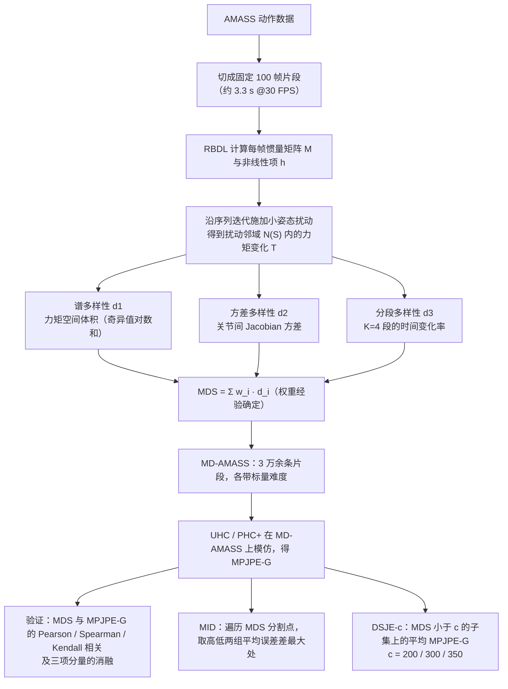

# Benchmarking Humanoid Imitation Learning with Motion Difficulty

**Benchmarking Humanoid Imitation Learning with Motion Difficulty** 收录于 [Robot Learning Paper Notebooks](https://imchong.github.io/Robot_Learning_Paper_Notebooks/index.html)（分类：11_Simulation_Benchmark）。本页为 **清单索引实体**，链向深读笔记与原始论文；详细机制待从笔记消化后补充。

## 一句话定义

现有人形模仿学习的指标（如关节位置误差 MPJPE）只衡量「策略学得多像」，却没法告诉你「这段动作本身有多难」——本文用刚体动力学给出一个与策略无关的 Motion Difficulty Score (MDS)：对参考姿态做小扰动后看产生的力矩变化空间，从体积 / 方差 / 时间变化率三个维度算难度；再用 MDS 把 AMASS 重新切成难度分层的 MD-AMASS，并配套两个新指标 MID（最大可模仿难度） 与 DSJE（按难度分层的关节误差）——首次把「比 SOTA」变成「在每个难度档分别比 SOTA」。（arXiv 当前版本 v2 题为《Distinguishing Imitation Error from Intrinsic Motion Learning Difficulty》，并把指标 MDS 改称 TVS（Torque Variation Score）；本页按 v1 的题名与指标名 MDS 撰写，沿用清单所列题名。）

## 英文缩写速查

| 缩写 | 英文全称 | 简要说明 |
|------|----------|----------|
| RL | Reinforcement Learning | 通过与环境交互最大化长期回报来学习策略 |
| WBC | Whole-Body Control | 协调全身关节满足多任务/约束的控制基础设施 |
| Sim2Real | Simulation to Real | 把仿真中学到的策略迁移落地真机的工程主线 |

## 为什么重要

- 列入 Paper Notebooks 策展清单，便于与全库 [机器人学习论文笔记总索引](../overview/humanoid-paper-notebooks-index.md) 及分类父节点交叉检索。
- 深读笔记提供比摘要更贴近实现的阅读路径，适合作为后续 ingest 深化起点。

## 流程总览

图依据：论文 v1 §4（Fig. 2、Fig. 3）、§5、§6。

## 核心信息

| 字段 | 内容 |
|------|------|
| 分类 | 11_Simulation_Benchmark |
| 深读笔记 | <https://imchong.github.io/Robot_Learning_Paper_Notebooks/papers/11_Simulation_Benchmark/Benchmarking_Humanoid_Imitation_Learning_with_Motion_Difficulty/Benchmarking_Humanoid_Imitation_Learning_with_Motion_Difficulty.html> |
| arXiv | <https://arxiv.org/abs/2512.07248> |

## 实验与评测

- 本页为 **策展清单索引** 摘要；量化 benchmark、消融与实机指标以 **深读笔记与论文 PDF** 为准（链接见 [参考来源](#参考来源)）。

## 结论

**这篇改的是评测的坐标系而不是方法：先给动作本身定一个与策略无关的难度，再要求所有比较都在同一难度档内进行。**

- 核心构件是 **MDS（Motion Difficulty Score）**：从刚体动力学出发，对参考姿态做小扰动、观察由此产生的力矩变化空间，从体积 / 方差 / 时间变化率三个维度打分；**与策略无关** 是它能当尺子的前提。
- 配套产物是难度分层的 **MD-AMASS** 切分，以及 **MID**（最大可模仿难度）与 **DSJE**（按难度分层的关节误差）两个指标，把「比 SOTA」改写成「在每个难度档分别比 SOTA」。
- 它要纠正的盲区很明确：MPJPE 这类指标只反映策略「学得多像」，不反映「这段动作本身有多难」，聚合数字因此会被容易的动作稀释。
- 适用边界：难度定义建立在刚体动力学与力矩敏感度之上，衡量的是动力学意义上的难，不覆盖感知或任务语义层面的难度。
- 本页为策展笔记摘要，量化 benchmark 与消融以 [参考来源](#参考来源) 中的深读笔记与论文 PDF 为准。

## 与其他页面的关系

- 分类父节点：[paper-notebook-category-11-simulation-benchmark](../overview/paper-notebook-category-11-simulation-benchmark.md)
- 总索引：[humanoid-paper-notebooks-index.md](../overview/humanoid-paper-notebooks-index.md)

## 参考来源

- [humanoid_pnb_benchmarking-humanoid-imitation-learning-with-mo.md](../../sources/papers/humanoid_pnb_benchmarking-humanoid-imitation-learning-with-mo.md)
- 深读笔记：<https://imchong.github.io/Robot_Learning_Paper_Notebooks/papers/11_Simulation_Benchmark/Benchmarking_Humanoid_Imitation_Learning_with_Motion_Difficulty/Benchmarking_Humanoid_Imitation_Learning_with_Motion_Difficulty.html>
- 论文：<https://arxiv.org/abs/2512.07248>
- [arXiv PDF](https://arxiv.org/pdf/2512.07248v1)：已通读方法部分（实验与附录以略读为准）：v1 §3 预备、§4 MDS 基准（含 MD-AMASS）、§5 验证、§6 MID / DSJE；v2 仅核对摘要与指标改名。arXiv 版本史：v1（2025-12-08）题为 Benchmarking Humanoid Imitation Learning with Motion Difficulty（指标 MDS），v2（2026-06-08）改题为 Distinguishing Imitation Error from Intrinsic Motion Learning Difficulty（指标 TVS）。

## 推荐继续阅读

- [机器人论文阅读笔记：Benchmarking Humanoid Imitation Learning with Motion Difficulty](https://imchong.github.io/Robot_Learning_Paper_Notebooks/papers/11_Simulation_Benchmark/Benchmarking_Humanoid_Imitation_Learning_with_Motion_Difficulty/Benchmarking_Humanoid_Imitation_Learning_with_Motion_Difficulty.html)
