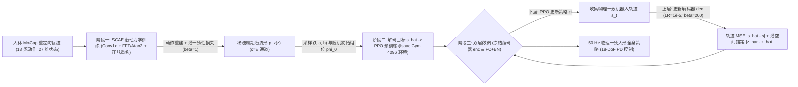

# Bi-Level Motion Imitation for Humanoid Robots

**Bi-Level Motion Imitation for Humanoid Robots**（CoRL 2024）已列入 [Robot Learning Paper Notebooks](https://imchong.github.io/Robot_Learning_Paper_Notebooks/index.html) 的 **PROGRESS.md** 清单（分类：05_Locomotion）。本页基于 CoRL 2024 原文全文核对补全核心机制、方法流程图、MIT 人形仿真指标与局限（保留 `status: stub` 待深读笔记归档）。

## 一句话定义

BMI（Bi-Level Motion Imitation）是一种面向欠驱动与力矩受限人形机器人的纯数据驱动双层运动模仿框架：先通过带潜空间重建正则的自洽自编码器（SCAE）提取稀疏周期性运动流形，再在双层微调阶段交替更新机器人跟踪策略（PPO）与运动解码器，使参考轨迹贴合机器人真实动力学而不偏离原始人体动捕模式。

## 英文缩写速查

| 缩写 | 英文全称 | 简要说明 |
|------|----------|----------|
| BMI | Bi-Level Motion Imitation | 本文框架：交替优化机器人策略与参考动作解码器的双层模仿学习方法 |
| SCAE | Self-Consistent Auto-Encoder | 本文提出的自洽自编码器：在 FLD 上增加重编码潜空间一致性损失 |
| FLD | Fourier Latent Dynamics | 基于可微傅里叶变换的多步前向潜动力学模型（本文主要对比基线） |
| PAE | Periodic Autoencoder | 周期性自编码器，将潜空间参数化为频率、振幅、偏置与相位 |
| MoCap | Motion Capture | 人体动作捕捉数据（经运动学重定向后用于人形模仿训练） |
| PPO | Proximal Policy Optimization | 近端策略优化强化学习算法（用于训练 50 Hz 关节跟踪策略） |

## 为什么重要

- **纯数据驱动解决 MoCap 参考「物理不可行」痛点**：由于人体与真实人形机器人在自由度与关节力矩上限上存在差异，直接跟踪运动学重定向轨迹会导致策略退化或失败；不同于依赖显式动力学模型和人工接触约束的轨迹优化（如 DOC），BMI 直接在隐空间约束下微调解码器生成物理可行参考。
- **单策略同时掌握 13 种高难度动态动作**：相比 FLD 仅能良好学习 9 种温和步态（run、jog 等），BMI 在不修改奖励函数的前提下，在 MIT Humanoid 上以单个策略同步学会了高动态的 `kick` 与 `jump`，踢腿时间占比由 FLD 的 **64.4%** 提升至 **71.3%**。
- **与 [机器人学习论文笔记总索引](../overview/humanoid-paper-notebooks-index.md) 及 [移动控制分类页](../overview/paper-notebook-category-05-locomotion.md) 衔接**：展示了「周期性潜流形 + 双层在线参考自适应」在人形全身运动模仿中的工程路径。

## 核心信息

| 字段 | 内容 |
|------|------|
| 分类 | 05_Locomotion |
| 作者 / 机构 | Wenshuai Zhao、Yi Zhao、Joni Pajarinen（Aalto University）；Michael Muehlebach（MPI for Intelligent Systems） |
| 会议出处 | 8th Conference on Robot Learning (CoRL 2024), Munich, Germany |
| 项目页 | <https://sites.google.com/view/bmi-corl2024> |
| 实验载体与仿真器 | **MIT Humanoid**（18 可控关节，保持原力矩/限位约束），**Isaac Gym**（4096 并行环境，50 Hz 控制） |
| 状态与动作维度 | 动力学状态 27 维；策略观测 103 维；动作 18 维关节目标位姿（下肢 PD `30/5`，上肢 PD `40/5`） |
| 深读状态 | 待撰写（[PROGRESS.md](https://github.com/ImChong/Robot_Learning_Paper_Notebooks/blob/main/papers/PROGRESS.md)） |
| 计划文件夹 | `papers/05_Locomotion/bi-level-motion-imitation-for-humanoid-robots` |

## 核心机制（归纳）

> 注：以下机制与实验数据均依据 CoRL 2024 原文（含 Appendix A.1–A.4）核对整理。

BMI 采用三阶段训练流程（§4 & Algorithm 1）：

1. **阶段一：自洽潜动力学模型（SCAE，§4.1 & A.3.3）**：
   - 输入长度为 $H=51$、每步 27 维（基座线速度 $v$、基座角速度 $w$、局部重力投影 $g$ 及 18 维关节角 $q$）的轨迹段 $\tau_t$，经 3 层 1D 卷积编码器（通道 `64 -> 64 -> 8`，卷积核 51，BN + ELU）映射至 $c=8$ 通道的潜嵌入 $z_t$。
   - 沿用 FLD / PAE 的周期参数化：经可微 **FFT** 层输出频率 $f_t$、振幅 $a_t$ 与偏置 $b_t$，另设全连接层 + BN + `Atan2` 输出相位 $\phi_t$；通过正弦重构 $\hat{z}_t = a_t \sin(2\pi(f_t T + \phi_t)) + b_t$ 并在多步前向区间（$N=50$ 步，$\phi_{t+i} \approx \phi_t + i f_t \Delta t$，$\Delta t = 0.02\text{ s}$）解码出预测轨迹 $\hat{\tau}'_{t+i}$。
   - **自洽正则化（Eq. 5）**：传统 FLD 仅最小化动作空间重构误差，易对重定向噪声过拟合；SCAE 将解码后的 $\hat{\tau}'_{t+i}$ 再次送入编码流程获得重编码潜嵌入 $\bar{\hat{z}}'_{t+i}$，损失函数定义为：
     $$L_{\text{SCAE}}^N = \sum_{i=0}^{N} \alpha^i \left(|\hat{\tau}'_{t+i} - \tau_{t+i}|^2 + \beta |\bar{\hat{z}}'_{t+i} - \hat{z}'_{t+i}|^2\right)$$
     （预训练阶段 $\alpha=1.0, \beta=1$，训练 5000 步）。该项促使模型仅激活少数主频通道，学得比 FLD 更稀疏、紧凑且对解码扰动稳健的运动流形。
2. **阶段二：基于潜采样的策略预训练（§4.2 & A.3.4）**：
   - 从 SCAE 缓冲区 $p_z(z)$ 采样潜参数 $(f_t, a_t, b_t)$ 并均匀采样初始相位 $\phi_0$，每步按 $\phi_t = \phi_{t-1} + f_{t-1}\Delta t$ 步进并由解码器生成目标状态 $\hat{s}_t$。
   - 策略网络（MLP `128-128-128` + ELU，输入 103 维含本体状态、上一动作及潜参数 $\sin\phi, \cos\phi, f, a, b$；输出 18 维目标关节角，以 **PPO** 在 4096 并行环境中训练 3000 步，辅以域随机化与动作平滑/力矩惩罚 $r_R$）学习跟踪解码出的参考动作。
3. **阶段三：潜空间锚定的双层微调（Bi-Level Fine-Tuning，§4.3 & Eq. 8）**：
   - 冻结卷积编码器 `enc` 与相位预测 `FC+BN` 层，外层循环（50 轮）交替求解如下双层优化：
     - **下层（策略更新）**：$\theta_\pi^* \in \arg\min_{\theta_\pi} \mathbb{E}[|\hat{s}_t - s_t|^2]$，利用 PPO 收集机器人真实物理轨迹并提升对当前解码参考的跟踪能力；
     - **上层（解码器更新）**：$\min_{\theta_{\text{dec}}} \mathbb{E}[|\hat{s}_t - s_t|^2 + \beta|\bar{\hat{z}}_t - \hat{z}_t|^2]$（学习率降至 `1e-5`，且将 $\beta$ 提高至 **200** 以平衡量级），使解码器贴近物理可行的人形机器人真实轨迹 $s_t$，同时通过潜重建误差锚定原始 MoCap 运动模式，防止解码器塌缩为原地不动的平庸动作。

### 方法流程图

## 工程实践

- **关键超参与训练调度（Appendix A.3）**：SCAE 预训练阶段使用 `H=51, N=50, c=8, Δt=0.02s, α=1.0, β=1`，学习率 `1e-4` 训练 5000 步；策略预训练在 **Isaac Gym** 中以 **4096 并行环境**、**50 Hz** 运行，PPO 策略与价值网络均为 `128-128-128` ELU MLP（`γ=0.99, ε=0.2, KL target=0.01`），训练 3000 步并施加观测噪声、质量扰动与推力随机化。
- **双层微调防坍缩调参（§4.3 & A.3.5）**：微调阶段仅放开 `dec`（学习率降至 `1e-5`，50 次外层迭代），同时必须把潜重建惩罚系数 $\beta$ 从预训练的 `1` 提升至 **`200`**，否则解码器会快速向低幅静止状态漂移。
- **底层 PD 控制配置（A.3.2）**：MIT Humanoid 共 18 个可控关节，下肢采用 PD 增益 `(30.0, 5.0)`、上肢采用 `(40.0, 5.0)`，保持真机级力矩与关节限位不变。

## 实验与评测

- **数据集与动作扩展（§5, A.3.1）**：在 FLD 的 9 种常规动作（`run`, `jog`, `step fast`, `back`, `side left`, `jog slow`, `side right`, `stride`, `step`）基础上新增 4 种高难度动作（`jump`, `kick`, `spin-kick`, `cross-over`），共 **13 种动作** × 10 条轨迹 × 240 步 = **31,200** 个 52 维状态点。
- **潜动力学表征对比（§5.1, Fig. 3–5, Fig. 8–9）**：
  - SCAE 与 FLD 保持相当的动作空间重建误差，但将潜空间重建误差大幅压低；超参消融（Fig. 8）显示 $\beta \in [0.1, 5]$ 时均可显著降低潜误差而不牺牲动作重构精度（仅 $\beta=10$ 时动作误差略升）。
  - 在 8 通道相位振幅可视化中，SCAE 激活的频率分量明显更少、冗余通道振幅趋近于零，13 种动作在主成分空间呈现出清晰的闭合周期圆环流形。
- **高难度动作策略评测（Table 1，MIT Humanoid，奖励设计保持不变）**：

| 评测动作与物理指标 | FLD | SCAE（仅预训练） | BMI（双层微调） |
|---|---|---|---|
| **Kick（踢腿时间占比 %）** | 64.4 | 61.2 | **71.3** |
| **Kick（踢腿高度 m）** | 0.157 | 0.152 | **0.164** |
| **Jump（腾空时间占比 %）** | 32.5 | **36.2** | 35.2 |

- **稳定性与零样本抗扰（§5.2, Fig. 6, A.4.3）**：
  - Fig. 6 显示在连续踢腿中，BMI 与 SCAE 的支撑脚离地抖动高度显著低于 FLD，站立稳定性更高；
  - 网站附加实验显示：向机器人额外增加 **5 kg** 质量块时策略可零样本 sim-to-sim 保持稳定；双层微调后 `stride` 动作出现符合动力学规律的更大手臂摆动幅度。

## 与其他工作对比

- **对比 FLD（Fourier Latent Dynamics）**：FLD 直接将编码器映射的原始目标交给策略追踪，在新增 4 类高动态动作下若不单独定制奖励极易失败；BMI 通过潜自洽约束与解码器双向微调，无需定制动作奖励即可在 `kick` 与 `jump` 上超越 FLD。
- **对比基于动力学模型的轨迹优化重映射（如 DOC）**：DOC 需精确动力学模型与手工接触约束，难以跨形态泛化；BMI 全程纯数据驱动，通过在线策略交互自动修正参考轨迹的物理可行性。

## 结论

**BMI 证明了「不丢弃、不过滤物理不可行 MoCap 数据，而是用潜空间锚定的双层优化在线修正参考解码器」的可行性：SCAE 的稀疏周期表征既提升了预训练表现，又在微调阶段充当防退化锚点，使 MIT 人形在不变奖励下突破 FLD 在踢腿与跳跃等高动态任务上的瓶颈。**

1. **用自洽潜重建约束（SCAE）替代单纯动作重构损失**：在 $\beta \in [0.1, 5]$ 范围内加入重编码潜空间一致性损失，可在不损伤重建精度的前提下显著稀疏化潜流形并利于下游策略提取任务目标。
2. **双层微调必须冻结编码器并重设 $\beta$ 量级**：仅放开解码器 `dec` 并把 $\beta$ 从 1 提至 **200**（配合低学习率 `1e-5`），才能避免解码器通过「照抄静止机器人轨迹」来偷懒最小化跟踪误差。
3. **关注「合理平衡优先」带来的动作保守倾向**：面对 `spin-kick`、`cross-over` 等强失稳动作时，双层修正仍会优先保平衡而压缩极限姿态（踢腿不抬高、双腿未完全交叉），需额外约束或课程设计。
4. **文档定位**：本页保留 `stub` 状态并已依据 CoRL 2024 原文全文补齐公式、架构与定量指标；待深读笔记撰写后可进一步补充代码实操细节。

## 常见误区或局限

1. **强平衡破坏动作仍未完全攻克（Appendix A.4.3, Fig. 13）**：单策略虽涵盖 13 种动作，但在高度动态的 `spin-kick` 与 `cross-over` 上表现仍不理想，机器人会优先维持不摔倒而牺牲动作幅度。
2. **依赖较好的预训练初值且缺乏通用跟踪评价指标（§6）**：双层微调要求阶段二预训练策略已具备基本跟随能力；同时因为原始参考本就物理不可行，传统轨迹 MSE 无法准确度量优劣，目前仍需针对特定动作手工定义物理指标（如踢腿高度/腾空时间）。
3. **尚未在 AMASS 大规模数据及真机部署上验证（§6）**：当前实验仅限 Isaac Gym 仿真内的 MIT Humanoid（31,200 帧小规模数据集），真机 Sim2Real 与大规模多样动作扩展留待后续；文内仅提供项目网站 `https://sites.google.com/view/bmi-corl2024`，未提供已验证开源代码仓。

## 关联页面

- 分类页：[paper-notebook-category-05-locomotion](../overview/paper-notebook-category-05-locomotion.md)
- 总索引：[humanoid-paper-notebooks-index.md](../overview/humanoid-paper-notebooks-index.md)

## 参考来源

- [humanoid_pnb_bi-level-motion-imitation-for-humanoid-robots.md](../../sources/papers/humanoid_pnb_bi-level-motion-imitation-for-humanoid-robots.md)
- [Robot Learning Paper Notebooks · PROGRESS.md](https://github.com/ImChong/Robot_Learning_Paper_Notebooks/blob/main/papers/PROGRESS.md)
- 项目页（CoRL 2024）：<https://sites.google.com/view/bmi-corl2024>

## 推荐继续阅读

- [Paper Notebooks 阅读进度（PROGRESS.md）](https://github.com/ImChong/Robot_Learning_Paper_Notebooks/blob/main/papers/PROGRESS.md)
