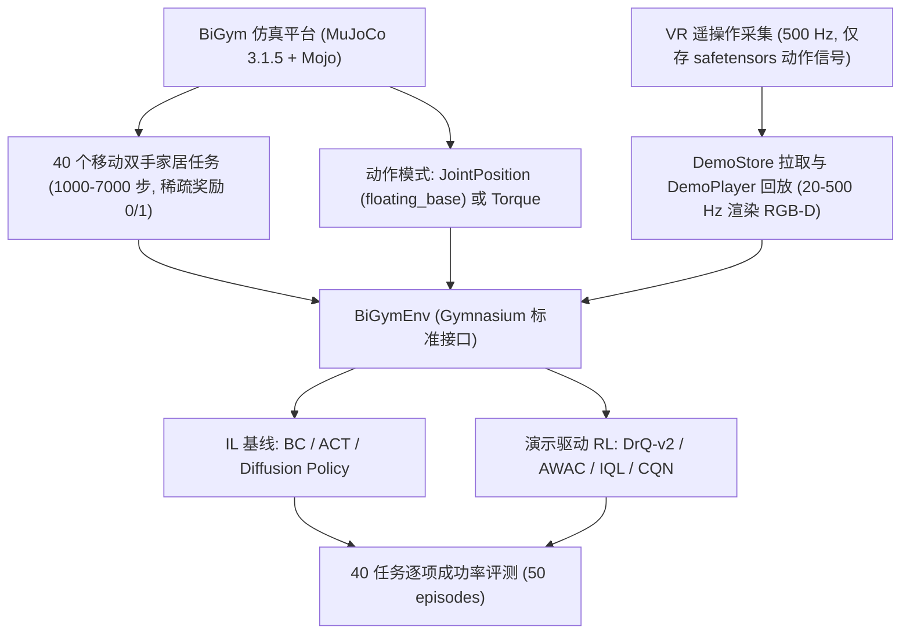
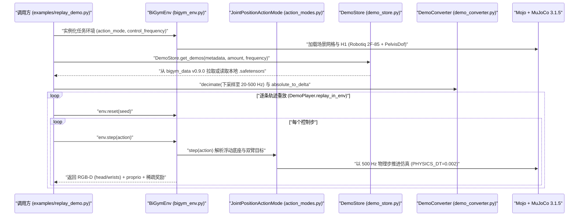

# BiGym

**BiGym: A Demo-Driven Mobile Bi-Manual Manipulation Benchmark** 收录于 [Robot Learning Paper Notebooks](https://imchong.github.io/Robot_Learning_Paper_Notebooks/index.html)（分类：11_Simulation_Benchmark）。本页已对照论文全文（arXiv v2，17 页，正文 §1–§5、附录 A–C、Table 1–2）与官方代码仓库 `chernyadev/bigym` 通读核对并编译。

## 一句话定义

BiGym 是面向移动双手操作的演示驱动 MuJoCo 家居基准，包含 40 个稀疏奖励任务与每任务 50 条 VR 遥操作人类演示，同时支持模仿学习（IL）与演示驱动强化学习（demo-driven RL）在同一 Gymnasium 接口下的统一评测。

## 英文缩写速查

| 缩写 | 英文全称 | 简要说明 |
|---|---|---|
| IL | Imitation Learning | 模仿学习，用人类演示监督策略（本页基线含 BC / ACT / Diffusion Policy） |
| RL | Reinforcement Learning | 强化学习；本页指演示驱动 RL 基线 DrQ-v2 / AWAC / IQL / CQN |
| POMDP | Partially Observable Markov Decision Process | 部分可观测马尔可夫决策过程，论文将移动操作任务形式化为 POMDP |
| BC | Behavior Cloning | 行为克隆，直接使用状态/图像到动作监督拟合的基线策略 |
| ACT | Action Chunking with Transformers | 基于 CVAE 与 Transformer 预测一段动作序列块的策略架构 |
| CVAE | Conditional Variational Autoencoder | 条件变分自编码器，ACT 用于编码演示动作分布的多模态潜空间 |
| RGB-D | Red-Green-Blue-Depth | 彩色图像与深度图像，BiGym 在头部及双腕提供 3 路相机输入 |
| CQN | Coarse-to-fine Deep Q-Network | 由粗到精离散化 Q 网络，演示驱动 RL 基线之一 |

## 为什么重要

- **移动 + 双手**是家务人形机器人的核心能力，BiGym 把它做成可复现的评测床，并提供 40 个任务，从单目标到达到洗碗机、厨柜等铰接物体操作。
- **人类演示更贴近真实数据**：论文指出，以运动规划器生成演示的 RLBench 轨迹常呈直线或不自然，而 BiGym 的人类演示噪声更大、模态更多（图 3）。
- **稀疏奖励、长时程**：论文认为手写形状奖励容易被策略钻空子，因此每个任务只给成功/失败的稀疏奖励，并附 50 条人类演示，同时支持 IL 与 demo-driven RL 的评测。
- **开源工程闭环**：官方仓库以 Apache-2.0 协议开放 MuJoCo/Mojo 任务定义、VR 演示回放器（`DemoStore` / `DemoPlayer`）与 `.safetensors` 轻量化演示轨迹下载，降低了社区复现移动双手操作基准的存储与环境门槛。

## 核心原理

### 输入、机制、输出

- **输入**：三路相机（`head`、`left_wrist`、`right_wrist`）的 RGB 与深度图（默认分辨率 84×84），加本体感受状态 $s_{\text{proprio}}$（`whole-body` 76 维、`bi-manual` 64 维）。
- **机制**：任务建模为 POMDP，策略需要依据历史观测与动作维持环境信念 $b_t$。平台底层通过 `mojo==0.1.1` 封装 `mujoco==3.1.5` 与 `dm_control==1.0.19`，以 500 Hz（`PHYSICS_DT = 0.002`）推进物理仿真。
- **输出**：连续控制动作。全身模式为 23 维（双臂 10、双腿 10、躯干 1、夹爪 2）；`bi-manual` 浮动底座模式为 16 维（双臂 10、底座 $(\delta x, \delta y, \delta z, \delta\theta)$ 4、夹爪 2，默认启用 `PelvisDof` 中的 `X, Y, RZ`）。

### 任务与奖励

- 40 个任务分四组：到达（Reach，3 个）、桌面（Tabletop，5 个）、洗碗机（Dishwasher，13 个）、厨房台面（Kitchen Countertops，19 个），任务长度跨度 1000–7000 步。
- 奖励为稀疏二值奖励：达到成功判据记 1，否则为 0。成功判据为基于几何或关节阈值的手写规则（如腕部到目标距离小于 0.1，洗碗机关节角接近 1 或 0），附录 B 给出逐任务定义。

### 演示采集与轻量存储

- 人类用 VR 头显与手柄遥操作仿真中的 Unitree H1 + Robotiq 2F-85 夹爪：头显位姿驱动身体，手柄 6-DoF 位姿经逆运动学驱动双臂。
- 演示在 500 Hz 下采集时**仅存动作与关键控制状态**到 `.safetensors` 文件（托管于 `bigym_data` Release v0.9.0），不预先打包庞大的视频图像；训练前通过 `DemoPlayer` 在仿真中重放并按 20–500 Hz 频率按需渲染 RGB-D 观测。

图依据：论文 §3.2–§3.4、§4、Fig. 2，以及 `bigym/bigym_env.py`、`bigym/action_modes.py`、`demonstrations/demo_player.py` 源码结构。

## 实验与对比评测

- **IL 基线**：BC、ACT、Diffusion Policy（在 UNet-1D 与 causal Transformer 两种骨干中取表现较高者，存在择优口径）。
- **演示驱动 RL 基线**：DrQ-v2、AWAC、IQL、CQN；均使用统一超参，未逐任务独立调参。
- **评测协议**：每任务 50 eval episodes，统计最后 3 个 checkpoint 聚合后的成功率（%）。

Table 2 中 40 个任务的平均成功率（论文 Average 行）：

| 方法 | 类型 | 平均成功率（%） |
|---|---|---|
| ACT | IL | 46.3 ± 1.4 |
| Diffusion Policy | IL | 20.8 ± 0.8 |
| BC | IL | 18.0 ± 1.1 |
| DrQ-v2 | demo-driven RL | 13.9 ± 0.2 |
| AWAC | demo-driven RL | 13.0 ± 1.2 |
| IQL | demo-driven RL | 12.4 ± 0.0 |
| CQN | demo-driven RL | 10.5 ± 0.4 |

代表性任务分布现象（Table 2）：

- **简单到达与抽屉关闭**：`reach target single`（ACT、DrQ-v2 均为 100%）与 `drawer top close`（全员 100%）已基本饱和。
- **高精度桌面与多物体操作**：`stack blocks` 七种方法全部为 0%；`move two plates` 最高 12.0%（Diffusion Policy）；`flip cup` 最高 21.3%（ACT）。
- **长时程与多铰接任务**：`dishwasher unload cups long` 全员 0%；`dishwasher close` 上 ACT 为 100%、Diffusion Policy 为 99.3%；`cupboards open all` 上 ACT 仅 17.3%。
- **论文 C.2 核心观察**：（1）引入移动底座显著放大高精度铰接与刚体操作难度；（2）长时程子目标依赖任务级规划，无层级模型无关策略全面失效；（3）生成式动作块（ACT / Diffusion Policy）明显优于单步 CNN+MLP；（4）稀疏奖励下离线/演示 RL 基线普遍受困于探索与长时域信用分配。

Table 1 跨基准定位对比（J：关节位置；EE：末端执行器；FB：浮动底座）：

| 基准 | 移动底座 | 手臂数 | 动作模式 | 任务步长 | 人类演示 | 任务数 |
|---|---|---|---|---|---|---|
| MetaWorld | ✗ | 1 | J / EE | 500 | ✗ | 50 |
| RLBench | ✗ | 1 | J / EE | 100–1000 | ✗（规划器） | 106 |
| RoboSuite | ✓ | 1/2 | J / EE | 500 | ✓ | 9 |
| LocoMujoco | ✓ | 0 | J | 100–500 | ✗ | 27 |
| HumanoidBench | ✓ | 2 | J | 500–1000 | ✗ | 27 |
| BiGym | ✓ | 2 | J / J+FB | 1000–7000 | ✓ | 40 |

## 结论

**BiGym 的核心贡献是为「演示驱动的移动双手操作」建立了一套可复现、轻量分发且直面稀疏奖励与多模态人类演示挑战的标准化测试床：在该基准下，ACT 以 46.3% 均值大幅领先 Diffusion Policy（20.8%）与演示驱动 RL（10.5%–13.9%），但长时程及高精度多物体任务仍然大面积归零。**

1. **真实人类演示的多模态挑战**：相比 RLBench 等直线运动规划轨迹，50 条人类 VR 遥操作轨迹包含犹豫、路径分叉与噪声，更能区分生成式动作序列建模与单步 MLP 的拟合上限。
2. **源码级复现已完整闭环**：`chernyadev/bigym` 以 Apache-2.0 协议开放了完整 MuJoCo/Mojo 环境、H1+2F-85 机器人配置与 `DemoStore`/`DemoPlayer` 轻量化 `.safetensors` 演示流，无需下载 TB 级视频。
3. **当前公开演示对动作模式有硬约束**：源码明确限定公开演示集目前仅适配 `JointPositionActionMode(floating_base=True, absolute=True/False)`，切入 `whole-body` 23-DoF 全身控制或力矩控制前需核查轨迹可用性。
4. **基线能力与瓶颈清晰**：ACT 受益于动作块 + CVAE + Temporal Ensembling，但在 `stack blocks`、`dishwasher unload cups long` 上与其余 6 种方法同样为 0%，证明缺乏任务层级与长时记忆仍然是核心瓶颈。
5. **与 BiGym 2.0 的界限**：本文 `bi-manual` 模式使用全向浮动底座代理下半身行走、专注于操作与移动协调；真实双足动态平衡行走下的家居操作请看后续工作 [BiGym 2.0](paper-bigym2-humanoid-household-benchmark.md)。

## 源码运行时序图

以下时序依据 `examples/replay_demo.py`、`demonstrations/demo_store.py`、`demonstrations/demo_player.py`、`demonstrations/demo_converter.py` 与 `bigym/bigym_env.py` 实读代码梳理：

## 工程实践

| 工程项 | 论文 / 源码实际配置 |
|---|---|
| 开源协议与核心依赖 | Apache-2.0；`mujoco==3.1.5`、`mojo==0.1.1`、`dm_control==1.0.19`、`gymnasium`、`safetensors`（`setup.py`） |
| 物理与控制频率 | 物理 500 Hz（`PHYSICS_DT=0.002`）；支持控制下采样 20–500 Hz（`bigym/const.py`） |
| 观测与动作维度 | 3 路 84×84 RGB-D；本体感受 `whole-body` 76 维 / `bi-manual` 64 维；动作 23 维 / 16 维 |
| 演示分发格式 | `DemoStore` 从 `chernyadev/bigym_data` Releases `v0.9.0` 按任务拉取 `.safetensors` 动作流并缓存 |
| 训练与采样超参 | Adam（lr `1e-4`），batch `256`，frame stack `4`；IL 训 150K 步、RL 训 100K 步；RL batch 含 50% 演示经验（附录 C.1） |
| ACT / Diffusion Policy 设定 | ResNet-18 视觉编码；chunk length 16、执行 1 步、开启 Temporal Ensembling |
| 单进程吞吐速度 | 无头服务器（NVIDIA L4 + Xeon Gold 6438Y+）约 400–1400 FPS，随启用相机数变化（附录 A，图 5） |

**工程落地建议：**

1. 优先通过 `DemoStore` 拉取官方 `.safetensors` 轨迹并经 `DemoPlayer` 重放生成观测，避免自行录制前期调试成本；注意使用 `JointPositionActionMode(floating_base=True, absolute=True/False)` 匹配官方演示。
2. 回放前对 `DemoStore` 拉取的演示运行一遍校验过滤，因 `README.md` 明确指出并非全部历史演示都能通过当前校验逻辑。
3. 若训练 IL 基线，优先从 ACT 入手记录分任务成功率，避免用 40 任务平均值掩盖 `stack blocks` 等 0% 长时程瓶颈任务。

## 常见误区与局限

- **纯仿真基准且为浮动底座代理**：论文未包含真机实验；`bi-manual` 模式下腿部由全向浮动底座与经典控制器替代，未耦合双足真实动力学稳定性（真双足操作见 [BiGym 2.0](paper-bigym2-humanoid-household-benchmark.md)）。
- **RL 未逐任务调参且 Diffusion Policy 存在择优**：演示驱动 RL 使用统一超参导致多任务 0%，不可直接解释为方法理论上限；Diffusion Policy 表格分数取 UNet-1D 与 Transformer 中的较高者。
- **公开演示与文本校验小幅瑕疵**：`README.md` 提示并非所有录制演示均通过校验且 `TorqueActionMode` / 无浮动底座演示暂缺；论文正文称 `put cups` 全员失败而 Table 2 列出 ACT 为 `30.0 ± 7.2%`，统计 `±` 定义与种子数未写明。
- **图像分辨率与稀疏判据边界**：默认 84×84 图像对精细插装与小物体对位偏低，而成功判据为手写几何/关节阈值，与现实语义成功不完全等价。

## 关联页面

- 分类父节点：[paper-notebook-category-11-simulation-benchmark](../overview/paper-notebook-category-11-simulation-benchmark.md)
- 总索引：[humanoid-paper-notebooks-index.md](../overview/humanoid-paper-notebooks-index.md)
- 评测选型：[具身评测与基准选型闭环](../queries/embodied-eval-benchmark-selection-loop.md)
- 后续工作：[BiGym 2.0](paper-bigym2-humanoid-household-benchmark.md)
- 同期对比：[robocasa](robocasa.md) · [paper-act](paper-act.md) · [mujoco](mujoco.md)
- 任务与方法：[bimanual-manipulation](../tasks/bimanual-manipulation.md) · [loco-manipulation](../tasks/loco-manipulation.md) · [imitation-learning](../methods/imitation-learning.md) · [behavior-cloning](../methods/behavior-cloning.md) · [diffusion-policy](../methods/diffusion-policy.md)

## 参考来源

- [bigym_arxiv_2407_07788_reading.md](../../sources/papers/bigym_arxiv_2407_07788_reading.md)（arXiv:2407.07788 v2 全文通读归档）
- [chernyadev_bigym.md](../../sources/repos/chernyadev_bigym.md)（GitHub 官方仓库源码核对归档）
- [humanoid_pnb_bigym.md](../../sources/papers/humanoid_pnb_bigym.md)（Paper Notebooks 共享摘要归档）
- 项目主页：<https://chernyadev.github.io/bigym/>
- 源码仓库：<https://github.com/chernyadev/bigym>

## 推荐继续阅读

- [论文 PDF（arXiv:2407.07788）](https://arxiv.org/pdf/2407.07788)：附录 B 的 40 任务成功判据与附录 C 的逐任务成功率详情
- [BiGym 官方源码与文档](https://github.com/chernyadev/bigym)：重点查阅 `bigym/action_modes.py` 与 `demonstrations/`
- [机器人论文阅读笔记：BiGym](https://imchong.github.io/Robot_Learning_Paper_Notebooks/papers/11_Simulation_Benchmark/BiGym__A_Demo-Driven_Mobile_Bi-Manual_Manipulation_Benchmark/BiGym__A_Demo-Driven_Mobile_Bi-Manual_Manipulation_Benchmark.html)
