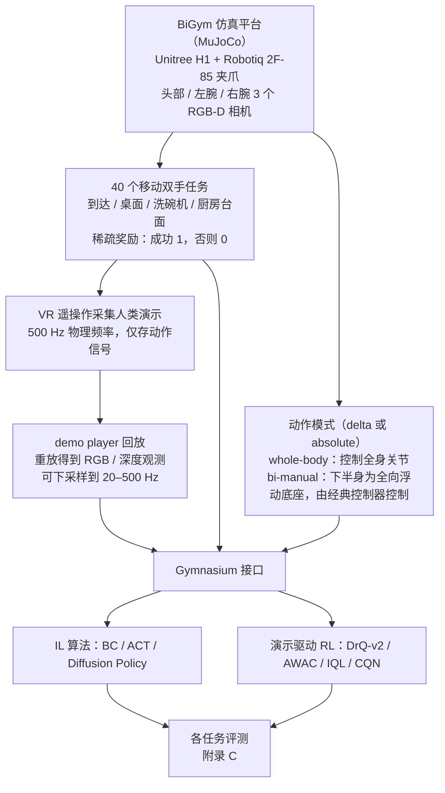

# BiGym

**BiGym: A Demo-Driven Mobile Bi-Manual Manipulation Benchmark** 收录于 [Robot Learning Paper Notebooks](https://imchong.github.io/Robot_Learning_Paper_Notebooks/index.html)（分类：11_Simulation_Benchmark）。本页已对照论文 PDF（arXiv v2，17 页，正文 §1–§5、附录 A–C、Table 1–2）通读核对；深读笔记作为辅助线索，细节以论文原文为准。

## 一句话定义

BiGym 是一个面向移动双手、演示驱动机器人操作的新基准与学习环境。它含 40 个家居任务，从简单到达到复杂厨房清洁。为准确反映真实表现，BiGym 为每个任务提供人类采集的演示，体现真实机器人轨迹的多样模态。它支持多种观测，包括本体感受与视觉输入（3 个相机视角的 RGB 与深度）。为验证可用性，作者在环境中充分评测了当前最佳的模仿学习与演示驱动强化学习算法，并讨论了未来机会。

## 英文缩写速查

| 缩写 | 含义 |
|---|---|
| IL | 模仿学习（Imitation Learning），用演示监督策略，本页基线 BC / ACT / Diffusion Policy 均属此类 |
| RL | 强化学习；本页指演示驱动 RL 基线 DrQ-v2 / AWAC / IQL / CQN |
| Demo-Driven | 演示驱动，训练时利用人类演示（IL 与 demo-driven RL 共用） |
| Bi-Manual | 双手（双臂）操作 |
| Whole-Body | 全身模式，同时控制全身关节（移动与操作）；bi-manual 模式下下半身由经典控制器替代 |
| POMDP | 部分可观测马尔可夫决策过程，论文把任务形式化为 POMDP |
| BC | 行为克隆（Behavior Cloning），IL 中最简单的基线 |
| ACT | Action Chunking with Transformers，预测一段动作序列的 Transformer 策略 |
| CVAE | 条件变分自编码器，ACT 用其编码演示中的动作分布 |
| RGB-D | 彩色图像 + 深度图像，BiGym 每个相机同时提供两者 |
| CQN | Coarse-to-fine Deep Q-Network，演示驱动 RL 基线之一 |

## 为什么重要

- **移动 + 双手**是家务人形机器人的核心能力，BiGym 把它做成可复现的评测床，并提供 40 个任务，从单目标到达到洗碗机、厨柜等铰接物体操作。
- **人类演示更贴近真实数据**：论文指出，以运动规划器生成演示的 RLBench 轨迹常呈直线或不自然，而 BiGym 的人类演示噪声更大、模态更多（图 3）。
- **稀疏奖励、长时程**：论文认为手写形状奖励容易被策略钻空子，因此每个任务只给成功/失败的稀疏奖励，并附 50 条人类演示，同时支持 IL 与 demo-driven RL 的评测。
- 与 RoboCasa 等同期家居基准互补：论文指出 RoboCasa 同样用人类演示，但只覆盖单臂任务；BiGym 的独特点在 **移动 + 双手 + 人类演示** 的组合。

## 核心原理

### 输入、机制、输出

- **输入**：三路相机（头部、左腕、右腕）的 RGB 与深度图，加本体感受 $s_{\text{proprio}}$。默认图像分辨率 84×84。
- **机制**：任务是 POMDP，策略需要维护信念 $b_t$（在历史观测与动作条件下对环境状态的分布）。论文以 IL（BC、ACT、Diffusion Policy）和演示驱动 RL（DrQ-v2、AWAC、IQL、CQN）两类算法在同一环境与同一演示集上比较。
- **输出**：连续动作。全身模式为 23 维（双臂 10、双腿 10、躯干 1、夹爪 2）；bi-manual 模式为 16 维（双臂 10、底座 $(\delta x, \delta y, \delta z, \delta\theta)$ 4、夹爪 2）。

### 任务与奖励

- 40 个任务分四组：到达（3，含单手、多模态、双手）、桌面（5）、洗碗机（13）、厨房台面（19）。
- 奖励为稀疏奖励：达到成功判据记 1，否则为 0。成功判据是手写的几何或关节阈值（如腕部到目标距离小于 0.1，洗碗机关节角接近 1 或 0），附录 B 给出每个任务的定义。

### 演示采集与观测

- 人类用 VR 头显与手柄遥操作仿真中的 H1：头显位姿控制身体，手柄 6 自由度位姿经逆运动学驱动双臂。
- 演示以 500 Hz（物理频率）采集，但只存动作信号；回放时再生成 RGB / 深度观测，并可下采样到 20–500 Hz。
- 每个任务提供 50 条人类演示。

## 流程总览

图依据：基准构建与评测协议图（基准），论文 §3.2 仿真平台与 Fig.2、§3.3 演示采集与管理、§3.4 任务与奖励、§4 实验（评测对象）；各算法的具体结果在附录 C，图中未画数字。

## 工程实践

| 项 | 取值（来源） |
|---|---|
| 物理频率 / 演示下采样 | 500 Hz / 20–500 Hz（§3.3） |
| 观测 | 3 相机 RGB-D；默认分辨率 84×84；本体感受 whole-body 76 维、bi-manual 64 维（附录 A） |
| 动作维度 | whole-body 23 维；bi-manual 16 维（附录 A） |
| 演示数量 | 每任务 50 条（§1） |
| 训练设置 | Adam，学习率 1e-4，batch 256，frame stack 4（附录 C.1） |
| 训练步数 | IL 150K，RL 100K；取最后 3 个 checkpoint 结果（附录 C.1） |
| ACT / Diffusion Policy | 视觉编码 ResNet-18；动作序列长 16、执行 1 步，开启 temporal ensembling（附录 C.1） |
| RL 演示采样 | 每个 batch 50% 来自独立的演示 replay buffer（AW-Opt 设定，附录 C.1） |
| 评测 | 每任务 50 episodes（Table 2） |
| 仿真速度 | 无头服务器（NVIDIA L4 + Xeon Gold 6438Y+）单进程约 400–1400 FPS，取决于相机数（附录 A，图 5） |
| 源码运行时序图 | **不适用**（仓库无法在本会话核实，未读源码，不绘制未经核实的运行时序；见下方开源状态） |

**复现步骤（依据论文 Fig. 4 示例与 §3.3）：**

1. 通过 demo player 拉取演示（论文示例从远端存储获取并缓存到本地），按需下采样到目标控制频率。
2. 选择动作模式：先用 bi-manual 模式降低问题难度，再考虑 whole-body。
3. 以 Gymnasium 接口封装 `env`，IL 基线优先选 ACT 或 Diffusion Policy（论文表中平均成功率最高的两类）。
4. 调试指标：按任务分别记录 success rate（即论文成功判据），不要只看平均值；论文表明平均值会掩盖大量 0% 任务。

**开源状态（步骤 2.5 核查，2026-11-06）：**

- 项目页 https://chernyadev.github.io/bigym/ 的 Code 链接指向 https://github.com/chernyadev/bigym ，论文正文也写明 "Code for BiGym is available on our project website"。
- 本会话访问该 GitHub 仓库返回 403，因此仓库内容、许可证、演示数据的公开可获取性 **（未核实）**。
- 据此开源状态记为 **作者声明已开源，待核实**；在核实前本页不写 `code:` frontmatter，也不绘制源码运行时序图。

## 实验与评测

- **IL 基线**：BC；ACT；Diffusion Policy（UNet-1D 与 causal Transformer 两种骨干中取较高者，存在择优偏差）。
- **演示驱动 RL 基线**：DrQ-v2、AWAC、IQL、CQN。所有 RL 方法使用统一超参，论文说明未针对单个任务调参。
- **指标**：各任务成功率（%），每个任务 50 episodes。

Table 2 中 40 个任务的平均成功率（论文 Average 行）：

| 方法 | 类型 | 平均成功率（%） |
|---|---|---|
| ACT | IL | 46.3 ± 1.4 |
| Diffusion Policy | IL | 20.8 ± 0.8 |
| BC | IL | 18.0 ± 1.1 |
| DrQ-v2 | demo-driven RL | 13.9 ± 0.2 |
| AWAC | demo-driven RL | 13.0 ± 1.2 |
| IQL | demo-driven RL | 12.4 ± 0.0 |
| CQN | demo-driven RL | 10.5 ± 0.4 |

（± 的统计定义论文正文未明确（未核实）；表注仅说明结果取最后三个 checkpoint 聚合。）

逐任务的几个代表性现象（Table 2）：

- 简单到达与抽屉关闭：多数方法接近 100%，例如 reach target single（ACT、DrQ-v2 为 100%）与 drawer top close（全部 100%）。
- 高精度桌面与多物体任务：stack blocks 七种方法全部为 0%；move two plates 上最高仅 12.0%（Diffusion Policy），flip cup 上最高为 21.3%（ACT）。
- 长时程任务：dishwasher unload cups long 全部为 0%。
- 洗碗机 / 橱柜：dishwasher close 上 ACT 为 100%、Diffusion Policy 为 99.3%；cupboards open all 上 ACT 仅 17.3%。

论文 C.2 的四点观察：（1）高精度铰接与刚体操作，加上移动底座后更难；（2）长时程任务需要任务级规划，无层级的模型无关策略全部失败；（3）ACT 与 Diffusion Policy 的生成式表示（CVAE、扩散）和 Transformer / UNet 结构明显优于 BC 与 RL 所用的 CNN + MLP；（4）演示驱动 RL 在稀疏奖励与复杂任务空间下大多失败，且只在最简单的任务上有非零成功率。

## 结论

**BiGym 的价值是给「演示驱动的移动双手操作」提供一把统一的尺子：在同一套人类演示与稀疏奖励下，当前基线只在少数任务上可用，平均表现远低于单臂基准上的常见水平。**

1. **规模与形态是主要贡献**：40 个家居任务覆盖从到达到洗碗机、厨柜的难度谱，且每个任务都配 50 条人类遥操作演示，轨迹噪声与多模态性比规划器生成的演示更接近真实数据。
2. **选型启示**：在本基准上，ACT（平均 46.3%）明显高于 Diffusion Policy（20.8%）与 BC（18.0%），说明带生成式动作表示与 Transformer / UNet 结构的 IL 比简单 CNN + MLP 更能拟合多模态演示。
3. **演示驱动 RL 基线整体偏弱**：DrQ-v2、AWAC、IQL、CQN 平均仅 10.5%–13.9%，多数任务为 0%。这是在统一超参、未逐任务调参下的结果，不能直接视为算法上限。
4. **瓶颈在长时程与信念估计**：stack blocks 与 dishwasher unload cups long 在所有方法上均为 0%，论文归因于任务级规划缺失与 POMDP 的信念估计困难，提示需要层级策略或更强的记忆机制。
5. **观测与动作的取舍需要明说**：bi-manual 模式把下半身换成固定控制器，适合只研究上肢移动操作；whole-body 模式才包含全身运动，两者结论不可直接混用。
6. **边界**：仿真基准，论文未做实机实验；成功判据为手写阈值（如距离 0.1），与真实任务成功的对应关系需要单独验证。

## 局限与风险

- **仿真到真实的差距**：论文只在 MuJoCo 中评测，未包含实机结果；H1 + Robotiq 2F-85 的平行夹爪配置也与真机的灵巧手不同。
- **基线未调参**：RL 基线使用统一超参，IL 基线的 Diffusion Policy 还存在 UNet / Transformer 择优，表格数字更适合做相对比较，不宜当作绝对上限。
- **正文与表格不一致**：正文称 put cups 上「所有算法均失败」，但 Table 2 中 ACT 为 30.0 ± 7.2%（未核实原因，本页以表为准）。
- **统计说明不足**：± 的定义、单次评测的随机种子数量未在正文中说明（未核实）。
- **数据量与质量**：每任务 50 条演示，正文未给出数据量消融；人类演示的操作者差异与质量控制细节见论文附录（正文未展开）。
- **不适用的基线**：3D next-best pose 类方法因依赖关键帧提取，论文未用于移动双臂形态。
- **速度与分辨率**：默认 84×84 图像，论文称这一设定在各任务上够用，但未验证更高分辨率的收益。
- **开源状态未核实**：见「工程实践」中的开源状态说明，复现前需确认仓库可访问与数据获取方式。

## 与其他工作对比

论文 Table 1 将 BiGym 与其他基准比较（J：关节位置动作；EE：末端执行器；FB：浮动底座）：

| 基准 | 移动 | 手臂数 | 动作模式 | 任务时长（步） | 人类演示 | 任务数 |
|---|---|---|---|---|---|---|
| MetaWorld | ✗ | 1 | J / EE | 500 | ✗ | 50 |
| RLBench | ✗ | 1 | J / EE | 100–1000 | ✗（规划器生成） | 106 |
| RoboSuite | ✓ | 1/2 | J / EE | 500 | ✓ | 9 |
| LocoMujoco | ✓ | 0 | J | 100–500 | ✗ | 27 |
| HumanoidBench | ✓ | 2 | J | 500–1000 | ✗ | 27 |
| BiGym | ✓ | 2 | J / J+FB | 1000–7000 | ✓ | 40 |

- 相对 RLBench：演示来自人类而非运动规划器，轨迹更自然、更多模态。
- 相对 LocoMujoco 与 HumanoidBench：二者针对人形机器人，但分别只含运动任务，或只用稠密形状奖励；BiGym 提供操作任务与人类演示，并同时支持 IL 与 demo-driven RL。
- 相对 RoboCasa：论文称其为同期工作，同样提供人类演示，但只覆盖单臂任务（论文 §2）。
- 与 ManiSkill-HAB 的对比：论文未讨论，本页未核实。

## 与其他页面的关系

- 分类父节点：[paper-notebook-category-11-simulation-benchmark](../overview/paper-notebook-category-11-simulation-benchmark.md)
- 总索引：[humanoid-paper-notebooks-index.md](../overview/humanoid-paper-notebooks-index.md)
- 后续工作：[BiGym 2.0](paper-bigym2-humanoid-household-benchmark.md)（arXiv:2610.07594，同一 Imperial College London 团队）——不是本文的新版本，而是另一篇论文：把基准从本文 H1 的浮动基座（腿部只回放动画）迁移到每个环境步都真实行走、保持平衡的 Unitree G1，并统一比较模仿学习、VLA、示范强化学习与编码智能体（见 [bigym2_arxiv_2610_07594.md](../../sources/papers/bigym2_arxiv_2610_07594.md)）
- 同期家居基准：[robocasa](robocasa.md)（论文 §2 提及）
- 方法背景：[imitation-learning](../methods/imitation-learning.md)、[behavior-cloning](../methods/behavior-cloning.md)、[diffusion-policy](../methods/diffusion-policy.md)、[paper-act](paper-act.md)
- 仿真平台：[mujoco](mujoco.md)

## 参考来源

- [humanoid_pnb_bigym.md](../../sources/papers/humanoid_pnb_bigym.md)
- [arXiv:2407.07788 摘要页](https://arxiv.org/abs/2407.07788)，全文核对所用 [arXiv PDF（v2）](https://arxiv.org/pdf/2407.07788)（17 页，标注 CoRL 2024）
- 项目页：<https://chernyadev.github.io/bigym/>（列出 GitHub 代码链接）
- 深读笔记：<https://imchong.github.io/Robot_Learning_Paper_Notebooks/papers/11_Simulation_Benchmark/BiGym__A_Demo-Driven_Mobile_Bi-Manual_Manipulation_Benchmark/BiGym__A_Demo-Driven_Mobile_Bi-Manual_Manipulation_Benchmark.html>

## 推荐继续阅读

- [论文 PDF（arXiv:2407.07788）](https://arxiv.org/pdf/2407.07788)：附录 B 的成功判据与附录 C 的完整 Table 2 值得精读
- [BiGym 项目页](https://chernyadev.github.io/bigym/)
- [机器人论文阅读笔记：BiGym](https://imchong.github.io/Robot_Learning_Paper_Notebooks/papers/11_Simulation_Benchmark/BiGym__A_Demo-Driven_Mobile_Bi-Manual_Manipulation_Benchmark/BiGym__A_Demo-Driven_Mobile_Bi-Manual_Manipulation_Benchmark.html)
