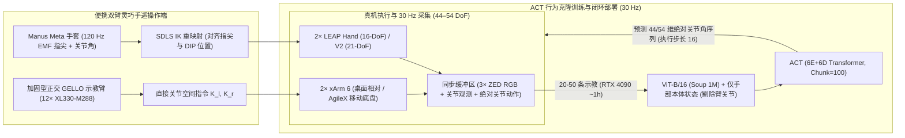

# Bimanual Dexterity for Complex Tasks

**Bimanual Dexterity for Complex Tasks**（arXiv:2411.13677v1 / CoRL 2024）已列入 [Robot Learning Paper Notebooks](https://imchong.github.io/Robot_Learning_Paper_Notebooks/index.html) 的 **PROGRESS.md** 清单（分类：06_Manipulation）。本页基于原文全文核对补全核心机制、方法流程图、定量对比数据、BOM 成本与局限（保留 `status: stub` 待深读笔记归档）。

## 一句话定义

BiDex 是一套低成本、低延迟、不依赖外部激光/光学基站的便携式双臂灵巧手遥操作与模仿学习数据采集系统，通过融合 120 Hz Manus Meta 电磁动捕手套与正交防碰撞加固版 GELLO 关节示教臂，高效控制 44–54+ 自由度双臂多指灵巧手（LEAP Hand / LEAP Hand V2）并训练出稳定的 ACT 闭环操作策略。

## 英文缩写速查

| 缩写 | 英文全称 | 简要说明 |
|------|----------|----------|
| BiDex | Bimanual Dexterity Teleoperation System | 本文提出的便携式双臂多指灵巧手遥操作与数据采集系统 |
| ACT | Action Chunking with Transformers | 动作分块 Transformer 行为克隆架构（本文用于 30 Hz 闭环操作学习） |
| SDLS | Selectively Damped Least Squares | 选择性阻尼最小二乘 IK 求解器，用于人手到机械手的指尖/DIP 重映射 |
| EMF | Electromagnetic Field | 电磁场传感（Manus 手套通过磁场与霍尔传感器实现无遮挡指尖追踪） |
| DoF | Degrees of Freedom | 自由度（配双 LEAP Hand 为 44-DoF；配双 LEAP Hand V2 为 54-DoF） |
| ViT | Vision Transformer | 视觉编码器骨干（采用 Soup 1M 预训练 ViT-B/16 提取 RGB 特征） |

## 为什么重要

- **弥合「高自由度灵巧操作」与「低成本便携采集」之间的断层**：纯视觉 VR（如 Apple Vision Pro）存在腕部抖动、遮挡敏感与延迟问题；SteamVR 需在场地四周架设 4 个外部激光定位基站而无法移动；BiDex 仅凭约 **\$6,395** 的手套+示教臂套件即可在桌面与移动底盘场景中稳定运行。
- **验证「关节空间示教 + 剔除臂本体输入」对高维策略泛化的关键作用**：相比末端位姿空间易因小预测误差引发关节跳变，BiDex 的关节级示教使 ACT 策略仅凭 **20–50 条**示教（单卡 RTX 4090 训练约 **1 小时**）即可在 44/54 维动作空间中稳定完成倒水、电钻、端锅等复杂操作。
- **与 [机器人学习论文笔记总索引](../overview/humanoid-paper-notebooks-index.md) 及 [操作分类页](../overview/paper-notebook-category-06-manipulation.md) 衔接**：为双臂多指灵巧手的硬件搭建、人机重映射与行为克隆管线提供完整可复现参考。

## 核心信息

| 字段 | 内容 |
|------|------|
| 分类 | 06_Manipulation |
| 作者 / 机构 | Jiahui Yang、Kenneth Shaw*、Yulong Li*、Mohan Kumar Srirama、Ray Liu、Haoyu Xiong、Russell Mendonca†、Deepak Pathak†（Carnegie Mellon University） |
| 论文 / 会议 | CoRL 2024（arXiv:2411.13677v1，<https://arxiv.org/abs/2411.13677>） |
| 项目页 | <https://bidex-teleop.github.io> |
| 遥操作硬件 | 双只 Manus Meta Quantum Metagloves（120 Hz，\$6,000）+ 2 套加固 GELLO 示教臂（12× Dynamixel XL330-M288，套件总 BOM **\$6,395**） |
| 机器人平台 | 双台 **xArm 6** + 双只 **16-DoF LEAP Hand** 或刚柔混合 **21-DoF LEAP Hand V2** + 3× ZED 相机（移动版搭载升降躯干与 **AgileX Ranger Mini** 全向底盘） |
| 深读状态 | 待撰写（[PROGRESS.md](https://github.com/ImChong/Robot_Learning_Paper_Notebooks/blob/main/papers/PROGRESS.md)） |
| 计划文件夹 | `papers/06_Manipulation/bimanual-dexterity-for-complex-tasks` |

## 核心机制（归纳）

> 注：以下机制、超参及实测数值均依据 arXiv:2411.13677v1 原文（含 Appendix 7–11）核对整理。

1. **电磁动捕手套跟踪与指尖-DIP 逆运动学重映射（§3.1, Appendix 11）**：
   - 采用 **Manus Meta Quantum Metagloves**，基于霍尔效应与 EMF 传感器以 **120 Hz** 输出每个指尖的 `xyz-quaternion` 位姿及每指 4 个关节角（$\theta_{\text{MCPside}}, \theta_{\text{MCPfwd}}, \theta_{\text{PIP}}, \theta_{\text{DIP}}$），克服了纯视觉在自遮挡/光照变化下的精度抖动以及 IMU 手套的漂移/发热缺陷。
   - 由于人手与机械手（尤其是拇指与指节比例）存在构型差异，直接映射关节角会导致捏取（pinch）失准；BiDex 采用 **SDLS 逆运动学求解器**优化手腕坐标下各指尖及远端指间关节（DIP）的相对位置一致性，适配 4 指 **16-DoF LEAP Hand** 与带主动柔性掌部、柔性外皮的 **21-DoF LEAP Hand V2**。
2. **正交安装与力学加固的 GELLO 关节级臂部示教（§3.2–3.3）**：
   - 沿用 GELLO 的同构缩放示教臂方案直接在**关节空间**采样目标关节角（$K_{lt}, K_{rt}$），消除末端 IK 奇异点跳变并自带轻微力学阻力提示。
   - **避免臂部自碰撞的安装设计**：将灵巧手模拟夹爪朝向安装在机械臂下方，从而在示教臂端使操作员前臂与示教臂呈**正交垂直**而非平行布置，消除碰撞并改善操作视野；为承受动捕手套重量，示教臂基座加装高强度轴承并在关节处增设橡皮筋偏置回中。
   - **桌面相对式 vs 移动平台（§3.3）**：桌面环境采用双臂相对（facing each other）布局以扩大共享操作空间并减少遮挡；移动环境将示教臂装于便携推车，真机侧将双臂与可升降躯干装于 **AgileX Ranger Mini** 全向底盘（由第二名操作员使用手柄控制底盘移动与任务复位）。
3. **30 Hz 闭环 ACT 策略与「去臂本体化」设计（§5.2, Appendix 10 & Table 7）**：
   - 数据流以 **30 Hz** 记录观测 $o_t = \{A_{lt}, A_{rt}, H_{lt}, H_{rt}, \{I_c\}_t\}$ 与绝对关节动作 $a_t = \{K_{lt}, K_{rt}, q_{lt}, q_{rt}\}$（LEAP Hand 为 44 维，LEAP Hand V2 为 54 维）。
   - **策略架构（Fig. 5 & Table 7）**：采用 **ViT-B/16**（Soup 1M 预训练，12 层，hidden=768）编码 RGB 图像，与线性投影后的**当前灵巧手关节角**拼成序列输入 **ACT**（6 层编码器 + 6 层解码器，hidden=512，chunk=100，推理步长 16，AdamW `lr=3e-4` 训练 10,000 步）。**关键设计在于从策略输入本体感觉中刻意排除当前双臂关节角**，迫使模型从视觉图像提取物体空间关系，避免策略过拟合到当前臂姿态而丧失位置泛化能力。

### 方法流程图

## 工程实践

- **遥操作硬件组装与软件桥接（§3.2, §8, Appendix 11）**：示教臂采用 12 个 Dynamixel XL330-M288 舵机与 U2D2 控制板，在基座关节加装高强度轴承并用橡皮筋偏置以抵消手套自重；Manus 手套端通过作者提供的 Windows API → Linux ROS 转发程序以 **120 Hz** 输出指尖/关节位姿，系统整体按 **30 Hz** 采样保存。
- **ACT 策略训练超参（Table 7）**：以 **ViT-B/16**（Soup 1M 预训练，patch=16，hidden=768）+ 仅手部关节角输入 **ACT**（6 层编码器 + 6 层解码器，hidden=512，feedforward=2048，action chunk=100，推理步长 16）；使用 AdamW（`lr=3e-4`, `weight_decay=0.05`, `batch_size=64`, cosine decay 10,000 steps, 500 warmup），**20–50 条示教**在单卡 **RTX 4090（24 GB）** 上训练约 **1 小时**。

## 实验与评测

- **桌面端遥操作效率与完成率对比（Table 1）**：

| 遥操作方案 | Handover（完成率 / 耗时） | Cup Stacking（完成率 / 耗时） | Bottle Pouring（完成率 / 耗时） |
|---|---|---|---|
| Apple Vision Pro VR | 60% / 21.6 s | 40% / 38.8 s | 70% / 35.5 s |
| SteamVR（4 个屋顶激光基站） | 80% / 17.5 s | **85%** / 16.5 s | 60% / 15.5 s |
| **BiDex（本文）** | **95% / 6.5 s** | 75% / **15.5 s** | **85% / 14.9 s** |

- **移动端遥操作对比（Table 2，20 trials 均值，配 LEAP Hand；SteamVR 因依赖固定基站不可用）**：
  - `Chair Pushing`：Vision Pro **75% / 15.0 s**｜BiDex **95% / 16.4 s**
  - `Box Carry`：Vision Pro **75% / 33.7 s**｜BiDex **95% / 29.7 s**
  - `Clear Trash`：Vision Pro **50% / 79.8 s**｜BiDex **75% / 74.6 s**
- **ACT 闭环模仿学习实机成功率（Table 3 & Table 4，基于 ~50 条示教）**：
  - **LEAP Hand（44-DoF，Table 3）**：`Can Handover` **7/10（70%）**、`Cup Stacking` **14/20（70%）**、`Bottle Pouring` **16/20（80%）**。
  - **LEAP Hand V2（54-DoF，Table 4）**：`Drill` **15/20（75%）**、`Lift Pot` **15/20（75%）**、`Bottle Pouring` **15/20（75%）**、`Plate Pickup` **13/20（65%）**。
- **新手用户研究与数据缩放对照（Appendix 9–10, Fig. 6 & Fig. 8）**：
  - 新手练习 3 分钟后各测 10 次交接任务，BiDex 在平均成功率、耗时与主观评分（准确度、响应、易用性、信心）上均显著优于 Apple Vision Pro（且一名测试者使用 Vision Pro 时因突变控制折断了机械手导致 0% 成功率）。
  - 采集 100 条示教按不同样本量训练对比表明：BiDex 采集的关节空间平滑数据在更少样本下即超越 Vision Pro 末端 IK 采集数据训练出的策略。
- **硬件 BOM 成本核对（Table 5 & Table 6）**：
  - BiDex 遥操作端总成本 **\$6,395**（Manus Meta 手套 \$6,000 + 12× Dynamixel XL330-M288 \$300 + U2D2 控制板 \$40 + 电源/线材/PLA 耗材 \$55）；
  - 移动双臂整机端分项加总为 **\$31,200**（2× xArm 6 \$18,000 + 移动底盘 \$6,000 + 2× LEAP Hand \$4,000 + Ubuntu 笔记本 \$2,000 + 3× ZED 相机 \$1,200；原文 Table 6 汇总行误印为 `$31,2000`，表注与摘要表述整套系统约 \$30k–\$35k）。

## 与其他工作对比

- **对比 Apple Vision Pro / Bunny-VisionPro**：无须受光线与手部遮挡困扰，也不用低通滤波换取延迟降低抖动；直接关节空间示教避免末端 IK 奇异跳变与误撞损坏灵巧手。
- **对比 SteamVR / Vicon / DexCap**：无需环境四周架设固定激光灯塔或光学反光球标定，真正支持带底盘移动野外作业；对比传统 GELLO（仅 1-DoF 夹爪）则通过加固结构与 SDLS IK 扩展到 20+ DoF 灵巧手。

## 结论

**BiDex 用「120 Hz 电磁手套 + 正交防碰撞 GELLO 臂」证明了关节空间臂示教与指尖 IK 手重定向相结合，是当前学术实验室以 \$6.4k 采集端成本获得高可用 44–54 DoF 双臂灵巧操作数据的实用范式。**

1. **尽量使用关节空间示教替代末端空间 IK 采集**：BiDex 与 Vision Pro 的同样本量对照实验表明，关节空间动作序列天然平滑，能直接提升下游 ACT 策略的数据效率并保护昂贵灵巧手。
2. **训练高自由度双臂 BC 时可尝试屏蔽臂关节本体输入**：仅保留灵巧手关节角与 RGB 图像作为 ACT 输入，可显著防止策略死记臂位姿从而泛化到物体不同初始位置。
3. **正交下挂手部构型是同构示教臂落地的实用技巧**：把灵巧手镜像为垂直于人手前臂的夹爪朝向，可彻底化解双臂交叠时的物理碰撞与视线遮挡。
4. **文档定位**：本页保留 `stub` 状态并已依据 arXiv:2411.13677v1 全文补齐核心机制、量化结果与硬件清单；待深读笔记撰写后可补充软件仓库与更多任务细节。

## 常见误区或局限

1. **缺少力觉与触觉反馈（§6）**：系统仅执行开环运动学位置控制，操作员看不到接触力且手套无力反馈，难以完成依赖精细力控的极端灵巧任务。
2. **手套价格与跨系统软件桥接门槛（§8, Appendix 11）**：虽然无需昂贵光学动捕房，但一对 Manus Meta 手套仍需 **\$6,000**；且发布时 Manus 官方 SDK 仅提供 Windows API，需通过作者发布的网络桥接转发至 Linux ROS 端；移动版尚需第二名操作员协助控底盘。
3. **原文排版笔误与公开代码核查**：原文 Table 6 机器人端总价误写为 `$31,2000`（分项求和实为 **\$31,200**）；论文指向项目页 `https://bidex-teleop.github.io` 公布装机教程与软件，未在论文 PDF 内直接列出独立 GitHub 仓库代码入口分析。

## 关联页面

- [模仿学习](../methods/imitation-learning.md) — 延伸阅读，理解示范数据如何用于策略训练。
- [机器人操作](../tasks/manipulation.md) — 延伸阅读，理解操作任务与工具接口。
- 分类页：[paper-notebook-category-06-manipulation](../overview/paper-notebook-category-06-manipulation.md)
- 总索引：[humanoid-paper-notebooks-index.md](../overview/humanoid-paper-notebooks-index.md)

## 参考来源

- [humanoid_pnb_bimanual-dexterity-for-complex-tasks.md](../../sources/papers/humanoid_pnb_bimanual-dexterity-for-complex-tasks.md)
- [Robot Learning Paper Notebooks · PROGRESS.md](https://github.com/ImChong/Robot_Learning_Paper_Notebooks/blob/main/papers/PROGRESS.md)
- 原文（CoRL 2024 / arXiv:2411.13677v1）：<https://arxiv.org/abs/2411.13677>
- 项目页：<https://bidex-teleop.github.io>

## 推荐继续阅读

- [Paper Notebooks 阅读进度（PROGRESS.md）](https://github.com/ImChong/Robot_Learning_Paper_Notebooks/blob/main/papers/PROGRESS.md)
