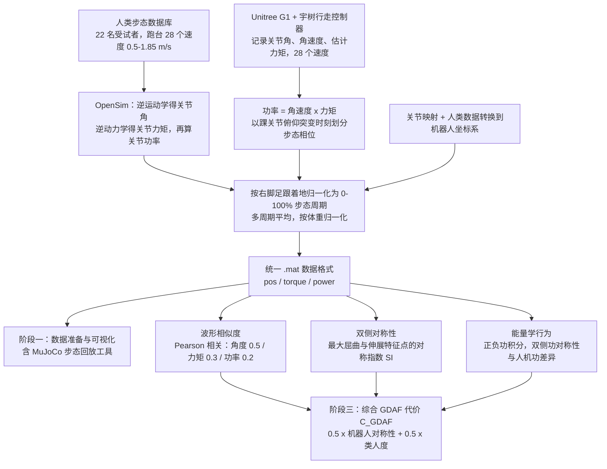

# Biomechanical Comparisons Reveal Divergence of Human and Humanoid Gaits

**Biomechanical Comparisons Reveal Divergence of Human and Humanoid Gaits** 收录于 [Robot Learning Paper Notebooks](https://imchong.github.io/Robot_Learning_Paper_Notebooks/index.html)（分类：05_Locomotion）。本页为 **清单索引实体**，链向深读笔记与原始论文；详细机制待从笔记消化后补充。

## 一句话定义

GDAF 提出一个与控制器无关、面向生物力学的评估框架，把"人形机器人走路像不像人"拆成波形相似度 + 双侧对称性 + 能量学行为三类指标，在 0.5–1.85 m/s 共 28 个速度档对一个 SOTA RL 人形控制器进行扫描，量化结论是：视觉上像人，生物力学上仍系统性偏离。

## 英文缩写速查

| 缩写 | 英文全称 | 简要说明 |
|------|----------|----------|
| RL | Reinforcement Learning | 通过与环境交互最大化长期回报来学习策略 |
| WBC | Whole-Body Control | 协调全身关节满足多任务/约束的控制基础设施 |
| Sim2Real | Simulation to Real | 把仿真中学到的策略迁移落地真机的工程主线 |

## 为什么重要

- 列入 Paper Notebooks 策展清单，便于与全库 [机器人学习论文笔记总索引](../overview/humanoid-paper-notebooks-index.md) 及分类父节点交叉检索。
- 深读笔记提供比摘要更贴近实现的阅读路径，适合作为后续 ingest 深化起点。

## 流程总览

图依据：论文 §II-A（数据获取与处理）、§II-B（GDAF 三阶段）。

## 核心信息

| 字段 | 内容 |
|------|------|
| 分类 | 05_Locomotion |
| 深读笔记 | <https://imchong.github.io/Robot_Learning_Paper_Notebooks/papers/05_Locomotion/Biomechanical_Comparisons_Reveal_Divergence_of_Human_and_Humanoid_Gaits/Biomechanical_Comparisons_Reveal_Divergence_of_Human_and_Humanoid_Gaits.html> |
| arXiv | <https://arxiv.org/abs/2602.21666> |

## 实验与评测

- 本页为 **策展清单索引** 摘要；量化 benchmark、消融与实机指标以 **深读笔记与论文 PDF** 为准（链接见 [参考来源](#参考来源)）。

## 结论

**这篇工作把「像不像人」从观感变成可测量的量：GDAF 用与控制器无关的生物力学指标做速度扫描，量化结论是视觉相似掩盖了系统性的力学偏离。**

- 评估被拆成三类互补指标——波形相似度、双侧对称性、能量学行为；只看其中任一类都容易得出「已经很像人」的错觉，三者合看才暴露偏离。
- 0.5–1.85 m/s 共 28 个速度档的连续扫描是关键设计：偏离是否随速度系统性变化，只有扫描才看得出来，单速度点评测无法支撑该结论。
- 适用边界要留意：被测对象是一个 SOTA RL 人形控制器，结论指向这类控制器的倾向而非所有步态方案；框架本身与控制器无关，可复用到其他策略上。
- 它的定位是评测框架而非控制方法——能诊断差距，但不提供缩小差距的手段。
- 本页为策展笔记摘要，指标定义与量化结果以深读笔记与论文 PDF 为准。

## 与其他页面的关系

- 分类父节点：[paper-notebook-category-05-locomotion](../overview/paper-notebook-category-05-locomotion.md)
- 总索引：[humanoid-paper-notebooks-index.md](../overview/humanoid-paper-notebooks-index.md)

## 参考来源

- [humanoid_pnb_biomechanical-comparisons-reveal-divergence-of-h.md](../../sources/papers/humanoid_pnb_biomechanical-comparisons-reveal-divergence-of-h.md)
- 深读笔记：<https://imchong.github.io/Robot_Learning_Paper_Notebooks/papers/05_Locomotion/Biomechanical_Comparisons_Reveal_Divergence_of_Human_and_Humanoid_Gaits/Biomechanical_Comparisons_Reveal_Divergence_of_Human_and_Humanoid_Gaits.html>
- 论文：<https://arxiv.org/abs/2602.21666>
- [arXiv PDF](https://arxiv.org/pdf/2602.21666)：已通读方法部分（实验与附录以略读为准）：§II-A 数据获取与处理、§II-B GDAF 框架

## 推荐继续阅读

- [机器人论文阅读笔记：Biomechanical Comparisons Reveal Divergence of Human and Humanoid Gaits](https://imchong.github.io/Robot_Learning_Paper_Notebooks/papers/05_Locomotion/Biomechanical_Comparisons_Reveal_Divergence_of_Human_and_Humanoid_Gaits/Biomechanical_Comparisons_Reveal_Divergence_of_Human_and_Humanoid_Gaits.html)
