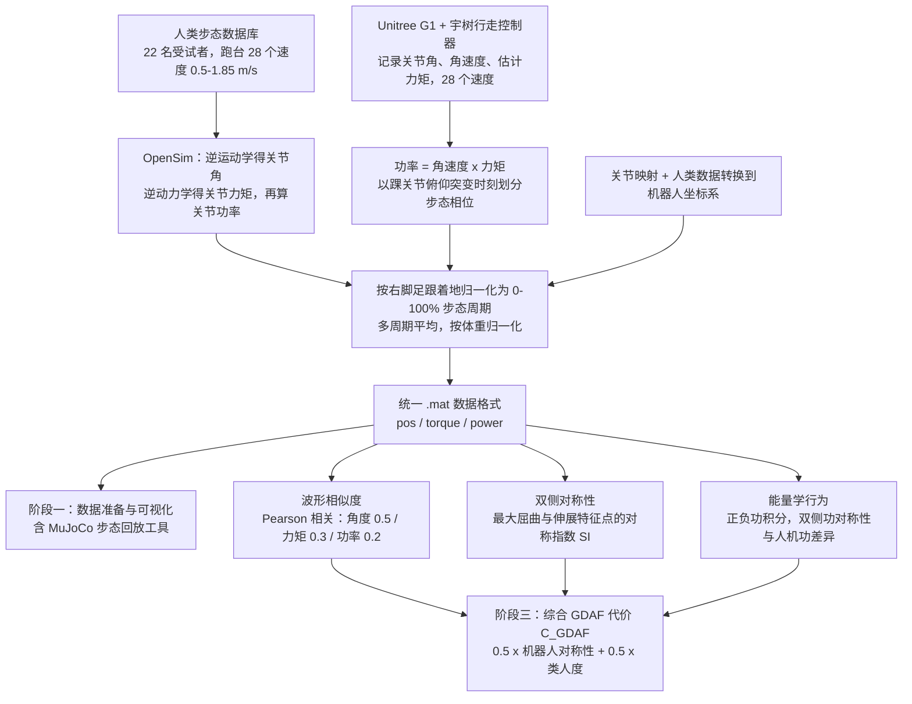

# Biomechanical Comparisons Reveal Divergence of Human and Humanoid Gaits

**Biomechanical Comparisons Reveal Divergence of Human and Humanoid Gaits** 是 Luying Feng、Yaochu Jin、Hanze Hu、Wei Chen 的 arXiv 论文（2602.21666v1，2026-02-25），收录于 [Robot Learning Paper Notebooks](https://imchong.github.io/Robot_Learning_Paper_Notebooks/index.html)（分类：05_Locomotion）。本页基于 arXiv PDF 全文（正文 §I–V、参考文献与附录 A–B）整理；深读笔记页未作为依据核对。

## 一句话定义

GDAF 提出一个与控制器无关、面向生物力学的评估框架，把"人形机器人走路像不像人"拆成波形相似度 + 双侧对称性 + 能量学行为三类指标，在 0.5–1.85 m/s 共 28 个速度档对一个 SOTA RL 人形控制器进行扫描，量化结论是：视觉上像人，生物力学上仍系统性偏离。

## 英文缩写速查

| 缩写 | 英文全称 | 简要说明 |
|------|----------|----------|
| GDAF | Gait Divergence Analysis Framework | 本文提出的人机步态差异分析框架，含数据准备、三维度指标与综合代价 |
| RL | Reinforcement Learning | 通过与环境交互最大化长期回报来学习策略；本文被测控制器由 RL 与 IL 训练 |
| IL | Imitation Learning | 模仿人类或参考运动来学习策略；论文指出仅模仿关节角轨迹不足以捕捉人类运动原理 |
| SI | Symmetry Index | 双侧对称指数，比较左右侧最大屈曲/伸展特征的差异，值越大越不对称 |
| IK | Inverse Kinematics | 逆运动学，由动捕标记反推关节角（OpenSim 流程中用于人类数据） |
| ID | Inverse Dynamics | 逆动力学，由关节运动与外力反推关节力矩（人类数据经 OpenSim 计算） |
| DoF | Degrees of Freedom | 自由度；论文可视化工具中的 Unitree G1 模型为 29-DOF |

## 为什么重要

- 论文指出，自然、接近人类的步态影响人形机器人的社会接受度、磨损与噪声，因此"像不像人"需要可量化的评价标准，而不只靠视频观感。
- 现有人机步态比较多在孤立或未受控的速度下进行，而步速会显著改变运动学与动力学特性；作者的核心动机是建立跨速度的统一比较（作者称为首个同时覆盖 28 个速度的此类比较，属作者自述）。
- 论文认为，当前 RL 奖励调参依赖经验，缺少步态质量的定量标准；GDAF 试图为策略评测与选择提供可复现指标。
- 列入 Paper Notebooks 策展清单，便于与全库 [机器人学习论文笔记总索引](../overview/humanoid-paper-notebooks-index.md) 及分类父节点交叉检索。

## 核心原理

**输入。** 两组数据在统一预处理后比较：

- 人类：开源步态数据库（Camargo 等，22 名成年受试者，跑台步行），取 28 个速度（0.5–1.85 m/s，步长 0.05 m/s，每速 30 s）；用 OpenSim 做 IK 得关节角、ID 得关节力矩，再由角速度与力矩相乘得功率。
- 机器人：Unitree G1 运行宇树专有的步行/跑步运动控制器（作者描述为 RL 与 IL 训练，属其最先进稳定的模型之一），在水平地面以 28 个速度记录关节角、角速度与估计力矩，采样 200 Hz，每速至少 25 s，剔除加减速段。

两者都按步态周期归一化为 0–100%（以右脚跟着地为起点），多周期平均，力矩与功率按体重归一化（Nm/kg、W/kg），并通过关节映射（图 1，跳过跖趾关节）与坐标变换对齐。

**三类指标。**

1. **波形相似度**：对每个关节和速度，用 Pearson 相关系数比较角度、力矩、功率曲线，再按 0.5 / 0.3 / 0.2 加权合成。
2. **双侧对称**：对六对左右关节，提取最大屈曲 $\phi_{max}$ 与最大伸展 $\phi_{min}$，用人类特征幅值作为分母的对称指数 SI 衡量左右差异。
3. **能量学行为**：把功率按正负分量积分得到正功 $W^+$ 与负功 $W^-$，计算左右功对称指数 $A^W$，以及人机之间的功差异 $d^{work}$。

**综合代价。** 作者把三类指标合成一个 GDAF 代价（越小越好）：

$$R_v^{wav} = 0.5\,\bar r_v^{angle} + 0.3\,\bar r_v^{moment} + 0.2\,\bar r_v^{power}$$

$$S_v^{R} = 0.5\,\overline{SI}_v^{R} + 0.5\cdot\frac{\bar A_v^{W,R}}{10}$$

$$H_v = 0.5\,(1-R_v^{wav}) + 0.5\cdot\frac{\bar d_v^{work}}{10}$$

$$C_v^{GDAF} = 0.5\,S_v^{R} + 0.5\,H_v$$

其中 $S_v^R$ 衡量机器人自身对称性，$H_v$ 衡量与人类的相似程度；缩放系数 1/10 用于平衡不同单位，使运动学对称项占主导。

**输出。** 每个速度一组指标，以及速度连续的 $C_v^{GDAF}$ 曲线，用于定位哪些关节、哪些步态相位、哪些速度段偏离人类。

## 流程总览

图依据：论文 §II-A（数据获取与处理）、§II-B（GDAF 三阶段）。

## 核心信息

| 字段 | 内容 |
|------|------|
| 分类 | 05_Locomotion |
| 论文 | Feng, Jin, Hu, Chen（Zhejiang University / Westlake University / NIMTE CAS）；arXiv 2602.21666v1，2026-02-25 |
| 深读笔记 | <https://imchong.github.io/Robot_Learning_Paper_Notebooks/papers/05_Locomotion/Biomechanical_Comparisons_Reveal_Divergence_of_Human_and_Humanoid_Gaits/Biomechanical_Comparisons_Reveal_Divergence_of_Human_and_Humanoid_Gaits.html> |
| arXiv | <https://arxiv.org/abs/2602.21666> |
| 数据与代码 | 论文与 arXiv 摘要页均写 "will be made publicly available upon acceptance"，截至入库日（2026-11-06）未查到可公开访问的数据或代码链接 |

## 工程实践

| 环节 | 要点 |
|------|------|
| 数据对齐 | 人类跑台 0.5–1.85 m/s、步长 0.05 m/s；机器人水平地面、200 Hz、每速 ≥25 s。两侧统一以右脚跟着地（人类为右跟标记线速度归零；机器人以踝关节俯仰突变近似，因无足底压力与动捕数据） |
| 关节映射 | 按解剖功能与运动平面建立人机关节对应（论文图 1）；跖趾关节无机器人对应而被排除；人类数据需转到机器人坐标系 |
| 数据格式 | 统一 `.mat`：`pos[channel, speed]`（角度，度）、`torque`（Nm/kg）、`power`（W/kg）、`channel label`、`unique speeds`（m/s）；其他机器人或仿真数据可按此格式导出后复用 |
| 复现入口 | 论文描述的 notebook 为 `GDAF 01 Data Visualization.ipynb` 与 `GDAF 02 Divergence Analysis.ipynb`，另有 `mujoco_gait_player.py`（加载 `unitree_robots/g1/g1_29dof.xml`，固定骨盆回放）；**公开状态未核实**，以论文承诺为准 |
| 调试入口 | 先用 MuJoCo 回放检查关节映射与符号约定，再看逐关节 Pearson 相关；重点查踝与距下关节的 SI，以及低速段的功对称 $A^W$ |
| 优化信号 | 论文建议把远端关节 SI、双侧功对称性作为训练正则或策略选择指标，并可用对称损失或镜像数据增强来显式约束（属作者建议，未在本文中实验验证） |
| 开源状态（步骤 2.5） | 未找到项目页；arXiv 摘要页与论文均写"录用后公开"，截至入库日未列 GitHub 或数据集 URL，归类为 **宣称将开源 / 未列链接** |
| 源码运行时序图 | **不适用**（论文称代码与数据录用后公开，入库时未找到可运行的官方仓库，无法对齐运行入口） |

## 实验与评测

**设置。** 人类数据来自 22 名成年受试者的跑台步行；机器人为 Unitree G1，控制器为宇树专有步行/跑步控制器。两者都在 28 个速度上比较，但采集条件不同（见局限）。

**主要结果。**

- **波形相似度**：髋与膝的角度相关系数通常高于 0.8；力矩与功率相似度波动更大，两侧距下关节相似度明显偏低；踝与距下关节的相似度随速度上升。
- **对称性**：人类在髋屈伸与膝部 SI 接近 0 且离散度小；机器人这些关节 SI 系统性更高，踝与距下关节的差距更大。
- **能量学**：机器人膝部正功明显高于人类（论文称"膝主导"的做功策略），踝部正功明显低于人类（论文称推离不足）；髋正功随速度上升但在高速时仍低于人类；机器人左右膝部负功差异更明显，且集中在低到中速段。
- **综合代价**（表 I，取论文给出的 5 个速度，其余速度见论文图 4–6 与附录）：

| 速度（m/s） | $S_v^R$ | $H_v$ | $C_v^{GDAF}$ |
|---|---|---|---|
| 0.5 | 0.5831 | 0.4380 | 0.5106 |
| 0.75 | 0.4715 | 0.3482 | 0.4099 |
| 1.0 | 0.4623 | 0.3225 | 0.3924 |
| 1.25 | 0.4083 | 0.2662 | 0.3373 |
| 1.5 | 0.3511 | 0.2371 | 0.2941 |

$C_v^{GDAF}$ 随速度下降，作者据此称步态质量随速度单调改善（逐速全表未在本页核对，未核实）。低速时功对称项 $A^{W,R}$ 与人类差距最大（表 I 中 0.5 m/s 为 3.3708，人类 0.3127）。

## 结论

**这篇工作把「像不像人」从观感变成可测量的量：GDAF 用与控制器无关的生物力学指标做速度扫描，结论是视觉相似掩盖了系统性的力学偏离。**

1. **评估被拆成三类互补指标** — 波形相似度、双侧对称性、能量学行为；只看角度曲线容易得出"已经很像人"的结论，加入对称与功分析后，远端关节与低速段的偏离才暴露出来。
2. **连续速度扫描是关键设计** — 0.5–1.85 m/s、步长 0.05 m/s 的扫描使偏离随速度的变化可见；单一速度点的评测无法支撑"低速是瓶颈"这类判断。
3. **诊断优先于修复** — 论文给出的主要用途是定位（哪个关节、哪个相位、哪个速度），并建议以 GDAF 作为训练正则或策略选择指标，但正文未实验验证这一用法。
4. **适用边界要留意** — 人类与机器人采集条件不同（跑台 vs 水平地面）、相位划分方式不同、被测对象只有一个控制器，结论主要针对该控制器，而非所有步态方案。
5. **它是评测框架而非控制方法** — 能指出差距，但不直接给出缩小差距的算法。

## 对比

- **与人形模仿学习（仅模仿关节角）**：论文认为只复制关节角轨迹无法捕捉人类运动的原理，并引用 PHUMA 等动作模仿工作作为背景；本文不训练新策略，而是评测已有控制器。
- **与既往人机步态比较**：论文指出既往研究多在未控制或孤立速度下比较，本文强调跨 28 个速度的统一条件（这一对比属作者自述，未逐篇核对）。
- **与临床步态分析**：三类指标分别借鉴 Pearson 相关、双侧对称指数与正负功分析，来自步态生物力学文献；论文未与其他机器人步态评测指标做数值对比。

## 局限与风险

- **采集条件不对称**：人类在跑台上，机器人在水平地面上；作者承认这一差异，并引用文献指出跑台与地面步行本身存在差别，因此跨主体的绝对数值解释需谨慎。
- **相位划分不同**：人类以右跟标记速度归零定义足跟着地，机器人以踝关节俯仰突变近似；步态周期起点的不一致会影响相似度与对称性数值。
- **功率来自估计力矩**：机器人力矩为控制器或驱动的估计值，并非直接测量，能量学结论依赖该估计的可靠性。
- **样本与对象单一**：人类为 22 名成年人，机器人只有一台 Unitree G1 和一个专有控制器；结论的普适性有限。
- **权重为启发式**：波形相似度的 0.5/0.3/0.2 权重与 1/10 缩放均为作者依据经验给出的理由，正文未见敏感性分析。
- **复现风险**：控制器为专有代码，数据与 GDAF 代码仅承诺录用后公开；截至入库日无法独立复现机器人侧数据。
- **误读风险**：SI 与 $A^W$ 的分母取人类参考值，读者需理解其相对尺度；$C_v^{GDAF}$ 越低越好，并非"越像人越高"。

## 与其他页面的关系

- 分类父节点：[paper-notebook-category-05-locomotion](../overview/paper-notebook-category-05-locomotion.md)
- 总索引：[humanoid-paper-notebooks-index.md](../overview/humanoid-paper-notebooks-index.md)
- 步态生成背景：[gait-generation](../concepts/gait-generation.md)
- 奖励设计与步态质量指标的关系：[reward-design](../concepts/reward-design.md)
- 仿真到真机的差距：[sim2real](../concepts/sim2real.md)

## 参考来源

- [humanoid_pnb_biomechanical-comparisons-reveal-divergence-of-h.md](../../sources/papers/humanoid_pnb_biomechanical-comparisons-reveal-divergence-of-h.md)
- 深读笔记：<https://imchong.github.io/Robot_Learning_Paper_Notebooks/papers/05_Locomotion/Biomechanical_Comparisons_Reveal_Divergence_of_Human_and_Humanoid_Gaits/Biomechanical_Comparisons_Reveal_Divergence_of_Human_and_Humanoid_Gaits.html>
- 论文：<https://arxiv.org/abs/2602.21666>
- [arXiv PDF](https://arxiv.org/pdf/2602.21666)：已通读全文（正文 §I–V、参考文献、附录 A–B；图像未逐图核对，数值以正文表 I 与文字为准）

## 推荐继续阅读

- [机器人论文阅读笔记：Biomechanical Comparisons Reveal Divergence of Human and Humanoid Gaits](https://imchong.github.io/Robot_Learning_Paper_Notebooks/papers/05_Locomotion/Biomechanical_Comparisons_Reveal_Divergence_of_Human_and_Humanoid_Gaits/Biomechanical_Comparisons_Reveal_Divergence_of_Human_and_Humanoid_Gaits.html)
- [arXiv 2602.21666 原文 PDF](https://arxiv.org/pdf/2602.21666)
