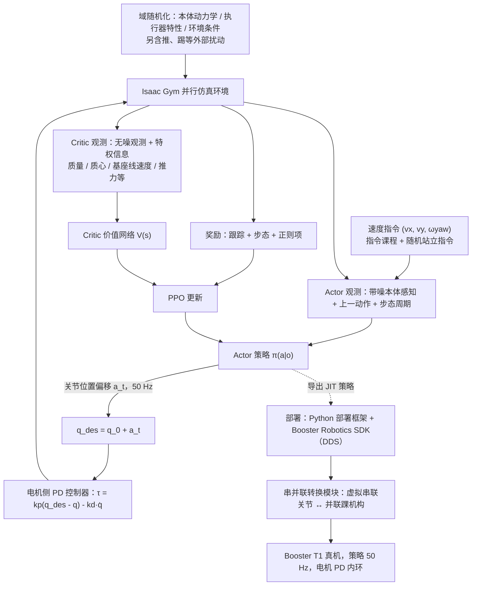

---

type: entity
tags: [paper, humanoid-paper-notebooks, paper-notebook-planned, booster]
status: planned
updated: 2026-09-15
arxiv: "2506.15132"
related:
  - ../overview/paper-notebook-category-05-locomotion.md
  - ../overview/humanoid-paper-notebooks-index.md
sources:
  - ../../sources/papers/humanoid_pnb_booster-gym-an-end-to-end-rl-framework-for-human.md
  - ../../sources/repos/booster_gym.md
summary: "Booster Gym：列入 Paper Notebooks PROGRESS.md 待深读清单；深读笔记完成后补成完整摘要。"
---

# Booster Gym

**Booster Gym: An End-to-End RL Framework for Humanoid Robot Locomotion** 已列入 [Robot Learning Paper Notebooks](https://imchong.github.io/Robot_Learning_Paper_Notebooks/index.html) 的 **PROGRESS.md 待深读** 清单（分类：05_Locomotion）。本页 **还没有深读笔记**：只给出这篇论文的分类位置与原文入口，方法细节与数据请直接看原文。

## 一句话定义

Booster Gym 的人形机器人学习论文条目，当前处于 Paper Notebooks 阅读进度（待深读）阶段。

## 英文缩写速查

| 缩写 | 英文全称 | 简要说明 |
|------|----------|----------|
| RL | Reinforcement Learning | 通过与环境交互最大化长期回报来学习策略 |
| WBC | Whole-Body Control | 协调全身关节满足多任务/约束的控制基础设施 |
| Sim2Real | Simulation to Real | 把仿真中学到的策略迁移落地真机的工程主线 |

## 为什么重要

- 这篇已排进 Paper Notebooks 的待读清单，可以从 [机器人学习论文笔记总索引](../overview/humanoid-paper-notebooks-index.md) 与分类页找到同一批工作。
- 深读笔记写出来之前，这里只保留分类位置与原文入口；方法流程见下方「流程总览」，仅依据论文方法部分，不含结论判断。

## 流程总览

图依据：论文 §III-A/B/C/D（Fig. 2、Table I、Table II）。

## 核心信息

| 字段 | 内容 |
|------|------|
| 分类 | 05_Locomotion |
| 深读状态 | 待撰写（[PROGRESS.md](https://github.com/ImChong/Robot_Learning_Paper_Notebooks/blob/main/papers/PROGRESS.md)） |
| 计划文件夹 | `papers/05_Locomotion/booster-gym-an-end-to-end-rl-framework-for-human` |
| arXiv | <https://arxiv.org/abs/2506.15132> |

## 实验与评测

- 深读笔记尚未完成；量化 benchmark、消融与实机指标待笔记撰写后补充。

## 结论

**本页深读状态仍是待读，但它已经不是孤立节点：Booster Gym 在本库中先以「被别人用作底层」的身份获得了存在感。**

- 唯一有实质分量的线索来自下游引用——[RAVEN](./paper-raven-rl-adaptive-visibility-graph-mpc.md) 的真机导航栈以 Booster Gym 作底层 locomotion，上层再接 DAVG-cfMPC；这说明它的定位是**可被复用的端到端 RL 行走底座**，而非某个单点算法。
- 除此之外可依赖的仅有归档信息：分类 05_Locomotion、计划文件夹路径与 <https://arxiv.org/abs/2506.15132>；框架细节、消融与实机指标待深读笔记补齐。
- 适用边界：本页可用于按分类检索、并作为 RAVEN 一类工作的上游锚点，**不可**作为该论文技术结论的引用来源。
- 深读笔记完成后，本页会补上笔记链接与实质要点。

## 与其他页面的关系

- 分类页：[paper-notebook-category-05-locomotion](../overview/paper-notebook-category-05-locomotion.md)
- 总索引：[humanoid-paper-notebooks-index.md](../overview/humanoid-paper-notebooks-index.md)

## 参考来源

- [Booster Gym 源码归档](../../sources/repos/booster_gym.md)（<https://github.com/BoosterRobotics/booster_gym>）

- [humanoid_pnb_booster-gym-an-end-to-end-rl-framework-for-human.md](../../sources/papers/humanoid_pnb_booster-gym-an-end-to-end-rl-framework-for-human.md)
- [Robot Learning Paper Notebooks · PROGRESS.md](https://github.com/ImChong/Robot_Learning_Paper_Notebooks/blob/main/papers/PROGRESS.md)
- 论文：<https://arxiv.org/abs/2506.15132>
- [arXiv PDF](https://arxiv.org/pdf/2506.15132)：已通读方法部分（实验与附录以略读为准）：§III-A 至 §III-D、§IV 开头

## 关联页面

- [RAVEN：RL 自适应可见图 + cf-MPC](./paper-raven-rl-adaptive-visibility-graph-mpc.md) — 真机导航栈以 Booster Gym 为底层 locomotion，上层接 DAVG-cfMPC

## 推荐继续阅读

- [Paper Notebooks 阅读进度（PROGRESS.md）](https://github.com/ImChong/Robot_Learning_Paper_Notebooks/blob/main/papers/PROGRESS.md)
- Hou et al., *RAVEN* ([arXiv:2607.15701](https://arxiv.org/abs/2607.15701)) — Booster Gym + RL-MPC 人形导航
