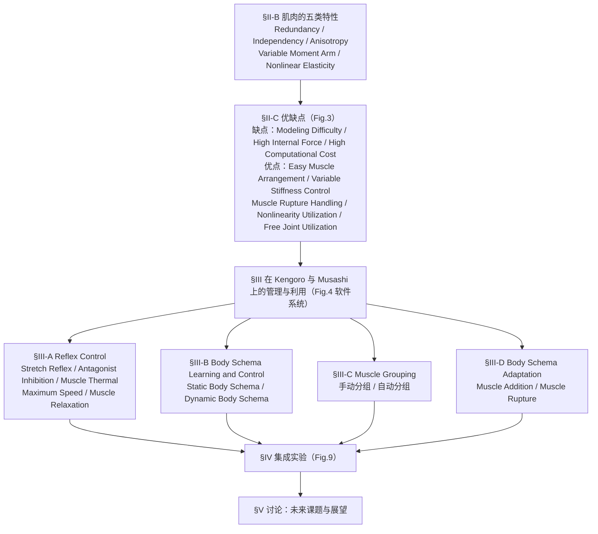

# Characteristics, Management, and Utilization of Muscles in Musculoskeletal Humanoids

**Characteristics, Management, and Utilization of Muscles in Musculoskeletal Humanoids: Empirical Study on Kengoro and Musashi**（Kawaharazuka、Okada、Inaba，arXiv:2602.08518）收录于 [Robot Learning Paper Notebooks](https://imchong.github.io/Robot_Learning_Paper_Notebooks/index.html)（分类：12_Hardware_Design）。作者自述全文为 perspective review，不是新方法论文：它把作者团队在 Kengoro（124 块肌肉）与 Musashi（74 块肌肉）上的既有研究归并成一套统一的讨论框架。

## 一句话定义

把 Kengoro 与 Musashi 两台腱驱动肌骨人形上的「设计 / 控制 / 学习」研究经验，整理成一篇「特性 → 管理 → 利用」的三段式实证总结：先讲清肌肉的五类固有特性（冗余 / 独立 / 各向异性 / 可变力臂 / 非线性弹性），再讲用哪些软件模块把这些特性"管住"，最后用四组实机演示说明整体系统如何把它们"用好"。

## 英文缩写速查

| 缩写 | 英文全称 | 简要说明 |
|------|----------|----------|
| EKF | Extended Kalman Filter | 用肌长变化递推估计关节角，本文用于无关节编码器的 Kengoro |
| MSC | Muscle Stiffness Control | 最底层的肌肉刚度控制，每块肌肉的张力由偏置项与长度误差决定 |
| SRC | Stretch Reflex Control | 模仿人体牵张反射：肌肉被突然拉伸时主动收缩 |
| AIC | Antagonist Inhibition Control | 模仿交互抑制（reciprocal innervation）：按力臂符号抑制拮抗肌 |
| MTC | Muscle Thermal Control | 电机温度升高时通过限制肌张力做保护，类似腱反射 |
| MRC | Muscle Relaxation Control | 在姿态基本不变时逐步放松非必要肌肉，降低内力 |
| QP | Quadratic Programming | 在张力上下限下求满足目标关节力矩的肌张力分配 |

## 为什么重要

- 肌骨人形的核心难点（建模难、内力大、计算量大）来自肌肉的冗余与非线性，作者把这些难点与肌肉特性的对应关系写成了一张表（Fig.3、Table I），便于按"问题 → 方法"的顺序查阅已有工作。
- 论文强调现有讨论大多停留在仿真或二维模型上，较少涉及全身实体肌骨机器人；本文以两台实机为例，补充了这一缺口。
- 对只关心控制与学习的读者，它提供了一条从底层反射到高层身体图式的完整软件链路，可作为进入该方向的索引。

## 流程总览

图依据：论文组织结构 / 分类体系图（实证综述），论文 §II-B、§II-C 与 Fig.3、§III 与 Fig.4、§IV Fig.9、§V；节点名取自论文原文标题。

## 核心信息

| 字段 | 内容 |
|------|------|
| 分类 | 12_Hardware_Design |
| 论文类型 | 综述式实证总结（作者自述 perspective review），无统一基准测试 |
| 研究对象 | Kengoro（124 块肌肉，无关节角传感器）、Musashi（74 块肌肉，关节带编码器）、Musashi-W（轮式变体） |
| 硬件范围 | 滑轮不在关节处、由电机卷绕钢丝（腱驱动）；不含气动肌与关节处滑轮式线驱动机器人 |
| 深读笔记 | <https://imchong.github.io/Robot_Learning_Paper_Notebooks/papers/12_Hardware_Design/Characteristics_Management_and_Utilization_of_Muscles_in_Musculoskeletal_Humanoids/Characteristics_Management_and_Utilization_of_Muscles_in_Musculoskeletal_Humanoids.html> |
| arXiv | <https://arxiv.org/abs/2602.08518> |
| 官方代码 / 项目页 | 未找到（截至 2026-11-06 的 arXiv 摘要页与论文正文均未列链接） |

## 核心原理

**输入 → 机制 → 输出。** 输入是肌肉长度 $l$、肌张力 $f$、肌肉温度 $c$（均可由编码器、张力单元、温度传感器测得）以及关节角 $\theta$（Kengoro 上需估计）。整体机制分两层：底层反射直接改写每块肌肉的目标长度与刚度；高层身体图式学习出传感量之间的映射，用于状态估计、控制与异常检测。输出是各肌肉的指令张力或目标长度。

**肌骨基本关系。** 论文用肌长 $l = g_m(\theta)$、肌肉雅可比 $G(\theta)$ 与关节力矩 $\tau = -G^T(\theta) f$ 描述关节与肌肉的关系。由于冗余，给定力矩时肌张力不唯一，本文用 $\min f^T W_1 f$ 在 $f_{min} \le f \le f_{max}$ 下求解。

**关节角估计。** 没有关节编码器时，用 EKF 把肌长变化 $\Delta l_t$ 递推为关节角，并用 AR 标记的视觉位姿做逆运动学修正。论文指出，单靠肌长估计易受肌肉拉伸与摩擦等未建模因素影响。

**底层反射（§III-A）。**
- MSC：$f_i = f_i^{bias} + \max(0,\ k_{msc,i}(l_i - l_i^{ref}))$，其余反射都通过改写 $k_{msc}$ 或 $l^{ref}$ 实现。
- SRC：肌张力的一步增量超过阈值时，目标长度短暂收缩一个固定量；阈值换算自指数弹性元件 $f = e^{k_n \Delta n}$，用于应对非线性弹簧吸收冲击的情况。
- AIC：用 $s = G(\theta)\dfrac{\theta^{ref}-\theta}{\|\theta^{ref}-\theta\|_2}$ 判断每块肌肉是主动肌还是拮抗肌，拮抗肌的 $k_{msc}$ 置零；默认阈值 $C_{aic}=0$，设为正值可避免小力臂肌肉被抑制。
- MTC：由两电阻热模型预测电机核心温度，以 MPC 式的时间序列张力约束让温度不超过上限，并通过 $\Delta l_{mtc}$ 放松目标长度。
- 最大速度控制：抑制拮抗肌电流（IC）或预先拉长拮抗肌（EC），以绕过肌肉最大长度速度限制。
- MRC：先用 QP 求姿态所需的张力，再对非必要肌肉逐步放松，仅在目标长度静止时启用。

**身体图式学习（§III-B）。** 身体图式是传感量与控制量之间的网络映射：$z = h_{enc}(x_{in}, m)$，$x_{out} = h_{dec}(z)$，其中 $m$ 为掩码。静态图式（同一时刻）用随机掩码训练，可互相估计 $\theta$、$f$、$l$，并用重建误差做异常检测；动态图式（$t$ 到 $t+1$）以 $\Delta l_{ref}$ 为输入预测下一步传感量，可用于接触估计与物体识别（参数偏置 Parametric Bias）。

**肌肉分组与身体图式适应（§III-C、§III-D）。** 冗余肌肉数量多，直接建模计算量大，因此把肌肉与关节按功能连接（网络权重）与空间连接（几何图、图划分）分组，每组建一个小的静态图式。肌肉增加时复制原权重并只重学新肌肉；肌肉断裂时用掩码 $r$ 屏蔽断裂肌肉，让其余肌肉继续完成任务。

## 工程实践

| 环节 | 做法（依据论文） | 关键参数 / 调试信号 |
|------|------------------|----------------------|
| 关节角估计（无编码器） | EKF 用肌长变化递推；视觉 AR 标记 + IK 修正 | 过程噪声 $Q$、观测噪声 $R$；视觉遮挡时估计不可靠 |
| 肌张力分配 | QP：$\min f^T W_1 f$ s.t. $\tau=-G^T f$，$f_{min}\le f\le f_{max}$；有误差时加入 $W_2$ 项 | 权重 $W_1$、$W_2$；张力上下限；论文说明两台机器人以肌长控制为主，未用张力控制形式 |
| 反射层 | MSC 为底层；SRC、AIC、MTC、MRC 按需叠加；精确操作时通常关闭 SRC/AIC/MRC | SRC 阈值；AIC 阈值 $C_{aic}$（默认 0）；MTC 温度上限；论文称 MTC 始终有效，最大速度控制仅对快速动作有效 |
| 静态身体图式 | 采集数据后随机变化掩码 $m$ 训练；可在线更新权重 | 掩码模式（如 110、101、011）；在线学习时关注重建误差 |
| 动态身体图式 | 随机给 $\Delta l_{ref}$ 采集时序数据训练；需要递归网络以利用时序 | 接触力与初始接触力之差的 L2 范数（论文用作 MPC 式优化目标）；重建误差用于异常检测 |
| 肌肉分组 | 手动：一组关节与其驱动肌肉成组（Kengoro 肩部约 10 肌 10 自由度，颈部约 10 肌 16 自由度）；自动：功能连接 + 空间连接 + 图划分 | 组数少而大通常更利于维护（论文观点） |
| 肌肉增减 / 断裂 | 断裂：预测误差检测并以掩码屏蔽；增加：复制旧权重后重学新肌肉 | 预测误差阈值（论文未给出具体数值） |
| 源码运行时序图 | **不适用**（未找到官方代码或项目页；论文为综述式实证总结，无单一可运行入口） | — |

## 实验与评测

- 论文第 IV 节自述为"代表性实验序列"的汇总，并说明"详细定量评测与逐方法对比见各原始论文"。因此本页不列入具体基准数字。
- 四组演示（Fig.9）：
  - (a) Kengoro 在线学习静态身体图式后完成物体抓取：首次抓取失败，经在线学习后成功。
  - (b) Musashi 肌肉断裂后：由静态图式的预测误差检测异常，随机运动重学后完成箱子操作。
  - (c) Musashi-W 桌布铺设（含柔性布料，动态图式）：论文报告变刚度控制使动态布料操作中的最大关节速度提升 12%。
  - (d) Musashi 自动驾驶：识别红绿灯、用动态图式操作踏板、用静态图式转向完成路口通过。
- 表 I 将既有控制研究（如 Antagonist Inhibition [27]、Stretch Reflex [30]、Muscle Grouping [33]、Maximum Speed [39] 等）与 8 类优缺点做了映射，属于"归类"而非"性能对比"。

## 结论

**这是一篇立场明确的实证综述：肌骨人形的难点不只在缺算法，肌肉固有特性既是负担也是资源，因此全文按「特性 → 管理 → 利用」三段递进，把两台实机上的软件经验组织成一条可执行的主线。**

1. 三段是递进关系而非并列：先讲清五类固有特性（冗余、独立、各向异性、可变力臂、非线性弹性），再用反射与身体图式把它们"管住"，最后用四组演示说明"用好"的效果。
2. 冗余是核心：论文认为内力、计算量、断裂鲁棒性与变刚度都源于冗余，因此反射（降低内力）与分组（降低计算量）是两条主要的工程杠杆。
3. 底层反射与高层学习分工明确：底层反射控制器以 100 Hz 以上运行、只读取少量传感器；高层学习控制器读取更多模态、约 10 Hz 即可，二者分别处理短期误差与长期误差（论文描述）。
4. 适用边界：结论绑定在腱驱动、关节无滑轮、电机卷绕钢丝的硬件路线上，且论文明确"硬件固定、只讨论软件"，脱离该结构后不直接成立。
5. 量化结论需回到原始论文：本文只给出演示序列，具体数字（如 12%）及消融需查阅各被引原文。

## 局限与风险

- **证据形式局限**：作者自述为 perspective review，四组演示为定性序列，不构成统一基准，也没有与其他肌骨平台的同场对比。
- **平台局限**：只有 Kengoro 与 Musashi（及 Musashi-W）两台机器人；Kengoro 无关节角传感器，依赖视觉与肌长估计，视觉被遮挡时不可靠。
- **硬件范围**：不覆盖滑轮式线驱动（恒定力臂）机器人与气动肌肉机器人，论文认为"理论可迁移"，但未实证。
- **非线性弹性**：论文承认当前未讨论弹性能量的存储与释放；Musashi 用橡胶 O 型圈实现非线性，粘性大，储能效率低；弹簧方案对多肌肉机器人体积过大。
- **外部交互**：未深入讨论动态障碍与外力下的稳定性；论文认为变刚度与反射对外力有帮助，但未展开实验。
- **反射冲突**：SRC、AIC、MRC 在精确操作中会干扰轨迹精度，论文承认通常会被关闭，且尚未给出自动切换机制。
- **认知与发育视角**：论文明确未覆盖发育与认知讨论。
- **阅读误区**：不要把"五类特性 + 八类优缺点"当作可直接复用的定量框架，其中多数映射是作者的归纳。

## 与其他工作对比

- 论文没有与其他肌骨平台的定量对比。与其他工作的关系主要通过 Table I 与第 II-D 节的文字归类体现：每一类优缺点对应哪些既有研究。
- 范围上，论文明确排除了关节处带滑轮、力臂恒定的线驱动机器人（认为是更简单的系统，理论可迁移），以及气动肌肉驱动的肌骨人形（"大部分性质相同"，但为统一叙述只讨论电机卷绕钢丝）。
- 同为肌骨机器人的相关条目可参见 [paper-musbric-pneumatic-muscle-bricks](./paper-musbric-pneumatic-muscle-bricks.md)（气动肌肉路线，本页未对其做实证比较）。

## 关联页面

- 分类父节点：[paper-notebook-category-12-hardware-design](../overview/paper-notebook-category-12-hardware-design.md)
- 总索引：[humanoid-paper-notebooks-index.md](../overview/humanoid-paper-notebooks-index.md)
- 人形机器人总览：[humanoid-robot.md](./humanoid-robot.md)
- 同类肌肉执行器（气动路线）：[paper-musbric-pneumatic-muscle-bricks](./paper-musbric-pneumatic-muscle-bricks.md)

## 参考来源

- [arxiv_2602_08518_musculoskeletal_muscle_characteristics.md](../../sources/papers/arxiv_2602_08518_musculoskeletal_muscle_characteristics.md)（arXiv 原文归档）
- [humanoid_pnb_characteristics-management-and-utilization-of-mu.md](../../sources/papers/humanoid_pnb_characteristics-management-and-utilization-of-mu.md)（笔记站归档）
- 深读笔记（第三方，非原文）：<https://imchong.github.io/Robot_Learning_Paper_Notebooks/papers/12_Hardware_Design/Characteristics_Management_and_Utilization_of_Muscles_in_Musculoskeletal_Humanoids/Characteristics_Management_and_Utilization_of_Muscles_in_Musculoskeletal_Humanoids.html>
- 论文：<https://arxiv.org/abs/2602.08518>
- 原文核对范围：[arXiv PDF](https://arxiv.org/pdf/2602.08518) 正文 §I–§VI 已通读（经 pdftotext 抽取，含 Fig.1–9、Table I 与公式 1–18、19–29）；参考文献列表未逐条核对；论文未见附录。

## 推荐继续阅读

- [arXiv:2602.08518 原文](https://arxiv.org/pdf/2602.08518)：Kawaharazuka 等，Characteristics, Management, and Utilization of Muscles in Musculoskeletal Humanoids。
- [机器人论文阅读笔记：Characteristics, Management, and Utilization of Muscles in Musculoskeletal Humanoids](https://imchong.github.io/Robot_Learning_Paper_Notebooks/papers/12_Hardware_Design/Characteristics_Management_and_Utilization_of_Muscles_in_Musculoskeletal_Humanoids/Characteristics_Management_and_Utilization_of_Muscles_in_Musculoskeletal_Humanoids.html)（第三方笔记，用于对照阅读路径）。
