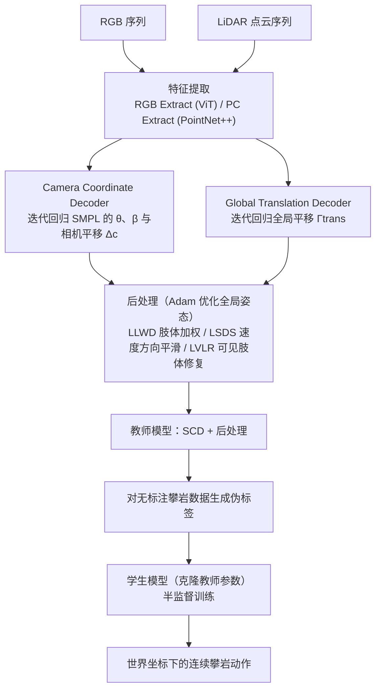

# ClimbingCap

**ClimbingCap: Multi-Modal Dataset and Method for Rock Climbing in World Coordinate** 收录于 [Robot Learning Paper Notebooks](https://imchong.github.io/Robot_Learning_Paper_Notebooks/index.html)（分类：14_Human_Motion）。本页以论文 arXiv 原文（2503.21268v1 正文与参考文献）为依据撰写，并保留深读笔记的摘要信息；附录未获取，相关细节以论文附录与笔记页为准。

## 一句话定义

ClimbingCap 是面向攀岩这类离地动作的全局人体动作恢复（HMR）方法：RGB 在相机坐标恢复姿态、LiDAR 在世界坐标恢复位置，两者联合优化，输出世界坐标下连续的 SMPL 动作；配套发布的 AscendMotion 数据集含 41.2 万帧 RGB、LiDAR 与 IMU 数据，覆盖 22 位攀岩教练、12 面岩壁。

## 英文缩写速查

| 缩写 | 含义 |
|---|---|
| HMR | Human Motion Recovery，人体动作恢复 |
| SMPL | 参数化人体模型，由姿态 θ 与形状 β 描述 |
| SCD | Separate Coordinate Decoding，分坐标解码（方法第一阶段） |
| LLWD / LSDS / LVLR | 后处理三项损失：肢体加权 / 速度方向平滑 / 可见肢体修复 |
| MPJPE / PA-MPJPE / W-MPJPE | 关节位置误差：相机系 / 对齐后 / 世界系 |
| RTE / Jitter | 根平移误差 / 运动抖动 |
| LiDAR / IMU / MoCap | 激光雷达 / 惯性测量单元 / 动作捕捉 |
| Off-ground | 离地动作（攀岩的核心特征） |

## 为什么重要

- **攀岩是离地、强接触的全身动作**，也已进入奥运竞技项目。现有 HMR 数据与方法大多面向地面动作（如行走、跑步）。
- **攀岩数据稀缺**：论文指出仅有两个公开攀岩数据集。SPEED21 为 2D（21 分钟、4.6 万帧）；CIMI4D 为 3D（约 120 分钟、18 万帧），但主要是业余攀岩者的简单动作。
- **现有全局方法在竖直攀爬上失效**：论文实验显示，GVHMR 通过预测水平速度估计运动方向，在以向上攀爬为主的竖直场景中表现明显变差。
- **对人形研究的价值**（本页推断，论文未涉及机器人）：攀岩等多接触、离地的极限动作可作为高难技能的参考动作源；全局位置恢复与世界系跟踪相关。

## 核心原理

**输入**：同步的 RGB 序列与 LiDAR 点云。点云先由世界系经外参转换到相机系，$P_c = \Omega_{w2c} P_w$。
**输出**：SMPL 姿态 $\theta$、形状 $\beta$、相机系平移 $\Delta c$，以及世界系全局平移 $\Gamma_{trans}$。

方法由三个阶段组成（论文 §3）：

1. **分坐标解码（SCD，§3.1）**：RGB 经 ViT、点云经 PointNet++ 提取特征。Camera Coordinate Decoder 迭代回归 $\theta$、$\beta$ 与 $\Delta c$；Global Translation Decoder 迭代回归 $\Gamma_{trans}$。
2. **后处理（§3.2）**：SCD 输出经逆外参转到世界系，再用 Adam 优化全局姿态，共三项损失。LLWD 按身体部位顶点加权，利用全局点云优化身体位置；LSDS 平滑速度方向在岩壁上的变化；LVLR 借助点云位置修复难估计的肢体末端。
3. **半监督训练（§3.3）**：教师模型（SCD + 后处理）对无标注攀岩数据生成伪标签，学生模型克隆教师参数并用伪标签训练。

训练总损失（论文式 3）：

$$
\mathcal{L}= \mathcal{L}_{kp3d} + \mathcal{L}_{kp2d} + \mathcal{L}_\theta^{smpl} + \mathcal{L}_\beta^{smpl} + \mathcal{L}_{traj}
$$

图依据：论文 §3.1 Separate Coordinate Decoding、§3.2 Post-processing、§3.3 Semi-supervised Training / Fig.2。

**AscendMotion 数据集**（§4）：

- 规模：有标注 344 分钟（约 6 小时）、无标注 441 分钟，共 412k 帧；22 位成年攀岩者，12 个真实攀岩场景；包含先锋攀（lead）、抱石（bouldering）与速度攀（speed）。
- 标注流程：预处理（时间同步与空间标定）→ 多阶段全局优化（以 IMU 动捕的平移与姿态为初值，使用全局贴合损失 $\mathcal{L}_{GR}$ 与场景接触损失 $\mathcal{L}_{ST}$）→ 四名观察员人工关键帧修正。

## 工程实践

| 项目 | 论文配置 / 要点 |
|---|---|
| 采集硬件 | LiDAR：Ouster OS1-128，20 FPS；RGB：Hik 1080P，20 FPS；IMU：XSENS MVN，17 个，60 FPS（仅有标注子集穿戴）；场景：Trimble X7 扫描，每个场景约 8000 万点 |
| 时间同步 | RGB 与 LiDAR 经 PTP 同步（以 CollShark Auto 66 为主时钟）；IMU 以锚点帧事后对齐 |
| 标定 | LiDAR 点云注册到高精度扫描场景，并以 LiDAR 坐标系为世界坐标系；IMU 经标定矩阵转换；RGB、LiDAR、IMU 逐帧标定（细节在附录，未获取） |
| 体型 | 每位攀岩者的形状参数 β 由 IPNet 估计，并配合手持点云扫描 |
| 评测指标 | 相机系：MPJPE、PA-MPJPE、PVE、ACCEL（m/s²）、PCK0.3；世界系：WA-MPJPE、W-MPJPE（按 100 帧分段对齐）、RTE、Jitter（m/s³）、T-Error |
| 对比基线 | RGB：TRACE、SLAHMR、WHAM、GVHMR；LiDAR：LiDARCapV2、LiveHPS；LiDAR+RGB：ImmFusion、FusionPose、LEIR |
| 调试建议 | 先看世界系指标（WA-MPJPE、W-MPJPE、RTE）与 Jitter，再看相机系 MPJPE；竖直场景与水平场景应分开统计 |
| 开源状态 | 论文摘要称数据与源码发布于 <http://www.lidarhumanmotion.net/climbingcap/>。核查时该地址返回 403 与备案拦截页，未能读到其中的代码或数据链接；截至本次核查，**代码与数据可用性未核实**（未核实）。 |
| 源码运行时序图 | **不适用**（未核实到可运行的官方代码，项目页不可达） |

## 实验与评测

- **数据集质量（§5.1，Tab. 2）**：按水平与竖直岩壁分别评估全局优化阶段，并与人工标注对比。消融显示加入 $\mathcal{L}_{ST}$ 与 $\mathcal{L}_{GR}$ 后误差下降，两者结合时误差最小（具体数值以原表为准）。
- **消融（§5.3，Tab. 5，AscendMotion）**：共五个变体。RGB-only（无 LiDAR）最差；去掉 LSDS 或 LVLR 时全局指标显著下降；去掉 LLWD 影响有限；去掉半监督模块仅小幅下降。

## 与其他工作对比

- **AscendMotion 基准（§5.2，Tab. 3）**：竖直场景中，ClimbingCap 在指标上显著优于第二名。GVHMR 在竖直场景表现较差。水平场景中，ClimbingCap 在 MPJPE、WA-MPJPE、W-MPJPE 等多数指标最优；WHAM 与 GVHMR 的相机系指标较好，但世界系指标不占优。
- **跨数据集泛化（Tab. 4，CIMI4D）**：不做重训或微调，直接在 CIMI4D 上测试。ClimbingCap 在多数指标上最优，WA-MPJPE 例外。
- **与纯 LiDAR、LiDAR+RGB 方法比较**：论文认为这些方法没有充分考虑相机系与世界系之间的关系，故在本数据集上弱于 ClimbingCap。

## 结论

**一句话总判：ClimbingCap 的增益来自「RGB 管姿态、LiDAR 管世界位置」的分坐标设计加上后处理约束，数据集本身与方法同样是论文的主要贡献；对人形研究，它更直接的价值在数据与参考动作，而非控制方法。**

1. **分坐标是核心取舍**：相机系姿态与世界系位置都要可靠。论文消融显示 RGB-only 最差，全局指标依赖 LSDS 与 LVLR。
2. **竖直攀爬是主要难点**：依赖水平速度先验的全局方法（如 GVHMR）在竖直场景明显退化，评测时应分水平、竖直场景分别报告。
3. **数据与标注成本高**：数据覆盖 22 人、12 面岩壁，标注依赖 IMU 动捕、LiDAR 与场景扫描，复现与扩展成本都高。
4. **半监督收益有限**：去掉半监督模块仅小幅下降，论文称其作用为"modest effect"。
5. **迁移到人形需额外一层**：论文不涉及机器人本体，若要用于人形，还需重定向与物理可行性检查（参见 [mocap-retarget](mocap-retarget.md)）。

## 局限与风险

- **数据覆盖面**：22 位攀岩者、12 面岩壁，难以代表所有岩壁与攀爬风格；使用条款为"仅用于科研目的"，商用或再分发的许可边界未核实。
- **标注误差**：IMU 动捕的平移可能长时间漂移，论文因此引入 LiDAR 与场景约束，并依赖人工关键帧修正。
- **传感器依赖**：ClimbingCap 需要 LiDAR 与场景扫描；论文显示纯 RGB 输入表现最差，不能直接替代为单目方案。
- **评测协议**：世界系 WA-MPJPE 与 W-MPJPE 按 100 帧分段对齐，与整段轨迹的绝对误差不同，比较时需对齐协议。
- **附录缺失**：损失的具体定义、训练流程与标定细节写在论文附录（supplementary）中，arXiv PDF 不含附录，本页未读到。
- **会议与代码未核实**：笔记页与本页称 CVPR 2025 收录，arXiv 版未标注会议（未核实）；项目页不可达，代码与数据开放情况未核实。
- **计算成本未知**：后处理使用 Adam 逐序列优化，论文未报告运行时间与实时性（未核实）。

## 与其他页面的关系

- 分类父节点：[paper-notebook-category-14-human-motion](../overview/paper-notebook-category-14-human-motion.md)
- 总索引：[humanoid-paper-notebooks-index.md](../overview/humanoid-paper-notebooks-index.md)
- 论文对比基线之一：[GVHMR](gvhmr.md)
- 动捕到人形重定向的背景：[mocap-retarget](mocap-retarget.md)

## 核心信息

| 字段 | 内容 |
|------|------|
| 分类 | 14_Human_Motion |
| 深读笔记 | <https://imchong.github.io/Robot_Learning_Paper_Notebooks/papers/14_Human_Motion/ClimbingCap__Multi-Modal_Dataset_and_Method_for_Rock_Climbing_in_World_Coordinate/ClimbingCap__Multi-Modal_Dataset_and_Method_for_Rock_Climbing_in_World_Coordinate.html> |
| arXiv | <https://arxiv.org/abs/2503.21268>（v1，27 Mar 2025，cs.CV） |
| 作者 | Ming Yan、Xincheng Lin、Yuhua Luo、Shuqi Fan、Yudi Dai、Qixin Zhong、Lincai Zhong、Yuexin Ma、Lan Xu、Chenglu Wen、Siqi Shen、Cheng Wang（厦门大学、ShanghaiTech、ETH AI Center 等） |
| 会议 | CVPR 2025（据笔记页；arXiv 版未标注，未核实） |
| 项目页 | <http://www.lidarhumanmotion.net/climbingcap/>（核查时不可达，未核实） |
| 笔记阅读日期 | 2026-06-21 |

## 参考来源

- [humanoid_pnb_climbingcap.md](../../sources/papers/humanoid_pnb_climbingcap.md)
- 论文 arXiv 原文：<https://arxiv.org/pdf/2503.21268>（v1；正文与参考文献已通读，附录未包含）
- 深读笔记：<https://imchong.github.io/Robot_Learning_Paper_Notebooks/papers/14_Human_Motion/ClimbingCap__Multi-Modal_Dataset_and_Method_for_Rock_Climbing_in_World_Coordinate/ClimbingCap__Multi-Modal_Dataset_and_Method_for_Rock_Climbing_in_World_Coordinate.html>

## 推荐继续阅读

- [机器人论文阅读笔记：ClimbingCap](https://imchong.github.io/Robot_Learning_Paper_Notebooks/papers/14_Human_Motion/ClimbingCap__Multi-Modal_Dataset_and_Method_for_Rock_Climbing_in_World_Coordinate/ClimbingCap__Multi-Modal_Dataset_and_Method_for_Rock_Climbing_in_World_Coordinate.html)
- [ClimbingCap 论文（arXiv 2503.21268）](https://arxiv.org/abs/2503.21268)
