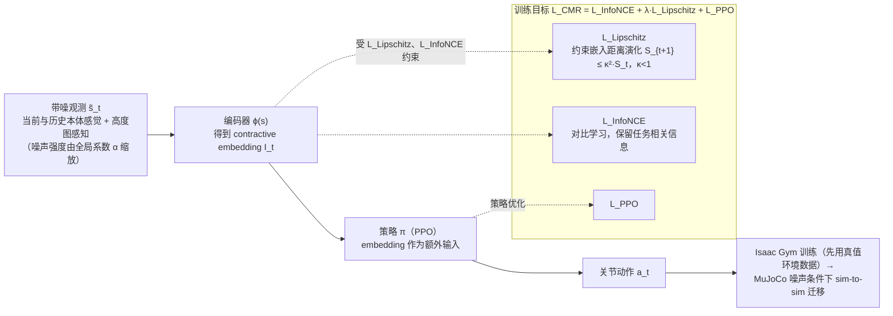

# CMR

**CMR: Contractive Mapping Embeddings for Robust Humanoid Locomotion on Unstructured Terrains** 收录于 [Robot Learning Paper Notebooks](https://imchong.github.io/Robot_Learning_Paper_Notebooks/index.html)（分类：05_Locomotion）。本页基于论文 PDF **全文**（正文 §I–IV 与附录证明、超参表）通读整理，并以深读笔记作对照；细节以论文原文为准。

## 一句话定义

非结构地形上，人形机器人的传感器会出错、模型也不准，观测噪声容易在闭环里被放大成失稳。CMR 的思路是：与其在原始观测空间里硬抗噪声，不如把观测映射到一个「收缩」潜空间——在那里相邻状态的扰动会随时间逐步收缩衰减。它用对比学习（InfoNCE）保住任务相关的语义结构（防止收缩过度把有用信息也压没了），同时用 Lipschitz 正则显式逼策略满足收缩条件，二者写成一个辅助损失直接加进 PPO；理论上还证明了：当潜动态满足收缩性（κ<1），策略性能因噪声的退化被一个与时间步长无关的上界 O(η/(1−κ)) 框住，而非标准分析里随时域指数爆炸。

## 英文缩写速查

| 缩写 | 全称 | 解释 |
|---|---|---|
| CMR | Contractive Mapping for Robustness | 本文方法名：把观测映到收缩嵌入空间以抵抗噪声 |
| PPO | Proximal Policy Optimization | 底层策略优化算法；CMR 的辅助损失与 $\mathcal{L}_{PPO}$ 相加 |
| InfoNCE | 对比学习损失（式 (4)，文献 [48]） | 保留任务相关语义结构，防止收缩过度丢信息 |
| Lipschitz | 利普希茨约束 / 正则 | 约束嵌入距离的演化，逼出 κ<1 的收缩条件 |
| κ (kappa) | 收缩因子 | 式 (3) 要求 κ<1；默认取 0.1 |
| λ | Lipschitz 损失权重 | 式 (5) 中平衡对比项与收缩项；默认取 0.05 |
| τ | 对比学习温度 | InfoNCE 中的 temperature；默认取 0.04 |
| HIM | Hybrid Internal Model | 对比基线，混合内部嵌入表示（文献 [24]） |
| LCP | Lipschitz-Constrained Policies | 对比基线，用梯度惩罚实现 Lipschitz 约束（文献 [23]） |
| POMDP | Partially Observable Markov Decision Process | 论文的问题建模：部分可观测马尔可夫决策过程 |

## 为什么重要

- **轻量即插**：只是一个辅助损失项，不动 PPO 主体、不加独立估计模块，迁移成本低，适合挂到现有 locomotion 训练框架上。
- **抗噪即抗未建模扰动**：把「观测噪声」当成一类一般扰动来收缩，对传感缺失/失真、轻度建模误差都有缓冲作用。
- **理论给安全感**：收缩界 `O(η/(1−κ))` 与时域无关，意味着长时域 rollout 下鲁棒性不随步数崩坏，对长距离穿越有意义（该结论的前提见 [局限与风险](#局限与风险)）。
- **限制**：收缩因子 κ、Lipschitz 权重 λ 需调，过强收缩可能压掉有用信息（靠 InfoNCE 平衡）；论文主要在仿真 + sim-to-sim 验证，真机结果论文称在验证中、未报告；超出训练噪声包络（α≫3）的极端情形仍可能退化（推断，论文未测）。

## 流程总览

图依据：论文 §III-C/D、Fig. 2、式 (3)–(5)（"embedding 作为额外输入"见 Fig. 2 图注）

## 核心原理

**输入。** 真实状态 $s_t$ 被带噪观测替代：$\tilde s_t = s_t + \delta_{s_t}$，其中 $\delta_{s_t}\sim U([-\zeta,\zeta]^d)$ 为零均值均匀噪声。策略观测 $\tilde s_t = [c_t,\ o^{proprio}_t,\ o^{percept}_t,\ a_{t-1}]$ 包含：速度命令 $c_t\in\mathbb{R}^3$；本体感知（基座角速度、29 个关节位置与速度，论文写作 $\mathbb{R}^{64}$，但其列出的分量合计 61 维，（未核实））；$15\times15$ 的机器人中心高度图（1.5 m × 1.5 m，0.1 m 分辨率）；上一步动作。

**机制。** 编码器 $\phi$ 把观测映射为嵌入 $I_t$，再作为额外输入交给策略。嵌入的训练由两个辅助项约束：

1. **Lipschitz 收缩项**：令 $S_t=\|\phi(s_t)-\phi(s'_t)\|^2$，惩罚违反收缩条件的情形：

$$
\mathcal{L}_{\text{Lipschitz}}=\mathbb{E}\big[\,[\,S_{t+1}-\kappa^2 S_t\,]_+\,\big],\qquad 0<\kappa<1
$$

   其中 $[x]_+=\max(x,0)$，只在 $S_{t+1}>\kappa^2 S_t$ 时产生梯度。

2. **对比项（InfoNCE）**：用轨迹内的正、负样本做对比学习，防止收缩把任务相关信息一起压没。温度为 $\tau$，相似度经 $w^{\sigma}_{i,j}=\exp(\mathrm{sim}(\phi(s_i),\phi(s_j^{\sigma}))/\tau)$ 计算（$\sigma\in\{+,-\}$）；式 (4) 的完整形式以原文为准。

两项与 PPO 目标合成一个训练目标：

$$
\mathcal{L}_{CMR}=\mathcal{L}_{InfoNCE}+\lambda\,\mathcal{L}_{Lipschitz}+\mathcal{L}_{PPO}
$$

**理论直觉。** 定理 1 给出普通闭环的界 $J(\pi^*)-J(\pi)\le O(H L_r L_f^{H})\,M\delta_{max}$，噪声经动力学的 Lipschitz 常数 $L_f$ 按 $L_f^H$ 随时域指数放大。定理 2 假设嵌入满足 $\|\phi(s_{t+1})-\phi(s'_{t+1})\|\le\kappa\|\phi(s_t)-\phi(s'_t)\|+\epsilon_t$（$\kappa<1$），且 $\mathbb{E}\|a_t-a^*_t\|\le\eta$，则 $J(\pi^*)-J(\pi)\le O\!\big(\eta/(1-\kappa)\big)$，与 $H$ 无关。附录还给出策略梯度特征 $g(\tilde s)$ 的偏差与方差界：偏差 $\le\kappa L_\pi\zeta\sqrt{d/3}$，方差 $\le\kappa^2L_\pi^2\zeta^2 d/3$（按附录证明推导，（未核实排版））。

**输出。** 策略 $\pi$（PPO 训练）输出关节动作 $a_t$。训练时先在 Isaac Gym 中使用真值环境数据，再迁移到 MuJoCo 的噪声条件下做 sim-to-sim 测试。

## 核心机制

1. **收缩映射做鲁棒表示**：论文作者声称这是首次把**收缩映射定理**引入学习式人形运动的抗噪问题——观测扰动在潜空间随时间衰减，而非闭环放大。
2. **可证明的退化上界**：证明潜动态收缩时，噪声导致的性能退化被 `O(η/(1−κ))` 框住，**与时域无关**，跳出 `O(L_f^H)` 指数爆炸。
3. **对比 + Lipschitz 双目标**：InfoNCE 保任务信息、Lipschitz 逼收缩，二者互补，避免「只收缩不保信息」或「只保信息不抗噪」。
4. **即插即用、近零开销**：写成辅助损失 `L_InfoNCE + λL_Lipschitz + L_PPO`，直接挂进现成深度 RL（PPO）管线。
5. **实证抗噪更强**：六类非结构地形、五档噪声（α 从 0.01 到 3）下，走得比 HIM / Naive PPO 远，并优于 LCP（部分设置下差距较小，见 [实验与评测](#实验与评测)）；sim-to-sim 零样本迁移指令跟踪更准、能耗更低。

方法拆解（深读笔记小节）：核心：把观测映到「收缩」潜空间；两个目标缝在一起；总损失（即插即用）；网络与训练管线。

## 核心信息

| 字段 | 内容 |
|------|------|
| 分类 | 05_Locomotion |
| 深读笔记 | <https://imchong.github.io/Robot_Learning_Paper_Notebooks/papers/05_Locomotion/CMR__Contractive_Mapping_Embeddings_for_Robust_Humanoid_Locomotion/CMR__Contractive_Mapping_Embeddings_for_Robust_Humanoid_Locomotion.html> |
| arXiv | <https://arxiv.org/abs/2602.03511> |
| 机构 | University of Southampton · Westlake University · Nanjing University |
| 作者 | Qixin Zeng, Hongyin Zhang, Shangke Lyu, Junxi Jin, Donglin Wang\*, Chao Huang\* |
| 发表 | 2026-02-03 (arXiv v1) |
| 源码 | 未开源（未核实）：论文正文未给出代码或项目页链接；arXiv 摘要页的 Code/Data 区块只列出第三方聚合服务，未见官方仓库。以后续版本或作者主页为准 |
| 笔记阅读日期 | 2026-06-15 |

## 实验与评测

**设置。** 机器人为 Unitree G1，分两种配置：上身锁定的 12-DOF 下肢控制，以及 29-DOF 全身控制。基线为 HIM（[24]，Long et al. [5] 将其用于人形）、LCP（[23]）与 Naive PPO。噪声分五档：Noise Case I 为仅高度图 α=2；Case II 为本体与感知全部 α=0.01；Case III–V 为两类观测同时加噪，α 分别为 1、2、3。训练只在感知观测上加 α=1 噪声。

**Table I（不平地形，Noise Case I，指标按论文表）。**

| 方法 | Joint Power (↓) | Action Rate (↓) | Action Smoothness (↓) | Distance (↑) |
|---|---|---|---|---|
| HIM | 1971.9 | 10.6 | 10.8 | 2.3 |
| LCP | 1333.3 | 4.1 | 164.8 | 5.8 |
| Naive PPO | 13618.3 | 27.0 | 5431.7 | 0.1 |
| CMR | 1120.7 | 4.1 | 4.5 | 7.0 |

Case II 下 CMR 的 Distance 为 7.2，Joint Power 为 1012.3；LCP 的 Joint Power 为 976.3，略低于 CMR（论文承认 LCP 在该项上有优势）。

**Table II（随机速度命令）。** Case I 下 CMR 的 Distance 为 6.1，LCP 为 5.6，HIM 为 2.1；OOD 命令与 Case II 下 CMR 为 6.2，LCP 为 5.0，且 CMR 的 Joint Power（1395.6）最低。

**Table III（sim-to-sim，MuJoCo，Noise Case I）。** 与 HIM 对比：Command Tracking Error 2.36 vs 2.51，DoF Vel 71.34 vs 81.09，Action Rate 2.67 vs 2.84，Joint Power 1023.32 vs 1465.43。表中标准差较大，论文未给出显著性检验。

**其他。** Fig. 1 与 Fig. 5 显示六类地形（不平地、踏脚石、平衡木等）上 CMR 的行走距离均高于基线（仅据图注与正文描述，图内逐点数值未核实）。Fig. 3–4 用 t-SNE 显示 CMR 的潜轨迹偏离更小、聚类分离更清晰。Fig. 6 为 τ、λ、κ 的消融，论文描述为「距离与能耗」间的一致 trade-off，默认值 τ=0.04、λ=0.05、κ=0.1 被作为平衡方案（图内数值未核实）。作者还观察到噪声加大时行走距离反而增加，并假设是嵌入空间带来的「自稳定」性质（论文自述为假设）。真机实验论文称「正在验证」，未给出结果。

## 结论

**CMR 的取舍是「用一个辅助损失换可证明的抗噪」：不加独立估计模块、不动 PPO 主体，把鲁棒性问题从原始观测空间搬到收缩潜空间里去解。**

- 真正起作用的是**双目标的相互牵制**：Lipschitz 正则逼出 κ<1 的收缩（本文取 0.1），InfoNCE 负责不让收缩把任务相关语义一起压掉；缺任一边就退化成「只收缩不保信息」或「只保信息不抗噪」（消融只报告了超参 trade-off，未做逐项去除实验）。
- 理论卖点是退化上界 `O(η/(1−κ))` **与时域无关**，跳出标准分析里 `O(L_f^H)` 的指数放大；这一结论依赖收缩条件成立的假设，因此收益主要体现在长时域 rollout（推断）。
- 实证边界清楚：六类非结构地形、五档噪声（α 0.01→3）下优于 HIM / Naive PPO，相对 LCP 的优势在多数指标上存在但幅度不一；论文未测 α≫3 的情形。
- 主要风险是调参与验证深度：κ 与 Lipschitz 权重 λ 需要调，过强收缩会压掉有用信息；验证止于仿真 + sim-to-sim，真机表现待后续。
- 工程状态：未见官方代码，「即插即用」的收益需要自行实现，勿假设可直接复现。

## 与其他工作对比

| 路线 | 代表 | 抗噪手段 | 理论保证 | 与本文的差异 |
|---|---|---|---|---|
| 收缩嵌入 + 对比学习 | CMR（本文） | 收缩潜空间 + InfoNCE + Lipschitz 辅助损失 | 退化界 $O(\eta/(1-\kappa))$，与 $H$ 无关（有假设） | 作为辅助损失并入 PPO，不做 teacher-student 蒸馏 |
| 混合内部模型 | HIM [24]，Long et al. [5] 用于人形 | 学习内部状态嵌入（论文归为 adaptation / mimic 类） | 论文未给出同类界 | CMR 直接约束嵌入的演化，而非只学估计 |
| Lipschitz 约束策略 | LCP [23] | 梯度惩罚作用于策略的 Lipschitz 约束 | 论文未给出同类界 | 作者评述 LCP 仅限基础行走、低复杂度地形；CMR 在六类地形上比较 |
| 低通滤波 / 平滑奖励 | [21], [22] 等 | 滤波观测或平滑动作 | 无 | 作者认为需要调参且会降低探索，并影响跨机器人迁移 |

与 wiki 内同主题页的对照：域随机化等工程手段见 [domain-randomization](../concepts/domain-randomization.md)；噪声训练的仿真—真机关系见 [sim2real](../concepts/sim2real.md)。

## 工程实践

| 项目 | 论文设定 |
|---|---|
| 机器人 | Unitree G1，12-DOF（上身锁定）与 29-DOF（全身）两种配置 |
| 仿真训练 | Isaac Gym，1200 个并行环境，单张 A100 GPU |
| 策略优化 | PPO，双 critic 结构（沿用 BeamDojo [6]）；actor 隐层 [512, 256, 128]，ELU |
| 编码器 | 隐层 [256, 256, 128]，ELU（Contractive Encoder） |
| 关键超参 | 对比温度 τ=0.04；κ=0.1；λ=0.05（Table IV） |
| 训练噪声 | 仅注入感知观测，α=1（沿用 BeamDojo）；评测时 α 可至 3 |
| 地形 | 六类非结构地形 I–VI（不平地、踏脚石、平衡木等） |
| 评测指标 | Joint Power、Action Rate、Action Smoothness、DoF Vel / Acc、Distance、Command Tracking Error |
| sim-to-sim | 训练策略迁移到 MuJoCo，并在噪声条件下测试 |
| 源码开放核查（步骤 2.5） | 论文正文未给出项目页；arXiv 摘要页未见官方仓库。判定为未开源（未核实） |
| 源码运行时序图 | **不适用**（未开源：论文与 arXiv 摘要页均未给出官方仓库；无可对齐的运行入口） |

复现注意：论文未详细说明 InfoNCE 的正、负样本构造方式，也未给出嵌入 $\phi$ 的输入/输出维度与 Lipschitz 项中 $(s_t, s'_t)$ 配对的具体采样方式（未核实），需要以附录与作者代码（若后续发布）为准。调试时可优先监控 Distance、Joint Power 与 Action Smoothness 三项，它们在论文表格中的差异最明显。

## 局限与风险

- **理论前提较强**：定理 2 假设嵌入满足收缩条件（$\kappa<1$ 且含 $\epsilon_t$ 项），而网络是否在训练中稳定地满足该条件，论文只通过 Lipschitz 损失间接施加，没有在线验证。界 $O(\cdot)$ 中的常数（$L_\phi$、$L_f$、$M$ 等）没有数值估计。
- **η 过大时的信息损失**：作者自述，若约束 $\mathbb{E}\|a_t-a^*_t\|\le\eta$ 中的收缩过强，任务相关信息可能被丢失。
- **超参敏感**：τ、λ、κ 的 trade-off 只在仿真消融中报告；跨机器人、跨任务的通用性未验证。
- **验证范围窄**：训练仅在 Isaac Gym 中进行，评测为仿真加 MuJoCo sim-to-sim；真机结果论文未报告。训练时只对感知加噪（α=1），对本体噪声的泛化依赖评测阶段的结果。
- **统计说明不足**：多个指标的标准差与均值相当（如 LCP 的 Action Smoothness 为 164.8 ± 861.3），论文未报告显著性检验，结论宜看趋势。
- **异常现象未解释**：噪声加大时行走距离增加，作者以「自稳定」假设解释，未给出独立证据。
- **复现风险**：无官方代码，Lipschitz 项与 InfoNCE 的实现细节需自行补全（见 [工程实践](#工程实践)）。
- **文献表述**：「首次将收缩映射定理引入人形运动」为作者声称，未经独立核对。

## 与其他页面的关系

- 分类父节点：[paper-notebook-category-05-locomotion](../overview/paper-notebook-category-05-locomotion.md)
- 总索引：[humanoid-paper-notebooks-index.md](../overview/humanoid-paper-notebooks-index.md)
- 同目录对照：[BeamDojo 笔记](paper-notebook-beamdojo-learning-agile-humanoid-locomotion-on-s.md)（本文噪声注入与双 critic 的来源）
- 方法与概念：[PPO](../methods/ppo.md)、[sim2real](../concepts/sim2real.md)、[domain-randomization](../concepts/domain-randomization.md)、[privileged-training](../concepts/privileged-training.md)
- 仿真与平台：[Isaac Gym](isaac-gym.md)、[MuJoCo](mujoco.md)、[Unitree G1](unitree-g1.md)

## 参考来源

- [humanoid_pnb_cmr.md](../../sources/papers/humanoid_pnb_cmr.md)（本文原始来源归档，已含 arXiv 链接，无需另建 raw source）
- 深读笔记：<https://imchong.github.io/Robot_Learning_Paper_Notebooks/papers/05_Locomotion/CMR__Contractive_Mapping_Embeddings_for_Robust_Humanoid_Locomotion/CMR__Contractive_Mapping_Embeddings_for_Robust_Humanoid_Locomotion.html>
- 论文：<https://arxiv.org/abs/2602.03511>
- [arXiv PDF](https://arxiv.org/pdf/2602.03511)：已通读全文（§I–IV、附录证明与 Table IV 超参）。Fig. 1–6 仅依据图注与正文描述，图内数值未逐一核对（未核实）。

## 推荐继续阅读

- [CMR 深读笔记（Robot Learning Paper Notebooks）](https://imchong.github.io/Robot_Learning_Paper_Notebooks/papers/05_Locomotion/CMR__Contractive_Mapping_Embeddings_for_Robust_Humanoid_Locomotion/CMR__Contractive_Mapping_Embeddings_for_Robust_Humanoid_Locomotion.html)
- [CMR 论文 arXiv 摘要页](https://arxiv.org/abs/2602.03511)
- [LCP：Learning smooth humanoid locomotion through lipschitz-constrained policies（arXiv:2410.11825）](https://arxiv.org/abs/2410.11825)，本文的 Lipschitz 基线
- [BeamDojo（arXiv:2502.10363）](https://arxiv.org/abs/2502.10363)，本文噪声注入与训练框架的来源
