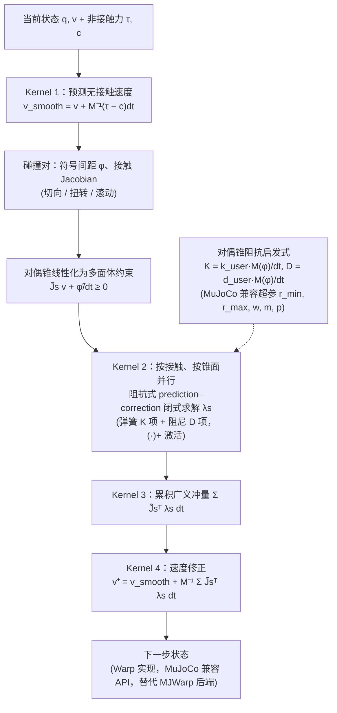
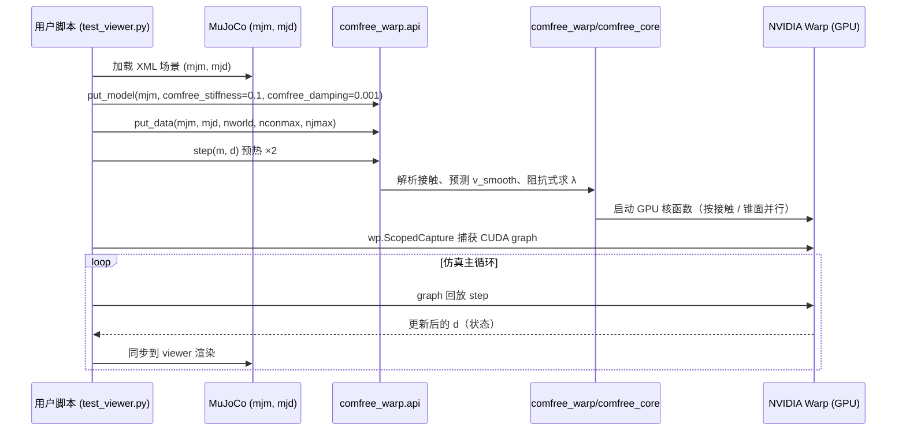

# ComFree-Sim

**ComFree-Sim: A GPU-Parallelized Analytical Contact Physics Engine for Scalable Contact-Rich Robotics Simulation and Control**（Borse, Xie, Huang, Jin；ASU IRIS 与 UIUC；arXiv:2603.12185）收录于 [Robot Learning Paper Notebooks](https://imchong.github.io/Robot_Learning_Paper_Notebooks/index.html)（分类：11_Simulation_Benchmark）。本页基于 arXiv PDF 全文（v2，2026-03-14）通读后整理，并核对了项目页与官方源码仓库的开源状态。

## 一句话定义

ComFree-Sim 是一个用 NVIDIA Warp 实现的 GPU 接触物理后端：它不再用全局互补约束（LCP/NCP）迭代求解接触，而是在库仑摩擦锥的对偶锥里用一次阻抗式（impedance-style）预测—修正，把每个接触冲量写成闭式解。接触对之间与摩擦锥面之间因此可以解耦并行，运行时随接触数量近线性增长；对外提供 MuJoCo 兼容接口，可作为 MJWarp 的替代后端。

## 英文缩写速查

| 缩写 | 全称 | 解释 |
|---|---|---|
| LCP / NCP | (Non)Linear Complementarity Problem | (非)线性互补问题，经典接触求解把「法向不穿透 + 摩擦」写成的数学形式，需要整体迭代求解 |
| Dual Cone | 对偶锥 | 库仑摩擦锥的对偶集合，ComFree-Sim 在其中做预测与修正 |
| Cone Facet | 摩擦锥面 | 把二次型的摩擦锥用若干多面体面线性化后的每个面，可按面独立并行 |
| Impedance | 阻抗 | 用刚度 K 与阻尼 D 把「约束违背量」映射成稳定的接触冲量（弹簧—阻尼式） |
| 6D Contact | 六维接触模型 | 同时建模切向、扭转（torsional）、滚动（rolling）摩擦的统一接触模型 |
| MJWarp | MuJoCo Warp | DeepMind 与 NVIDIA 合作的 GPU 版 MuJoCo，本文的主要对比基线 |
| MPC / MPPI | 模型预测控制 / 模型预测路径积分 | 每步用仿真器滚动采样来优化控制序列；MPPI 是本文用的采样式优化器 |
| Warp | NVIDIA Warp | NVIDIA 的 Python GPU 核函数框架，ComFree-Sim 的实现后端 |

## 为什么重要

- 接触求解决定了刚体仿真的物理保真度、数值稳定性与运行时间；主流引擎为了强制非穿透与库仑摩擦，通常把每步求解写成互补或约束优化问题，单步代价随接触数增长常呈超线性，这对批量仿真、可微仿真与在线规划都是瓶颈（论文 §I）。
- 即使是 GPU 化的 MJWarp，在接触密集场景下步长时间也会明显增长，实时部署受限（论文 §I）。
- 本文提供的是一个可直接替换 MJWarp 后端的解析接触实现：在论文的基准与灵巧手实验中给出了比 MJWarp 更低的单步/每次 MPPI 计算时间，是「用更轻的接触模型换取高频仿真吞吐」这一取舍的具体样本。
- 列入 Paper Notebooks 策展清单，便于与全库 [机器人学习论文笔记总索引](../overview/humanoid-paper-notebooks-index.md) 及分类父节点交叉检索。

## 解决什么问题

**问题陈述**：接触密集任务的仿真为什么慢？主流物理引擎（MuJoCo、Bullet 等）把接触当成一个**互补问题**来解——所有接触点之间相互耦合，必须用迭代器（PGS、CG、Newton 等）**全局**求约束优化。接触越多，耦合越强，迭代越慢，而且这种全局耦合**很难切成 GPU 上互不依赖的并行任务**。

这就带来两难：要保留接触的保真度，就得做全局迭代求解，既慢又难并行；要换成简化接触模型（如早期 ODE、Bullet 常用的近似），又会牺牲物理保真度与稳定性。ComFree-Sim 试图在两者之间找到第三条路：保持摩擦锥可行性，同时让每个接触的计算局部化。

## 核心原理

**输入**：广义位置/速度 $(q, v)$、非接触广义力 $(\tau, c)$、惯量 $M$、碰撞检测得到的接触集合（每个接触的符号间距 $\phi$、接触 Jacobian、摩擦系数 $\mu_s$），以及用户给定的全局阻抗参数 $(k_{user}, d_{user})$。

**关键机制**：

1. **免互补接触建模**（核心）：先用无接触力预测平滑速度 $v^+_{smooth} = v + M^{-1}(\tau - c)\,dt$（式 2），再把二次型的对偶锥约束线性化为多面体约束 $\tilde J_s v + \tilde\phi/dt \ge 0$（式 6–7）。对每个接触、每个锥面，接触力由阻抗式给出（式 8，PDF 抽取的符号与 Algorithm 1 略有出入，以下为论文语义的简写，符号细节（未核实））：
   $$\lambda_s \;\approx\; -\Big[K\big(\tilde J_s v^+_{smooth}\,dt+\tilde\phi\big)+D\,\tilde J_s v^+_{smooth}\Big]_+$$
   其中 $K$ 为「弹簧」刚度、$D$ 为「阻尼」，$[\cdot]_+$ 为逐元素取正部。约束违背量越大，冲量越大；取正部的激活模式决定粘着、滑动或分离三种状态（论文 Fig. 2）。
2. **6D 摩擦统一建模**：切向摩擦（滑动）、扭转摩擦（绕法向）与滚动摩擦（切平面内）都写成对偶锥约束（式 3–5），因此共用同一套闭式更新。
3. **对偶锥阻抗启发式**：精确计算 $K$、$D$ 需要逐接触求逆，代价较高，论文用对角近似 $K(q)\,dt + D(q) \approx (\tilde J M^{-1}\tilde J^\top)^{-1}/dt$（式 10），再取经验形式 $K = k_{user}M(\phi)/dt$、$D = d_{user}M(\phi)/dt$（式 11），其中 $M(\phi)$ 是随间距变化的约束空间阻抗（式 12–13），沿用 MuJoCo 的 $(r_{min}, r_{max}, w, m, p)$ 参数接口，默认 $[0.9, 0.95, 0.001, 0.5, 2.0]$。
4. **GPU 并行的四个 Kernel**（Algorithm 1）：(I) 按自由度并行算 $v^+_{smooth}$；(II) 按接触 $k$、摩擦类型 $s$、锥面 $j$ 并行求 $\lambda$；(III) 并行累加广义冲量 $\sum \tilde J^\top\lambda\,dt$；(IV) 按自由度并行做速度修正 $v^+ = v^+_{smooth} + M^{-1}\sum\tilde J^\top\lambda\,dt$。

**输出**：修正后的下一时刻速度 $v^+$（再积分得到位姿）。论文声称该更新在摩擦锥可行性上「由构造保证」（primal 库仑约束 (3) 满足），细节证明引用前作 [8]（RSS 2025），本次未核实。

**直觉**：与其把所有接触一起解一个大问题，不如让每个接触只看自己的「违背量」，用一个弹簧—阻尼式的一步修正把它拉回可行域；接触之间的耦合只通过最后一步的广义冲量累加体现。

## 流程总览

图依据：论文 §III（式 (1)–(13)、Fig. 2）与 Algorithm 1（GPU 核心四个 Kernel）。

## 工程实践

**接入方式**（依据官方仓库 README 与 `test_local/test_viewer.py`，已核对）：

1. 安装：仓库根目录 `uv sync` 或 `pip install .`。
2. 把 MuJoCo 模型交给后端：`cfwarp.put_model(mjm, comfree_stiffness=..., comfree_damping=...)`，再 `cfwarp.put_data(mjm, mjd, nworld=..., nconmax=..., njmax=...)`。
3. 先 warm-up 两次 `cfwarp.step(m, d)`，再用 `wp.ScopedCapture` 捕获 CUDA graph 循环调用，与 MJWarp 的用法保持一致。
4. 对比基线：同一脚本里把 `engine` 切换为 `0=MJC`、`1=MJWARP`、`2=COMFREE_WARP`（默认），仓库另有 Franka 抓取与灵巧手吞吐脚本。

**关键参数与论文取值**（论文 §IV–VI，仅列论文明确给出的数字）：

| 场景 | $k_{user}$ | $d_{user}$ | 时间步 $dt$ | 其他 |
|---|---|---|---|---|
| 穿透/稳定性基准（§IV-A, C） | 0.1 / 0.3 / 0.5 | 0.001 / 0.005 | 0.002 s | 与 MJWarp 同碰撞检测与积分 |
| Allegro 吞吐（§IV-E） | 0.1 | — | — | 256–4096 个并行环境，1500 步 |
| 灵巧手 MPC（§V） | 0.1 | 0.002 | 0.004 s | MPPI：N=256，horizon H=48，温度 2×10⁻³，采样标准差 0.02 |
| 动作重定向（§VI） | 0.55 | 0.55×10⁻³ | — | SPIDER 框架，MuJoCo-CPU 做全轨迹回放 |

**调试与验收指标**（论文采用的做法，可直接沿用）：

- 穿透深度：碰撞密集的落体测试，记录所有接触对的穿透，统计 1000 步后的均值与标准差（论文 Fig. 3）。
- 摩擦：扭转/滚动摩擦用受控接触测试，检查角速度或质心速度是否单调衰减（论文 Fig. 4–5，仅定性结果）。
- 稳定性：自由落体 + 滑动测试，检查水平速度是否单调衰减、无异常漂移，并扫描 $(k_{user}, d_{user}, dt)$（论文 Fig. 6）。
- 性能：单步墙钟时间随接触数的曲线（Fig. 7）与并行环境下的吞吐（Fig. 8）。
- 控制：任务成功率（位置误差 < 0.02 m 且四元数误差 < 0.04）与 MPPI 单步耗时（Table I）。

**机器人应用**：论文把它作为 MPPI 的滚动模型用于 LEAP Hand 灵巧手的在线 in-hand 重定向（相机 + FoundationPose 位姿估计，约 25 Hz，闭环 35–72 Hz）；也作为 SPIDER 动作重定向的优化仿真器（由 MuJoCo-CPU 回放全轨迹）。

**不适用 / 未验证**：本次只通读了论文正文（8 页 PDF，未见独立附录），未在本仓库内复现任何数值结果；仓库完整 Python API 文档位于外部 `irislab.tech/comfree-doc`，本页未逐条核对（未核实）。

## 源码运行时序图

以下时序对齐官方仓库 `test_local/test_viewer.py` 与 `comfree_warp/api.py` 的调用顺序（2026-11-06 核对）：

## 实验与评测

论文在 MJWarp 基线上做了四组评测（均为论文自报数据，硬件为 AMD 32 核 CPU + RTX 4090）：

- **穿透深度**（Fig. 3，表格数值见正文）：MJWarp 为 1.7 ± 4.9 mm；ComFree-Sim 在 $(k_{user}, d_{user}) = (0.1, 0.001)$ 时为 3.9 ± 6.9 mm，$(0.5, 0.001)$ 时降至 1.0 ± 2.1 mm。作者的结论是「调参得当时可与 MJWarp 相当或更低」，默认参数下穿透反而更大。
- **摩擦与稳定性**：扭转/滚动摩擦测试与自由落体滑动测试仅给出单调衰减曲线，未给出可比的定量指标（Fig. 5–6）。
- **运行时随接触数的扩展**（Fig. 7）：512 个并行环境，每环境三组堆叠的小积木阵列；论文称 ComFree-Sim 约 3 倍快，步长时间近似线性，MJWarp 为超线性且方差更大。具体数值点未在正文给出（未核实）。
- **吞吐**（Fig. 8）：Allegro 在手内抓取场景，环境数 256–4096，正文称约 2 倍于 MJWarp（摘要与 Fig. 1 称 2–3 倍，二者口径不一，以正文为准）。
- **灵巧手实机 MPC**（Table I，LEAP Hand，每个目标 20 次试验）：MPPI 单步耗时 ComFree-Sim 为 13.9–28.2 ms，MJWarp 为 34.0–68.8 ms，平均约 2.4 倍加速（中位约 2.2 倍）；八个任务的平均成功率从 MJWarp 的约 24% 提升到约 51%（论文称平均 +27 个百分点）。个别任务例如 Cube（Yaw）成功率 80% vs 65%，Cylinder（Yaw）50% vs 10%。
- **动作重定向**（Table II，Unitree G1 五个动作，MuJoCo-CPU 回放）：位置误差与关节误差在 ComFree-Sim 与 MJWarp 之间基本接近（如 Cartwheels 0.037 vs 0.033 m），四元数误差略高；MPPI 耗时在 Cartwheels、Martial Arts、Dance、Getup 上更低，但 PushBox 上 ComFree-Sim 更慢（1.171 s vs 0.719 s）。

## 与其他工作对比

| 维度 | ComFree-Sim（本文） | MJWarp（MuJoCo Warp） | 经典互补/全局迭代接触 |
|---|---|---|---|
| 接触求解 | 免互补，对偶锥内闭式阻抗更新 | 互补/凸锥优化，迭代求解 | 全局 LCP/NCP，迭代（PGS、CG、Newton 等） |
| 并行粒度 | 接触对与锥面可独立并行 | GPU 版 MuJoCo，耦合在求解器内 | 耦合强，难切分 |
| 运行时 | 论文称近线性，约 3 倍（单步） | 超线性增长 | 随接触数超线性增长（论文泛化描述） |
| 保真度依据 | 穿透/摩擦/稳定性与 MJWarp 相当（论文自报） | 参考实现 | — |
| 控制任务 | MPC 成功率与速度均更好（Table I），重定向略降精度 | 作为基线 | — |
| 接口 | MuJoCo 兼容，可替代后端 | 原生 | — |

论文没有与 Isaac Sim/PhysX 或 Newton 等其他 GPU 引擎做横向对比，因此本页不作此类结论。

## 结论

**ComFree-Sim 的关键一步是把接触从「全局互补约束」里解出来：一旦每个接触冲量能闭式求出，GPU 并行就是这个公式的顺带结果，而不是靠工程优化硬凑出来的。**

1. **真正起作用的是免互补公式**：在库仑摩擦锥的对偶锥里做一次阻抗式预测—修正，把接触冲量写成闭式解，去掉了 LCP/NCP 全局迭代带来的接触间耦合。
2. **速度优势主要体现在接触密集场景**：论文中单步约 3 倍、吞吐约 2 倍（口径不一），MPC 中 MPPI 单步约 2.4 倍加速，且成功率平均提升约 27 个百分点；但在 PushBox 这类任务上没有优势。
3. **精度不是免费的**：默认阻抗参数下穿透比 MJWarp 大，需要按任务调 $k_{user}$、$d_{user}$ 与 $dt$；论文也说它需要比 MJWarp 更小的步长（实验统一用 0.002 s）。
4. **建模上是「启发式 + 闭式」**：$K$、$D$ 由经验阻抗启发式给出，6D 摩擦的扭转/滚动部分只有定性验证。把它当成与互补解等价的物理模型使用是不妥的，应当按任务做 sim-to-sim 核验（论文 Table II 的 MJWarp 对照即是一个例子）。
5. **工程落地门槛低，但许可要注意**：源码开放且可通过 MuJoCo 兼容接口替换后端，但 `comfree_core` 采用**非商业学术研究许可**（商用需 ASU IRIS 书面许可），vendored 的 MJWarp 代码为 Apache-2.0。纳入产品前必须先看许可。

## 局限与风险

- **仅有一篇论文的自报数据**：所有性能与精度数字都来自作者的实验设置；§IV–VI 的基准规模、场景与对比基线有限，未见独立复现（本页未复现）。
- **穿透与参数敏感**：默认参数下穿透均值与方差都高于 MJWarp（3.9 ± 6.9 mm vs 1.7 ± 4.9 mm）；论文称对 $(k_{user}, d_{user})$ 的单调趋势稳定，但需要为每类接触调参。
- **摩擦模型的验证较弱**：扭转与滚动摩擦只给出定性衰减曲线，缺少与解析解或 MuJoCo 的定量对照。
- **接口与模型覆盖范围（未核实）**：论文测试的是 MuJoCo 风格的刚体场景与凸基元；仓库 README 的示例包含柔性体与高度场（floppy、hfield），但本次未核对这些模块在 ComFree 后端下的支持程度。
- **sim-to-sim 差异**：论文实验中，控制与重定向的全轨迹仍由 MuJoCo-CPU 回放，说明 ComFree 与 MuJoCo 的接触行为存在可度量的差距；直接用于 sim2real 时需要单独评估（参见 [sim2real](../concepts/sim2real.md)）。
- **许可风险**：`comfree_core` 为非商业学术研究许可，商用、为盈利实体提供服务、或将其纳入专利申请都受限（见仓库 `comfree_warp/comfree_core/LICENSE`）。
- **论文版本**：本页基于 arXiv v2 的 8 页 PDF，没有独立附录；若 v1 或后续版本数字有变，以最新版为准。

## 与其他页面的关系

- 分类父节点：[paper-notebook-category-11-simulation-benchmark](../overview/paper-notebook-category-11-simulation-benchmark.md)
- 总索引：[humanoid-paper-notebooks-index.md](../overview/humanoid-paper-notebooks-index.md)
- 接触动力学背景：[contact-dynamics](../concepts/contact-dynamics.md)、[contact-rich-manipulation](../concepts/contact-rich-manipulation.md)
- 互补与摩擦锥形式化：[contact-complementarity](../formalizations/contact-complementarity.md)、[friction-cone](../formalizations/friction-cone.md)
- 对照的 GPU 仿真后端与框架：[mujoco-warp](../entities/mujoco-warp.md)、[mujoco](../entities/mujoco.md)、[nvidia-warp](../entities/nvidia-warp.md)
- 可微与批量仿真背景：[differentiable-simulation](../concepts/differentiable-simulation.md)

## 参考来源

- [comfree_sim_arxiv_2603_12185.md](../../sources/papers/comfree_sim_arxiv_2603_12185.md)（arXiv 原文归档）
- [humanoid_pnb_comfree-sim.md](../../sources/papers/humanoid_pnb_comfree-sim.md)（Paper Notebooks 策展归档）
- arXiv PDF（已通读）：<https://arxiv.org/pdf/2603.12185>，摘要页 <https://arxiv.org/abs/2603.12185>
- 项目页：<https://irislab.tech/comfree-sim/>（页头含 GitHub 链接；文档链接 <https://irislab.tech/comfree-doc/intro.html>）
- 官方源码：<https://github.com/asu-iris/comfree_warp>（2026-11-06 浅克隆核对：README、`test_local/`、`comfree_warp/` 与许可文件）
- 深读笔记：<https://imchong.github.io/Robot_Learning_Paper_Notebooks/papers/11_Simulation_Benchmark/ComFree-Sim__GPU-Parallelized_Analytical_Contact_Physics_Engine/ComFree-Sim__GPU-Parallelized_Analytical_Contact_Physics_Engine.html>

## 推荐继续阅读

- [ComFree-Sim 项目页](https://irislab.tech/comfree-sim/)：视频、结果与代码入口
- [ComFree-Sim 文档](https://irislab.tech/comfree-doc/intro.html)：API 与示例（本次未逐条核对）
- [asu-iris/comfree_warp](https://github.com/asu-iris/comfree_warp)：源码与 `test_local/` 运行脚本
- [机器人论文阅读笔记：ComFree-Sim](https://imchong.github.io/Robot_Learning_Paper_Notebooks/papers/11_Simulation_Benchmark/ComFree-Sim__GPU-Parallelized_Analytical_Contact_Physics_Engine/ComFree-Sim__GPU-Parallelized_Analytical_Contact_Physics_Engine.html)
- 前作（免互补接触建模）：W. Jin, "Complementarity-free multi-contact modeling and optimization for dexterous manipulation," RSS 2025（论文参考文献 [8]，本次未获取原文）
