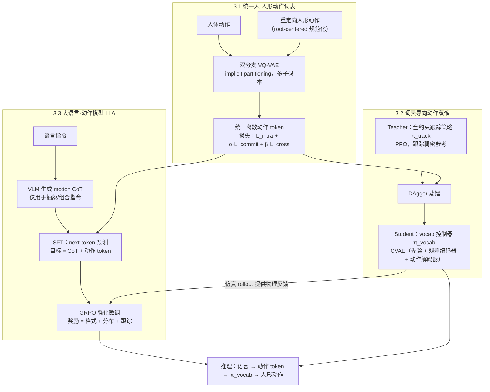

# Commanding Humanoid by Free-form Language

**Commanding Humanoid by Free-form Language: A Large Language Action Model with Unified Motion Vocabulary** 收录于 [Robot Learning Paper Notebooks](https://imchong.github.io/Robot_Learning_Paper_Notebooks/index.html)（分类：04_Loco-Manipulation_and_WBC）。本页已对照论文 PDF 正文（arXiv v3）核对方法与实验数字；论文附录未随任何版本的 PDF 提供，架构与训练超参细节以附录与深读笔记为准（见 [局限与风险](#局限与风险)）。

## 一句话定义

Humanoid-LLA 是一个大语言-动作模型：把自由形式自然语言直接映射为人形全身可执行动作，先学习人与人形共用的离散动作词表连接语言与控制，再用「监督动作思维链 + 物理反馈强化学习」两阶段微调保证物理稳定。

## 英文缩写速查

| 缩写 | 含义 |
|---|---|
| LLA | Large Language Action model，大语言-动作模型，即 Humanoid-LLA 本体 |
| VQ-VAE | 向量量化变分自编码器，把人与人形动作编码为离散 token |
| CoT | Chain-of-Thought，动作思维链，仅用于抽象或组合指令的分步分解 |
| CVAE | 条件变分自编码器，学生动作控制器 π_vocab 的结构 |
| DAgger | Dataset Aggregation，把教师跟踪策略蒸馏为词表控制器所用的算法 |
| GRPO | Group Relative Policy Optimization，无 critic 的组相对策略优化，用于 RL 精修 |
| MPJPE | Mean Per-Joint Position Error，平均关节位置误差（mm），物理侧指标 |
| FID | Fréchet Inception Distance，此处在人形动作空间中衡量生成分布与参考分布的距离 |

## 为什么重要

- **离散动作词表是连接 LLM 与控制的接口**：论文用一个共享离散空间同时服务语言建模、词表控制器与跨本体迁移。与 [UniAct](paper-loco-manip-161-023-uniact.md) 同属「离散量化作为语言与控制接口」的思路（UniAct 的具体量化方式为未核实细节）。
- **瓶颈不在人类文本-动作数据，而在可在特定人形上执行的成对数据**：论文指出既有流水线会丢弃大部分在某一人形上不可执行的人类动作（§1），词表让全部人类语料用于语言对齐，仅可执行子集用于物理接地。
- **「监督 CoT + 物理反馈 RL」是语言-动作模型的训练范式之一**：先学映射，再用仿真物理信号把生成拉回可执行流形。
- **与 [LangWBC](paper-bfm-37-langwbc.md)、[RLPF](paper-notebook-rl-from-physical-feedback-aligning-large-motion.md) 等路线形成对照**：前者偏重端到端执行、语言对齐较弱；后者在人类动作空间做物理反馈，二值奖励易削弱多样性（论文自述）。

## 流程总览

图依据：论文 §3 / Fig.2。

## 解决什么问题

用自由语言指挥人形面临两道坎：

- **数据稀缺**：可在特定人形上执行的成对「语言-动作」数据少，且难以大规模采集；
- **物理不稳定**：全身动作对小误差敏感，接触动力学会放大误差导致摔倒。

论文还指出两类既有范式的局限：运动模仿范式（文本生成人体动作再重定向）中，生成器只在人类分布上训练，常产生违反人形动力学的动作；蒸馏范式（从特权跟踪器蒸馏文本条件策略）把语义理解与运动控制压进同一个变分模型，削弱语言接地。论文要做的是：用统一动作词表把语言与物理控制对齐，并通过训练让模型对新指令泛化且保持物理保真。

## 核心原理

**输入 → 机制 → 输出**：输入为自然语言指令 $w$（训练时另有人体动作、重定向人形动作及其 motion CoT）；模型先把语言译为动作 token 序列，再由词表控制器执行为关节目标；输出为人形全身动作，推理时无需解码与重定向。

### 三个阶段

1. **统一人-人形词表（§3.1）**：人体与重定向人形动作先做 root-centered 规范化，经双分支 VQ-VAE 编码，潜变量按 implicit partitioning 切分为子块并由多个子码本量化。训练目标为
   $$\mathcal{L} = \mathcal{L}_{intra} + \alpha\,\mathcal{L}_{commit} + \beta\,\mathcal{L}_{cross}$$
   其中 $\mathcal{L}_{cross}$ 要求同一 token 从任一本体解码都得到同一运动基元，这是「跨本体共享词表」的关键约束。
2. **词表导向蒸馏（§3.2）**：先训练特权教师 π_track（PPO，跟踪稠密参考），再用 DAgger 把它蒸馏为学生 π_vocab。学生是 CVAE（先验 $\rho$、残差编码器 $E$、动作解码器 $D$），观测中的词表约束经随机掩码 $M(\cdot)$ 注入，训练损失为动作回归加 KL 正则。
3. **大语言-动作模型（§3.3）**：
   - **SFT**：以 next-token 预测学习「CoT + 动作 token」；CoT 由 Qwen2.5-VL 基于渲染的动作序列生成，仅用于抽象或组合指令，原子指令直接透传。
   - **GRPO 精修**：对每个提示采样一组候选输出，用组内归一化优势更新策略，并以 KL 约束靠近参考模型。奖励为 $r = r_{format} + r_{dist} + r_{track}$：
     - $r_{format}$ 为二值：必须是 `<think>…</think>` 后接 `<motion>…</motion>`，且 token 按 cb0→cb(N-1) 循环顺序出现；
     - $r_{dist}$ 用对比式运动编码器与文本编码器，同时衡量与参考动作的分布距离和与语义描述的一致性；
     - $r_{track}$ 为学生控制器仿真 rollout 的位置项与加速度项之和。

### 核心机制

1. **统一人-人形动作词表**：把高层语言语义与物理可控的底层控制连接起来，缓解数据稀缺与模态鸿沟；
2. **两阶段微调**：监督动作思维链学映射，物理反馈 RL 补物理稳定；
3. **跨本体泛化**：同一套 token 语义可迁移到不同人形（论文实机为 Unitree G1 与 Booster T1）；
4. **泛化与保真的目标**：对新语言指令泛化，生成多样且物理可信的动作。

## 核心信息

| 字段 | 内容 |
|------|------|
| 分类 | 04_Loco-Manipulation_and_WBC |
| 深读笔记 | <https://imchong.github.io/Robot_Learning_Paper_Notebooks/papers/04_Loco-Manipulation_and_WBC/Commanding_Humanoid_by_Free-form_Language__LLA_with_Unified_Motion_Vocabulary/Commanding_Humanoid_by_Free-form_Language__LLA_with_Unified_Motion_Vocabulary.html> |
| arXiv | <https://arxiv.org/abs/2511.22963> |
| 项目页 | <https://humanoidlla.github.io/> |
| 原文版本 | arXiv v3（修订于 2026-05-11），PDF 正文 14 页（至参考文献），无附录 |
| 开源状态 | 截至 2026-11-06 核查：项目页 Code 区写 `Code (coming soon)`，未列代码或模型仓库 URL（页内唯一的 GitHub 链接指向页面模板，非本文代码）。归类为「宣称将开源 / 未列链接」 |
| 作者 | Zhirui Liu、Kaiyang Ji、Ke Yang、Yahao Fan、Jingyi Yu、Ye Shi、Jingya Wang（上海科技大学等） |
| 发表 | 2025 年 11 月（arXiv 首版） |
| 笔记阅读日期 | 2026-06-21（深读笔记）；原文核对 2026-11-06 |

## 实验与评测

**设置**：在 AMASS 的文本标注子集（约 27K 条动作序列，mink 重定向到人形）上实验。教师策略过滤出 G1 可执行子集，约保留全集 70%；物理阶段仅在该子集上进行。每条原始描述用 Qwen2.5-VL 生成 motion CoT。

**指标**：生成侧用 FID（参考集为教师策略跟踪得到的可执行动作集，即衡量与可执行分布的接近度）、MM-Dist、R-Precision（top-3）与 Div；物理侧用 Succ.、MPJPE（mm）、Evel（mm/frame）与 Eacc（mm/frame²）。该协议由论文作者设计，文中称尚无统一的人形动作评测协议。

**生成指标（论文 Table 1 左）**，箭头表示优方向：

| 方法 | FID↓ | R-Prec.↑ | MM-Dist↓ | Div.→ |
|---|---|---|---|---|
| MDM+Retarget | 11.759 | 0.262 | 6.599 | 6.419 |
| OmniH2O | 17.159 | 0.222 | 8.021 | 5.868 |
| UH-1 | 8.682 | 0.295 | 5.896 | 6.749 |
| LangWBC | 6.171 | 0.320 | 5.587 | 6.031 |
| UniAct-T2M | 8.513 | 0.284 | 6.031 | 6.514 |
| **Humanoid-LLA** | **2.626** | **0.447** | **4.911** | 7.122 |

**物理指标（论文 Table 1 右）**：

| 方法 | Succ.↑ | MPJPE↓ | Evel↓ | Eacc↓ |
|---|---|---|---|---|
| OmniH2O | 72.2% | 73.43 | 11.78 | 10.48 |
| UH-1 | 68.8% | 121.51 | 16.59 | 14.80 |
| LangWBC（*） | 76.0% | − | − | − |
| RLPF | 80.0% | 140.00 | − | − |
| UniAct-T2M | 82.5% | 60.33 | 9.15 | 8.93 |
| **Humanoid-LLA** | **87.6%** | **56.43** | **8.92** | **8.74** |

**消融（论文 Table 2）**：

| 变体 | FID↓ | R-Prec.↑ | MM-Dist↓ | Div.→ | Succ.↑ | MPJPE↓ | Evel↓ | Eacc↓ |
|---|---|---|---|---|---|---|---|---|
| w/o CoT | 10.423 | 0.270 | 6.222 | 6.405 | 64.90% | 90.43 | 14.11 | 11.23 |
| w/o RLFT | 5.132 | 0.331 | 5.443 | 6.668 | 68.64% | 78.31 | 12.12 | 10.01 |
| w/o r_dist | 4.597 | 0.342 | 5.401 | 6.892 | 85.33% | 61.27 | 9.31 | 9.02 |
| w/o r_track | 2.578 | 0.439 | 5.013 | 7.007 | 76.72% | 66.42 | 10.89 | 9.77 |
| Humanoid-LLA（完整） | 2.626 | 0.447 | 4.911 | 7.122 | 87.6% | 56.43 | 8.92 | 8.74 |

（*）LangWBC 与 RLPF 在论文表中仅有部分指标。

**真机**：Unitree G1 与 Booster T1 上的定性演示（论文 Fig.3，包含「Shake hand」「Squat in place」「Hug a friend」及需要分解的抽象指令），正文未给实机成功率或试验次数。

## 与其他工作对比

- **MDM+Retarget / OmniH2O**：在人类动作空间生成后重定向，生成多样性较好，但物理可行性不足（论文 §4.2 解释为人形与人类动作空间差异导致跟踪失败）。
- **UH-1**：在机器人轨迹上学习潜空间解码，物理指标优于前两者，但 Succ. 为 68.8%，MPJPE 为 121.51。
- **LangWBC**：语言与控制联合的 CVAE 策略，执行强但语言对齐弱（论文解释）；生成侧 FID 6.171 优于 UH-1。
- **RLPF**：用物理反馈约束 LLM 生成器，但在人类空间优化、二值奖励偏保守，Succ. 为 80.0%。
- **UniAct-T2M**：最接近的基线，同样使用离散量化；本文在 Succ. 上高 5.1 个百分点，MPJPE 低 3.9。

以上均为论文内部对比，基线的复现细节（是否与原始设置一致）在附录中，本页未核实。

## 结论

**Humanoid-LLA 的关键不是「让大模型直接生成关节动作」，而是先造一个人与人形共用的离散动作词表作接口，再用物理反馈把生成拉回可执行；语义对齐与物理稳定被拆成两步分别解决。**

1. **词表是接口** — 统一词表让全部人类语料参与语言对齐，可执行子集负责物理接地，这是缓解数据稀缺的主要手段。
2. **两阶段分工有可量化的收益** — 去掉 CoT 后 FID 从 2.626 升至 10.423、R-Precision 从 0.447 降至 0.270；去掉 RLFT 后 Succ. 从 87.6% 降至 68.64%，MPJPE 从 56.43 升至 78.31。
3. **奖励项各司其职，但有取舍** — r_dist 主要保持生成分布与语义一致（去掉后 FID 升至 4.597）；r_track 保证执行稳定（去掉后 Succ. 降至 76.72%）。去掉 r_track 的 FID 反而略优（2.578 对 2.626），说明跟踪约束在生成指标上有小代价。
4. **表内领先，但评测是作者自定义的** — 生成与物理指标在同一协议下均领先所列基线；协议与基线复现细节未经独立核实，跨论文数字不宜直接比较。
5. **适用边界** — 真机只有定性展示，训练只用 G1 可执行子集（约 70%），长时程规划与多模态 grounding 为作者列出的未来方向。
6. **复现门槛** — 截至 2026-11-06 项目页未发布代码，附录超参亦未取得，目前只能按论文描述理解方法，难以复现。

## 局限与风险

- **实机证据弱**：Unitree G1 与 Booster T1 仅有定性演示（Fig.3），没有成功率、试验次数或失败案例统计；「跨本体」结论的强度无法从正文判断。
- **执行范围受限**：物理阶段只使用 G1 可执行子集（约 70%）。对其他人形，词表与控制器需要重新蒸馏与训练，迁移成本未在正文量化。
- **CoT 依赖 VLM**：动作思维链由 Qwen2.5-VL 基于渲染动作生成，标注质量没有独立评估；消融只说明「有 CoT 比没有好」。
- **指标设计存在偏差**：FID 的参考分布来自教师跟踪策略，衡量的是与「可执行分布」的接近度，而非人类真实分布；物理指标也由作者定义。
- **统计可靠性未报告**：表中未见多随机种子的方差或置信区间（附录未核实）。
- **作者自述的首创性**：「first free-form text-to-humanoid whole-body control」为论文自述，未独立核实。
- **附录缺失**：架构细节、奖励权重、训练超参与基线实现均在附录中，本页未能核对（未核实），直接影响复现。
- **常见误区**：Humanoid-LLA 的 LLM 输出的是词表 token，经 π_vocab 执行，并不直接输出关节角；把它当成「端到端 LLM 控制器」会误解其接口设计。

## 工程实践

| 项目 | 内容 |
|---|---|
| 输入 / 输出 | 输入：自然语言指令（原子指令直接透传；抽象或组合指令先经 VLM 生成 motion CoT）；输出：动作 token 经 π_vocab 得到人形关节目标 |
| 数据规模（论文报告） | AMASS 文本标注子集约 27K 条；G1 可执行子集约 70%；SFT 使用全部增强后的人类语料，RL 只用可执行子集 |
| 关键超参 | **未核实**（论文说明在附录，本次未取得） |
| 调试指标 | 生成侧 FID、R-Precision、MM-Dist、Div；物理侧 Succ.、MPJPE、Evel、Eacc。消融表显示 Succ. 对 RLFT 最敏感 |
| 真机平台 | Unitree G1、Booster T1（定性演示，论文 Fig.3） |
| 开源状态 | 项目页 `Code (coming soon)`，未列仓库；截至 2026-11-06 无可运行官方代码 |
| 源码运行时序图 | **不适用**（项目页无可运行官方代码，仅有宣称将开源的占位表述） |

## 关联页面

- 分类父节点：[paper-notebook-category-04-loco-manipulation-and-wbc](../overview/paper-notebook-category-04-loco-manipulation-and-wbc.md)
- 总索引：[humanoid-paper-notebooks-index.md](../overview/humanoid-paper-notebooks-index.md)
- 最接近的基线：[UniAct](paper-loco-manip-161-023-uniact.md)（同为离散量化的文本到动作路线）
- 语言到全身控制的对照：[LangWBC](paper-bfm-37-langwbc.md)、[RLPF](paper-notebook-rl-from-physical-feedback-aligning-large-motion.md)、[SENTINEL](paper-sentinel.md)、[OmniH2O](paper-hrl-stack-08-omnih2o.md)
- 同簇（语言 / 多模态驱动全身控制）：[FRoM-W1](paper-loco-manip-161-096-from-w1.md)、[SafeFlow](paper-loco-manip-161-104-safeflow.md)、[ULTRA](paper-notebook-ultra-unified-multimodal-control-for-autonomous.md)
- 方法概念：[GRPO](../methods/grpo.md)、[DAgger](../methods/dagger.md)、[PPO](../methods/ppo.md)
- 数据与工具：[AMASS](amass.md)、[mink](mink-ik.md)

## 参考来源

- [humanoid_pnb_commanding-humanoid-by-free-form-language.md](../../sources/papers/humanoid_pnb_commanding-humanoid-by-free-form-language.md)
- [humanoid_pnb_commanding-humanoid-by-free-form-language-a-larg.md](../../sources/papers/humanoid_pnb_commanding-humanoid-by-free-form-language-a-larg.md)
- 深读笔记：<https://imchong.github.io/Robot_Learning_Paper_Notebooks/papers/04_Loco-Manipulation_and_WBC/Commanding_Humanoid_by_Free-form_Language__LLA_with_Unified_Motion_Vocabulary/Commanding_Humanoid_by_Free-form_Language__LLA_with_Unified_Motion_Vocabulary.html>
- 论文：<https://arxiv.org/abs/2511.22963>
- [arXiv PDF](https://arxiv.org/pdf/2511.22963)：已通读 v3 正文（§1–§5 与参考文献，共 14 页）。论文引用的附录未随 v1、v2、v3 任一 PDF 提供，附录内容未读。
- 项目页：<https://humanoidlla.github.io/>（核查于 2026-11-06：Code 区为 `Code (coming soon)`）

## 推荐继续阅读

- [机器人论文阅读笔记：Commanding Humanoid by Free-form Language](https://imchong.github.io/Robot_Learning_Paper_Notebooks/papers/04_Loco-Manipulation_and_WBC/Commanding_Humanoid_by_Free-form_Language__LLA_with_Unified_Motion_Vocabulary/Commanding_Humanoid_by_Free-form_Language__LLA_with_Unified_Motion_Vocabulary.html)
- [论文 arXiv 摘要页](https://arxiv.org/abs/2511.22963)：确认版本与修订历史，并查找附录获取渠道
- [项目页 humanoidlla.github.io](https://humanoidlla.github.io/)：视频与真机演示，待代码发布后再核对
