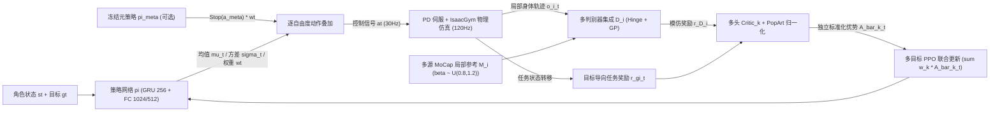

# Composite Motion Learning with Task Control

**Composite Motion Learning with Task Control**（Pei Xu, Xiumin Shang, Victor Zordan, Ioannis Karamouzas，ACM TOG 2023 / arXiv:2305.03286v1）提出了一种面向物理仿真角色的多目标强化学习框架，无需人工拼接参考动作即可自动组合多源局部运动并兼顾目标控制。条目收录于 [Robot Learning Paper Notebooks](https://imchong.github.io/Robot_Learning_Paper_Notebooks/index.html)（分类：13_Physics-Based_Animation）。

## 一句话定义

通过局部身体动作解耦、多判别器对抗模仿学习、单策略多 Critic（配合 PopArt 值归一化）及基于元策略的增量动作叠加，使物理仿真人形角色在无需人工合成复合参考动作的前提下，同时模仿多源局部运动并完成多个目标导向控制任务。

## 英文缩写速查

| 缩写 | 英文全称 | 简要说明 |
|------|----------|----------|
| RL | Reinforcement Learning | 通过与环境交互最大化长期回报来学习策略 |
| WBC | Whole-Body Control | 协调全身关节满足多任务/约束的控制基础设施 |
| Sim2Real | Simulation to Real | 把仿真中学到的策略迁移落地真机的工程主线 |
| GAN | Generative Adversarial Network | 用判别器替代手工模仿奖励的对抗学习框架 |
| PPO | Proximal Policy Optimization | 本文用于策略更新的同策略（on-policy）强化学习算法 |
| PopArt | Preserving Outputs Precisely, while Adaptively Rescaling Targets | 自适应归一化多目标 Critic 价值目标并保持输出不变的稳定化技术 |
| DTW | Dynamic Time Warping | 动态时间规整，用于对齐并度量合成动作与参考动作的轨迹误差 |

## 为什么重要

- 传统基于 MoCap 的物理角色控制（如 DeepMimic、AMP、ICCGAN）通常依赖**全身参考动作**，面对上/下身新组合或附加任务目标时，需要重新采集或手工剪辑混合动作且难以保证物理可行性。
- 本文直接在训练期将全身模仿拆分为**多组局部身体判别器**，并用**多 Critic 独立标准化优势**取代手工调节标量奖励权重，解决了难易目标失衡问题；同时增量学习机制把复杂复合任务（如 `Aiming+Run`）的采样需求降低一个数量级。
- 该方法在本库中也是[Learning to Ball](./paper-notebook-learning-to-ball.md) 官方实现的方法底座，属于[机器人学习论文笔记总索引](../overview/humanoid-paper-notebooks-index.md)与物理动画分类页的关键方法节点。

## 核心信息

| 字段 | 内容 |
|------|------|
| 作者 | Pei Xu, Xiumin Shang, Victor Zordan, Ioannis Karamouzas |
| 出处 | ACM Transactions on Graphics (TOG), Vol. 42, No. 4 (2023) / arXiv:2305.03286v1 |
| DOI / 原文 | `10.1145/3592447` / <https://arxiv.org/abs/2305.03286> |
| 仿真与角色 | IsaacGym（120 Hz 物理仿真 / 30 Hz 控制策略），15 个刚体连杆、28 DoF（网球任务右手腕额外 +3 DoF），线性 PD 伺服 |
| 分类 | 13_Physics-Based_Animation（[PROGRESS.md](https://github.com/ImChong/Robot_Learning_Paper_Notebooks/blob/main/papers/PROGRESS.md) 待深读） |
| 计划文件夹 | `papers/13_Physics-Based_Animation/composite-motion-learning-with-task-control` |

## 核心机制

1. **全身运动解耦与局部参考采样**：将全身位姿 $P_t$ 拆分为多个局部身体组 $P_t^i$（如上身 vs. 下身，或在杂耍行走任务中拆为双臂 vs. 躯干+头+骨盆+双腿）；必要时组间可共享关键连杆状态（如一条腿的状态同时纳入两组以避免同手同脚顺拐）。下身观察以末帧根连杆（骨盆）局部坐标表示，上身以父连杆（骨盆或躯干）逐帧局部坐标表示。从参考片段 $\mathcal{M}_i$ 采样时采用动态时间间隔 $\Delta t = \beta T$（$T = 1/30\text{ s}$，$\beta \sim \text{Uniform}(0.8, 1.2)$），自动适应不同来源动作的节奏差异。
2. **多判别器集成（Discriminator Ensemble）**：为每个身体组 $i$ 分配独立判别器集成 $D^i = \{D_n^i\}_{n=1}^N$，输入 $n_i + 2$ 帧局部轨迹 $o_t^i$（瞄准为 3 帧，其余为 5 帧），使用 Hinge Loss 与梯度惩罚（$\lambda_{\text{GP}} = 10$）训练，输出裁剪均值作为模仿奖励 $r_t^{D^i} \in [-1, 1]$。
3. **单策略多 Critic 与 PopArt 平衡**：避免简单加权求和 $\sum \omega_k r_t^k$ 导致策略偷懒只学简单目标，为每个模仿奖励和目标任务奖励分配独立价值头 $\text{Critic}_k$，分别计算并标准化优势函数 $\bar{A}_t^k = (A_t^k - \mathbb{E}_t[A_t^k]) / \sqrt{\text{Var}_t[A_t^k]}$，再按固定权重 $\omega_k$ 合并策略梯度 $\mathcal{L}_\pi = \mathbb{E}_t[\sum_k \omega_k \bar{A}_t^k \log \pi(a_t | s_t, g_t)]$（大多数任务 $\omega_k = 1/K$ 即可生效）；每个 Critic 配备独立 PopArt 归一化器以应对不同目标收益量纲差异。
4. **基于元策略的增量学习（Incremental Learning）**：复用冻结预训练元策略 $\pi^{\text{meta}}$ 的动作输出，协同策略学习残差均值与按自由度动态变化的权重向量 $\mathbf{w}_t$：$\pi(a_t | s_t, g_t, a_t^{\text{meta}}) = \mathcal{N}(\boldsymbol{\mu}_t + \mathbf{w}_t \odot \text{Stop}(a_t^{\text{meta}}), \boldsymbol{\sigma}_t^2)$。相比从零训练或全量 MoE 线性混合，$\mathbf{w}_t$ 能随状态自动决定各关节多大程度沿用元策略（如 `Aiming+Walk` 下身权重高、上身由协同策略接管；`Crouch+AimingWalk` 则上身沿用元策略、下身接管）。

### 方法流程图

## 实验与评测

- **网络与训练配置**：策略网络采用 256 维 GRU + FC(1024, 512)；Critic 与判别器集成均为 GRU(256) + FC(256, 128)。512 并行 PPO worker，单卡 Nvidia V100 训练。PPO 超参：$\gamma = 0.95$，$\lambda = 0.95$，$\epsilon = 0.2$，策略/Critic/判别器学习率分别为 $5\times 10^{-6}$、$1\times 10^{-4}$、$1\times 10^{-5}$。
- **双片段组合模仿精度（Table 1，20M 样本，约 1.5 h）**：使用快速 DTW 度量连杆位置误差，上下身误差高度均衡，未出现偏科放弃难动作的现象：
  - `Chest Open + Front Jumping Jack (lower)`：0.11 ± 0.02 m / 0.16 ± 0.03 m
  - `Front Jumping Jack (upper) + Walk In-place`：0.30 ± 0.03 m / 0.29 ± 0.02 m
  - `Chest Open + Squat`：0.10 ± 0.01 m / 0.09 ± 0.01 m
  - `Waist Twist + Leg Lunge`：0.15 ± 0.04 m / 0.13 ± 0.02 m
  - `Hand Waving + Walk`：0.06 ± 0.03 m / 0.09 ± 0.02 m
  - `Punch + Walk` / `Punch + Run`：0.11 ± 0.02 m & 0.10 ± 0.01 m / 0.17 ± 0.03 m & 0.14 ± 0.01 m
- **目标导向复合任务**：成功验证 Target Heading（多风格上身+定向行走）、Target Location + 握持网球拍奔跑、Tennis Swing（非结构化步法+正手挥拍击球）、Target Location + 3 球抛接杂耍（4 个目标同时优化）、以及 Aiming + Crouch/Walk/Run（支持运行时交互式切换步态）。
- **增量学习效率对比（Fig. 11）**：从零训练复杂目标任务需 **15–30 小时**、**$2\times 10^8$–$4\times 10^8$** 样本；借助增量学习复用元策略可压缩至 **30 分钟–2 小时**。在 `Aiming+Run` 上，增量学习仅用 **1.5 小时、约 20M 样本**即收敛，而无增量学习的从零训练需**额外多花约 20 小时与 3 亿（300M）样本**才能达到相近水平。
- **消融实验（Fig. 10 & Fig. 11）**：`w/o MO`（直接相加奖励）在 `ChestOpen+JumpingJack` 与 `Punch+Run` 中会顾此失彼，甚至在 `Aiming+Walk/Run` 中为刷目标分完全牺牲风格模仿；`MO+PopArt` 相比 `w/o PopArt` 收敛更快、方差更小、最终模仿误差更低。

## 与其他工作对比

- **相比传统全身模仿（DeepMimic / AMP / ICCGAN）**：无需预先拼接或采集「一边跑步一边挥拳/瞄准」的全身组合 MoCap 片段，通过多判别器在局部关节空间各自监督。
- **相比标量加权多目标 RL / 分层 RL**：不需要预先设计任务层级或反复试错奖励缩放权重，利用多 Critic 优势标准化自动把异构模仿奖励与任务奖励对齐到同一梯度更新尺度。
- **相比 MoE 动作线性混合**：MoE 难以线性切分「只保留 A 专家下身、替换成 B 专家上身」的局部动作；本文通过逐 DoF 门控权重 $\mathbf{w}_t$ 与残差叠加直接实现局部技能复用与跨维度（$\mathbf{a}_t^{\text{meta}}$ 维度可不同于 $\mathbf{a}_t$）增量适配。

## 常见误区或局限

1. **非相位锁定、不区分多阶段时序**：判别器仅评估短窗口连续转移（3–5 帧），未引入相位锁或状态机，不擅长严格多阶段长程流程控制。
2. **需要人工选择可兼容的身体拆分与动作组合**：系统无法自动判断动作组合在物理上是否兼容。论文给出明确失败案例：将身体左右二分分别模仿行走与跳跃时，角色只能做出既不像走也不像跳的折中动作；在平均速度约 **3.5 m/s** 的奔跑中执行 3 球杂耍也无法成功接球。
3. **无法免训练运行时直接拼装**：新增未见组合动作仍需重新训练（尽管增量学习已大幅缩短训练时长），尚不能把两个独立已训练策略在推理期直接零样本组合。
4. **物理动画边界与风格偏差**：忽略不同 MoCap 采集者的体型/风格差异，且评估全部在 IsaacGym 物理动画仿真中完成（含简化接触规则如杂耍近手自动吸附），直接用于真机前仍需补充 Sim2Real 约束与硬件适配。

## 结论

**Composite Motion Learning with Task Control 用「多局部判别器 + 多 Critic 优势标准化 + 逐自由度增量门控」解决了一个核心工程痛点：无需采集全排列组合 MoCap 数据即可训练出风格自然且能完成多目标任务的物理仿真控制器。**

1. **多目标不调权的本质是梯度尺度对齐**：各任务与判别器独立配 Critic + PopArt 并标准化优势，使异构奖励在同一更新步幅下推进，比手工调标量权重稳定得多。
2. **增量学习把复杂复合技能训练成本压低约 10–15 倍**：如 `Aiming+Run` 从 300M+ 样本（20h+）降至 20M 样本（1.5h），工程上可先沉淀通用 locomotion 元策略再按需叠加操作技能。
3. **身体拆分的物理耦合决定成败**：上/下身或双臂/躯干腿拆分可行，但违背动力学平衡的拆分（如左右腿各自模仿走与跳）或超物理极限的叠加（3.5 m/s 狂奔杂耍）必然退化。
4. **注意仿真假设边界**：实验基于 IsaacGym 虚拟人形（120 Hz + 简化手部捕获判定），在真机部署上不能直接套用，更适合作为动作先验或上游行为合成基座（如 [Learning to Ball](./paper-notebook-learning-to-ball.md)）。

## 与其他页面的关系

- 分类页：[paper-notebook-category-13-physics-based-animation](../overview/paper-notebook-category-13-physics-based-animation.md)
- 总索引：[humanoid-paper-notebooks-index.md](../overview/humanoid-paper-notebooks-index.md)
- 后续篮球长程组合应用：[Learning to Ball](./paper-notebook-learning-to-ball.md) — 官方实现基于本方法 + ICCGAN

## 参考来源

- [humanoid_pnb_composite-motion-learning-with-task-control.md](../../sources/papers/humanoid_pnb_composite-motion-learning-with-task-control.md)
- [Robot Learning Paper Notebooks · PROGRESS.md](https://github.com/ImChong/Robot_Learning_Paper_Notebooks/blob/main/papers/PROGRESS.md)
- 论文原文：Pei Xu et al., *Composite Motion Learning with Task Control*, ACM TOG 2023, [arXiv:2305.03286](https://arxiv.org/abs/2305.03286)

## 推荐继续阅读

- [Paper Notebooks 阅读进度（PROGRESS.md）](https://github.com/ImChong/Robot_Learning_Paper_Notebooks/blob/main/papers/PROGRESS.md)
- [ACM TOG 论文主页 / arXiv:2305.03286](https://arxiv.org/abs/2305.03286)
