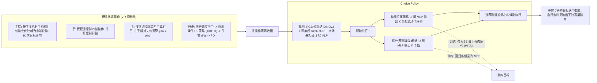

# Coordinated Humanoid Manipulation with Choice Policies

**Coordinated Humanoid Manipulation with Choice Policies**（UC Berkeley，arXiv:2512.25072，2025-12）收录于 [Robot Learning Paper Notebooks](https://imchong.github.io/Robot_Learning_Paper_Notebooks/index.html)（分类：04_Loco-Manipulation_and_WBC）。本页已对照 **arXiv 原文 PDF（v1）** 通读方法、实验与局限；附录仅核对了底层 RL 控制器的部署设置。

## 一句话定义

人形要在人类环境中干活，难点是头、手、腿的全身协调。本文把模块化遥操作接口与可扩展学习框架结合：遥操作设计把人形控制分解为直观子模块——手眼协调、抓取基元、臂末端跟踪、行走，从而高效采集高质量演示。在此之上提出 Choice Policy：一种生成多个候选动作并学会给候选打分的模仿学习方法——既推理快又能建模多模态行为。在两个真实任务（洗碗机装载、擦白板的全身移动操作）上，Choice Policy 显著优于扩散策略与标准行为克隆；并发现手眼协调对长时程任务的成功至关重要。

## 英文缩写速查

| 缩写 | 含义 |
|---|---|
| Choice Policy | 一次前向生成 K 个候选动作并预测各自误差的策略，本文方法 |
| WTA（winner-takes-all） | 只让误差最小的候选接收梯度的训练方式，使各候选分化 |
| MSE | 均方误差；本文既是训练回归目标，也是候选打分的对象 |
| BC | Behavior Cloning，行为克隆，单次回归动作的基线 |
| DP | Diffusion Policy，扩散策略，需多步采样的基线 |
| IK | Inverse Kinematics，逆运动学，把末端位姿换算为目标关节 |
| DINOv3 | 自监督视觉特征编码器，本文用其冻结特征编码 RGB |
| OOD | Out-of-Distribution，分布外（新颜色、新位置的盘子） |

## 为什么重要

- **「生成候选 + 打分」是 BC 与扩散之间的折中**：BC 对多模态示教会平均化，DP 推理需多步采样；Choice Policy 单次前向即可保留多种模式，适合实时全身操作。
- **模块化遥操作降低采数门槛**：把高自由度人形控制拆成手眼、抓取、臂末端、行走四个子模块，论文报告操作者练习不到 10 分钟即可完成长时程任务，是人形数据采集的实用工程经验。
- **手眼协调被实证为长时程关键**：去掉头部对活动手的跟踪后，插入阶段成功率几乎归零，提示全身操作策略应显式考虑视觉与手部动作的耦合。
- **与人形全身遥操作工作的分工**：多数前作要么只控上肢（如 Open-Television），要么把上下肢解耦（如 HumanPlus），本文强调全身、可行走的完整人形遥操作与学习闭环。

## 核心信息

| 字段 | 内容 |
|------|------|
| 分类 | 04_Loco-Manipulation_and_WBC |
| 深读笔记 | <https://imchong.github.io/Robot_Learning_Paper_Notebooks/papers/04_Loco-Manipulation_and_WBC/Coordinated_Humanoid_Manipulation_with_Choice_Policies/Coordinated_Humanoid_Manipulation_with_Choice_Policies.html> |
| arXiv | <https://arxiv.org/abs/2512.25072>（v1，2025-12-31） |
| 项目页 | <https://choice-policy.github.io> |
| 作者 | Haozhi Qi、Yen-Jen Wang、Toru Lin、Brent Yi、Yi Ma、Koushil Sreenath、Jitendra Malik（UC Berkeley） |
| 发表 | 2025 年 12 月（arXiv 预印本） |
| 笔记阅读日期 | 2026-06-21 |
| 硬件 | Fourier GR-1（44 DoF，文中示例）；Robotera Star1（55 DoF，文中示例） |

## 解决什么问题

人形**全身协调**（头/手/腿）既难采数据又难学策略：

- **采集难**：整体遥操作一个高自由度人形，难得到高质量演示；现有 VR 系统多只控上肢或缺少主动头部控制。
- **建模难**：操作示教常是**多模态**的（操作者偏好不同，同一状态有多种合理动作）。论文指出，确定性 MSE 回归会平均化这些动作；扩散策略能建模分布但采样慢；离散化/token 化方法在高自由度人形上尚未展示强性能。

论文要：一套**好采数据**的遥操作接口，加一个**既快又能建多模态**的策略。

## 流程总览

图依据：论文 §III（Fig. 2）、§IV-B/C（Fig. 3、Fig. 4 伪代码）、附录 A（控制频率）。

## 核心原理

**输入 → 机制 → 输出。** 观测 $o_t$ 包含 RGB（冻结 DINOv3 特征）、可选深度（随机初始化、从头训练的 ResNet-18，BatchNorm 换成 GroupNorm）与本体感知（3 层 MLP）；三者拼接为 $f_t$。动作提案网络（两层 MLP）一次输出 $K$ 条候选动作，每条为 $T \times |A|$ 的多步目标；得分网络（两层 MLP）同时输出 $K$ 个值。

训练时，记第 $k$ 条候选与真值的误差为

$$
\ell^{(k)} = \frac{1}{|A||T|}\sum_{i=1}^{|A|}\sum_{j=1}^{|T|}\left(a_t^{(k)}[i,j]-a_t[i,j]\right)^2
$$

- **得分损失**：$\mathcal{L}_{\text{score}} = \frac{1}{K}\sum_{k}\left(\sigma_t^{(k)}-\ell^{(k)}\right)^2$，让得分网络回归各候选的 MSE（Fig. 4 伪代码中该目标做了 `detach`）。
- **WTA 动作损失**：$k^\star=\arg\min_k \ell^{(k)}$，$\mathcal{L}_{\text{action}}=\ell^{(k^\star)}$，只有获胜候选反传梯度。
- 总损失 $\mathcal{L}=\mathcal{L}_{\text{action}}+\mathcal{L}_{\text{score}}$。

推理时，策略一次前向得到 $K$ 条候选，选预测误差最小者执行：

$$
k^\star=\arg\min_k \sigma_t^{(k)},\qquad a_t=a_t^{(k^\star)}
$$

注意：这里的「得分」实为**预测的 MSE**，数值越小越好，不是越大越好。直觉上，WTA 让不同提案头分化到不同模态或子技能，得分网络负责在推理时挑出当前最合适的一个。论文可视化显示，同一次洗碗机 rollout 中不同 Choice ID 分别主导抓取、交接等阶段。

**模块化遥操作的四个子模块（Fig. 2）：**

1. **臂末端跟踪**：仅在按住扳机时启用（on-demand activation），手柄相对位姿变化映射到机器人基座系下的末端位姿，再经 IK 求目标关节；一只手静止时不会悬空漂移。
2. **抓取基元**：握把键驱动四个非拇指手指整体，摇杆独立控制拇指，保留 power / precision / flattening 等抓取类型。
3. **手眼协调**：按钮切换头部跟踪左或右手。设相对位移 $r = p_h - p_{\text{head}}$，则 $\text{yaw}=\operatorname{atan2}(r_y,r_x)$，$\text{pitch}=\operatorname{atan2}(-r_z,\sqrt{r_x^2+r_y^2})$，roll 固定为 0，并按关节限位截断。（PDF 文本抽取时根号形式不清，此处按常规写法记录，未核实原式。）
4. **行走**：摇杆速度指令驱动一个速度条件的 RL 底层策略（100 Hz，输出目标关节由 PD 跟踪）；搭配 20 Hz 高层命令模块，通过 ROS 2 over Ethernet 通信（附录 A）。

## 工程实践

| 项目 | 论文中的设置 / 结论 |
|------|------|
| 硬件与数据量 | 洗碗机任务：Fourier GR-1 固定在货架上，100 条演示；擦白板任务：可行走，50 条演示 |
| 洗碗机输入 | 头部 RGB + 两个腕部相机 + 上肢与手关节位置（29 维本体感知） |
| 擦白板输入 | 头部 RGB + 深度（论文称仅 RGB 不足以估计到白板距离）+ 上肢与手关节；下肢为转向/前后/横移的低维命令 |
| 训练细节 | 冻结 DINOv3；WTA + 得分回归；K=5 提案（可视化所用） |
| 推理 | 单次前向，无迭代采样；论文强调与 BC 同量级的推理速度 |
| 操作者培训 | 论文报告不到 10 分钟练习即可完成长时程任务 |
| 底层控制 | 低层 RL 控制器在 IsaacGym 中训练（沿用 DWL 方法），100 Hz；高层 20 Hz |
| 复现入口 | 论文 Fig. 4 给出约十行 PyTorch 伪代码，实现门槛低；项目页列出 `x-robotics-lab/modular-teleop`、`x-robotics-lab/minbc` 两个 GitHub 链接（**未核实**：本环境无法访问仓库，内容、许可与可运行入口均未确认） |
| 源码运行时序图 | **不适用**（未核实：项目页列出了代码仓库，但无法读取仓库以确认可运行的训练 / 推理入口，故不绘制运行时序图；待核实后补充） |
| 调试指标 | 论文以分阶段成功率（pickup / handover / insertion；walk / wiping）作为指标；未报告 OOD 之外的系统性失败模式统计 |

## 实验与评测

**洗碗机装载（表 I–III，每阶段 10 次试验）。** 任务分 pickup（薄盘需靠桌沿滑动）、handover（左右手交接）、insertion（插入洗碗机碗架）三段，任一阶段失败即整体失败。

- **有手眼协调时**：Choice Policy 在交接与插入上分别约为 9/10 与 7/10；DP 与 BC 约为 7/10 与 5/10（正文称 DP/BC 交接约 70%、插入约 50%）。
- **无手眼协调时**：插入成功率接近零（表 I 中为 1–2/10，正文称「几乎为零」）；头部固定时碗架常被遮挡。图 5 给出对应的腕部与头部视角对比。
- **分布外（表 II）**：Color OOD（训练未见的绿色盘子）与 Position OOD（盘子放在训练范围外）两种设置下，三种方法都明显退化；Choice Policy 在交接与插入上仍最高，但低于分布内水平。表 II 的版式抽取存在歧义，具体数字请以原表为准（未核实）。
- **消融（表 III）**：同一 K 个提案上，比较随机选择、均值、固定单一头（最好 / 最差）与学习到的得分选择。得分选择的交接与插入分别为 9/10 与 7/10，其余变体在插入阶段最多 3/10，均值法几乎全部失败。

**擦白板的全身移动操作（表 IV，5 次试验，50 条演示）。** 四阶段：头部搜索橡皮擦、抓取、走到白板前、擦拭。

- 论文称：DP 因推理慢且训练不稳定，未能部署；BC 与 Choice Policy 都能稳定完成找头阶段（5/5）。
- **结果表述存在不一致（未核实）**：正文写 BC 在抓取（2/5）和擦拭（2/5）上更高，而表 IV 的数字抽取结果更像是 Choice Policy 在抓取（2/5）、行走（2/5）、擦拭（2/5）上更好、BC 为 1/5、0/5、1/5。以原表为准；两种方法整体成功率都很低，论文也将其定位为开放问题。

## 结论

**一句话总判：这篇工作把人形全身操作的瓶颈拆成「采得到」与「学得动」两半：模块化遥操作解决前者，「生成候选 + 学打分」解决后者，在推理速度与多模态之间给出了 BC 与扩散之外的一条路。**

1. **真正起作用的是 WTA 式多提案 + 误差预测**：单次前向即可覆盖多种示教模式，推理成本接近 BC；论文的消融显示，换成随机选、均值或固定单头都明显更差，说明打分机制本身是关键，而不只是「输出多条动作」。
2. **数据侧的取舍在接口设计**：把高自由度人形拆成手眼 / 抓取 / 臂末端 / 行走四个子模块，操作者几乎无需协调全部自由度；遥操作接口本身是方法的一部分，不能忽略。
3. **手眼协调是长时程插入任务的前提**：没有头部跟踪活动手时，插入阶段几乎失败；工程上应优先保证操作区域持续在视野内，而不是只堆数据量。
4. **适用边界有限**：结论来自两个真实任务（各 50–100 条演示）、单一平台的少量试验，且 OOD 与擦白板结果仍低；跨本体、跨场景的泛化没有被证明。论文自己也承认视觉感知泛化有限，手眼协调依赖启发式头部控制。
5. **与末端跟踪类工作的关系**：论文把臂末端跟踪降为遥操作接口的一个子模块，而非研究目标；若要做以末端精度为核心的研究，应以专门的末端跟踪工作为对照，而本文的重心是全身协调与策略形式。
6. **可复用的低门槛点**：WTA + 得分回归的训练代码约十行（Fig. 4），易于嫁接到其他 BC 管线中做对照实验。

## 与其他工作对比

| 对比对象 | 论文中的关系 | 本文的取舍 |
|---|---|---|
| Diffusion Policy [9] | 主要基线 | 单次前向、推理快；在论文的两个任务上成功率更高，但仍需多次试验验证方差 |
| 行为克隆（BC，含 action chunking） | 主要基线 | 同样单次前向；BC 在多模态示教上趋于平均化，洗碗机交接与插入上 Choice Policy 更稳 |
| Open-Television [2]、HumanPlus [26] | 论文指出仅控上肢或解耦上下肢 | 本文强调全身、主动头部、可行走的完整遥操作 |
| AMO [31]、HOMIE [32] | 论文指出前者在半尺寸 G1 上演示、后者任务较简单 | 本文在全尺寸 GR-1 上做双手交接与插入 |
| 离散化 / token 化动作（如 BeT [37]） | 论文称尚未在高自由度人形上展示强性能 | 本文用连续多步提案 + 打分，避免离散化 |
| 注：参考文献对应关系 | 论文正文称上肢设计受 HATO 启发，但参考文献 [6] 指向 Lin 等人的灵巧手视触觉工作，HATO 的出处未核实 | — |

## 局限与风险

- **视觉泛化有限**：作者承认感知模块对显著不同的场景与物体泛化不足，建议用更多样数据或大规模预训练改进。
- **手眼协调是启发式**：头部朝向由手的相对位置几何计算，未学习；遇到障碍遮挡或手部运动超出关节限位时，视角行为未在论文中系统评估。
- **数据规模与试验次数小**：每个任务仅 50–100 条演示、每项 5–10 次试验，统计置信区间很宽；不宜把单一百分点差异当作稳定结论。
- **多模态机制的解释性有限**：各提案头的「专门化」是对可视化的观察，论文未给出定量证明。
- **部署风险**：全身移动操作依赖 RL 底层平衡控制器与 ROS 2 通信链路；行走阶段的定位误差会累积到抓取与擦拭（论文中擦拭阶段成功率同样偏低）。
- **常见误区**：「得分」是预测误差，数值越小越优；把它当成奖励或置信度会在推理时选错提案。

## 关联页面

- 分类父节点：[paper-notebook-category-04-loco-manipulation-and-wbc](../overview/paper-notebook-category-04-loco-manipulation-and-wbc.md)
- 总索引：[humanoid-paper-notebooks-index.md](../overview/humanoid-paper-notebooks-index.md)
- 扩散策略基线：[diffusion-policy](../methods/diffusion-policy.md)，其实体页 [paper-diffusion-policy](../entities/paper-diffusion-policy.md)
- 行为克隆与模仿学习背景：[behavior-cloning](../methods/behavior-cloning.md)，[imitation-learning](../methods/imitation-learning.md)
- 全身协调概念：[whole-body-coordination](../concepts/whole-body-coordination.md)，[whole-body-control](../concepts/whole-body-control.md)
- 论文使用的视觉编码器：[paper-rcl-2508-10104-dinov3](../entities/paper-rcl-2508-10104-dinov3.md)
- 论文引用的人形全身操作前作：[paper-loco-manip-161-131-open-television](../entities/paper-loco-manip-161-131-open-television.md)，[paper-loco-manip-161-135-amo](../entities/paper-loco-manip-161-135-amo.md)，[paper-loco-manip-161-040-homie](../entities/paper-loco-manip-161-040-homie.md)

## 参考来源

- [humanoid_pnb_coordinated-humanoid-manipulation-with-choice-po.md](../../sources/papers/humanoid_pnb_coordinated-humanoid-manipulation-with-choice-po.md)（Paper Notebooks 深读笔记归档）
- [choice_policy_humanoid_arxiv_2512_25072.md](../../sources/papers/choice_policy_humanoid_arxiv_2512_25072.md)（arXiv 原文归档）
- 深读笔记：<https://imchong.github.io/Robot_Learning_Paper_Notebooks/papers/04_Loco-Manipulation_and_WBC/Coordinated_Humanoid_Manipulation_with_Choice_Policies/Coordinated_Humanoid_Manipulation_with_Choice_Policies.html>
- 论文原文：<https://arxiv.org/abs/2512.25072>（PDF 已通读正文 §I–§VI 与附录 A）

## 推荐继续阅读

- [arXiv PDF：Coordinated Humanoid Manipulation with Choice Policies](https://arxiv.org/pdf/2512.25072)：原文，含全部表格与附录 A 底层控制器设置
- [项目页 choice-policy.github.io](https://choice-policy.github.io)：视频与补充结果
- [机器人论文阅读笔记：Coordinated Humanoid Manipulation with Choice Policies](https://imchong.github.io/Robot_Learning_Paper_Notebooks/papers/04_Loco-Manipulation_and_WBC/Coordinated_Humanoid_Manipulation_with_Choice_Policies/Coordinated_Humanoid_Manipulation_with_Choice_Policies.html)：深读笔记
- [Diffusion Policy（Chi et al., IJRR 2024）](https://arxiv.org/abs/2303.04137)：论文的主要对照基线
