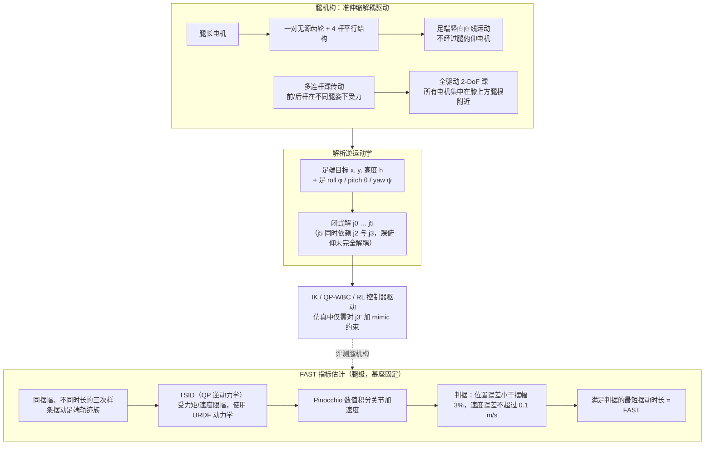

# DecARt Leg

**DecARt Leg: Design and Evaluation of a Novel Humanoid Robot Leg with Decoupled Actuation for Agile Locomotion**（Egor Davydenko 等，MIPT；arXiv:2511.10021v1，2025-11-13）收录于 [Robot Learning Paper Notebooks](https://imchong.github.io/Robot_Learning_Paper_Notebooks/index.html)（分类：12_Hardware_Design）。本页以 **论文原文全文**（8 页，§I–§VII）为依据编译，并保留深读笔记中的要点；笔记与论文细节以原文为准。

## 一句话定义

人形腿长期卡在「好看 vs 敏捷」的二选一里：要拟人外观（前向膝、串联结构）就牺牲速度，要敏捷（Cassie/Digit 的解耦结构）就长得像鸟腿。DecARt Leg 用 准伸缩（pantograph + 齿轮膝）机构把「腿长」和「腿俯仰」解耦、把所有电机都放到膝盖以上以压低摆动惯量、再用多连杆把 2 自由度踝的力矩从近端远程传过来，做到一条前向膝、拟人外观的腿也能拿到 Cassie 级的摆腿速度。

## 英文缩写速查

| 缩写 | 全称 | 解释 |
|---|---|---|
| DoF | Degree of Freedom | 自由度；文中「2-DoF 踝」指踝的俯仰与横滚两个自由度 |
| FAST | Fastest Achievable Swing Time | 最快可达摆动时间，本文提出的腿级敏捷度指标 |
| IK | Inverse Kinematics | 逆运动学；本文给出 DecARt 腿的闭式解（式 1–7） |
| QP | Quadratic Programming | 二次规划；用于 TSID 逆动力学与 QP 型 WBC 行走控制器 |
| TSID | Task Space Inverse Dynamics | 任务空间逆动力学；FAST 估计中由它求关节力矩与加速度 |
| WBC | Whole-Body Control | 全身控制；硬件实验中的 QP-WBC 行走控制器 |
| URDF | Unified Robot Description Format | 机器人描述文件；FAST 估计使用其中的动力学模型 |
| RL | Reinforcement Learning | 强化学习；硬件实验中的一种行走控制器（基于文献 [23]） |

## 为什么重要

- **腿部机构设计**：给出「拟人外观 + 解耦敏捷」可兼得的一个具体机构样本，打破二选一惯性
- **敏捷度评测**：FAST 提供一个脱离整机尺度/上半身重量的腿级横向对比标尺；论文称其计算代码已开源（见 [工程实践](#工程实践)）
- **控制范式无关（有限证据）**：论文在硬件上用 IK、QP-WBC、RL 三种控制器各跑通了一次行走，说明机构不绑定单一控制栈；定量对比尚未发表
- **硬件-控制协同**：把「低摆动惯量」做进机构，等于在硬件层先替控制器减负

## 流程总览

图依据：论文 §III（Fig.2–4，式 1–7）与 §IV-A（FAST 估计流程，Fig.5–6）。

## 解决什么问题

人形机器人的腿设计存在一条长期的张力：

- **拟人 / 串联（serial）结构**：膝盖朝前、外观像人，但电机沿腿串联布置，大腿小腿都挂着电机，**摆动惯量大**，限制了摆腿速度和敏捷度。
- **解耦 / 并联结构（Cassie、Digit）**：把电机集中到髋部附近，用连杆远程传力，**摆动惯量小、速度快**，但外观像鸟腿，且 Cassie 行走时常让膝（加大的脚跟）朝后，不拟人。

论文的设计要求是：解耦驱动、拟人外观、重电机靠近腿根以减小摆动惯量、结构紧凑轻量、使用可本体感知的旋转执行器（便于建模与控制）。

## 核心机制

1. **新型解耦腿机构**：用「准伸缩（pantograph + 齿轮膝）+ 无源齿轮 / 4 杆平行 + 多连杆踝传动」，把腿长、腿俯仰和 2-DoF 踝全部用膝上电机驱动，在**保留前向膝拟人外观**的同时压低摆动惯量。
2. **FAST 敏捷度指标**：提出一个**只评测腿本身、脱离上半身质量与惯量、可跨尺度比较**的量，并公开了计算代码。
3. **多控制器验证**：仿真中用 ALIPM 步态控制器加 TSID 全身力矩控制完成行走；硬件（两条腿 + 简易骨盆）上分别用 **IK、QP-WBC（ALIPM 框架）、RL** 三种控制器完成免缆行走。论文称三者都验证了仿真结果，但定量硬件比较仍在进行。
4. **量化收益**：FAST 为 0.17 s，优于其串联消融版 DecARt-S（0.25 s）、Cassie（0.24 s）与 Fourier GR1T2（0.24 s）。

## 核心原理

- **输入**：IK 部分为足端目标位置 $x, y$、目标高度 $h$ 与足部姿态 roll/pitch/yaw（$\phi, \theta, \psi$）。FAST 部分为腿的 URDF 动力学模型、关节力矩与速度限幅、摆幅 $L$ 与一族摆动轨迹。
- **关键机制**：
  - **准伸缩**：旋转的腿长电机经一对无源齿轮和 4 杆平行结构，直接变成足端的竖直直线运动，不经过腿俯仰电机（§III-A）。论文称该结构可完全收缩和完全伸展，而普通 pantograph 会在端点出现奇异。
  - **闭式 IK**（式 1–7）：$j_0=\psi$，$j_1=\arctan(y_r/h)$，$j_2=\arctan(-x_r/h)$，$j_4=\theta-j_1$，$j_5=\phi-j_2-j_3$，其中 $(x_r,y_r)$ 为绕 yaw 旋转后的足端坐标。$j_3$ 由反余弦给出（式 4），排版不完整，本页未逐项核对。仿真建模时仅需对 $j_3'$ 加 mimic 约束。
  - **多连杆踝传动**：前杆与后杆在伸直、半蹲、全蹲等不同姿态下轮流受力（图 3），使踝力矩可以从膝上电机远程传递。
  - **FAST 估计**：同一摆幅、不同时长的三次样条摆动轨迹，经 TSID（QP）在力矩与速度限幅下求解，再用 Pinocchio 积分关节加速度，检查足端误差；满足判据的最短时长即 FAST。轨迹起点为腿后倾 30°，终点为腿前倾 30°，摆幅即由此得到的 $L$。
- **输出**：一个 FAST 值（秒）。论文将其换算为理论步行速度 $v = L / t_{\text{FAST}}$，并明确忽略支撑相与双支撑。

## 工程实践

| 项目 | 论文给出的做法 | 注意 |
|---|---|---|
| 仿真建模 | 在 PyBullet 与 MuJoCo 中建立 DecARt 腿模型（§III） | 闭链需要 mimic 约束（$j_3'$） |
| 运动学与控制器 | 闭式 IK 与雅可比用于控制器设计（§III） | 踝俯仰 $j_5$ 依赖 $j_2$ 与 $j_3$，腿长变化时仍需踝俯仰驱动 |
| 执行器 | 旋转式本体感知执行器，全部电机位于膝上（§III） | 论文未给出具体电机型号与减速比（未核实） |
| FAST 参数 | 腿长缩放 0.98 避免 QP 奇异；基座固定；判据为 3% 摆幅与 0.1 m/s；三次样条轨迹取自 ETH OCS2 [19] | FAST 结果依赖腿俯仰电机限幅，结果不能只用于比较电机强弱 |
| 整机仿真 | ALIPM 控制器加 TSID 全身力矩控制；整机约 35 kg（§V） | 仿真参数；未给出控制器增益 |
| 硬件 | 两条 DecARt 腿加简易骨盆；三种控制器（§VI） | 仅初步验证，无上半身 |
| 源码开放状态（步骤 2.5） | 论文脚注给出 FAST 指标代码仓库 <https://github.com/egordv/the_FAST_metric>，称为「可直接计算该指标的代码」。论文与 arXiv 摘要页均未列独立项目页。本页未能访问该仓库（代理返回 403），仓库内容与入口未核实（未核实）。论文未声明腿 URDF、控制器或硬件代码开源。 | 判定为 **部分开源**（指标代码已公开，机构与控制代码未声明），截至 2026-11-06 |
| 源码运行时序图 | **不适用**（仓库无法访问，未能核实可运行入口；不用通用模板代替） | 复现前需先读仓库 README |

## 实验与评测

### FAST 对比（论文 Table I）

| 机器人 | 腿驱动形式 | FAST (s) | 对应摆动长度 (m) | 理论步行速度 (m/s) |
|---|---|---|---|---|
| **DecARt Leg** | 解耦 | **0.17** | 0.71 | **4.18** |
| Cassie | 解耦 | 0.24 | 0.95 | 3.94 |
| Fourier GR1T2 | 串联（髋部电机） | 0.24 | 0.70 | 2.92 |
| DecARt-S（串联消融） | 串联 | 0.25 | 0.71 | 2.84 |
| Unitree G1 | 串联（膝电机） | 0.34 | 0.64 | 1.87 |
| Booster T1 | 串联（膝电机） | 0.33 | 0.51 | 1.55 |

理论步行速度 = 摆动长度 / FAST，忽略支撑相与双支撑；它不是实测步行速度。

### 仿真结果（§V，PyBullet，整机约 35 kg，ALIPM + TSID WBC）

- 最大行走速度：平地 2.2 m/s；5 cm 起伏粗糙地形 0.8 m/s。
- 最大推力：矢状向 200 ms 内 95 N；横向 200 ms 内 50 N。
- 可越过台阶高度 10 cm；额外躯干负重 8.5 kg；双臂搬运箱子 3.5 kg。
- 另有开门、搬背包、预定义轨迹跳跃等仿真场景（图 7）。

### 硬件结果（§VI，初步）

- 两条 DecARt 腿加简易骨盆组成双足平台，上身仍在设计中。
- 三种控制器（IK、QP-WBC、RL）均完成免缆行走；另展示深蹲、半粗糙地形行走与预定义轨迹跳跃（图 8）。
- 论文明确表示定量硬件评测与控制器比较尚未完成，本页不给出硬件数字。

## 与其他工作对比

- **同一腿机构，解耦 vs 串联**（DecARt vs DecARt-S）：0.17 s 对 0.25 s。消融方式是把 URDF 中的闭链与膝齿轮去掉、锁死腿长电机位置，电机位置与连杆质量不变。这是本文最干净的因果证据。
- **与 Cassie（解耦，pantograph）**：FAST 同为 0.24 s 时 DecARt 为 0.17 s。但两者摆动长度不同（0.71 m 对 0.95 m），论文认为 FAST 可跨尺度比较，本页仅转述论文结论。
- **与串联人形**（GR1T2、G1、T1）：FAST 为 0.24–0.34 s。论文的结论是「电机靠近腿根」比「电机在膝上」的串联设计更有利。
- **与上半身结果的关系**：论文称整机速度会因上半身而退化（§V）。但 §V 报告的是仿真整机速度，与表 I 理论速度口径不同，本页不做直接换算。

## 局限与风险

- **指标依赖电机限幅**：FAST 对腿俯仰电机的力矩/速度限幅很敏感，过强的电机能把 FAST 压得很低。论文明确指出 FAST 不应作为唯一指标。
- **评测口径有限**：基座固定，不含支撑相、双支撑与上半身惯量；「理论步行速度」不是实测速度。
- **踝俯仰未完全解耦**：$j_5$ 依赖 $j_2$ 与 $j_3$，腿长变化时仍需踝俯仰驱动，论文也称这与 Cassie/Digit 类似。
- **运动范围受限**：为避免 QP 奇异，腿长被缩放为 0.98 倍。
- **硬件证据薄**：只有两条腿加简易骨盆，无上身，定量硬件评测与控制器比较尚未发表。
- **论文未评估的风险**：传动效率、负载能力、连杆刚度与间隙、热与成本，本页与论文均未讨论（未核实）。
- **外观是设想**：论文提到可用盖板遮挡内部连杆以保持拟人外观，但并未展示盖板方案。
- **复现前核对**：FAST 代码仓库本页未能访问，使用前需确认其版本与入口。

## 结论

**DecARt Leg 说明「拟人外观」和「敏捷」不必二选一：决定摆腿速度的主要是摆动质量的位置，把电机放到膝上并用连杆远程传动踝力矩，前向膝的腿也能拿到接近或超过 Cassie 的 FAST。**

1. **真正起作用的是解耦机构本身**：DecARt 0.17 s 对同一腿的串联消融版 0.25 s，是最干净的因果证据，收益来自机构而不是整机尺度或调参。
2. **FAST 比这条腿更值得复用**：它是腿级、脱离上半身的标尺，能让 Cassie（0.24 s）、GR1T2（0.24 s）等进行横向对比；论文称计算代码已公开，复现前需核对仓库。
3. **不要只看 FAST**：指标强依赖腿俯仰电机的限幅，论文自己也提醒不能单独用它选型；传动效率、负载与成本未在论文中评估。
4. **硬件结论仍是初步的**：三种控制器都完成了免缆行走，但没有定量硬件数字，也没有上身，不宜据此判断实际敏捷度。

## 与其他页面的关系

- 分类父节点：[paper-notebook-category-12-hardware-design](../overview/paper-notebook-category-12-hardware-design.md)
- 总索引：[humanoid-paper-notebooks-index.md](../overview/humanoid-paper-notebooks-index.md)
- 对照的解耦腿 RL 工作：[paper-cassie-biped-versatile-locomotion-rl](./paper-cassie-biped-versatile-locomotion-rl.md)
- 串联人形对照机：[unitree-g1](./unitree-g1.md)
- 全身控制概念（QP-WBC）：[whole-body-control](../concepts/whole-body-control.md)
- 并联 / 闭链关节解算（DecARt 踝为闭链，需 mimic 约束）：[humanoid-parallel-joint-kinematics](../concepts/humanoid-parallel-joint-kinematics.md)

## 参考来源

- [humanoid_pnb_decart-leg-novel-humanoid-robot-leg-with-decoupl.md](../../sources/papers/humanoid_pnb_decart-leg-novel-humanoid-robot-leg-with-decoupl.md)
- 深读笔记：<https://imchong.github.io/Robot_Learning_Paper_Notebooks/papers/12_Hardware_Design/DecARt_Leg_Novel_Humanoid_Robot_Leg_with_Decoupled_Actuation/DecARt_Leg_Novel_Humanoid_Robot_Leg_with_Decoupled_Actuation.html>
- 论文（arXiv 摘要页）：<https://arxiv.org/abs/2511.10021>
- [arXiv PDF](https://arxiv.org/pdf/2511.10021)：2026-11-06 全文通读（v1，8 页，§I–§VII，PDF 无附录）；图表与式 1–7 的排版以 PDF 为准。
- FAST 指标代码（论文脚注）：<https://github.com/egordv/the_FAST_metric>（未核实：代理返回 403，未能访问）

## 推荐继续阅读

- [机器人论文阅读笔记：DecARt Leg](https://imchong.github.io/Robot_Learning_Paper_Notebooks/papers/12_Hardware_Design/DecARt_Leg_Novel_Humanoid_Robot_Leg_with_Decoupled_Actuation/DecARt_Leg_Novel_Humanoid_Robot_Leg_with_Decoupled_Actuation.html)
- [FAST 指标代码仓库（论文脚注）](https://github.com/egordv/the_FAST_metric)
- Pratt, J. E., 2000，MIT 博士论文「Exploiting inherent robustness and natural dynamics in the control of bipedal walking robots」，论文引用的 FAST 相关思想（最小摆动时间）来源之一
