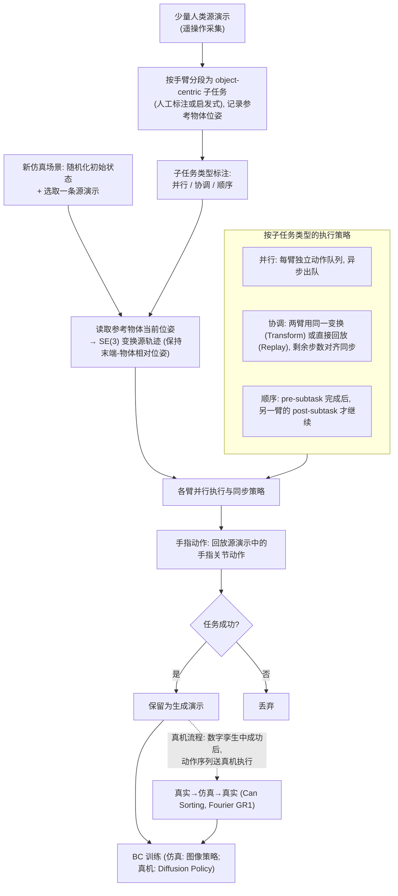

# DexMimicGen

**DexMimicGen: Automated Data Generation for Bimanual Dexterous Manipulation via Imitation Learning** 收录于 [Robot Learning Paper Notebooks](https://imchong.github.io/Robot_Learning_Paper_Notebooks/index.html)（分类：11_Simulation_Benchmark），深读笔记已完成。本页是 **笔记摘要**：要点编译自深读笔记，细节以笔记原文与论文 PDF 为准。

## 一句话定义

从人类演示模仿学习能有效教机器人操作，但数据采集是主要瓶颈。在仿真里自动生成数据是有吸引力、可扩展的替代。为此提出 DexMimicGen：一个大规模自动数据生成系统，从少量人类演示为带灵巧手的人形机器人合成出大量轨迹。系统包含一组覆盖多种双手操作行为的仿真环境，能从 60 条源人类演示生成 21,000 条演示；并在真实人形的易拉罐分拣（can sorting）任务上部署验证，评估了数据生成与策略学习的多种设计选择。

## 英文缩写速查

| 缩写 | 含义 |
|---|---|
| DexMimicGen | 本文的双手灵巧数据生成系统 |
| Bimanual Dexterous | 双手灵巧（多指手）操作 |
| Trajectory Synthesis | 轨迹合成，从少量演示扩出大量 |
| Source Demo | 源演示，人类提供的少量样本 |
| Real-to-Sim-to-Real | 真实↔仿真↔真实流程 |
| Imitation Learning | 模仿学习 |

## 为什么重要

- **自动数据生成是模仿学习规模化的关键**：把少量人类演示放大成海量训练数据；
- **双手灵巧**是数据最稀缺、最该自动化的方向；
- **real-to-sim-to-real**闭环让合成数据落到真机；
- 与 HumanoidGen、Mimicking-Bench 等共同壮大人形操作数据生态（同出 NVIDIA/UT 系）。

## 流程总览

图依据：论文 §III Prerequisites（MimicGen）/ §IV-A–D DexMimicGen Method（Fig.2–3）/ §VI-D Real-World Evaluation（数字孪生流程，Fig.1）。

## 解决什么问题

模仿学习**数据采集贵**，对**双手灵巧人形**尤甚： - 人类演示**难采、量小**； - 双手灵巧协调复杂； - 需可扩展的数据来源。

DexMimicGen 要：从**极少量人类演示**在仿真里**自动合成大规模**双手灵巧演示。

## 核心机制

1. **大规模自动数据生成系统**：少演示合成海量双手灵巧轨迹；
2. **面向灵巧手人形**：覆盖多种双手操作行为；
3. **60 → 21,000 演示**：极高的数据放大比；
4. **真机部署**：人形易拉罐分拣验证。

方法拆解（深读笔记小节）：少演示 → 大规模轨迹合成；覆盖多种双手行为的仿真环境；真实→仿真→真实；结果；🧭 整体流程（mermaid）。

## 核心信息

| 字段 | 内容 |
|------|------|
| 分类 | 11_Simulation_Benchmark |
| 深读笔记 | <https://imchong.github.io/Robot_Learning_Paper_Notebooks/papers/11_Simulation_Benchmark/DexMimicGen__Automated_Data_Generation_for_Bimanual_Dexterous_Manipulation/DexMimicGen__Automated_Data_Generation_for_Bimanual_Dexterous_Manipulation.html> |
| arXiv | <https://arxiv.org/abs/2410.24185> |
| 作者 | Zhenyu Jiang、Yuqi Xie、Kevin Lin、Zhenjia Xu、Weikang Wan、Ajay Mandlekar、Linxi Fan、Yuke Zhu（UT Austin / NVIDIA） |
| 发表 | 2024 年 10 月 |
| 笔记阅读日期 | 2026-06-21 |

## 实验与评测

- 本页是深读笔记的摘要，没有搬运原文的量化结果；量化 benchmark、消融与实机指标以 **深读笔记与论文 PDF** 为准（链接见 [参考来源](#参考来源)）。

## 结论

**DexMimicGen 押的是「数据可以被合成」而非「数据必须被采集」：把 60 条人类演示放大成 21,000 条双手灵巧轨迹，让模仿学习的瓶颈从遥操作工时转移到仿真环境与合成规则的设计。**

- 关键量是 **60 → 21,000 的放大比**，但它只有配上一组覆盖多种双手操作行为的仿真环境才有意义——环境覆盖面决定了放大出来的数据是否还有多样性。
- 落地靠 **real-to-sim-to-real** 闭环收口：以真实人形的易拉罐分拣任务验证合成数据能迁到真机，而不是只在仿真里自评。
- 适用边界：起点仍是人类源演示，属「少演示放大」而非零演示生成；论文自陈评估了数据生成与策略学习的多种设计选择，说明结果对这些选择敏感，换任务时不能默认沿用。
- 定位：与 HumanoidGen、Mimicking-Bench 同属人形操作数据生态（同出 NVIDIA/UT 系），差异在于本文主攻 **双手灵巧** 这一数据最稀缺、最该自动化的方向。
- 本页为笔记摘要，量化 benchmark、消融与实机指标以深读笔记与论文 PDF 为准。

## 与其他页面的关系

- 分类父节点：[paper-notebook-category-11-simulation-benchmark](../overview/paper-notebook-category-11-simulation-benchmark.md)
- 总索引：[humanoid-paper-notebooks-index.md](../overview/humanoid-paper-notebooks-index.md)

## 结论

**本页为 HMI 开源主表对应的独立详情节点：先抓住问题接口与开源边界，再决定是否深挖训练细节。**

- 数值与消融以论文 PDF / 官方仓库为准。
- 与相邻 VLA / 仿真 / 数据生成页交叉阅读，避免重复造页。
- 若仅有笔记摘要，部署前必须回一手 README。

## 参考来源

- [humanoid_pnb_dexmimicgen.md](../../sources/papers/humanoid_pnb_dexmimicgen.md)
- 深读笔记：<https://imchong.github.io/Robot_Learning_Paper_Notebooks/papers/11_Simulation_Benchmark/DexMimicGen__Automated_Data_Generation_for_Bimanual_Dexterous_Manipulation/DexMimicGen__Automated_Data_Generation_for_Bimanual_Dexterous_Manipulation.html>
- 论文：<https://arxiv.org/abs/2410.24185>
- [arXiv PDF](https://arxiv.org/pdf/2410.24185)：已通读方法部分（实验与附录以略读为准）：§III Prerequisites、§IV DexMimicGen Method（A–D）、真机评测一节（Real-World Evaluation，数字孪生流程）

## 推荐继续阅读

- [机器人论文阅读笔记：DexMimicGen](https://imchong.github.io/Robot_Learning_Paper_Notebooks/papers/11_Simulation_Benchmark/DexMimicGen__Automated_Data_Generation_for_Bimanual_Dexterous_Manipulation/DexMimicGen__Automated_Data_Generation_for_Bimanual_Dexterous_Manipulation.html)
