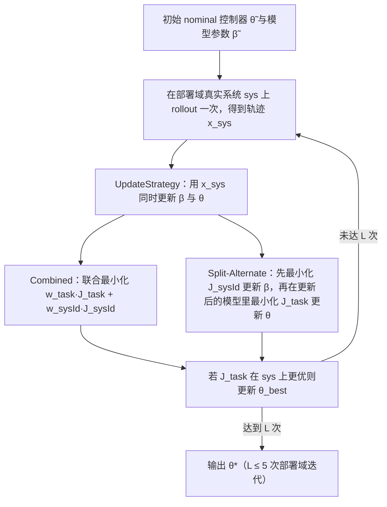

# DiffCoTune

**DiffCoTune: Differentiable Co-Tuning for Cross-domain Robot Control**（arXiv:2505.24068，cs.RO，2025-05-29）收录于 [Robot Learning Paper Notebooks](https://imchong.github.io/Robot_Learning_Paper_Notebooks/index.html)（分类：10_Sim-to-Real）。本页已对照 **原始 arXiv 论文 PDF 全文**（方法、实验、对比与局限）编译；深读笔记仅作导读线索。

## 一句话定义

DiffCoTune 是一种**梯度式协同调参**方法：用可微仿真器同时调仿真器参数 $\beta$ 与控制器参数 $\theta$，仅用目标域约 5 次真实 rollout，把已有的名义控制器迁移到部署域（sim-to-real 或 sim-to-sim）。

## 英文缩写速查

| 缩写 | 含义 |
|---|---|
| Co-Tuning | 协同调参，同时调仿真器参数 $\beta$ 与控制器参数 $\theta$ |
| sysId | 系统辨识（system identification），此处指让仿真器拟合目标系统闭环轨迹 |
| Rollout | 轨迹采样，一次从初始状态出发执行控制器得到的状态序列 |
| Split-Alternate | 交替更新变体：先更新 $\beta$（最小化 $J_{\text{sysId}}$），再更新 $\theta$（最小化 $J_{\text{task}}$） |
| DNN | 深度神经网络，本文用作学习型控制器 $\pi(x;\theta)$ 的参数化形式 |
| LQR | 线性二次型调节器，本文 cartpole 的模型法控制器 |
| MPC | 模型预测控制，本文双足的模型法控制器（QP 形式） |
| QP | 二次规划，MPC 每步的在线求解形式 |
| MJX | MuJoCo XLA，本文的可微仿真器（基于 JAX） |
| Adam | 自适应矩估计梯度优化器，本文用于所有梯度更新 |
| BO | 贝叶斯优化，本文作为无梯度调参基线 |
| TO | 轨迹优化，本文双足跳跃的离线参考生成方法 |

## 为什么重要

- **把 sim-to-real 当成双向适配**：传统做法只调控制器或只做系统辨识，本文把两者耦合为一个跨域调参问题，只关心部署域性能，而不要求精确复现目标系统。
- **梯度比黑盒搜索省样本**：论文的 BO 基线在 cartpole LQR 上约需 90 次目标域试验才找到最优，而梯度方法在前约 10 次即快速下降（见 [实验与评测](#实验与评测)）。对真机双足这类昂贵、危险的试验，这一点很关键。
- **不引入任务专用超参**：论文设定 $w_{\text{task}}=w_{\text{sysId}}=1$，并在所有系统上使用同一套设置（编者注：这是论文的主张，跨任务泛化的充分性仍需更多独立验证）。
- 与本仓 10_Sim-to-Real 模块的 [MOSAIC](paper-loco-manip-161-014-mosaic.md)、[ZEST](paper-zest.md) 相比，本文的路线是「对已有名义控制器做局部梯度微调」，而非新训练一套策略（编者判断，原文未与二者比较）。

## 流程总览

图依据：论文 §III 问题表述、§IV Algorithm 1（迭代协同调参）、Algorithm 2（Combined）、Algorithm 3（Split-Alternate）。

## 解决什么问题

控制器部署的核心障碍是**建模差异**：为可计算而**简化模型**，或**仿真器不准**（论文 Fig. 1 中的 synthesis domain 与 deployment domain 之间的 mismatch）。传统上靠**手工临时调参**才能迁移，费时且不系统。DiffCoTune 要做的是：从一个名义控制器出发，**自动、基于梯度**地把它调到目标域，并且**只用少量目标域试验**。

论文刻意不追求全局最优的系统辨识或从零合成控制器，而是只寻求对名义控制器的局部改进（论文 §I）。

## 核心原理

**输入**：名义可微控制器 $\pi(x_t;\theta)$ 与初始参数 $(\tilde\beta,\tilde\theta)$；可微模型（仿真器）$x_{t+1}=f(x_t,u_t;\beta)$；目标系统 sys 的黑盒访问（只能 rollout 并观测部分状态）。

**关键机制**：

1. **两类损失**。系统辨识损失让模型的闭环轨迹贴近目标系统的闭环轨迹：$J_{\text{sysId}}(\theta,\beta,\{x^{\text{sys}}_t\})=\frac{1}{T}\sum_t \tfrac12\|x_t-x^{\text{sys}}_t\|_2^2$；任务损失在模型内定义：$J_{\text{task}}(\theta,\beta)=\frac{1}{T}\sum_t c(x_t,u_t)$，其中 $c=\|x_t-x^*_t\|_2^2$（对非欧空间状态，按分量累加范数误差）。
2. **迭代协同调参（Algorithm 1）**。每轮在目标系统上 rollout 一次（论文约束为单次 rollout），用这条轨迹更新 $\beta$ 与 $\theta$；只有在目标系统上 $J_{\text{task}}$ 更好时才保留新的 $\theta_{\text{best}}$。这一「先采数据、再调参」的循环类似在线策略学习。
3. **Combined 更新**（Algorithm 2）：对加权和 $w_{\text{task}}J_{\text{task}}+w_{\text{sysId}}J_{\text{sysId}}$ 同时对 $[\theta,\beta]$ 做梯度下降。
4. **Split-Alternate 更新**（Algorithm 3，论文主推）：先固定 $\theta_l$，求 $\beta_{l+1}=\arg\min_\beta J_{\text{sysId}}(\theta_l,\beta,\{x^{\text{sys}}_t\}_l)$；再固定 $\beta_{l+1}$，求 $\theta_{l+1}=\arg\min_\theta J_{\text{task}}(\theta,\beta_{l+1})$。这是交替优化（alternating optimization）的一种形式，两个子问题各自用 Adam 求解。

**输出**：经过至多 $L$ 次目标域迭代后，取目标系统上任务损失最小的 $\theta^*$。

**直觉**：模型参数 $\beta$ 负责「让仿真器更像真机」，控制器参数 $\theta$ 负责「在更像真机的仿真器里把控制做好」；目标域的真实 rollout 只用来校正模型，不直接对目标系统求梯度（因为 sys 是黑盒）。

## 工程实践

| 项目 | 论文中的取值或做法 |
|---|---|
| 目标域 rollout 次数 | 每轮 1 次，最多 $L=5$ 轮（对比基线也取 $L=5$） |
| 模型内梯度步数 | $K=100$；Split-Alternate 中 $\beta$ 与 $\theta$ 各分配 $K/2$ |
| 优化器 | Adam（学习率未在正文中给出，未核实） |
| 终止条件 | $\lvert J_k-J_{k-1}\rvert<10^{-3}$（收敛）或 $J_k>J_{k-1}+10^{-3}$（发散） |
| 损失权重 | Combined 中 $w_{\text{task}}=w_{\text{sysId}}=1$，无额外调参 |
| 软件栈 | JAX + MuJoCo XLA（MJX）作为可微仿真器，Flax 定义 DNN，Optax 提供 Adam |
| 特殊处理 | 双足 MPC 的 QP 在梯度更新后对 $\theta$ 做裁剪，保证 $Q\succeq 0$（凸性）；sim-to-real 的 quadruped 速度反馈先经 5 阶 Savitzky-Golay 滤波 |
| 调试指标 | 目标域上每轮的 $J_{\text{task}}(\theta,\text{sys})$（论文报告的主指标）；模型内 $J_{\text{sysId}}$ 与 $J_{\text{task}}$ 的收敛/发散判据 |
| 源码运行时序图 | **不适用**（未发布官方实现，见下方「开源状态」） |

**复现要点**（据论文方法归纳，编者整理）：

1. 准备一个数值可微的模型 $f$ 与可微控制器 $\pi$（论文只要求数值梯度或次梯度存在）。
2. 选择待调的 $\beta$（如连杆质量、关节阻尼、齿轮比）：论文中 quadruped 仅调连杆质量，cartpole 测试了 2–5 维组合。
3. 在目标系统上 rollout 名义控制器，记录可观测状态。
4. 在模型内按 Split-Alternate 先更新 $\beta$（$K/2$ 步），再更新 $\theta$（$K/2$ 步）。
5. 在目标系统上评估新 $\theta$ 的 $J_{\text{task}}$，若更优则保留；重复至 $L=5$ 轮。

**开源状态（步骤 2.5 核查）**：项目页检索结果——arXiv 摘要页的 Code/Data 栏未列出官方仓库；PDF Fig. 1 处的视频链接为占位文字 "link"。深读笔记页链接的 GitHub 仓库（ImChong/Robot_Learning_Paper_Notebooks）是笔记站点本身，不是 DiffCoTune 的实现。截至入库日（2026-11-06）**未见官方代码或数据发布**（未核实：作者主页或后续版本可能已发布）。

## 实验与评测

实验覆盖从低维到高维、从模型法到学习法的五组 {系统, 控制器} 组合（论文 Table I，表中部分列在文本提取中错位，以下仅引用正文明确给出的数字）。所有任务的损失为 $c=\|x_t-x^*_t\|_2^2$。

| {系统, 控制器} | 调参的 $\beta$ | 部署域与设置 | 正文报告的结果 |
|---|---|---|---|
| cartpole, LQR（线性化模型） | 质量 | 目标系统比模型重 30% | 相位图从欠阻尼收敛到临界阻尼（Fig. 2a,b），定性改善 |
| cartpole, DNN（[32,32] MLP，IsaacLab PPO） | 连杆质量、关节阻尼、齿轮比，最多 5 维 | 质量失配 300%（极端设置）；多种失配 | 稳态速度误差消除，响应由欠阻尼变为过阻尼，到位时间最短（Fig. 2c,d）；各类失配下均有改善 |
| quadruped, DNN（[128]×4 MLP，Brax PPO，$\dim\theta=112280$） | 连杆质量 | 仿真到仿真：Barkour → PyBullet，15% 质量失配（LCP 与软接触模型差异） | 名义控制器立即摔倒；调参后性能提升 60%，接近完美跟踪（Fig. 3） |
| quadruped, DNN | 同上 | 仿真到真机：Unitree Go1，前进 1.0 m/s | 调参后多前进 1.04 m（目标 5 m），跟踪更好（Fig. 4） |
| biped, MPC（HECTOR，SRBM + QP） | 正文未明确列出（据称 $\beta$ 更新补偿了 SRBM 忽略的腿部惯量）；$\theta$ 为 $Q$ 矩阵 diag 项 | 仿真到仿真：MuJoCo | 跟踪性能提升 29.29%，抖动减轻 |
| biped, TO（跳跃，关节 PD 增益） | 连杆质量（补偿电池负载） | 仿真到真机（HECTOR） | 目标跳距 40 cm：未调 20 cm 失败，DiffTune 27 cm 失败，DiffCoTune 34 cm 成功（Fig. 5） |

**与基线和消融的比较**（论文 §V-B）：

- **是否需要协同调参**：cartpole LQR 在无失配时各 AD 变体表现接近；有失配时仅调控制器的 DiffTune（model rollout 版）先改善后停滞，Split-Alternate 在后续迭代继续下降。cartpole DNN 与 quadruped DNN 上趋势一致（Fig. 7）。
- **梯度法 vs 无梯度法**：BO 在 cartpole LQR 上跑 100 次目标域迭代，约 90 次才找到最优；梯度方法在前 10 次内快速下降，之后缓慢收敛（Fig. 6 右）。论文也指出 BO 难以扩展到 >20 维参数空间，且 DNN 参数的搜索边界难以设定。
- **迭代收集 vs 先辨识后调参**：quadruped DNN 上，sysId-then-tune 在初始偏离后有所改善但之后摔倒；DiffCoTune 利用第一次调参后的 rollout，在第二步取得更大的损失下降（Fig. 6 左，视频佐证）。
- **Combined vs Split-Alternate**：无失配时两者接近；有失配时 Combined 在 cartpole 与 quadruped 上发散，论文将其归因于 $w=1$ 的朴素选择对目标函数曲率敏感。Split-Alternate 不需要权重，在各系统上稳定。
- **失配大小**（quadruped DNN，质量）：15% 时两种方法改善相当；30% 与 45% 时 DiffCoTune 更好；60% 时两者都退化，论文认为此时名义控制器已失效，问题从「调参」退化为「合成」（Fig. 8 左）。
- **失配类型**（cartpole DNN）：连杆质量、关节阻尼、齿轮比单独或组合（5 维 $\beta$）时，Split-Alternate 均持续改善（Fig. 8 右）。

## 与其他工作对比

| 方法 | 调什么 | 数据来源 | 论文中的定位 |
|---|---|---|---|
| DiffCoTune Split-Alternate（本文） | 模型 $\beta$ + 控制器 $\theta$ | 目标域 rollout 校正模型；模型内多步梯度 | 论文主推，失配下最稳健 |
| DiffCoTune Combined（本文） | 同上，联合优化 | 同上 | 设计上直接，但失配下易发散 |
| DiffTune（系统 rollout 版） | 仅 $\theta$ | 目标域 rollout 上的灵敏度传播，每轮仅 1 次梯度（$K=1$） | 利用目标域数据但梯度步数少 |
| DiffTune（模型 rollout 版） | 仅 $\theta$ | 模型内任意多步梯度，不用目标域数据 | 梯度步多，但错误模型导致平台期 |
| sysId-then-tune | 先 $\beta$ 后 $\theta$ | 目标域 rollout 一次性用于辨识 | 非迭代，论文中在 quadruped 上表现较差 |
| Bayesian optimization | 仅 $\theta$（无梯度） | 目标域试验 | 样本效率低，参数维度受限 |

论文的整体结论是：在可微仿真器可用的前提下，**迭代地同时调模型与控制器**比只调一边或只用一次辨识更稳健，且能扩展到 112280 维的 DNN 控制器（论文报告的最大参数规模）。

## 结论

**DiffCoTune 把 sim-to-real 从「单向迁移」改写成「双向适配」：不只调控制器，也调仿真器，用可微仿真把原本靠手工试凑的部署调参变成有梯度方向的优化。**

1. **真正起作用的是「协同 + 迭代 + 交替」**：Split-Alternate 每轮先用目标域轨迹校正模型，再在校正后的模型里调控制器；论文的消融显示，只调控制器（DiffTune）或只用一次辨识都不如它。
2. **样本效率是主要卖点**：目标域仅 $L=5$ 次 rollout（论文 contribution 称「少于 5 次试验」即可改善）；对昂贵的真机双足，这比最终性能的小幅差距更关键。
3. **Combined 形式不可直接用**：$w=1$ 的加权和在失配下发散，部署时应优先采用 Split-Alternate 或仔细调权重。
4. **前提是梯度可用**：方法只要求控制器与模型数值可微，但接触动力学（LCP 硬接触 vs 软接触）造成的梯度偏差是论文承认的 sim-to-real 误差来源之一；对梯度病态的接触场景，效果未在论文中验证。
5. **数字要分开看**：60%（仿真到仿真）、29.29%（MPC 跟踪）、1.04 m（真机前进）、34 cm（真机跳跃）分别来自不同系统与指标，不能直接横向比较；正文未报告多随机种子统计（未核实：补充材料可能有）。

## 局限与风险

- **论文自述的边界**：仅在 cartpole、四足、双足上验证；作者把「对整个吸引域（region of attraction）调参」与「协同调参 DNN 残差动力学」列为未来工作（论文 §VI）。
- **适用前提**：需要可微模型与可微控制器；控制器结构不可微（如含离散切换、采样式规划）时不能直接套用（编者判断）。
- **可观测性依赖**：$J_{\text{sysId}}$ 只比较可观测状态，未被观测的内部状态失配不会被直接纠正（编者判断，基于公式定义）。
- **闭环而非开环辨识**：$J_{\text{sysId}}$ 比较的是闭环轨迹，与传统开环辨识不同；若控制器在目标域的闭环行为极少激励某些参数，$\beta$ 可能不可辨识（编者判断）。
- **真机安全**：论文的真机实验（四足、双足）依赖于名义控制器本身能在目标域存活；Fig. 5 中的 DiffTune 基线在真机跳跃中落地失败，说明中间迭代仍有风险。
- **极端失配**：60% 质量失配时两种方法都退化（论文 Fig. 8）。
- **超参与实现细节**：学习率、Savitzky-Golay 窗口之外的滤波细节、QP 裁剪方式等在正文中不完整，复现需要参考补充材料或代码（未核实是否发布）。

## 关联页面

- 分类父节点：[paper-notebook-category-10-sim-to-real](../overview/paper-notebook-category-10-sim-to-real.md)
- 总索引：[humanoid-paper-notebooks-index.md](../overview/humanoid-paper-notebooks-index.md)
- 概念：[可微仿真](../concepts/differentiable-simulation.md)、[系统辨识](../concepts/system-identification.md)、[Sim2Real](../concepts/sim2real.md)、[域随机化](../concepts/domain-randomization.md)
- 同类可微仿真调参工作：[Kovalev 等：可微仿真的运动系统辨识](paper-kovalev-differentiable-simulation-locomotion-sysid.md)
- 方法与工具：[模型预测控制](../methods/model-predictive-control.md)、[轨迹优化](../methods/trajectory-optimization.md)、[Adam](../methods/adam.md)、[MJX](mujoco-mjx.md)

## 参考来源

- [arxiv_2505_24068_diffcotune.md](../../sources/papers/arxiv_2505_24068_diffcotune.md)（arXiv 原文归档）
- [humanoid_pnb_diffcotune.md](../../sources/papers/humanoid_pnb_diffcotune.md)（深读笔记归档）
- 论文 PDF（全文通读）：<https://arxiv.org/pdf/2505.24068>
- 论文摘要页：<https://arxiv.org/abs/2505.24068>
- 深读笔记：<https://imchong.github.io/Robot_Learning_Paper_Notebooks/papers/10_Sim-to-Real/DiffCoTune__Differentiable_Co-Tuning_for_Cross-domain_Robot_Control/DiffCoTune__Differentiable_Co-Tuning_for_Cross-domain_Robot_Control.html>

## 推荐继续阅读

- S. Cheng et al., "DiffTune: Autotuning through autodifferentiation," IEEE Transactions on Robotics, vol. 40, pp. 4085–4101, 2024（论文 [27]，本文直接对比的前作；链接与 arXiv 编号未在本次核实）
- [机器人论文阅读笔记：DiffCoTune](https://imchong.github.io/Robot_Learning_Paper_Notebooks/papers/10_Sim-to-Real/DiffCoTune__Differentiable_Co-Tuning_for_Cross-domain_Robot_Control/DiffCoTune__Differentiable_Co-Tuning_for_Cross-domain_Robot_Control.html)
