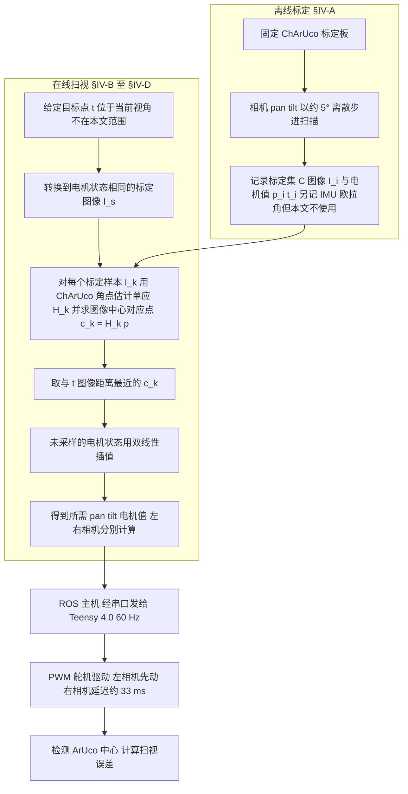
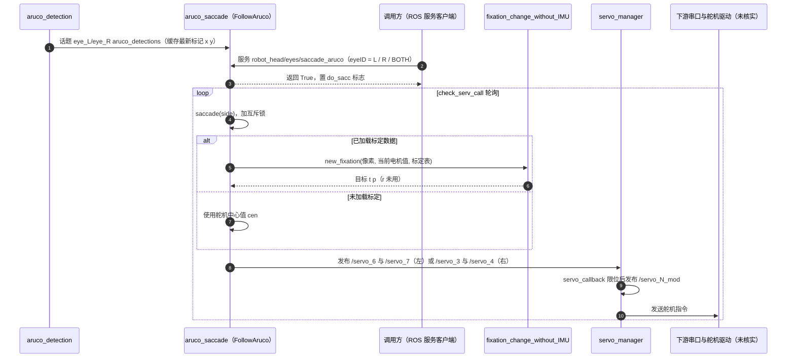

# DIJIT

**DIJIT: A Robotic Head for an Active Observer** 收录于 [Robot Learning Paper Notebooks](https://imchong.github.io/Robot_Learning_Paper_Notebooks/index.html)（分类：12_Hardware_Design）。本页基于 **论文全文（arXiv:2512.07998，IEEE RA-L 预印本）** 与官方 GitLab 仓库的 ROS 入口撰写；深读笔记作为补充入口保留。

## 一句话定义

DIJIT 的核心是：不把相机当成被动取景器，而是当成会「主动注视」的眼睛——给每只相机 3 个机械自由度 + 4 个光学自由度、再给脖子 3 个自由度，凑齐了会聚立体视觉所需的 vergence（聚散）/ version（共轭转动）/ cyclotorsion（眼球扭转），并实现了速度达人类峰值扫视 85% 以上、精度与人相当的仿生扫视，从而能在真实平台上对照「人眼-头-颈协同」与「现有计算机视觉」的差距。

## 英文缩写速查

| 缩写 / 术语 | 全称 / 含义 | 解释 |
|---|---|---|
| Active Observer | 主动观察者 | 能自主移动、转动视线去主动获取信息的视觉系统，而非被动接收图像；DIJIT 即为这一定位设计的平台 |
| DOF | Degree of Freedom（自由度） | 机械或光学上可独立控制的运动维度；DIJIT 为 9 个机械 + 每相机 4 个光学 DOF |
| Vergence | 聚散运动 | 双眼向内/向外转动以聚焦不同深度目标，是会聚立体视觉的前提 |
| Version | 共轭运动 | 双眼同向同步转动（一起左右或上下看） |
| Cyclotorsion | 眼球扭转 | 眼球绕视线轴的旋转；DIJIT 每相机用一个 roll 电机实现 |
| Saccade | 扫视 | 眼在注视点之间的快速跳转；DIJIT 复现其速度与精度 |
| Homography | 单应（矩阵） | 纯旋转或平面场景下两幅图像之间的像素映射，DIJIT 标定的核心数学工具 |
| ChArUco | ChArUco 标定板 | 棋盘格与 ArUco 标记结合的标定板，提供可检测的角点对应 |
| ArUco | ArUco 标记 | 二维码式基准标记；论文实验中用作扫视目标，并用 OpenCV 检测其中心 |
| IMU | 惯性测量单元 | 每相机配一个 BNO085，以 60 Hz 输出转动状态；论文标定与扫视不使用其数值 |
| ROS | Robot Operating System | 论文中主机与运行时模块的通信框架（话题与服务） |

## 为什么重要

- **「主动视觉」需要相称的硬件**：很多关于「人怎么看」的科学问题，光靠被动相机加算法无法回答。DIJIT 把人眼-头-颈的几何与动力学补进硬件，给 active observer 研究提供了一个可对照人类的平台。
- **眼球扭转（cyclotorsion）常被忽视**：多数机器人头省掉这一维。论文的设计把 roll 自由度放进每只相机，使会聚立体视觉的运动范围在硬件层面成立。
- **扫视控制的工程巧思**：用「相机朝向与电机值之间的数据驱动映射」绕开了对电机轴与光轴偏差的显式建模，是硬件-控制协同设计的好例子。
- **对人形机器人的意义**：人形机器人最终也要「会主动看」，DIJIT 这类仿生头-颈视觉系统是感知前端的候选范式。论文自述的后续方向包括主动双目三维重建与轮椅使用者辅助。

## 流程总览

图依据：论文 §IV-A 至 §IV-D 与 §V（扫视标定与执行链路；文中无整体流程图，箭头为按文字顺序归纳）

## 解决什么问题

主流计算机视觉默认相机是**被动**的：图像「送进来」，算法去处理。但人类视觉是**主动**的——我们靠眼动、头动、颈动的协同去对准目标、会聚双眼、稳定注视，很多视觉能力恰恰建立在这套主动控制之上。

要研究「人到底是怎么用眼/头/颈去解决视觉任务的」，需要一个自由度、运动范围、速度都逼近人类的硬件平台。论文指出，已有机器人头大多在某些维度上简化：或缺少眼球扭转、或颈部自由度不足、或基线与重量偏离人类、或速度远低于人眼（见 [与其他机器人头的对比](#与其他机器人头的对比)），不足以复现会聚立体视觉的完整几何。

## 核心原理

### 硬件设计（方法的前提）

- **机械自由度**：颈部 3 个（整体 pan、侧弯 side-bending、屈伸 flexion/extension），每只相机 3 个（pan、tilt、roll 绕视线轴）。颈部由底部一个 20 kg DC 舵机做 pan，两侧 Hitec HS-422 通过推拉金属杆实现屈伸与侧弯。
- **光学自由度**：每个镜头/相机 4 个，分别对应焦距（类比人眼调节）、曝光时间（类比视觉积分时间）、白平衡（类比颜色恒常性）与传感器增益（类比感光灵敏度）。
- **连杆结构**：电机放在相机后方，通过刚性连杆驱动相机框架，使两相机间基线接近人类（论文表 I 中为 115 mm）。
- **材料与重量**：机身与关节为 3D 打印的 PA6-CF，整机约 1.4 kg；头部（不含颈）尺寸约 22×18×12 cm（W×D×H），含颈约 22×22×26 cm。
- **控制与感知**：9 个舵机由 Teensy 4.0 控制；相机为 iDS U3-3881LE-AF（全局快门，USB 3.0，最高 3088×2076 分辨率下 59 fps），镜头为 Corning Varioptic 液体透镜（9.6 mm），单相机视场约 40°×30°（H×V）。

### 扫视（saccade）方法

输入是图像中的目标点 $t$（由外部给定，检测不在本文范围），输出是左右相机各自的 pan 与 tilt 电机值。

1. **标定数据采集（§IV-A）**：固定一块 ChArUco 标定板，pan/tilt 以约 5° 步进遍历范围，记录每个状态的图像 $I_i$ 与电机值 $(p_i, t_i)$，形成标定集 $C$。采集一个相机约需不到 3 分钟（作者声称；COG 方法据其报告约 90 分钟）。
2. **单应估计（homography，§IV-C）**：纯旋转时两幅图像由单应相关。对标定板角点对应 $a_j = H_k b_j$（$j=1,\dots,r$）估计 $H_k$，再把图像中心 $p$ 映射为 $c_k = H_k p$，得到第 $k$ 个标定图在参考状态图 $I_s$ 中的中心位置。作者假设相机绕光心旋转，因此单个平面标定区域的单应可推广到整幅图像。
3. **最近样本与插值（§IV-B、§IV-D）**：在 $I_s$ 中选出与 $t$ 像素距离最近的 $c_k$。若目标状态未被采样，则用四个最近的已采样图像做双线性插值；若参考图与目标图都未采样，则两种插值组合使用。
4. **执行（§V）**：一次扫视的电机值计算约 12 ms（四个电机，AMD Ryzen 7 7700X）；左相机两个电机先发送，右相机约延迟 33 ms 启动。

核心思想是：不显式建模电机轴与光轴的偏差，而是用标定板把「像素位置 ↔ 电机状态」做成一张数据驱动的查找表。作者指出，拆装相机或电机后必须重新标定，否则相机可在数天内、数百次扫视中保持有效。

## 源码运行时序图

官方 GitLab 仓库的 `head_ws/src` 中包含 ROS 工作区（`robot_head`、`aruco_head` 与消息包）。下图依据 `aruco_head/scripts/aruco_saccade.py`、`aruco_head/launch/saccade.launch`、`aruco_head/srv/Saccade.srv` 与 `robot_head/scripts/servo_manager.py` 的代码结构绘制；`fixation_change_without_IMU.new_fixation` 内部实现与下游串口/驱动链路未逐行核实。

复现路径：先用 `saccade.launch` 的 `folder_L`、`folder_R` 参数指向两路标定数据目录，启动 `aruco_detection` 与 `aruco_saccade`，再以 `Saccade.srv` 请求左、右或双目扫视。`BOTH` 分支未在取值前检查标记是否为空，实际使用时需注意（代码观察，未运行验证）。

## 工程实践

| 项 | 内容 |
|---|---|
| 开源状态（步骤 2.5） | **已开源**：论文脚注与 GitLab 仓库 `robots/dijit-pub` 给出 3D 打印 CAD、硬件与 ROS 代码，仓库含 LICENSE 文件；论文声明采用 MIT 许可（未逐字核对 LICENSE 文本）。论文未给出独立项目页，深读笔记不是项目页。 |
| 可运行入口 | `head_ws` ROS 工作区：`robot_head` 含相机标定、数据采集、舵机管理与控制界面；`aruco_head` 含扫视服务与标记检测；装配依据仓库 wiki（本次未读取） |
| 硬件清单 | 9 个机械舵机（相机每侧 3 个 MG90S，颈部 1 个 20 kg DC 舵机与 2 个 HS-422）+ Teensy 4.0 + 2 个 BNO085 IMU + iDS U3 相机 + Varioptic 液体透镜 |
| 标定参数 | 步进约 5°；标定集覆盖 pan/tilt 范围；拆装后必须重标定 |
| 通信 | 主机与 Teensy 串口 60 Hz；每相机状态（IMU、电机值、图像）以 60 Hz 发布；舵机总线（论文描述为 I2C，400 kHz） |
| 关键指标 | 单次电机值计算约 12 ms；左右相机启动相差约 33 ms；扫视误差（中位数，水平 0.73°/0.80°，垂直 0.29°/0.37°，左/右） |
| 调试指标 | 扫视后重新检测 ArUco 中心，计算落点与图像中心的反投影射线夹角；论文以 1° 作为是否执行修正扫视的阈值 |

## 局限与风险

- **目标检测不在范围内**：论文假设目标点已给定，且扫视期间不更新目标位置；真实场景中的运动目标与 100 ms 量级的视觉延迟未被覆盖。
- **标定依赖**：标定假设同一块标定板在所有视角可见；拆装后必须重标定；遮挡与光照不影响标定本身，但会影响目标点的获得。
- **只做 pan/tilt 扫视**：论文的扫视方法可推广到 cyclotorsion，但被标为「进行中的工作」；off-horopter 双目融合同样尚未完成。
- **精度上限**：论文自述其电机编码器分辨率低于部分其他仿生头所用编码器，但仍报告了可比的精度；误差随扫视幅度增大（<6° 约 1.0°，>12° 约 1.3°–1.6°）。
- **对比口径不一**：表 II 混合了仿真结果（Van Opstal、iCub 等，作者标注）与实机结果，且部分数据由像素误差换算为角度，只能作量级参考。
- **平台限制**：实验采用刚性安装，未验证安装在移动底盘上的效果；颈部运动未参与扫视评测（扫视定义为纯眼动）。
- **单平台、单次评测**：175 次试验来自一台机器、一块 ArUco 目标；未见多台设备或多种场景的复现数据。

## 结论

**DIJIT 不是在造一个更像人的机器人头，而是在补一把「主动视觉研究缺失的尺子」：自由度与动力学先做到与人相称，才谈得上在真实平台上对照人类视觉与现有计算机视觉的差距。**

1. **硬件层面覆盖了会聚立体的运动范围** — 每相机 pan/tilt/roll 加颈部 3 DOF，基线 115 mm；但扫视控制目前只驱动 pan 与 tilt，cyclotorsion 的控制仍是后续工作。
2. **标定换掉了轴对齐建模** — 用 ChArUco 单应把「像素 ↔ 电机值」做成查找表并双线性插值；作者报告标定不到 3 分钟，但每次拆装都要重做。
3. **速度与精度可量化** — 最高约 600°/s（作者称达人类峰值 700°/s 的 85% 以上）；扫视平均误差 1.17°（左）与 1.14°（右），修正扫视后降至约 0.93°/0.95°。
4. **对比数字要分口径读** — Table II 同时包含仿真与实机、像素与角度误差；DIJIT 的优势在速度与口径一致的精度，而非所有指标全面领先。
5. **可复现性高于同类** — 3D 打印、低成本硬件与 ROS 代码均已公开（论文称 MIT 许可），但 ROS 节点的运行结果未在本页验证。

## 与其他机器人头的对比

论文表 I 与表 II 的要点（数值以原文为准）：

- **结构**：DIJIT 是「每相机 pan/tilt/roll 独立 + 颈部 3 DOF」一类，同类中只有 ETL-Humanoid 与 Robot Bionic Eyes 的颈部也有 3 DOF；Robot Bionic Eyes 无光学自由度，TRISH 仅 1 个颈部自由度、基线 320 mm；iCub 的两相机合计仅 3 个眼部自由度。
- **基线**：DIJIT 为 115 mm，接近人类；OREO、iCub、Agile 同样接近人类基线。
- **扫视**：DIJIT 最高约 600°/s，表 II 中仅 OREO 报告的 535°/s 与之接近；平均误差 1.17°/1.14°，与人类报告区间（0.6°–2.89°，依条件而定）处于同一量级。
- **与 COG 的差异**：COG 在线学习扫视映射，报告约 90 分钟标定；DIJIT 为离线标定约 3 分钟。

## 实验与评测

实验在 DIJIT 实机上进行：ArUco 标记放在双相机视场内，OpenCV 检测其中心作为目标点，执行扫视后再次检测落点。

- **试验规模**：共 175 次双目扫视；91 次从 home 位置出发，84 次从上一次落点出发。目标偏心分布为 58% 在 6° 内、27% 在 6°–12°、15% 大于 12°，最大扫视为 19.08°（左）与 18.41°（右），分布与人类自由观看显示器的统计相近（作者引用 [45]）。
- **误差**：平均扫视误差 1.17° ± 0.86°（左）与 1.14° ± 0.67°（右）；水平与垂直分量分别为 1.03° ± 0.88° / 0.40° ± 0.36°（左）与 0.92° ± 0.69° / 0.49° ± 0.40°（右）；中位数水平 0.73°/0.80°、垂直 0.29°/0.37°。
- **分幅度**：<6° 时 1.00°/0.92°，6°–12° 时 1.33°/1.50°，>12° 时 1.56°/1.28°（左/右）。
- **落点阈值**：左相机 55%、右相机 49% 的扫视误差小于 1°；85%、87% 小于 2°。
- **修正扫视**：仅当主扫视误差超过 1° 时执行，平均误差降至 0.93°（左）与 0.95°（右）。
- **重复性**：10 个标记位置各重复 10 次（共 100 次），平均幅度 11.67°/11.25°，平均误差 1.13°/1.43°；落点在 10 次间的标准差，左相机水平 0.36°、垂直 0.13°，右相机 0.22°、0.21°。
- **速度与时间**：最高扫视速度约 600°/s；12 ms 计算；右相机晚 33 ms 启动。

## 与其他页面的关系

- 分类父节点：[paper-notebook-category-12-hardware-design](../overview/paper-notebook-category-12-hardware-design.md)
- 总索引：[humanoid-paper-notebooks-index.md](../overview/humanoid-paper-notebooks-index.md)
- 会聚深度算法：[Convergent Binocular Stereo（CBS）](./paper-convergent-binocular-stereo.md)，同实验室；DIJIT 提供 vergence/version/cyclotorsion 的硬件基础，CBS 提供会聚几何下的 metric 深度与 CBS-BM 基准。

## 参考来源

- [humanoid_pnb_dijit-a-robotic-head-for-an-active-observer.md](../../sources/papers/humanoid_pnb_dijit-a-robotic-head-for-an-active-observer.md)
- [dijit-binocular-robotic-head.md](../../sources/repos/dijit-binocular-robotic-head.md)（GitLab 工程仓归档）
- 论文：<https://arxiv.org/abs/2512.07998>（IEEE RA-L，DOI 10.1109/LRA.2026.3682980）
- 深读笔记：<https://imchong.github.io/Robot_Learning_Paper_Notebooks/papers/12_Hardware_Design/DIJIT_A_Robotic_Head_for_an_Active_Observer/DIJIT_A_Robotic_Head_for_an_Active_Observer.html>
- 全文核对：已通读 arXiv PDF 全文（§I 引言至 §VI 讨论、参考文献；论文无附录）。流程图与时序图分别依据 §IV 与 §V，以及 GitLab 仓库 `head_ws` 中的 ROS 脚本。

## 推荐继续阅读

- [DIJIT 论文 PDF（arXiv:2512.07998）](https://arxiv.org/pdf/2512.07998)：原文，含表 I 与表 II 的完整数值
- [dijit-pub GitLab 仓库](https://gitlab.nvision.eecs.yorku.ca/robots/dijit-pub)：CAD、许可证与 ROS 工作区 `head_ws`
- [机器人论文阅读笔记：DIJIT](https://imchong.github.io/Robot_Learning_Paper_Notebooks/papers/12_Hardware_Design/DIJIT_A_Robotic_Head_for_an_Active_Observer/DIJIT_A_Robotic_Head_for_an_Active_Observer.html)
