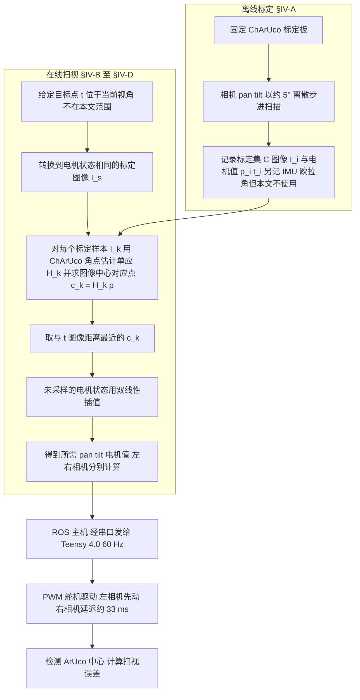

# DIJIT

**DIJIT: A Robotic Head for an Active Observer** 收录于 [Robot Learning Paper Notebooks](https://imchong.github.io/Robot_Learning_Paper_Notebooks/index.html)（分类：12_Hardware_Design），深读笔记已完成。本页是 **笔记摘要**：要点编译自深读笔记，细节以笔记原文与论文 PDF 为准。

## 一句话定义

DIJIT 的核心是：不把相机当成被动取景器，而是当成会「主动注视」的眼睛——给每只相机 3 个机械自由度 + 4 个光学自由度、再给脖子 3 个自由度，凑齐了会聚立体视觉所需的 vergence（聚散）/ version（共轭转动）/ cyclotorsion（眼球扭转），并实现了速度达人类峰值扫视 85% 以上、精度与人相当的仿生扫视，从而能在真实平台上对照「人眼-头-颈协同」与「现有计算机视觉」的差距。

## 英文缩写速查

| 缩写 / 术语 | 全称 / 含义 | 解释 |
|---|---|---|
| Active Observer | 主动观察者 | 能自主移动、转动视线去「主动获取信息」的视觉系统，而非被动接收图像 |
| DOF | Degree of Freedom | 自由度，机械/光学可独立控制的运动维度 |
| Vergence | 聚散运动 | 双眼向内/向外转动以聚焦不同深度目标（会聚立体视觉关键） |
| Version | 共轭运动 | 双眼同向同步转动（一起左右/上下看） |
| Cyclotorsion | 眼球旋转 | 眼球绕视线轴的扭转，维持立体几何一致性 |
| Saccade | 扫视 | 眼睛在注视点之间的快速跳转，DIJIT 仿生复刻其速度与精度 |
| Convergent Stereo | 会聚立体视觉 | 两眼视线相交于目标的立体视，区别于平行双目 |

## 为什么重要

- **「主动视觉」需要相称的硬件**：很多关于「人怎么看」的科学问题，光靠被动相机+算法无法回答，DIJIT 把人眼-头-颈的几何与动力学补进硬件，等于给主动视觉研究造了一把对的尺子。
- **眼球扭转（cyclotorsion）常被忽视**：多数机器人头省掉这一维，但它对维持会聚立体的几何一致很关键，DIJIT 把它补齐体现了对生物视觉的尊重。
- **扫视控制的工程巧思**：用「朝向↔电机值直接映射」绕开复杂逆运动学求解，换来接近人类的扫视精度，是硬件-控制协同设计的好例子。
- **对人形机器人的意义**：人形机器人最终也要「会主动看」，DIJIT 这类仿生头-颈视觉系统是感知前端的潜在范式。

## 流程总览

图依据：论文 §IV-A 至 §IV-D 与 §V（扫视标定与执行链路；文中无整体流程图，箭头为按文字顺序归纳）

## 解决什么问题

主流计算机视觉默认相机是**被动**的：图像「送进来」，算法去处理。但人类视觉是**主动**的——我们靠**眼动 + 头动 + 颈动的协同**去对准目标、会聚双眼、稳定注视，很多视觉能力恰恰建立在这套「主动控制」之上。

要研究「人到底是怎么用眼/头/颈去解决视觉任务的」，需要一个**自由度、运动范围、速度都逼近人类**的硬件平台。已有的机器人头大多在某些维度上简化了（比如缺少眼球扭转、脖子自由度不足、或速度远低于人眼），不足以复现会聚立体视觉的完整几何。

## 核心机制

- 核心机制以深读笔记为准（见 [参考来源](#参考来源)）。

## 核心信息

| 字段 | 内容 |
|------|------|
| 分类 | 12_Hardware_Design |
| 深读笔记 | <https://imchong.github.io/Robot_Learning_Paper_Notebooks/papers/12_Hardware_Design/DIJIT_A_Robotic_Head_for_an_Active_Observer/DIJIT_A_Robotic_Head_for_an_Active_Observer.html> |
| arXiv | <https://arxiv.org/abs/2512.07998> |
| 机构 | York University（约克大学）电气工程与计算机科学系 · Tsotsos Lab（主动与注意视觉实验室） |
| 发表 | 2025-12-08 (arXiv) |
| 笔记阅读日期 | 2026-06-11 |

## 实验与评测

- 本页是深读笔记的摘要，没有搬运原文的量化结果；量化 benchmark、消融与实机指标以 **深读笔记与论文 PDF** 为准（链接见 [参考来源](#参考来源)）。

## 结论

**DIJIT 不是在造一个更像人的机器人头，而是在补一把「主动视觉研究缺失的尺子」：自由度与动力学先做到与人相称，才谈得上在真实平台上对照人类视觉与现有计算机视觉的差距。**

- 关键在自由度的完整性而非数量：每只相机 3 个机械 + 4 个光学自由度、脖子 3 个自由度，凑齐 vergence / version / cyclotorsion，会聚立体视觉的几何才成立。
- **cyclotorsion（眼球扭转）** 是本页点名的差异项——多数机器人头省掉这一维，但缺了它就维持不住会聚立体的几何一致性。
- 工程巧思落在控制侧：用「朝向↔电机值直接映射」绕开复杂逆运动学求解，换来速度达人类峰值扫视 **85% 以上**、精度与人相当的仿生扫视，是硬件-控制协同设计的样本。
- 边界要看清：本页把 DIJIT 定位为研究平台与感知前端范式，且核心机制小节明确以深读笔记为准，不宜据本页推断它在具体视觉任务上的表现。
- 对人形机器人的意义在 **感知前端** 而非控制策略：它回答「怎么主动地看」，不回答「看到之后怎么动」。

## 与其他页面的关系

- 分类父节点：[paper-notebook-category-12-hardware-design](../overview/paper-notebook-category-12-hardware-design.md)
- 总索引：[humanoid-paper-notebooks-index.md](../overview/humanoid-paper-notebooks-index.md)
- 会聚深度算法：[Convergent Binocular Stereo（CBS）](./paper-convergent-binocular-stereo.md) — 同实验室；DIJIT 提供 vergence/version/cyclotorsion，CBS 提供会聚几何下的 metric 深度与 CBS-BM 基准

## 参考来源

- [humanoid_pnb_dijit-a-robotic-head-for-an-active-observer.md](../../sources/papers/humanoid_pnb_dijit-a-robotic-head-for-an-active-observer.md)
- 深读笔记：<https://imchong.github.io/Robot_Learning_Paper_Notebooks/papers/12_Hardware_Design/DIJIT_A_Robotic_Head_for_an_Active_Observer/DIJIT_A_Robotic_Head_for_an_Active_Observer.html>
- 论文：<https://arxiv.org/abs/2512.07998>
- [arXiv PDF](https://arxiv.org/pdf/2512.07998)：已通读方法部分（实验与附录以略读为准）：§III DIJIT Design、§IV Saccade Control、§V 实验设置开头（流程图仅涵盖扫视控制与执行链路，机械设计未入图）

## 推荐继续阅读

- [机器人论文阅读笔记：DIJIT](https://imchong.github.io/Robot_Learning_Paper_Notebooks/papers/12_Hardware_Design/DIJIT_A_Robotic_Head_for_an_Active_Observer/DIJIT_A_Robotic_Head_for_an_Active_Observer.html)
