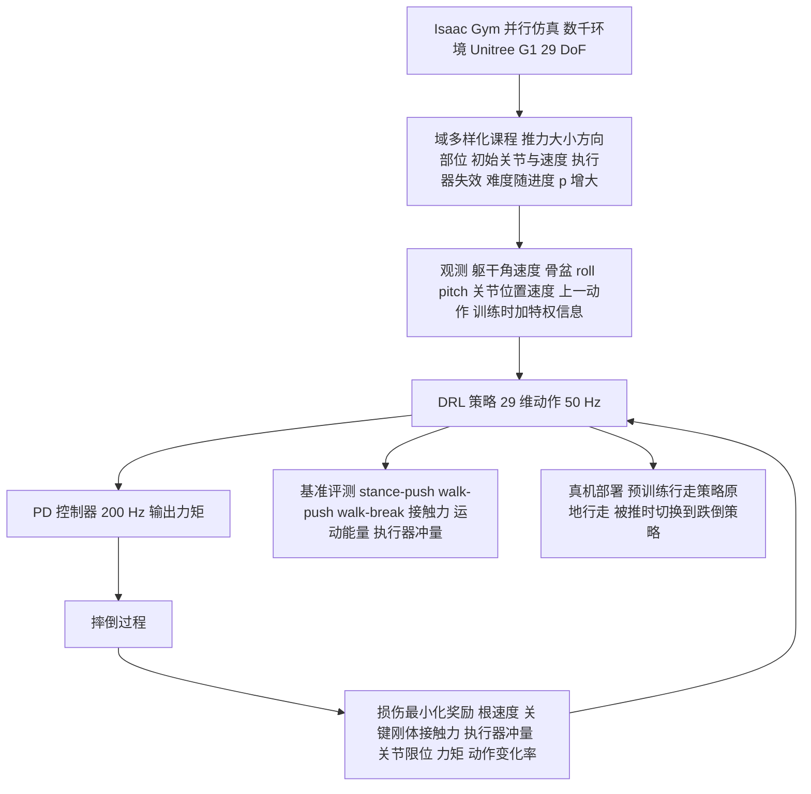

# Discovering Self-Protective Falling Policy for Humanoid Robot via Deep Reinforcement Learning

**Discovering Self-Protective Falling Policy for Humanoid Robot via Deep Reinforcement Learning** 收录于 [Robot Learning Paper Notebooks](https://imchong.github.io/Robot_Learning_Paper_Notebooks/index.html)（分类：04_Loco-Manipulation_and_WBC）。本页依据 **论文 PDF 全文**（arXiv:2512.01336v1，正文 7 页，无独立附录）编译；深读笔记与 arXiv 摘要页只作线索。图表中的具体数值未从 PDF 文本中提取，以下只写文字可确认的结论。

## 一句话定义

**人形机器人跌倒既频繁又代价高，本文用大规模深度强化学习加域多样化课程，让 Unitree G1 在仿真中自行学出护身跌倒策略，发现以手臂撑出「三角（triangle）」结构可显著降低刚性机体的跌落损伤，并迁移到真机。**

## 英文缩写速查

| 缩写 | 含义 |
|---|---|
| DRL | Deep Reinforcement Learning，深度强化学习；本文用于学习跌倒策略 |
| PPO | Proximal Policy Optimization，近端策略优化；训练算法之一 |
| LCP | Lipschitz-Constrained Policies，Lipschitz 约束策略；提供行走基线 |
| CL | Curriculum Learning，课程学习；按训练进度 p 逐步加大扰动难度 |
| DR | Domain Randomization，域随机化；本文称「域多样化」 |
| ROA | Regularized Online Adaptation，正则化在线适应；训练用特权信息，部署由历史观测推断 |
| PD | Proportional-Derivative，比例-微分控制器；把策略输出的目标位置换算为力矩 |
| DoF | Degree of Freedom，自由度；G1 共 29 个 DoF |
| CoM | Center of Mass，质心；人形质心高，跌倒时降低质心是策略的一部分 |
| ZTC | Zero Torque Control，零力矩控制；不做任何控制的跌倒基线 |
| DPC | Default Position Control，默认姿态控制；策略恒输出初始姿态 |
| Sim2Real | 仿真到真机迁移 |

## 为什么重要

- **跌倒安全是人形落地的硬约束**：人形体重大、CoM（质心）高、DoF 多，不受控跌倒会损坏自身与周围物体。论文指出，膝、骨盆、腕等任一部件损坏都会让机器人停机、等待维修并造成经济损失，因此「如何尽量减少跌落损伤」本身就是问题。
- **让 RL 自己找姿态，而不是人为规定**：人会用手撑、用膝或骨盆减冲击，但人体是软组织，而人形是金属刚性结构，直接照搬人的护身动作未必适用。论文的核心主张正是让数据驱动的策略去搜索「贴合自身物性」的护身方式。
- **覆盖长尾跌倒场景**：站立、行走、不同推力方向、不同初速、执行器失效等组合很多，控制法和预设轨迹难以覆盖，域多样化课程用来补上这一块。
- **同主题研究簇**：与 [SafeFall](paper-hrl-stack-41-safefall.md)、[Robot Crash Course](paper-notebook-robot-crash-course.md)、[VIGOR](paper-notebook-vigor-visual-goal-in-context-inference-for-unifi.md)、[Unified Fall-Safety Policy](paper-notebook-unified-humanoid-fall-safety-policy-from-a-few-d.md) 同属人形跌落安全方向。

## 流程总览

图依据：论文 §III、§IV-B/C、§V-A/E 与 Fig.2（箭头为按文字顺序归纳，非原图直接复制）。

## 解决什么问题

已有人形跌倒控制研究多基于简化动力学，或依赖强人类先验（如用膝或骨盆减小冲击），或依赖预先计算的运动轨迹；另有工作需要硬件改动去模拟人体柔性。这些方法难以覆盖站立或行走、不同推力方向等多样跌落情形，真机实验也有限。

论文的做法是：在 Isaac Gym 中用数千个并行环境训练，配合精心设计的奖励与课程，让智能体探索所有可能的跌倒行为，然后选出既降低损伤、又适合自身物理特性的那一个。

## 核心原理

### 输入、输出与控制链路

- **观测**：$o_t = [\dot{\omega}, r, p, q, \dot{q}, a_{t-1}]$，其中 $\dot{\omega}$ 为躯干角速度（PDF 文本提取，记号未核实），$r, p$ 为骨盆 roll 与 pitch，$q, \dot{q} \in \mathbb{R}^{29}$ 为关节位置与速度，$a_{t-1}$ 为上一步动作。
- **特权信息**：沿用 ROA 框架，训练时输入额外的特权信息，部署时由最近 10 步观测推断。
- **动作**：策略输出 29 维目标，经 PD 控制器转为力矩 $\tau = K_p(a - q) - K_d \dot{q}$。策略 50 Hz 运行，PD 200 Hz 运行。
- **训练目标**：标准的折扣回报最大化，$\pi^* = \arg\max_\pi \mathbb{E}\left[\sum_t \gamma^t R(s_t, a_t)\right]$，策略基于观测 $o$（部分可观测 MDP）。

### 奖励：以损伤最小化为目标

奖励的目标是在「减少全身损伤」「保护头、躯干、骨盆」之间取平衡。主要项（权重取自 PDF 表 I 的文本提取，以原表为准）：

| 项 | 权重 | 作用 |
|---|---|---|
| 根部线速度平方 $\|v_\text{root}\|^2$ | −1.03125 | 惩罚根部运动 |
| 关键刚体接触力（头、躯干、骨盆） | −0.02 | 保护易损且昂贵的部件 |
| 全部接触力（踝部下调） | −0.001 | 减少不必要的碰撞；踝部下调以减轻站立接触的影响 |
| 执行器冲量（撞限位） | −7.25 | 惩罚关节撞击限位的冲量 |
| 关节超限位置 | −29 | 惩罚越过关节限位 |
| 驱动力矩超限 | −24.65 | 惩罚超过最大驱动力矩 |
| 大力矩 | −2.9e−3 | 惩罚大力矩 |
| 动作变化率 | −0.23 | 惩罚动作抖动 |
| 关节加速度 | −2e−4 | 惩罚关节加速度 |

作者记录了一个反例：直接奖励「用手臂撑地」会导致机器人手臂笔直顶地，真机上可能折断关节（奖励被钻空子）。因此论文没有显式奖励撑手动作，而是让「撑出三角」作为损伤最小化的副产物涌现。

### 课程：域多样化（CL 与域随机化）

训练环境的随机化（课程学习 CL 的一种形式）随训练进度 $p$ 从 0 线性增到 1（Table II）：

- **外部推力**：大小 $U(50+100p,\ 350+500p)$ N，方向 $U(-\pi, \pi)$，作用部位 $U\{\text{Head}, \text{Torso}, \text{Pelvis}\}$；
- **初始关节**：$U(0.8q_0, 1.2q_0)$，外加腰、肩、肘的额外随机化；
- **初始根部速度**：$v_x, v_y \sim U(-0.1-0.25p,\ 0.1+0.25p)$；
- **执行器失效**：随机选择一个髋、膝或踝关节失效（输出力矩为零）。

### 涌现的「三角」结构

训练后的策略在跌倒时用上臂与手臂形成三角支撑（图 1、图 6–8），作者归纳了三个作用：把跌落冲量分散到多个执行器与刚体上；手臂本身不易断裂；腿部张开以降低质心并减少地面上的水平运动。论文还指出，骨盆在三种跌倒模式中都受到持续碰撞，说明该部位仍需更多保护（§V-D）。

## 工程实践

| 项目 | 设置（来自原文） |
|---|---|
| 仿真平台 | NVIDIA Isaac Gym，数千个并行环境，见 [isaac-gym](isaac-gym.md) |
| 机器人 | Unitree G1，29 DoF，见 [unitree-g1](unitree-g1.md) |
| 算法 | PPO 训练，LCP 作为行走基线的训练框架，课程式域随机化用于 sim2real |
| 控制频率 | 策略 50 Hz，PD 200 Hz |
| 测试集 | stance-push 72 组（3 种推力 × 8 方向 × 3 部位）；walk-push 72 组（750 N，8 方向，3 种速度）；walk-break 18 组（6 个关节 × 3 种速度） |
| 重复次数 | 每组配置多次 rollout，N 分别为 98、98、112 |
| 核心指标 | 接触力、运动能量 $E = \tfrac{1}{2}mv^2$、执行器冲量；聚合方式为取上均值（top-5 平均，细节未核实） |
| 仿真验证 | 策略迁移到 [MuJoCo](mujoco.md) 中拍摄跌倒过程（视频见补充材料） |
| 真机流程 | 预训练行走策略原地行走，人推躯干使其跌倒，同时切换到跌倒策略 |
| 源码开放状态 | 核查日期 2026-11-06：arXiv 摘要页与论文 PDF 未列代码或项目页链接；深读笔记只指向其自身的笔记仓库，未见本工作的官方代码。**未核实**项目页是否存在，目前按「未列 GitHub」处理 |
| 源码运行时序图 | **不适用**（未见官方可运行代码） |

**复现注意**：奖励项数量多、权重跨度大（从 $10^{-4}$ 到 $10^{1}$ 量级），建议逐项监控接触力与执行器冲量的变化；论文用 MuJoCo 检查跌倒过程，复现时也可做同样的跨仿真器检查（此为建议，非原文结论）。

## 实验与评测

- **基线**：LCP 训练的站立与行走策略（Baseline，未专门针对跌倒训练）；零力矩控制（ZTC）；默认姿态控制（DPC）；本文策略（Ours）。
- **总体结论（文字描述）**：ZTC 在三类指标上都最差，说明完全不控制的跌倒损伤最重；DPC 的执行器冲量最小，接触力与运动能量次之；Baseline 的接触力与执行器冲量甚至差于 DPC，说明未针对跌倒训练的策略可能比被动控制更伤；Ours 在运动能量与接触力上最好，执行器冲量略高，作者解释为主动用关节来撑地。
- **分布分析（Fig.11）**：相比 DPC，本文策略显著降低躯干、头部、骨盆的运动能量与接触力，同时增加肩、肘与腕部的能量与接触，执行器冲量在肘与腕上略增，腰俯仰冲量变大以维持上身高度。
- **真机**：Unitree G1 在原地行走中被推倒，策略成功用三角结构撑地。**这是一次定性演示**，论文文本中没有真机损伤或接触力的量化数据。
- 数值结果以论文图 5、图 9–11 为准；本页未从图中读取具体数字（**未核实**）。

## 与其他工作对比

| 路线 | 代表 | 与本文的差异 |
|---|---|---|
| 人类先验 / 仿人护身动作 | 论文中 [17]、[18]、[19]、[20] 等 | 依赖膝、骨盆或人类跌倒动作，或需要硬件改造模拟软组织；本文不预设姿态 |
| 预设轨迹 / 优化轨迹 | 论文中 [18]、[20] 等 | 对多样跌倒场景覆盖有限；本文用 RL 在多场景中搜索 |
| 统一控制策略 | 论文中 [19] 等 | 作者认为其在多样跌倒场景上泛化有限；本文用域多样化课程覆盖更多情形 |
| 同主题学习类工作 | [SafeFall](paper-hrl-stack-41-safefall.md)、[Robot Crash Course](paper-notebook-robot-crash-course.md)、[Unified Fall-Safety Policy](paper-notebook-unified-humanoid-fall-safety-policy-from-a-few-d.md) | 本页只依据本文原文对比；其他页面的具体设定以各自页面为准 |
| 跌倒后恢复 | [balance-recovery](../tasks/balance-recovery.md) 所涵盖的恢复类工作 | 本文处理的是跌落过程中的硬件保护，不是跌倒后的站起 |

## 结论

**一句话总判：护身姿态不该由人规定，而应由 RL 在多样跌倒场景中自己搜出来；对刚性人形而言，「三角」撑地是有效的降损解，但它是跌落保护层，不是平衡方案。**

1. **奖励锁定损伤，课程覆盖场景**：奖励把目标限定在损伤最小化，课程负责方向、初速、执行器失效等长尾情形。论文没有单独的消融实验，两者各自的贡献无法从文中判断。
2. **「三角」是涌现结果，不是设计**：作者只写了损伤相关的奖励，撑地动作由策略自己学出。直接奖励撑手会导致手臂硬顶地面，所以工程上要避免把「撑手」写成显式奖励。
3. **取舍是把冲击从躯干与骨盆转移到手臂**：运动能量与接触力下降，但肩、肘、腕的接触和执行器冲量上升；选用时要确认手臂与肘关节能承受这部分负载。
4. **定位是「摔得聪明」而不是「不摔」**：本文与平衡、跌后恢复类工作互补，不能替代。
5. **真机证据较弱**：真机只有一次推倒的定性演示，没有量化损伤数据，也没有代码或权重公开，复现需要自行实现奖励与课程。

## 局限与风险

- **场景范围有限**：论文只在 Unitree G1 上验证，作者在结论中提到需要扩展更多跌倒场景，并结合环境感知以便与周围物体发生合适的交互。
- **真机证据偏弱**：真机实验是定性的，缺少接触力、运动能量等量化对比。
- **Sim2Real 差距**：训练在 Isaac Gym 中完成，验证在 MuJoCo 中完成；接触模型与执行器模型的差异可能影响实际损伤，论文未讨论。
- **奖励钻空子风险**：撑手的奖励可能导致手臂顶地、关节折断，实际部署前需要核查手臂与肘部的力矩与冲量上限。
- **基线设定**：论文中的 Baseline 是为行走训练的 LCP 策略，而非专门的跌倒策略，因此「本文优于 Baseline」的对比强度有限。
- **代码与复现**：截至核查日期未见官方代码或权重；图表中的具体数值未核实。

## 关联页面

- 分类父节点：[paper-notebook-category-04-loco-manipulation-and-wbc](../overview/paper-notebook-category-04-loco-manipulation-and-wbc.md)
- 总索引：[humanoid-paper-notebooks-index.md](../overview/humanoid-paper-notebooks-index.md)
- 同主题跌落安全：[paper-hrl-stack-41-safefall](paper-hrl-stack-41-safefall.md)、[paper-notebook-robot-crash-course](paper-notebook-robot-crash-course.md)、[paper-notebook-unified-humanoid-fall-safety-policy-from-a-few-d](paper-notebook-unified-humanoid-fall-safety-policy-from-a-few-d.md)
- 任务与方法：[balance-recovery](../tasks/balance-recovery.md)、[ppo](../methods/ppo.md)、[lcp](../methods/lcp.md)、[curriculum-learning](../concepts/curriculum-learning.md)、[domain-randomization](../concepts/domain-randomization.md)、[sim2real](../concepts/sim2real.md)
- 平台与仿真：[unitree-g1](unitree-g1.md)、[isaac-gym](isaac-gym.md)、[mujoco](mujoco.md)

## 参考来源

- [humanoid_pnb_discovering-self-protective-falling-policy-for-h.md](../../sources/papers/humanoid_pnb_discovering-self-protective-falling-policy-for-h.md)：Paper Notebooks 溯源归档
- 论文 PDF（全文通读）：<https://arxiv.org/pdf/2512.01336>
- arXiv 摘要页：<https://arxiv.org/abs/2512.01336>
- 深读笔记：<https://imchong.github.io/Robot_Learning_Paper_Notebooks/papers/04_Loco-Manipulation_and_WBC/Discovering_Self-Protective_Falling_Policy_for_Humanoid_Robot_via_Deep_RL/Discovering_Self-Protective_Falling_Policy_for_Humanoid_Robot_via_Deep_RL.html>

## 推荐继续阅读

- [论文 PDF：Discovering Self-Protective Falling Policy for Humanoid Robot via Deep Reinforcement Learning（arXiv:2512.01336）](https://arxiv.org/pdf/2512.01336)
- [机器人论文阅读笔记：Discovering Self-Protective Falling Policy for Humanoid Robot via Deep Reinforcement Learning](https://imchong.github.io/Robot_Learning_Paper_Notebooks/papers/04_Loco-Manipulation_and_WBC/Discovering_Self-Protective_Falling_Policy_for_Humanoid_Robot_via_Deep_RL/Discovering_Self-Protective_Falling_Policy_for_Humanoid_Robot_via_Deep_RL.html)
- [PPO 原论文 arXiv:1707.06347](https://arxiv.org/abs/1707.06347)，本文训练算法
- [RMA arXiv:2107.04034](https://arxiv.org/abs/2107.04034)，本文引用的快速运动适应框架
