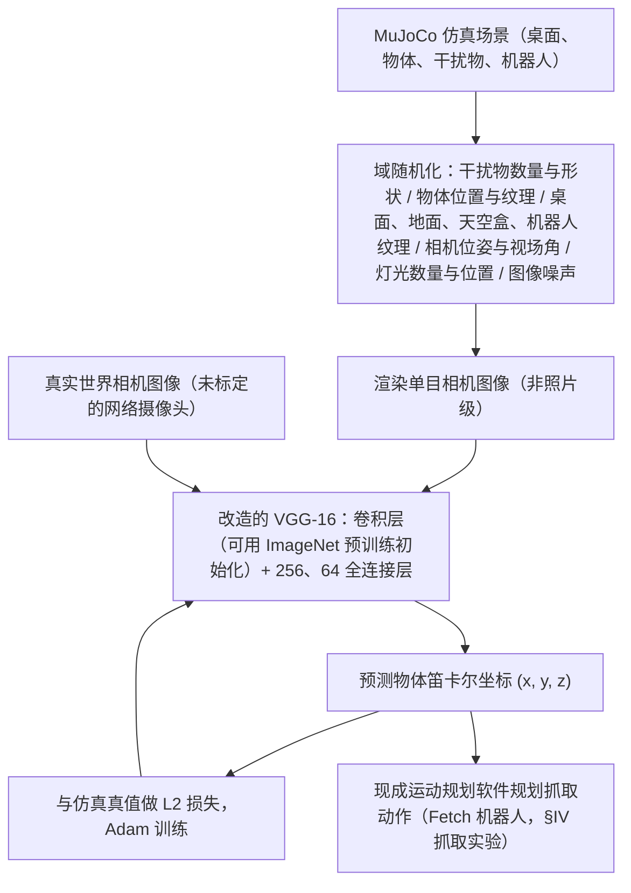

# Domain Randomization for Transferring Deep Neural Networks from Simulation to the Real World

**Domain Randomization for Transferring Deep Neural Networks from Simulation to the Real World** 收录于 [Robot Learning Paper Notebooks](https://imchong.github.io/Robot_Learning_Paper_Notebooks/index.html)（分类：01_Foundational_RL）。本页为 **清单索引实体**，链向深读笔记与原始论文；详细机制待从笔记消化后补充。

## 一句话定义

在视觉参数随机化的仿真环境里训练神经网络，让真实世界看起来只是仿真的"另一个变体"，从而无需任何真实数据即可完成 sim-to-real 迁移。

## 英文缩写速查

| 缩写 | 英文全称 | 简要说明 |
|------|----------|----------|
| RL | Reinforcement Learning | 通过与环境交互最大化长期回报来学习策略 |
| WBC | Whole-Body Control | 协调全身关节满足多任务/约束的控制基础设施 |
| Sim2Real | Simulation to Real | 把仿真中学到的策略迁移落地真机的工程主线 |

## 为什么重要

- 列入 Paper Notebooks 策展清单，便于与全库 [机器人学习论文笔记总索引](../overview/humanoid-paper-notebooks-index.md) 及分类父节点交叉检索。
- 深读笔记提供比摘要更贴近实现的阅读路径，适合作为后续 ingest 深化起点。

## 流程总览

图依据：论文 §III-A / §III-B、Fig. 1 / Fig. 2、§IV 抓取实验。

## 核心信息

| 字段 | 内容 |
|------|------|
| 分类 | 01_Foundational_RL |
| 深读笔记 | <https://imchong.github.io/Robot_Learning_Paper_Notebooks/papers/01_Foundational_RL/Domain_Randomization_for_Transferring_Deep_Neural_Networks_from_Simulation_to_the_Real_World/Domain_Randomization_for_Transferring_Deep_Neural_Networks_from_Simulation_to_the_Real_World.html> |
| arXiv | <https://arxiv.org/abs/1703.06907> |

## 实验与评测

- 本页为 **策展清单索引** 摘要；量化 benchmark、消融与实机指标以 **深读笔记与论文 PDF** 为准（链接见 [参考来源](#参考来源)）。

## 结论

**这篇工作的取舍是「不追求仿真更真，而是让仿真足够杂」：把真实世界压成随机化分布里的一个普通样本，从而彻底绕开真实数据。**

- 起作用的就是 **视觉参数随机化** 本身——训练分布覆盖得够广，真实世界便只是"另一个变体"，因此无需任何真实数据即可完成 sim-to-real 迁移。
- 定位是 01_Foundational_RL 的方法基石，是后续 Sim2Real 工程主线的起点，而非某个具体任务上的最优解。
- 本页为策展笔记摘要，随机化的具体维度、量化 benchmark 与消融以深读笔记与论文 PDF 为准。

## 与其他页面的关系

- 分类父节点：[paper-notebook-category-01-foundational-rl](../overview/paper-notebook-category-01-foundational-rl.md)
- 总索引：[humanoid-paper-notebooks-index.md](../overview/humanoid-paper-notebooks-index.md)

## 参考来源

- [humanoid_pnb_domain-randomization-for-transferring-deep-neura.md](../../sources/papers/humanoid_pnb_domain-randomization-for-transferring-deep-neura.md)
- 深读笔记：<https://imchong.github.io/Robot_Learning_Paper_Notebooks/papers/01_Foundational_RL/Domain_Randomization_for_Transferring_Deep_Neural_Networks_from_Simulation_to_the_Real_World/Domain_Randomization_for_Transferring_Deep_Neural_Networks_from_Simulation_to_the_Real_World.html>
- 论文：<https://arxiv.org/abs/1703.06907>
- [`sources/papers/lc_awesome_sim2real_noarxiv_117_domain-randomization-for-transferring-de.md`](../../sources/papers/lc_awesome_sim2real_noarxiv_117_domain-randomization-for-transferring-de.md) — 本条目策展摘录
- [`sources/papers/lc_awesome_sim2real_catalog.md`](../../sources/papers/lc_awesome_sim2real_catalog.md) — 列表总表
- [`sources/repos/awesome-sim2real.md`](../../sources/repos/awesome-sim2real.md)
- [arXiv PDF](https://arxiv.org/pdf/1703.06907)：已通读方法部分（实验与附录以略读为准）：摘要、§I、§III（A 域随机化、B 模型与训练）、§IV 抓取实验段与 §V；§II 相关工作、其余实验消融略读

## 推荐继续阅读

- [机器人论文阅读笔记：Domain Randomization for Transferring Deep Neural Networks from Simulation to the Real World](https://imchong.github.io/Robot_Learning_Paper_Notebooks/papers/01_Foundational_RL/Domain_Randomization_for_Transferring_Deep_Neural_Networks_from_Simulation_to_the_Real_World/Domain_Randomization_for_Transferring_Deep_Neural_Networks_from_Simulation_to_the_Real_World.html)
