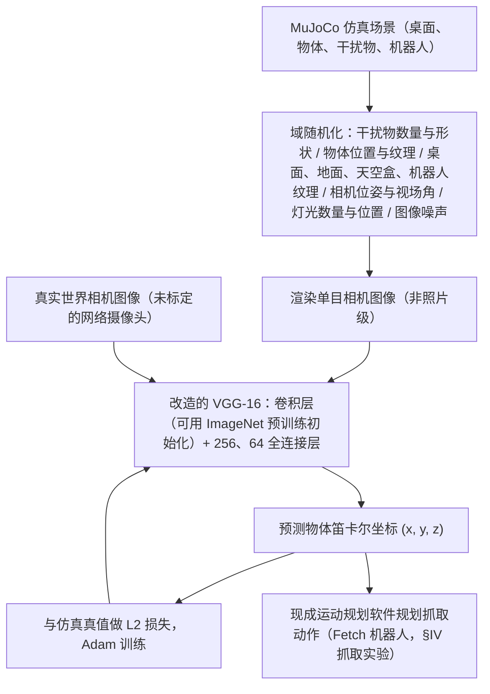

# Domain Randomization for Transferring Deep Neural Networks from Simulation to the Real World

**Domain Randomization for Transferring Deep Neural Networks from Simulation to the Real World** 收录于 [Robot Learning Paper Notebooks](https://imchong.github.io/Robot_Learning_Paper_Notebooks/index.html)（分类：01_Foundational_RL）。原文为 Tobin、Fong、Ray、Schneider、Zaremba、Abbeel（OpenAI / UC Berkeley，arXiv 2017-03）。本页已据原文全文归纳方法与实验；深读笔记作为补充阅读。

## 一句话定义

在视觉参数随机化的仿真环境里训练神经网络，让真实世界看起来只是仿真的"另一个变体"，从而无需任何真实数据即可完成 sim-to-real 迁移。

## 英文缩写速查

| 缩写 | 英文全称 | 简要说明 |
|------|----------|----------|
| DR | Domain Randomization | 训练时随机化仿真的渲染与场景参数，使真实世界落在训练分布之内 |
| Sim2Real | Simulation to Real | 把仿真中训练的模型或策略迁移到真实机器人与真实图像上 |
| RL | Reinforcement Learning | 文中用作动机：深度强化学习需要大量探索样本，难以直接在真机上做 |
| RGB | Red-Green-Blue | 论文只使用单目 RGB 彩色图像输入，不依赖深度信息 |
| VGG-16 | Visual Geometry Group 16-layer network | 本文改造的卷积骨干网络，前端卷积层沿用标准 VGG 结构 |
| FOV | Field of View | 相机视场角，训练时在原值上随机缩放最多约 5% |
| L2 | L2 loss（平方误差类损失） | 网络预测的物体坐标与仿真真值之间的回归损失 |

## 为什么重要

- 真机数据昂贵且有风险：深度强化学习（RL）常需数十万到数百万样本，直接在硬件上采集不现实；而仿真能便宜地生成带精确标签的数据。
- 视觉是低成本入口，但也是最难迁移的部分：仿真渲染器（如 MuJoCo 自带渲染器）很难复现真实相机的光照、噪声与纹理，这是 Sim2Real 的主要障碍之一。
- 论文把"物体定位"作为通向通用操作技能的一块基石，给出了一个不做任何真实数据训练、就能在真机上闭环抓取的可复现工程范式。
- 列入 Paper Notebooks 策展清单，便于与全库 [机器人学习论文笔记总索引](../overview/humanoid-paper-notebooks-index.md) 及分类父节点交叉检索。

## 流程总览

图依据：论文 §III-A / §III-B、Fig. 1 / Fig. 2、§IV 抓取实验。

## 核心原理

**输入**：一张来自仿真的单目 RGB 图像（渲染为低保真、非照片级）。**输出**：场景中目标物体的三维笛卡尔坐标 $(x, y, z)$ 。**核心机制**是把"真实世界"视为随机化分布中的一个样本，而不是去逼近某一个精确的仿真。

- **域随机化（DR，每个训练样本独立采样）**：桌面上 0–10 个干扰物（数量与形状随机）；目标与干扰物的位置与纹理；桌面、地面、天空盒、机器人的纹理；相机在约 10×5×10 cm 的盒子内随机平移，朝向在固定点基础上偏移最多 0.1 rad，视场角（FOV）缩放最多 5%；灯光数量、位置与高光特性；随机图像噪声。
- **纹理生成**：只用三类程序化纹理——随机 RGB 常色、两色渐变、两色棋盘格。物体颜色对检测器不可见，检测器只能依靠形状与尺寸。
- **几何简化**：真实相机未标定，桌面高度在仿真中固定，问题被约化为类似二维位姿的估计；相机内外参不需要精确标定。
- **网络与训练**：VGG-16 卷积层（可用 ImageNet 权重初始化，也可随机初始化）加两层全连接（256、64 维，无 dropout），输出 $(x, y, z)$；用 L2 损失与 Adam 优化，学习率约 1e-4。论文未给出损失的确切公式形式（未核实是否取平方）。
- **验证方式**：训练期间不使用任何真实数据做验证，真实图像只在最终测试时使用。

## 工程实践

| 环节 | 论文中的做法 / 数值 | 调试与注意事项 |
|------|----------------------|----------------|
| 仿真器 | MuJoCo 内置渲染器，不追求照片级，不要求物理上合理的纹理与光照 | 渲染越快越好；重点在变化范围而非逼真度 |
| 数据规模 | 约 5 千样本即可得到可用检测器；约 5 万样本时性能继续提升 | 预训练模型在小数据下更有优势；大数据下随机初始化可接近预训练 |
| 纹理多样性 | 固定 1 万样本时，纹理数少于 1 千会明显退化 | 论文结论：在低数据区，纹理随机化比位置随机化更重要 |
| 干扰物 | 训练时每图 0–10 个几何干扰物 | 去掉训练期干扰物后，真实图像上干扰物场景误差从 1.8 cm 升到 7.2 cm（见实验） |
| 相机随机化 | 位置、朝向、视场角均随机 | 去掉后误差略升（见实验），不是必需但有益 |
| 优化器 | Adam，学习率约 1e-4（标准 1e-3 易陷入"全部映射到桌面中心"的局部最优）；超参搜索 lr∈{1e-4, 2e-4}，batch∈{25, 50, 100} | 论文报告最好的网络 |
| 真实测试集 | 480 张网络摄像头图，距离 70–105 cm，未控制光照与背景；每类物体 60 张标注图（单独 / 干扰 / 遮挡各 20） | 标注通过将物体对齐到桌面网格获得 |
| 机器人闭环 | 检测位置交给现成运动规划（MoveIt）抓取，Fetch 机器人 | 论文报告的是检测后规划抓取，不是端到端控制策略 |
| 源码运行时序图 | **不适用**（截至核查日未找到官方代码仓库，见下方"开源状态"） | 无法对齐官方运行入口，故不绘制时序图 |

**开源状态（步骤 2.5 核查）**：原文脚注给出项目页 <https://sites.google.com/view/domainrandomization/>。核查时该页面 HTML 中未发现 GitHub 或其他代码 / 数据仓库链接（页面为脚本渲染，核查可能不完整，未核实）；arXiv 摘要页未列出官方代码。因此本页记为 **未找到官方代码链接**，不写"已开源"。

**复现要点（实践建议）**：先在仿真中渲染带随机纹理的桌面场景，再训练一个小型检测器；用少量真实图像做测试而不是训练；按 Object only / Distractors / Occlusions 三组分别报告误差，便于定位失败模式。

## 实验与评测

实验围绕 8 个几何体（锥、立方体、圆柱、六棱柱、四棱锥、长方体、四面体、三棱柱）展开，每个物体各训练一个检测器。

- **真实图像定位精度（Table I）**：各物体在 *Object only* 下误差约 0.7–1.3 cm；加入干扰物后大部分在 0.6–1.9 cm；遮挡下多数在 0.9–1.9 cm，四面体遮挡误差达 3.2 ± 5.8 cm，方差较大。论文据此概括为平均约 1.5 cm。训练集上误差仅 0.3–0.5 cm，说明对仿真数据存在过拟合。
- **消融（Table II，平均误差，cm）**：完整方法为 1.3 ± 0.6（单独）、1.8 ± 1.7（干扰物）、2.4 ± 3.0（遮挡）；去掉噪声几乎无影响（1.4 / 1.9 / 2.4）；去掉相机随机化为 2.0 / 2.4 / 2.9；去掉训练期干扰物时干扰物与遮挡场景升到 7.2 ± 4.5 与 7.4 ± 5.3，是影响最大的因素。
- **纹理与数据量**：Fig. 5 显示固定 1 万样本时，纹理数少于 1 千性能显著下降；Fig. 4 显示数据量从约 5 千到约 5 万的改善趋势（曲线数值未从图像读取，未核实精确数值）。
- **机器人抓取（§IV-D）**：在 Fetch 机器人上，对两个最稳定的检测器分别在 20 个渐杂乱场景中测试，共 40 次中成功抓取 38 次（含严重遮挡场景）；对未见过的 YCB 罐头（Spam）检测器在 10 次中成功 9 次，其间还包括训练时未见的食品干扰物。

## 与其他工作对比

按原文相关工作（§II）的划分，与本文最接近或最常被对照的几类方法如下：

- **Sadeghi & Levine（CAD2RL）**：同样用仿真随机化的 3D 场景与纹理做四旋翼飞行，但纹理取自约 200 种基本真实的材质；本文只用程序生成的非真实纹理，并能生成数十万乃至更多的纹理组合。CAD2RL 任务是避障，本文聚焦高精度定位。
- **系统辨识 / 高保真渲染**：通过精确建模与真实感渲染逼近真实（如 James & Johns 的 RGB 仿真、DepthSynth 的深度仿真）。本文走的是另一条路：渲染器质量不做要求，依靠变异覆盖真实分布；深度仿真的结论可与本文互补。
- **领域自适应（domain adaptation）**：如目标域再训练、特征对齐、图像翻译（Tzeng 等、Rusu 等 progressive nets）。这些方法通常需要真实数据、奖励或标签；本文不需要任何真实训练数据，且论文认为可以与其组合。
- **动力学随机化 / 集成模型**：Mordatch 等用动力学模型集合训练控制器，Antonova 等在随机摩擦与动作延迟下训练枢轴策略。这些属于对动力学参数的随机化；本文是对视觉渲染参数的随机化。
- **迭代学习控制**：借助真实数据迭代修正动力学模型，同样需要真机数据。

## 结论

**这篇工作的取舍是「不追求仿真更真，而是让仿真足够杂」：把真实世界压成随机化分布里的一个普通样本，从而彻底绕开真实训练数据。**

1. **数据多样性比渲染真实感更关键** — 去掉训练期干扰物会让真实场景误差从约 1.8 cm 升到约 7 cm，是论文中影响最大的因素。
2. **纹理多样性要足够大** — 程序化随机纹理的种类低于约 1 千时性能明显退化，不能只靠少量"看起来真实"的纹理。
3. **预训练不是必需的** — 数据充足时随机初始化的网络可以达到与 ImageNet 预训练相近的迁移效果；数据少时预训练仍然有用。
4. **精度足以做粗粒度抓取，不足以做接触密集或高精度操作** — 平均约 1.5 cm 的定位误差可支持论文中的抓取演示，论文也明确把接触密集任务与更高精度列为未来工作。
5. **工程上应把随机化视为"覆盖"而非"逼真"** — 调参的重点是保证真实分布落在采样范围内，并用真实测试图分组报告误差，而不是把仿真调得更像真实。

## 局限与风险

- **适用边界窄**：只验证了 8 个几何体的定位与一次桌面抓取；论文自己的结论是尚不足以完成接触密集或高精度的操作任务。
- **任务约化**：桌面高度固定，输出只关注物体中心位置，没有估计姿态，也不处理其他支撑面。
- **仿真过拟合**：训练集误差 0.3–0.5 cm，远低于真实误差，说明检测器对仿真分布有偏好。
- **输入限制**：只用单目 RGB，不使用深度、多视角或立体信息；论文将其列为改进方向。
- **测试规模有限**：真实测试只用一个相机位置的 480 张图，且未控制光照与背景；抓取实验只有 40 次与 10 次。
- **需要物体模型**：每个物体需要网格模型用于渲染，换物体需重新建模与训练。
- **常见误区**：把"没有真实训练数据"理解为"无需任何真实数据校验"；论文训练期间也未用真实数据验证，超参的好坏只能在测试时事后得知。另一个误区是认为随机化越大越好，论文显示在特定范围内随机化是有效的，但过分放大会增加训练难度（未核实，原文未系统测试）。
- **源码与复现**：截至核查日未找到官方代码，复现需按论文描述自行实现渲染与训练流程。

## 与其他页面的关系

- 分类父节点：[paper-notebook-category-01-foundational-rl](../overview/paper-notebook-category-01-foundational-rl.md)
- 总索引：[humanoid-paper-notebooks-index.md](../overview/humanoid-paper-notebooks-index.md)
- 概念页：[域随机化 (Domain Randomization)](../concepts/domain-randomization.md)、[Sim2Real](../concepts/sim2real.md)
- 相关论文：[Domain Randomization 的 Notebook 深读条目](paper-notebook-domain-randomization-understanding-sim-to-real-t.md)、[Peng 等动力学随机化](paper-peng-dynamics-randomization-sim2real.md)
- 应用方向：[操作任务 (Manipulation)](../tasks/manipulation.md)

## 参考来源

- [humanoid_pnb_domain-randomization-for-transferring-deep-neura.md](../../sources/papers/humanoid_pnb_domain-randomization-for-transferring-deep-neura.md)
- 论文全文（arXiv:1703.06907v1，2017-03-20，已通读正文、相关工作、实验与附录）：<https://arxiv.org/pdf/1703.06907>
- 项目页（原文脚注 5）：<https://sites.google.com/view/domainrandomization/>
- 深读笔记：<https://imchong.github.io/Robot_Learning_Paper_Notebooks/papers/01_Foundational_RL/Domain_Randomization_for_Transferring_Deep_Neural_Networks_from_Simulation_to_the_Real_World/Domain_Randomization_for_Transferring_Deep_Neural_Networks_from_Simulation_to_the_Real_World.html>
- [`sources/papers/lc_awesome_sim2real_noarxiv_117_domain-randomization-for-transferring-de.md`](../../sources/papers/lc_awesome_sim2real_noarxiv_117_domain-randomization-for-transferring-de.md) — 本条目策展摘录
- [`sources/papers/lc_awesome_sim2real_catalog.md`](../../sources/papers/lc_awesome_sim2real_catalog.md) — 列表总表
- [`sources/repos/awesome-sim2real.md`](../../sources/repos/awesome-sim2real.md)

## 推荐继续阅读

- [论文原文（arXiv:1703.06907）](https://arxiv.org/abs/1703.06907)：方法、消融与抓取实验的一手来源。
- [项目页（视频与补充材料）](https://sites.google.com/view/domainrandomization/)：原文提供的演示与补充资料。
- [机器人论文阅读笔记：Domain Randomization for Transferring Deep Neural Networks from Simulation to the Real World](https://imchong.github.io/Robot_Learning_Paper_Notebooks/papers/01_Foundational_RL/Domain_Randomization_for_Transferring_Deep_Neural_Networks_from_Simulation_to_the_Real_World/Domain_Randomization_for_Transferring_Deep_Neural_Networks_from_Simulation_to_the_Real_World.html)：中文策展笔记，便于对照阅读。
