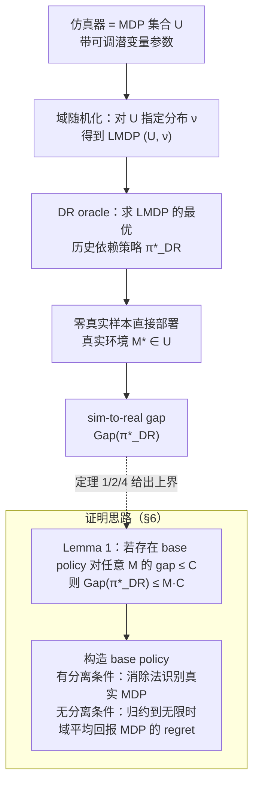

# Understanding Domain Randomization for Sim-to-real Transfer

**Understanding Domain Randomization for Sim-to-real Transfer**（Chen, Hu, Jin, Li, Wang；ICLR 2022）收录于 [Robot Learning Paper Notebooks](https://imchong.github.io/Robot_Learning_Paper_Notebooks/index.html)（分类：01_Foundational_RL）。本页为论文实体页，依据 arXiv 原文（v2）通读正文得出；论文为纯理论工作，没有数值实验。

## 一句话定义

这篇论文把 DR 建模为「在一组带可调潜变量的仿真 MDP 上，求一个历史依赖策略（LMDP 的最优策略）」，并证明：在仿真器类有限或足够平滑、且真实环境可通信且直径有界等条件下，**完全不用真实样本**训练出的 DR 策略在真实环境中的次优性差距是次线性的（相对horizon $H$ 为 $o(H)$），同时指出**记忆（history-dependent policy）**是这一保证的必要组成。

## 英文缩写速查

| 缩写 | 英文全称 | 在本页中的含义 |
|------|----------|----------------|
| DR | Domain Randomization | 训练时随机化仿真器参数（如摩擦、阻尼、视觉属性），让策略覆盖真实环境可能的取值 |
| MDP | Markov Decision Process | 论文中每个仿真器成员都是一个 $M=(S,A,P_M,R,H,s_1)$ 形式的 episodic MDP |
| LMDP | Latent Markov Decision Process | 每个 episode 开始时按分布 $\nu$ 抽取一个 MDP，agent 不知道抽到哪一个；DR 即在 LMDP 上求最优策略 |
| POMDP | Partially Observable MDP | LMDP 是 POMDP 的特例，因而最优策略一般依赖历史，而非仅依赖当前状态 |
| LSTM | Long Short-Term Memory | 论文 §3.2 提到的循环记忆结构，实践中用于实现历史依赖策略 |
| RL | Reinforcement Learning | 论文的研究对象：在仿真中学习策略，再迁移到真实环境 |

## 为什么重要

- DR 是 sim-to-real 里最常用的「零真实数据」迁移手段之一（论文引用 Sadeghi & Levine 2016、Tobin 2017、Peng 2018、OpenAI 2018 等），但经验上的成功缺乏理论解释。
- 论文回答的问题是：**DR 训练出的策略直接部署到真实环境，其相对真实环境最优策略的损失能否被保证？** 这是对「为什么 DR 能工作」的一个可证伪回答。
- 对工程的直接意义：论文给出了「为什么要随机化、为什么要带记忆、随机化范围要覆盖什么」的理论依据（§5 的必要性论断与 §5.3 的平滑条件）。

## 核心原理

### 输入、机制、输出

- **输入**：仿真器是一个 MDP 集合 $\mathcal{U}$，各成员共享状态与动作空间、转移概率 $P_M$ 由潜变量（如摩擦系数、风速）决定；真实环境对应未知的 $M^* \in \mathcal{U}$（§4.1 的假设）；DR 在 $\mathcal{U}$ 上指定分布 $\nu$（通常为均匀分布）。
- **DR oracle**（Definition 1）：$\pi^*_{DR} = \arg\max_{\pi \in \Pi} \mathbb{E}_{M \sim \nu} V^{\pi}_{M,1}(s_1)$，即 LMDP $(\mathcal{U}, \nu)$ 上的全局最优历史依赖策略。论文不限定求解算法，可以是 model-based 或 model-free。
- **评价量**（Eq. 1）：$\mathrm{Gap}(\pi) = V^{*}_{M^*,1}(s_1) - V^{\pi}_{M^*,1}(s_1)$，即策略在真实环境上的价值与真实最优价值之差；策略全程不使用真实样本。
- **输出**：一个可直接部署的策略 $\pi^*_{DR}$，其 sim-to-real gap 是本文的分析对象。

直觉：若策略能在前几步通过交互「辨认」出当前处于哪个仿真 MDP，之后就能近似最优地行动。这种辨认需要记忆结构（论文 §3.2 指出实践中常用 LSTM 等循环网络），这正是论文强调「记忆 + 随机化」的原因。

### 流程总览

图依据：论文 §4（形式化：sim-to-real 与 DR 作为 LMDP oracle）、§5 主要结果、§6 Proof Overview；本篇为理论论文，图表示其分析框架与证明归约，不是可部署的训练管线。

### 归约思路（§6）

- **Lemma 1（归约到 base policy）**：若存在某策略 $\hat\pi$ 对任意 $M \in \mathcal{U}$ 的 gap 都不超过 $C$，则有限情形下 $\mathrm{Gap}(\pi^*_{DR}) \le |\mathcal{U}| \cdot C$；平滑情形下 $\mathrm{Gap}(\pi^*_{DR}) \le C/\nu(\mathcal{C}_{M^*,\epsilon}) + L\epsilon$。即 DR 的最优性不会比任一 base policy 差太多。
- **Lemma 2（episodic 与 infinite-horizon 的换算）**：$H\rho^*_M - D \le V^*_{M,1}(s_1) \le H\rho^*_M + D$，把 gap 问题转化为平均回报 MDP 的 regret 问题。
- 有限且 δ-separated 时（Assumption 2），用「消除法」构造 base policy：先探索信息量大的状态-动作对，排除不像真实 MDP 的候选，再执行真实 MDP 的最优策略。
- 无 separation 时，把 base policy 的构造归约为 infinite-horizon average-reward MDP 的 regret 最小化问题，并给出一个带一般函数逼近的乐观探索算法（Algorithm 4，附录 C.3）。

### 主要结论

| 设定 | 结论（论文原文表述，以下为正文定理） |
|------|--------------------------------------|
| 有限 $\mathcal{U}$、满足 δ-separation（Thm 1） | $\mathrm{Gap}(\pi^*_{DR}) = O\!\left(\frac{D M^3 \log(MH)\log^2(SMH/\delta)}{\delta^4}\right)$，对 $H$ 仅 poly-log |
| 有限 $\mathcal{U}$、无 separation（Thm 2） | $\mathrm{Gap}(\pi^*_{DR}) = O\!\left(D\sqrt{M^3 H \log(MH)}\right) = \tilde O(\sqrt{H})$，单步损失 $\tilde O(H^{-1/2})$ |
| 无限 $\mathcal{U}$、满足平滑条件 Assumption 3（Thm 4） | 用 $\epsilon$-eluder 维数 $d_e$ 与覆盖数 $N(\mathcal{F},1/H)$ 刻画复杂度，界为 $O\!\left(\frac{\sqrt{D d_e H \log(H N(\mathcal{F},1/H))}}{\nu(\mathcal{C}_{M^*,\epsilon})}\right) + L\epsilon$ |
| 下界（Thm 3） | 任意历史依赖策略在某些 $\mathcal{U}$ 上的 gap 至少 $\Omega(\sqrt{DMH})$，说明 $\sqrt{H}$ 量级不可避免 |
| 直径假设必要（Prop 1） | 去掉 Assumption 1 后存在实例使 $\mathrm{Gap}(\pi^*_{DR}) = \Omega(H)$ |
| 平滑/规模条件必要（Prop 2，附录 G.3） | 大仿真器类且不满足平滑条件时，即使有低秩结构，也可能 $\Omega(H)$ |

论文还说明：没有随机化（策略没见过所有环境）或没有记忆（策略无法隐式辨认环境）都无法获得次线性最坏情况 gap（§5.2）。

## 核心信息

| 字段 | 内容 |
|------|------|
| 分类 | 01_Foundational_RL |
| 深读笔记 | <https://imchong.github.io/Robot_Learning_Paper_Notebooks/papers/01_Foundational_RL/Domain_Randomization_Understanding_Sim-to-Real_Transfer/Domain_Randomization_Understanding_Sim-to-Real_Transfer.html> |
| arXiv | <https://arxiv.org/abs/2110.03239> |

## 工程实践

以下为本页对论文理论的工程解读，**不是论文给出的算法或实验**：

| 项目 | 做法 / 检查点 | 依据 |
|------|---------------|------|
| 仿真器建模 | 把仿真写成「参数化 MDP 集合」：对摩擦、关节阻尼等潜变量指定分布 $\nu$ | §4.2、§5.3（论文以 OpenAI 灵巧手的参数随机化为例） |
| 策略结构 | 策略须带记忆（如 LSTM 等循环结构）；无记忆时理论上无法保证次线性 gap | §3.2、§5.2 |
| 随机化范围 | 分布须在真实参数 $M^*$ 附近有正概率质量（平滑条件）；$\nu(\mathcal{C}_{M^*,\epsilon})$ 越小，界越松 | Assumption 3、Thm 4 |
| 直径假设 | 任意状态应能在有界时间内到达（通信 MDP，直径 $D$）；论文举例为机械臂位置/角度，代价为常数时间 | Assumption 1、Prop 1 |
| 诊断思路 | 理论要求策略能在少数步内辨认环境；工程上可检查 episode 开头的行为是否随环境参数发生可区分的变化（论文未给实验，此为解读） | §5.1 的「先识别再最优」直觉 |
| 源码开放状态（步骤 2.5） | 未找到官方项目页或代码仓库：深读笔记为第三方策展页；arXiv 摘要页的「Code, Data, Media」区块未见可用的官方代码链接（页面动态区块未核实）。论文为纯理论工作，无可运行实现 | 入库核查结论 |
| 源码运行时序图 | **不适用**（纯理论论文，未发布可运行代码） | 步骤 2.5 |

## 实验与评测

- 论文**没有数值实验、没有仿真或真机结果**。「评测」以理论界替代：主要结果即上表的 Thm 1–4，以及 Prop 1–2、Thm 3 的下界。
- 论文的合理读法：看 gap 的 **阶数**（$\log^3 H$、$\sqrt H$、$o(H)$）与 **常数依赖**（$M$、$1/\delta$、$d_e$、$1/\nu(\cdot)$），而非数值大小。
- 附带结果：无限平均回报 MDP 上带一般函数逼近的乐观算法，regret 为 $\tilde O(D\sqrt{d_e T})$（Algorithm 4，附录 C.3），论文称为独立有价值的贡献（此为论文自述）。

## 与其他工作对比

- **相对 LMDP 学习文献（Kwon et al., 2021）**：后者研究 LMDP 最优策略的学习与 regret；本文不研究学习本身，而是研究「把仿真中的 LMDP 最优策略搬到真实环境」的 gap（§2）。
- **相对已有 sim-to-real 理论（Jiang 2018、Feng 2019、Zhong 2019）**：这些工作都需要真实样本微调，而本文的 DR 不使用任何真实样本（§2）。
- **相对实践中的其他方法**：渐进网络（progressive networks）、贝叶斯方法等用于减少真实交互，并非本文的分析对象；本文只分析 DR 这一条路线。
- **相对「更高保真仿真器」路线**：本文的 gap 定义为策略价值差，描述的是仿真集合覆盖与策略记忆带来的误差，不分析单个仿真器的物理精度误差。

## 结论

**这是给 DR 补理论账的工作：DR 能在零真实数据下迁移不是玄学，但它有前提——仿真集合要覆盖真实环境、真实环境要有界直径、策略必须带记忆。**

1. **记忆不是可选项**：论文的理论把「历史依赖策略」作为 DR 能达到次线性最坏情况 gap 的必要条件；若工程上用无记忆的策略，论文理论不保证这一结果。
2. **随机化必须覆盖真实参数附近**：平滑条件要求 $\nu$ 在 $M^*$ 附近有正质量；随机化范围偏离真实参数时，界会按 $1/\nu(\mathcal{C}_{M^*,\epsilon})$ 恶化。
3. **直径假设决定能否得到次线性 gap**：去掉有界直径假设，最坏情况下 gap 可达 $\Omega(H)$，即策略可能完全失效。
4. **阶数读法**：有限且可分离时对 $H$ 仅 poly-log；一般有限情形为 $\tilde O(\sqrt H)$，单步损失 $\tilde O(H^{-1/2})$；$\sqrt H$ 下界说明这一量级不可避免。
5. **不是新的 DR 技巧**：论文不提供新的随机化方式、没有真机或仿真实验；它解释的是为什么已有 DR 管线可行、在哪些条件下可行。

## 局限与风险

- **纯理论、无实验**：上界为最坏情况，常数未必紧（论文自述 $M$ 与 $\delta$ 的依赖可能不紧）；不能直接当作部署性能预测。
- **假设较强**：Assumption 1（通信、有界直径）、Assumption 2（δ-separation）、Assumption 3（平滑）、真实环境 $M^* \in \mathcal{U}$（可实现性）以及 DR oracle 能求得 LMDP 全局最优（§4.2）。这些假设在真实机器人上是否成立需要单独核查。
- **不覆盖允许真实数据微调的场景**：论文明确只研究「纯仿真训练、零真实样本」的设定（§4.1）；混合 on-policy 微调留作未来工作。
- **模型覆盖范围**：论文的 MDP 框架显式建模的是转移概率中的潜变量差异（奖励可扩展，论文称易于推广）；视觉渲染随机化未被分析。
- **常见误读**：把 $o(H)$ 读成「每步误差趋于 0 的实际保证」，或把 gap 与仿真物理精度误差混为一谈，都不对。

## 与其他页面的关系

- 概念页：[domain-randomization](../concepts/domain-randomization.md)、[sim2real](../concepts/sim2real.md)
- 同领域论文实体页：[paper-notebook-domain-randomization-for-transferring-deep-neura](paper-notebook-domain-randomization-for-transferring-deep-neura.md)（DR 的经验实践路线）、[paper-peng-dynamics-randomization-sim2real](paper-peng-dynamics-randomization-sim2real.md)（动力学随机化的 sim2real 工作）、[paper-rarl-robust-adversarial-rl](paper-rarl-robust-adversarial-rl.md)（对抗式鲁棒 RL）
- 分类父节点：[paper-notebook-category-01-foundational-rl](../overview/paper-notebook-category-01-foundational-rl.md)
- 总索引：[humanoid-paper-notebooks-index.md](../overview/humanoid-paper-notebooks-index.md)

## 参考来源

- [humanoid_pnb_domain-randomization-understanding-sim-to-real-t.md](../../sources/papers/humanoid_pnb_domain-randomization-understanding-sim-to-real-t.md)（本库来源归档）
- 论文原文：[arXiv:2110.03239](https://arxiv.org/abs/2110.03239)（PDF：<https://arxiv.org/pdf/2110.03239>，v2；页眉注明 ICLR 2022 会议版）。阅读范围：正文 §1–§7 全文，附录 A（预备知识）；附录 C–G 的算法构造与省略证明未逐行读，结论以正文定理为准。
- 深读笔记：<https://imchong.github.io/Robot_Learning_Paper_Notebooks/papers/01_Foundational_RL/Domain_Randomization_Understanding_Sim-to-Real_Transfer/Domain_Randomization_Understanding_Sim-to-Real_Transfer.html>

## 推荐继续阅读

- [arXiv 摘要页](https://arxiv.org/abs/2110.03239)与[PDF](https://arxiv.org/pdf/2110.03239)：原文，建议优先读 §4（形式化）与 §5（主要结果）。
- [机器人论文阅读笔记：Understanding Domain Randomization for Sim-to-real Transfer](https://imchong.github.io/Robot_Learning_Paper_Notebooks/papers/01_Foundational_RL/Domain_Randomization_Understanding_Sim-to-Real_Transfer/Domain_Randomization_Understanding_Sim-to-Real_Transfer.html)：策展深读笔记（第三方，非原文）。
