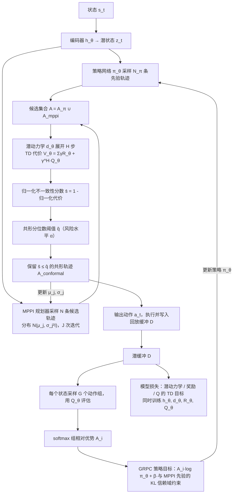

# DoublyAware

**DoublyAware: Dual Planning and Policy Awareness for Temporal Difference Learning in Humanoid Locomotion** 已列入 [Robot Learning Paper Notebooks](https://imchong.github.io/Robot_Learning_Paper_Notebooks/index.html) 的 **PROGRESS.md 待深读** 清单（分类：05_Locomotion）。本页 **还没有深读笔记**：只给出这篇论文的分类位置与原文入口，方法细节与数据请直接看原文。

## 一句话定义

DoublyAware 的人形机器人学习论文条目，当前处于 Paper Notebooks 阅读进度（待深读）阶段。

## 英文缩写速查

| 缩写 | 英文全称 | 简要说明 |
|------|----------|----------|
| RL | Reinforcement Learning | 通过与环境交互最大化长期回报来学习策略 |
| WBC | Whole-Body Control | 协调全身关节满足多任务/约束的控制基础设施 |
| Sim2Real | Simulation to Real | 把仿真中学到的策略迁移落地真机的工程主线 |

## 为什么重要

- 这篇已排进 Paper Notebooks 的待读清单，可以从 [机器人学习论文笔记总索引](../overview/humanoid-paper-notebooks-index.md) 与分类页找到同一批工作。
- 深读笔记写出来之前，这里只保留分类位置与原文入口；方法流程见下方「流程总览」，仅依据论文方法部分，不含结论判断。

## 流程总览

图依据：论文 §III-A/B/C（Fig. 2、Fig. 3、Alg. 1、Alg. 2）。

## 核心信息

| 字段 | 内容 |
|------|------|
| 分类 | 05_Locomotion |
| 深读状态 | 待撰写（[PROGRESS.md](https://github.com/ImChong/Robot_Learning_Paper_Notebooks/blob/main/papers/PROGRESS.md)） |
| 计划文件夹 | `papers/05_Locomotion/doublyaware-dual-planning-and-policy-awareness-f` |
| arXiv | <https://arxiv.org/abs/2506.12095> |

## 实验与评测

- 深读笔记尚未完成；量化 benchmark、消融与实机指标待笔记撰写后补充。

## 结论

**DoublyAware 在本库目前只是一条「已排期、未深读」的待读条目：它只标出这篇落在 locomotion 分支下"时序差分学习"这条线这条线上，给不出可直接引用的方法结论。**

- 本页能确认的只有索引层信息——arXiv 2506.12095、分类 05_Locomotion 与计划中的笔记文件夹；标题指向"规划感知与策略感知双路用于人形运动的 TD 学习"这一命题，两种 awareness 各自如何建模、如何进入 TD 目标，页内均未展开。
- 适用边界：适合经[分类页](../overview/paper-notebook-category-05-locomotion.md)与[机器人学习论文笔记总索引](../overview/humanoid-paper-notebooks-index.md)做检索与交叉定位，不适合作为算法选型或方法对比的依据。
- 主要风险是把待读条目误读成已消化的结论：量化 benchmark、消融与实机指标本页全部缺失，深读状态须回到 PROGRESS.md 跟踪，结论以论文原文为准。

## 与其他页面的关系

- 分类页：[paper-notebook-category-05-locomotion](../overview/paper-notebook-category-05-locomotion.md)
- 总索引：[humanoid-paper-notebooks-index.md](../overview/humanoid-paper-notebooks-index.md)

## 参考来源

- [humanoid_pnb_doublyaware-dual-planning-and-policy-awareness-f.md](../../sources/papers/humanoid_pnb_doublyaware-dual-planning-and-policy-awareness-f.md)
- [Robot Learning Paper Notebooks · PROGRESS.md](https://github.com/ImChong/Robot_Learning_Paper_Notebooks/blob/main/papers/PROGRESS.md)
- 论文：<https://arxiv.org/abs/2506.12095>
- [arXiv PDF](https://arxiv.org/pdf/2506.12095)：已通读方法部分（实验与附录以略读为准）：§III-A 至 §III-C（含 Alg. 1、Alg. 2）

## 推荐继续阅读

- [Paper Notebooks 阅读进度（PROGRESS.md）](https://github.com/ImChong/Robot_Learning_Paper_Notebooks/blob/main/papers/PROGRESS.md)
