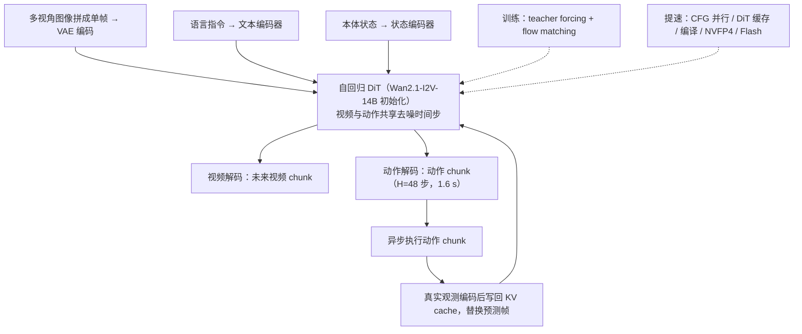

# DreamZero：World Action Models are Zero-shot Policies

**DreamZero**（*World Action Models are Zero-shot Policies*，[arXiv:2602.15922](https://arxiv.org/abs/2602.15922)，NVIDIA，2026-02-17）。本页依据论文 v1 全文整理，核对范围与缺项见来源归档 [dreamzero_arxiv_2602_15922](../../sources/papers/dreamzero_arxiv_2602_15922.md)；章节号均指论文章节。此前版本只是 [Robot Learning Paper Notebooks](https://imchong.github.io/Robot_Learning_Paper_Notebooks/papers/06_Manipulation/DreamZero_World_Action_Models_are_Zero-shot_Policies/DreamZero_World_Action_Models_are_Zero-shot_Policies.html)（分类 06_Manipulation）的笔记摘要，本次已改写并对照原文。

## 一句话定义

DreamZero 是一个 14B 的 World Action Model（WAM）：以预训练图像到视频扩散模型 Wan2.1-I2V-14B-480P 为骨干（§4.1），在同一个自回归 DiT 里联合去噪未来视频与动作，作者称这把动作学习从「稠密的状态-动作模仿」变成「把动作对齐到预测出的视觉未来」，即逆动力学（§1）。

## 英文缩写速查

| 缩写 | 全称 | 解释 |
|---|---|---|
| WAM | World Action Model | 联合预测未来世界状态（此处是视频）与动作的模型（§2.2） |
| VAM | Video Action Model | 作者认为 WAM 是更宽的叫法，视频只是世界建模目标之一（§2.2） |
| VLA | Vision-Language-Action | 从 VLM 初始化的视觉语言动作模型，本文的对照对象 |
| IDM | Inverse Dynamics Model | 由观测序列反推动作，式 (1) 里动作项即 IDM |
| DiT | Diffusion Transformer | 扩散 Transformer 骨干 |
| CFG | Classifier-Free Guidance | 无分类器引导，需条件与无条件两次前向（§3.2.3） |
| KV cache | Key-Value cache | 自回归推理缓存历史 token 的键值（§3.1） |
| PnP | Pick and Place | 抓取放置，评测分 Easy 与 Hard（§4.1） |
| NVFP4 | NVIDIA FP4 | Blackwell 上的 4 比特量化格式（§3.2.4） |

## 为什么重要

- 作者的论点：VLA 擅长语义泛化，但对新环境与新动作技能泛化弱；WAM 继承视频预训练的时空先验，可从异构、非重复数据学习（§1）。
- 数据取向：约 500 小时、22 个环境、强调多样性而非重复的遥操作数据（§4.1，附录 E）。消融里同为约 500 小时，多样数据 50% 对重复数据 33%（Table 4，仅 PnP Easy）。
- 工程可行性：作者把 14B 视频扩散模型做到约 7 Hz 闭环，并开源权重、推理代码与 RoboArena、PolaRiS、Genie Sim 3.0 评测代码（§1）。
- 下游（以下两条论文中没有，沿用此前页面说法，未核实）：Dream Labs 的 [Dream-1](./dreamlabs-dream-1.md) 项目页把 DreamZero 研究列为起点；NVIDIA 称 GR00T 2 基于 DreamZero 研究。

## 核心原理与流程总览

### 形式化（§3.1）

联合分布分解为「自回归视频预测」乘「IDM 动作预测」：π(o, a | 历史, c, q) = π(o | 历史, c, q) · π(a | o, q)（式 1）。作者没有拆成两个模型，而是单个模型端到端训练，理由是「相信」这样视频与动作对齐更好（作者自述，未做拆分对照实验）。

### 流程图

图依据：§3.1、§3.2、Fig.4、Alg.1/2。

### 关键设计

1. **架构（§3.1）：** 只新增状态编码器、动作编码器与动作解码器；多视角拼成一帧，不改骨干结构。自回归只用于视频模态，每个 chunk 为 K=2 个潜帧，默认 M=4 个 chunk（附录 C）。作者给自回归的理由：KV cache 更快、可用观测历史、避免双向模型的语言-视频对齐与子采样改变帧率问题（§3.1，附录 B）。
2. **训练（§3.1, §4.1）：** flow matching，同一 chunk 内共享时间步，不同 chunk 独立；视频与动作共享去噪时间步；teacher forcing；100K 步，batch 128；冻结文本编码器、图像编码器与 VAE。
3. **闭环推理（§3.1）：** 每次执行后用真实观测替换 KV cache 中的预测帧，作者称这消除了自回归视频生成的误差累积。
4. **实时化（§3.2, Table 1）：** 朴素实现 5.7 s/chunk。异步执行、CFG 并行、DiT 缓存、torch.compile 加 CUDA Graphs、NVFP4 量化、cuDNN 注意力累计 H100 上 9.6x、GB200 上 16.6x；再加 DreamZero-Flash 为 38x，约 150 ms。
5. **DreamZero-Flash（§3.2.5）：** 训练时让视频偏向高噪（Beta(7,1)），动作时间步仍均匀，使模型学会从含噪视觉上下文预测干净动作，推理扩散步由 4 降到 1（350 ms 到 150 ms）。

## 工程实践

- **算力与部署：** 论文称 7 Hz 用 2 块 GB200（§6）；NVFP4 量化只在 Blackwell 上（Table 1 中 H100 无此项）。动作在 30 Hz 控制下按 48 步（1.6 s）一个 chunk 异步执行，目标推理延迟约 200 ms 以下（§3.2.2）。
- **动作后处理：** 动作 chunk 上采样 2x、Savitzky-Golay 滤波（窗口 21，阶数 3）再下采样（附录 D.3）。
- **数据：** 每个 episode 选三个粗粒度任务连续执行，平均约 42 个子任务；某任务采满 50 个 episode 即下架（附录 E）。动作用相对关节位置，过滤空闲动作（§4.1）。
- **评测协议（§4.1）：** 评测场地与采集场地不同；AgiBot 已见与未见任务各 80 次 rollout，DROID 共 80 次 rollout 覆盖 40 个任务，按 0 到 1 的部分完成度打分。
- **复现入口：** 开源权重、推理代码与 DROID-sim（PolaRiS）评测代码在 [dreamzero0/dreamzero](https://github.com/dreamzero0/dreamzero)；AgiBot 数据集论文称「计划开源」（§4.1 脚注 5）。本页未运行或审阅该仓库。

## 评测证据与清单说法的对比核对

清单（Glen Berseth 的 CoRL 2026 阅读清单，014/101，P0，Oral）的一句话摘要为：「DreamZero: a world action model on a video diffusion backbone that jointly predicts video and actions, doubling VLA generalization to new tasks.」清单说明该摘要由 LLM 据摘要起草，排序是作者按自己研究兴趣打分，并非论文质量评价。逐项核对：

| 清单说法 | 论文里的实际情况 |
|---|---|
| 世界动作模型，视频扩散骨干，联合预测视频与动作 | 属实（§1，§3.1，骨干为 Wan2.1-I2V-14B） |
| 对新任务的泛化「翻倍」 | 方向属实但需限定：AgiBot G1 未见任务 39.5% 对预训练 VLA 基线 16.3%（约 2.4 倍，Fig.9）；DROID-Franka 未见动词任务进度 49% 对 31% 与 33%（约 1.5 倍），成功率 22.5% 对 12.5% 与 7.5%（Fig.9）。摘要写「超过 2 倍」，指的是新任务与新环境的平均任务进度，主要由 AgiBot 结果支撑 |
| 基线 | 比较对象是 GR00T N1.6 与 π0.5，各取 from-scratch 与 from-pretrained 两种（§4）；from-scratch VLA 接近 0，因此「翻倍」的分母主要是预训练版，且这些基线是在作者数据上继续训练的，并非原样官方权重（§4 脚注 4） |
| 仿真还是真机 | 主结果均为真机（AgiBot G1、Franka）；仿真只在脚注 1 提到 Genie Sim 3.0 有「非平凡」表现，未给出数字 |
| 清单没有提到的内容 | 7 Hz 实时（2 块 GB200，Flash 为训练期方案）、跨本体视频迁移（+42% 相对）、30 分钟新本体适配，这些是论文的另外几项主要贡献 |

另：评测次数不多（每种设置 80 次 rollout，8 次/任务），Table 2 的标准误较大（约 ±7 到 ±10 个百分点）。「零样本」指任务与环境不在该机器人的训练数据中，而非从未见过任何机器人数据：WAM 骨干见过大量网络视频，对比的预训练 VLA 也被允许见过跨本体数据（§5.1 Q2）。

## 结论

DreamZero 支持联合视频动作建模改善未见任务进度，但计算成本、视频错误和精细操作仍是部署约束。

- 按目标硬件实测闭环频率与延迟，7 Hz 的双 GB200 配置不能直接搬到消费级 GPU。
- 把部分任务进度、完整成功率和跨本体结果分开汇报，避免把早期迁移信号当成熟能力。
- 为视频计划错误设置监测与恢复，并单独验收长记忆和亚厘米操作任务。

## 局限

**论文自己承认的（§6，附录 H，脚注）：**

- 没有 WAM 缩放律证据，只有 5B 对 14B 的单点对比（§6，Table 4）。
- 计算昂贵：7 Hz 需 2 块 GB200，对比 VLA 在消费级 GPU 可超 20 Hz（§6）。
- 视觉记忆仅约 6 秒，作为 System 1 模型难以长程推理；依赖记忆的任务未评测（§6，脚注 2）。
- 亚厘米精度任务（如插钥匙、精细装配）存在行为克隆的通病（§6）。
- 失败多来自视频生成错误，机器人忠实执行错误的视频计划（§5.1，附录 H，Fig.16）。
- 人类视频只用了 12 分钟的实验室数据；跨本体成功率「仍属中等」，是早期信号（§5.1 Q4）。每个本体单独预训练，多本体联合训练未做（§4）。

**我在读文时看到的未验证之处（我的判断）：**

- 「端到端联合训练比拆成视频模型加 IDM 更好」「自回归更利于泛化」「IDM 视角样本效率更高」等机理解释都是作者假设（用「believe」「hypothesize」表述），论文没有对应的受控对照；仅有的架构消融（Table 4）显示 AR 与双向任务进度同为 50%。
- 基线比较的公平性：预算对齐的是 batch 与梯度步数，而不是 GPU 小时或模型参数（DreamZero 14B 对比 GR00T N1.6 与 π0.5）；Table 4 的放大 VLA（截断 8B/32B VLM 加 DiT 动作头）只在 PnP Easy 上给出 0%。
- GR00T N1.6-DROID 是作者内部训练的检查点，不是公开权重（§4.1）。
- 主结果每格仅 80 次 rollout，评分为人工部分完成度，缺少统计检验。Table 2 引用的「Table 9」基线在 PDF 文本中未找到对应表。
- Flash 的消融只在桌面清理一个任务上（Table 3）；量化与 DiT 缓存并非数学等价，作者称影响「很小」，但未单独给出逐项精度数字（§3.2.6）。
- 我未运行官方代码，也未复现任何数字。

## 关联页面

- 分类父节点：[paper-notebook-category-06-manipulation](../overview/paper-notebook-category-06-manipulation.md)，总索引：[humanoid-paper-notebooks-index](../overview/humanoid-paper-notebooks-index.md)
- 下游产品化页面：[Dream-1](./dreamlabs-dream-1.md)
- 对照的路线：[VLA](../methods/vla.md)、[基础策略](../concepts/foundation-policy.md)、[π0.5 开放世界 VLA](./paper-pi05-open-world-vla.md)
- 方法构件：[逆动力学模型](../concepts/inverse-dynamics-model.md)、[Flow Matching 具身策略](../concepts/flow-matching-embodied-policy.md)、[Diffusion Transformer](../concepts/diffusion-transformer.md)、[滚动时域策略执行](../concepts/receding-horizon-policy-execution.md)
- 骨干与数据：[Wan 视频生成模型](./paper-wan-video.md)、[DROID](./droid-policy-learning.md)
- 视频生成当作模拟器的另一条路线：[Video as Simulation](../concepts/video-as-simulation.md)

## 参考来源

- 来源归档（通读）：[dreamzero_arxiv_2602_15922](../../sources/papers/dreamzero_arxiv_2602_15922.md)
- 此前的笔记锚点：[humanoid_pnb_dreamzero-world-action-models-are-zero-shot-poli](../../sources/papers/humanoid_pnb_dreamzero-world-action-models-are-zero-shot-poli.md)
- 论文：[arXiv:2602.15922](https://arxiv.org/abs/2602.15922)，[PDF](https://arxiv.org/pdf/2602.15922v1)
- 项目页：<https://dreamzero0.github.io>，代码：<https://github.com/dreamzero0/dreamzero>
- 深读笔记：<https://imchong.github.io/Robot_Learning_Paper_Notebooks/papers/06_Manipulation/DreamZero_World_Action_Models_are_Zero-shot_Policies/DreamZero_World_Action_Models_are_Zero-shot_Policies.html>

## 继续阅读

- [Dream-1](./dreamlabs-dream-1.md)：WAM 路线的商业化出口（以其项目页为准）
- [Wan 视频生成模型](./paper-wan-video.md)：DreamZero 的骨干来源
- [逆动力学模型](../concepts/inverse-dynamics-model.md)：理解式 (1) 中动作项
