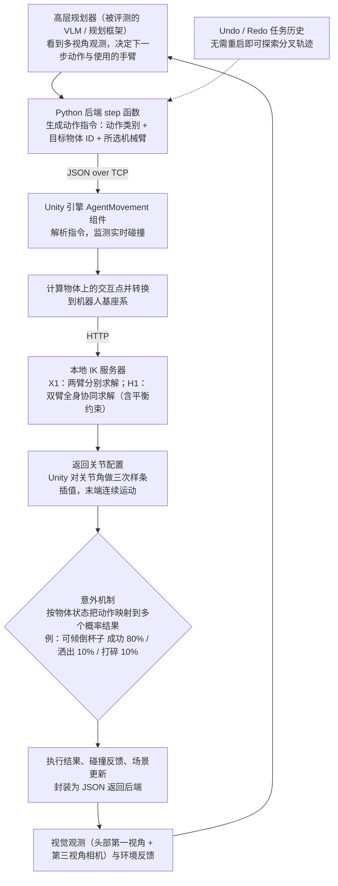

# DualTHOR

**DualTHOR: A Dual-Arm Humanoid Simulation Platform for Contingency-Aware Planning** 收录于 [Robot Learning Paper Notebooks](https://imchong.github.io/Robot_Learning_Paper_Notebooks/index.html)（分类：11_Simulation_Benchmark），深读笔记已完成。本页在笔记摘要之外，已对照 arXiv v1 正文（含 Table 1–3）核对实验数字；附录 A–C 未能获取，故本页仍为 **草稿**。

## 一句话定义

开发能在真实场景做复杂交互任务的具身智能体，仍是具身 AI 的根本挑战。DualTHOR 是一个面向复杂双臂人形机器人的物理仿真平台，构建在扩展版 AI2-THOR 之上。它包含：真实世界机器人资产、双臂协作任务套件、以及面向人形形态优化的逆运动学（IK）求解器；并引入一个纳入执行失败的「意外（contingency）」机制，让仿真更贴近现实的不确定性。论文用它评测视觉语言模型（VLM）在家务任务上的表现，发现当前 VLM 在双臂协调上能力有限、面对现实意外时鲁棒性下降，凸显该平台对发展更强具身 AI 的价值。（说明：arXiv 页面显示该论文已被作者撤回，当前可取的是 v1；本页依据 v1。）

## 英文缩写速查

| 缩写 | 含义 |
|---|---|
| AI2-THOR | 本文仿真平台的母体，基于 Unity 的室内具身 AI 环境 |
| IK | Inverse Kinematics，逆运动学；H1 为双臂全身协同求解，X1 为逐臂求解 |
| VLM | Vision-Language Model，本文的评测对象，输入多视角图像与任务指令 |
| Contingency | 「意外」机制：按概率把一个动作映射为成功、洒出、打碎等结果 |
| H1 / X1 | 本文预置的两款双臂人形机器人（Unitree H1、AgiBot X1） |
| Undo / Redo | 任务历史管理，在同一初始状态下探索分叉轨迹，无需重启仿真器 |
| JSON over TCP | Python 后端与 Unity 引擎之间的双向指令通信方式 |
| DAG-Plan | 本文评测的双臂规划基线（用图结构表示双臂任务，基于 GPT-4o） |

## 为什么重要

- **"意外感知"是从仿真走向现实的关键缺口**：现实充满执行失败，仿真应建模之；
- **双臂人形平台**填补单臂与轮式仿真的空白；
- **VLM 仍难做双臂协调**，提示高层规划与底层执行的鸿沟；
- 与本仓 11 其它仿真/基准平台共同丰富评测生态。

## 核心信息

| 字段 | 内容 |
|------|------|
| 分类 | 11_Simulation_Benchmark |
| 深读笔记 | <https://imchong.github.io/Robot_Learning_Paper_Notebooks/papers/11_Simulation_Benchmark/DualTHOR__A_Dual-Arm_Humanoid_Simulation_Platform_for_Contingency-Aware_Planning/DualTHOR__A_Dual-Arm_Humanoid_Simulation_Platform_for_Contingency-Aware_Planning.html> |
| arXiv | <https://arxiv.org/abs/2506.16012>（页面显示已撤回；正文以 v1 为准） |
| 作者 | Boyu Li、Siyuan He、Hang Xu、Haoqi Yuan、Junpeng Yue、Börje F. Karlsson、Zongqing Lu 等 |
| 发表 | 2025 年 6 月（arXiv v1 提交于 2025-06-19） |
| 笔记阅读日期 | 2026-06-21 |
| 本页核对的原文 | arXiv v1 PDF，正文 §1–§5 与参考文献；附录 A–C 不在该 PDF 中，未读 |

## 解决什么问题

具身 AI 缺少同时满足「双臂人形」与「贴近现实意外」的仿真环境。论文指出三点缺口：

- **机器人形态单一**：论文 Table 1 将 AI2-THOR、RoboTHOR、ProcTHOR 等平台列为轮式或单臂机器人，HumanoidBench 与 Isaac Gym 侧重低层控制而非长程规划；
- **低层执行被简化**：多数平台用瞬时状态跳转代替连续执行过程，无法暴露执行失败；
- **VLM 能力不明**：不清楚 VLM 在双臂协调与执行失败下的表现如何。

DualTHOR 要做的是：一个**双臂人形、含意外机制**的物理仿真平台，并在其上评测 VLM 规划。

## 核心机制

1. **双臂人形物理仿真平台**：基于 AI2-THOR 扩展，含真实机器人资产、双臂任务与人形 IK；
2. **意外机制**：按物体状态把动作映射到若干概率结果，纳入执行失败；
3. **VLM 评测**：揭示当前 VLM 在双臂协调与抗意外上的不足；
4. **研究资源**：提供任务历史 Undo / Redo，便于生成分叉轨迹数据。

## 流程总览

图依据：论文 v1 §3.1、§3.3、§3.4 / Fig. 1、Fig. 3（规划器一侧的描述来自 Fig. 3 图注与 §4 的评测设定）。

## 核心原理

- **输入**：规划器给出一条动作指令，包含动作类别（如 PICKUP、OPEN、FILL、TOGGLE）、目标物体 ID 与所选手臂；Unity 把交互点换算到机器人基座系。
- **IK 与插值**：X1 对每只手臂用 3×3 旋转矩阵加平移向量单独求解；H1 用 4×4 齐次变换同时求解双臂，并结合当前关节角与速度做动态优化，重点保持平衡约束。Unity 再对关节角做三次样条插值，使末端平滑运动。
- **意外机制**：结果从与物体状态相关的类别分布中采样，各结果互斥。论文例子是抓取「可倾倒」杯子，成功、洒出、打碎的概率分别为 80%、10%、10%：

$$
\mathbf{p} = (p_{\text{success}},\, p_{\text{spill}},\, p_{\text{break}}) = (0.8,\, 0.1,\, 0.1), \qquad o \sim \mathrm{Cat}(\mathbf{p})
$$

  对于重复或多步动作，论文称可扩展为多项分布（未核实具体实现）。
- **状态约束**：动作受物体状态限制。例如已 `Cooked` 的食材不能再执行 COOK，但仍可被抓取。
- **输出**：执行结果、碰撞反馈与场景更新被打包为 JSON 返回后端，并附带头部与第三视角的视觉观测，供 VLM 重规划。

## 工程实践

| 项目 | 论文设定 / 说明 |
|---|---|
| 规模 | 356 个任务、10 个房间、68 个物体（§4.1） |
| 机器人 | H1 使用灵巧手，X1 使用夹爪；两者 IK 实现不同 |
| 依赖结构 | Unity 运行时 + Python 后端，经 JSON over TCP 通信；IK 为本地 HTTP 服务；位姿与 IK 求解借用 OmniManip（§3.3） |
| 评测设置 | 每任务 50 次试验；temperature 0；最大输出 2048 token；输入图像 500×500；高层规划最多 50 个环境步 |
| 难度分级 | 低层动作成功率 100%（Easy）、50%（Medium）、20%（Hard） |
| 调试指标 | 按任务类别（双臂必需 / 双臂可选 / 单臂）与机器人分别统计成功率；看 Medium、Hard 下的降幅，判断重规划能力 |
| 代码与开源状态 | arXiv 摘要给出代码链接 `github.com/ds199895/DualTHOR`。**未核实**：本次核对时该仓库无法访问（代理返回 403，未调用 `add_repo`），无法确认其是否含可运行的训练或仿真入口，也未核实权重与资产是否公开。 |
| 源码运行时序图 | **未完成**：因上述仓库未能核实，暂无法据源码绘制运行时序，待核实后补充。 |

## 实验与评测

**设置。** 在 10 个房间、356 个任务上评测。基线分三类：闭源 VLM（GPT-4o、Gemini-1.5-Pro）、开源 VLM（Qwen2.5-VL-7B、InternVL2.5-8B）、提示增强方法（LLM-Planner、RAP、DAG-Plan，后两者以 GPT-4o 为底座）。指标为 50 次试验的成功率。

**Table 2：动作成功率 100%（Easy）下的成功率（X1 / H1）。** 下表只列 Table 3 中可交叉核对的三个基线；Table 2 中 Gemini-1.5-Pro、Qwen2.5-VL、LLM-Planner、RAP 的数字在 PDF 文本中列序混乱，未能可靠还原（未核实）。

| 基线 | 双臂必需任务 X1 / H1 | 双臂可选任务 X1 / H1 | 单臂任务 X1 / H1 |
|---|---|---|---|
| GPT-4o | 23.56% / 27.34% | 39.53% / 41.37% | 51.67% / 55.39% |
| InternVL2.5-8B | 9.71% / 15.63% | 23.51% / 25.17% | 23.57% / 31.62% |
| DAG-Plan | 36.54% / 41.53% | 51.25% / 52.31% | 55.47% / 57.86% |

**Table 3：随低层成功率下降（Easy 100%、Medium 50%、Hard 20%）的成功率，格式为 Easy / Medium / Hard。**

| 基线 | 双臂必需 X1 | 双臂必需 H1 | 双臂可选 X1 | 双臂可选 H1 | 单臂 X1 | 单臂 H1 |
|---|---|---|---|---|---|---|
| GPT-4o | 23.56 / 20.63 / 11.54 | 27.34 / 21.51 / 13.67 | 39.53 / 31.69 / 23.34 | 41.37 / 35.87 / 21.19 | 51.67 / 44.69 / 28.31 | 55.39 / 45.87 / 26.69 |
| InternVL2.5-8B | 9.71 / 6.31 / 2.67 | 15.63 / 6.87 / 3.15 | 23.51 / 17.39 / 8.51 | 25.17 / 19.67 / 7.94 | 23.57 / 20.39 / 10.13 | 31.62 / 23.67 / 11.33 |
| DAG-Plan | 36.54 / 23.17 / 11.69 | 41.53 / 20.33 / 15.53 | 51.25 / 43.13 / 27.37 | 52.31 / 39.63 / 23.34 | 55.47 / 52.67 / 31.42 | 57.86 / 48.63 / 36.53 |

**主要发现（原文表述，并附表内数字核对）：**

- 双臂必需任务在所有基线上都低于其他两类任务（原文结论，表内数字一致）。
- H1 的平均成功率普遍高于 X1，论文归因于其更大的作业范围。
- 随失败率升高，三个基线都明显下降；例如 GPT-4o 在 X1 双臂必需任务上从 23.56% 降到 11.54%（Hard）。
- 原文称 DAG-Plan 在双臂可选任务上「性能下降最小」。按表 2 与表 3 核对，这一说法需谨慎：DAG-Plan 的绝对成功率最高，但在 X1 上其 Easy→Hard 的绝对降幅（约 23.9 个百分点）大于 GPT-4o（约 16.2）与 InternVL2.5-8B（约 15.0）；单臂与可选任务的差距上，X1 上 InternVL2.5-8B 也更小（未核实原文的比较口径）。
- 原文的 DAG-Plan 在失败后会新建节点并从头重新规划，论文据此认为高层规划器的重规划鲁棒性有限。

## 与其他工作对比

- **与仿真平台**（论文 Table 1）：列出的 9 个已有平台中，机器人形态为轮式、单臂或两者混合，动作控制多为离散；Contingency（执行失败建模）一列全部为 ✗。DualTHOR 是表中唯一标注 Dual Arm 与 Contingency ✓ 的平台，且连续过渡与离散动作并存。
- **与 AI2-THOR**：DualTHOR 直接建立在 AI2-THOR 之上，新增双臂人形机器人、人形 IK、意外机制，并补充碰撞与流体（倒水、注水）模拟。
- **与规划基线**：DAG-Plan 在本文三类基线中所有设置下均最强，但在动作失败时仍需从头重规划。LLM-Planner 与 RAP 的对比数字未能可靠核对（未核实）。
- **与真机迁移**：论文以降低 sim-to-real 差距为动机，但正文未报告真机实验；与 [sim-vs-real 评测差距](../concepts/sim-vs-real-eval-gap.md) 相关的讨论仅停留在动机层面。

## 结论

**DualTHOR 的主张不是「再造一个仿真器」，而是把「执行会失败」写进仿真契约：双臂人形 + 意外机制，让规划研究能在贴近现实不确定性的环境里被评测。**

1. **平台组成** — 真实机器人资产、双臂任务套件与人形 IK 求解器，建在扩展版 AI2-THOR 上；真正的区分点是 contingency（意外）机制。
2. **主要发现** — 当前 VLM 在双臂必需任务上最弱（X1 上 GPT-4o 为 23.56%，DAG-Plan 为 36.54%），并且随低层成功率下降而明显退化。
3. **取舍读法** — 意外概率（如 80/10/10）是设计者设定的，论文正文未说明是否由真机数据标定，不宜直接当作真机失败率。
4. **适用边界** — 它是测试床而非控制方法；任务面向家务室内场景，结论不应外推到高动态运动或户外地形。
5. **对照** — 与本仓 11_Simulation_Benchmark 其它平台相比，本文补的是「双臂人形」与「失败建模」两块空白。

## 局限与风险

- **版本与可得性**：arXiv 页面显示该论文已撤回，本页依据 v1；最新版不可获取。
- **附录未读**：论文引用附录 A（意外机制与可倾倒类别的实现）、附录 B（任务细节与实验细节）、附录 C（与其他仿真器的差异）；这些内容不在所获 PDF 中，未读（未核实）。因意外机制实现与任务细节是方法理解所需，本页保持草稿。
- **场景与任务规模有限**：论文自述场景多样性有限，资产生成工具与更多机器人仍在开发；非网格定位、可控失败模式、多房间与多智能体协作均列为后续工作。
- **未报告真机结果**：正文未见实机实验，仿真到真机的迁移效果无法由本文证明。
- **外部依赖**：位姿与 IK 求解借用 OmniManip 等外部方法，其精度与稳定性会传递到仿真结果中（未核实细节）。
- **评测口径**：结果依赖具体模型版本与提示设置（temperature 0、500×500 输入、最多 50 步），跨模型或跨提示的推广需谨慎。
- **源码状态未核实**：代码链接来自 arXiv 摘要，仓库本次不可访问，不能据此断言已开源或可复现。

## 关联页面

- 分类父节点：[paper-notebook-category-11-simulation-benchmark](../overview/paper-notebook-category-11-simulation-benchmark.md)
- 总索引：[humanoid-paper-notebooks-index.md](../overview/humanoid-paper-notebooks-index.md)
- 平台母体：[AI2-THOR](./ai2-thor.md)
- 评测背景：[sim-vs-real 评测差距](../concepts/sim-vs-real-eval-gap.md)

## 参考来源

- [humanoid_pnb_dualthor.md](../../sources/papers/humanoid_pnb_dualthor.md)
- 深读笔记：<https://imchong.github.io/Robot_Learning_Paper_Notebooks/papers/11_Simulation_Benchmark/DualTHOR__A_Dual-Arm_Humanoid_Simulation_Platform_for_Contingency-Aware_Planning/DualTHOR__A_Dual-Arm_Humanoid_Simulation_Platform_for_Contingency-Aware_Planning.html>
- 论文摘要页：<https://arxiv.org/abs/2506.16012>（页面显示已撤回）
- 原文：[arXiv v1 PDF](https://arxiv.org/pdf/2506.16012v1)，已通读正文 §1–§5 与参考文献（含 Table 1–3）；附录 A–C 不在该 PDF 中，未读。

## 推荐继续阅读

- [机器人论文阅读笔记：DualTHOR](https://imchong.github.io/Robot_Learning_Paper_Notebooks/papers/11_Simulation_Benchmark/DualTHOR__A_Dual-Arm_Humanoid_Simulation_Platform_for_Contingency-Aware_Planning/DualTHOR__A_Dual-Arm_Humanoid_Simulation_Platform_for_Contingency-Aware_Planning.html)
- [AI2-THOR: An Interactive 3D Environment for Visual AI（arXiv:1712.05474）](https://arxiv.org/abs/1712.05474)
