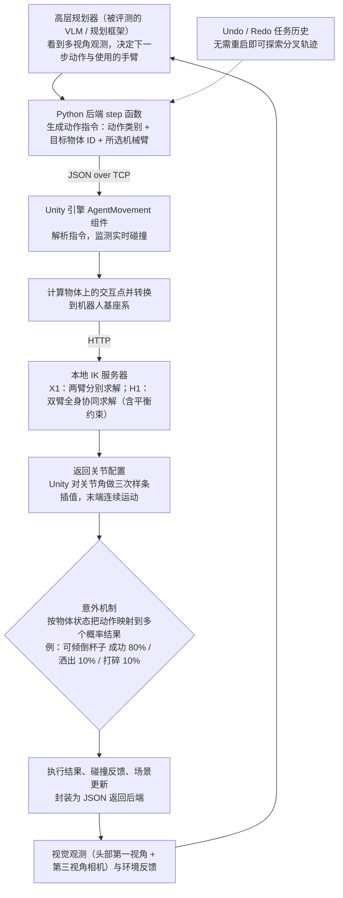

# DualTHOR

**DualTHOR: A Dual-Arm Humanoid Simulation Platform for Contingency-Aware Planning** 收录于 [Robot Learning Paper Notebooks](https://imchong.github.io/Robot_Learning_Paper_Notebooks/index.html)（分类：11_Simulation_Benchmark），深读笔记已完成。本页是 **笔记摘要**：要点编译自深读笔记，细节以笔记原文与论文 PDF 为准。

## 一句话定义

开发能在真实场景做复杂交互任务的具身智能体，仍是具身 AI 的根本挑战。DualTHOR 是一个面向复杂双臂人形机器人的物理仿真平台，构建在扩展版 AI2-THOR 之上。它包含：真实世界机器人资产、双臂协作任务套件、以及面向人形形态优化的逆运动学（IK）求解器；并引入一个纳入执行失败的「意外（contingency）」机制，让仿真更贴近现实的不确定性。论文用它评测视觉语言模型（VLM）在家务任务上的表现，发现当前 VLM 在双臂协调上能力有限、面对现实意外时鲁棒性下降，凸显该平台对发展更强具身 AI 的价值。（说明：arXiv 上 v2（2025-10-13）已被作者撤回、无 PDF，v1 仍可取；本页流程图依据 v1。）

## 英文缩写速查

| 缩写 | 含义 |
|---|---|
| AI2-THOR | 一个具身 AI 室内仿真环境 |
| Dual-Arm Humanoid | 双臂人形 |
| Contingency | 意外/突发，含执行失败 |
| IK | Inverse Kinematics，逆运动学 |
| VLM | Vision-Language Model |
| Task Suite | 任务套件 |

## 为什么重要

- **"意外感知"是从仿真走向现实的关键缺口**：现实充满执行失败，仿真应建模之；
- **双臂人形平台**填补单臂仿真的空白；
- **VLM 仍难做双臂协调**，提示高层规划与底层执行的鸿沟；
- 与本仓 11 其它仿真/基准平台共同丰富评测生态。

## 流程总览

图依据：论文 v1 §3.1、§3.3、§3.4 / Fig. 1、Fig. 3（规划器—执行闭环中规划器一侧的描述来自 Fig. 3 图注与 §4 的评测设定）。

## 解决什么问题

具身 AI 缺**双臂人形 + 贴近现实意外**的仿真： - 多数平台面向单臂/简化抓取； - 缺**执行失败/意外**建模，与真实差距大； - 不清楚 VLM 在双臂协调与意外下表现如何。

DualTHOR 要：一个**双臂人形、含意外机制**的物理仿真平台 + VLM 评测。

## 核心机制

1. **双臂人形物理仿真平台**：扩展 AI2-THOR，含真实资产、双臂任务、人形 IK；
2. **意外机制**：纳入执行失败，支持意外感知规划研究；
3. **VLM 评测**：揭示当前 VLM 双臂协调与抗意外的不足；
4. **研究资源**：为更强具身 AI 提供测试床。

方法拆解（深读笔记小节）：扩展 AI2-THOR 的双臂人形物理仿真；意外（contingency）机制；VLM 评测；发现；🧭 整体流程（mermaid）。

## 核心信息

| 字段 | 内容 |
|------|------|
| 分类 | 11_Simulation_Benchmark |
| 深读笔记 | <https://imchong.github.io/Robot_Learning_Paper_Notebooks/papers/11_Simulation_Benchmark/DualTHOR__A_Dual-Arm_Humanoid_Simulation_Platform_for_Contingency-Aware_Planning/DualTHOR__A_Dual-Arm_Humanoid_Simulation_Platform_for_Contingency-Aware_Planning.html> |
| arXiv | <https://arxiv.org/abs/2506.16012> |
| 作者 | Boyu Li、Siyuan He、Hang Xu、Haoqi Yuan、Junpeng Yue、Börje F. Karlsson、Zongqing Lu 等 |
| 发表 | 2025 年 6 月 |
| 笔记阅读日期 | 2026-06-21 |

## 实验与评测

- 本页是深读笔记的摘要，没有搬运原文的量化结果；量化 benchmark、消融与实机指标以 **深读笔记与论文 PDF** 为准（链接见 [参考来源](#参考来源)）。

## 结论

**DualTHOR 的主张不是「再造一个仿真器」，而是把「执行会失败」写进仿真契约：双臂人形 + 意外机制，让规划研究能在贴近现实不确定性的环境里被评测。**

- 平台由三件套构成——真实世界机器人资产、双臂协作任务套件、面向人形形态优化的 IK 求解器，建在扩展版 AI2-THOR 之上；真正的区分点是纳入执行失败的 **contingency（意外）机制**。
- 最有信息量的结果来自 VLM 评测：当前 VLM 在 **双臂协调** 上能力有限，且 **面对现实意外时鲁棒性下降**——高层规划与底层执行之间的鸿沟被显式暴露出来。
- 适用边界：它是测试床而非控制方法，产出的是评测结论与研究资源；任务面向家务场景，结论主要覆盖室内交互操作，不应外推到高动态运动或户外地形。
- 与本仓 11_Simulation_Benchmark 其它平台的对照：多数平台面向单臂或简化抓取，本文补的正是「双臂人形」与「失败建模」这两块空白。
- 本页为笔记摘要，量化 benchmark、消融与实机指标以深读笔记与论文 PDF 为准。

## 与其他页面的关系

- 分类父节点：[paper-notebook-category-11-simulation-benchmark](../overview/paper-notebook-category-11-simulation-benchmark.md)
- 总索引：[humanoid-paper-notebooks-index.md](../overview/humanoid-paper-notebooks-index.md)

## 参考来源

- [humanoid_pnb_dualthor.md](../../sources/papers/humanoid_pnb_dualthor.md)
- 深读笔记：<https://imchong.github.io/Robot_Learning_Paper_Notebooks/papers/11_Simulation_Benchmark/DualTHOR__A_Dual-Arm_Humanoid_Simulation_Platform_for_Contingency-Aware_Planning/DualTHOR__A_Dual-Arm_Humanoid_Simulation_Platform_for_Contingency-Aware_Planning.html>
- 论文：<https://arxiv.org/abs/2506.16012>
- [arXiv PDF](https://arxiv.org/pdf/2506.16012v1)：已通读方法部分（实验与附录以略读为准）：v1 §1 引言、§3 DualTHOR（3.1 概览、3.2 任务类别、3.3 低层控制、3.4 意外机制）、§4.1 至 §4.3 实验设定；arXiv 默认 PDF 链接（最新版 v2）已撤回，本页读取的是 v1。

## 推荐继续阅读

- [机器人论文阅读笔记：DualTHOR](https://imchong.github.io/Robot_Learning_Paper_Notebooks/papers/11_Simulation_Benchmark/DualTHOR__A_Dual-Arm_Humanoid_Simulation_Platform_for_Contingency-Aware_Planning/DualTHOR__A_Dual-Arm_Humanoid_Simulation_Platform_for_Contingency-Aware_Planning.html)
