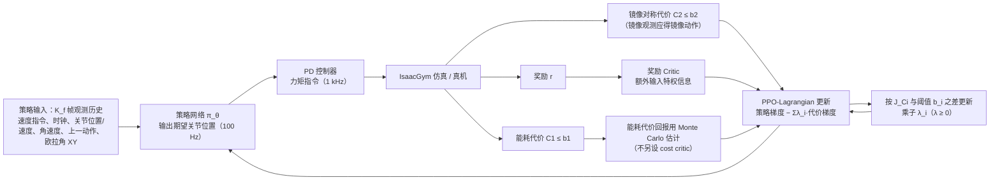

# ECO Energy Constrained Optimization with RL for Humanoid Walking

**ECO Energy Constrained Optimization with RL for Humanoid Walking** 收录于 [Robot Learning Paper Notebooks](https://imchong.github.io/Robot_Learning_Paper_Notebooks/index.html)（分类：03_High_Impact_Selection）。本页为 **清单索引实体**，链向深读笔记与原始论文；详细机制待从笔记消化后补充。

## 一句话定义

把电机能耗从「多目标奖励里的一堆加权项」里拆出来，改成 CMDP 下的显式不等式约束（再配合镜像对称 / 参考运动类约束），用 PPO-Lagrangian 在仿真里稳定求解，并在 BRUCE 上实现比 MPC、普通 PPO 显著更低能耗的稳健对称行走。

## 英文缩写速查

| 缩写 | 英文全称 | 简要说明 |
|------|----------|----------|
| RL | Reinforcement Learning | 通过与环境交互最大化长期回报来学习策略 |
| WBC | Whole-Body Control | 协调全身关节满足多任务/约束的控制基础设施 |
| Sim2Real | Simulation to Real | 把仿真中学到的策略迁移落地真机的工程主线 |

## 为什么重要

- 列入 Paper Notebooks 策展清单，便于与全库 [机器人学习论文笔记总索引](../overview/humanoid-paper-notebooks-index.md) 及分类父节点交叉检索。
- 深读笔记提供比摘要更贴近实现的阅读路径，适合作为后续 ingest 深化起点。

## 流程总览

图依据：论文 §IV-A–E、Fig. 2（能耗代价的 Monte Carlo 估计见 §IV 末段）

## 核心信息

| 字段 | 内容 |
|------|------|
| 分类 | 03_High_Impact_Selection |
| 深读笔记 | <https://imchong.github.io/Robot_Learning_Paper_Notebooks/papers/03_High_Impact_Selection/ECO_Energy_Constrained_Optimization_with_RL_for_Humanoid_Walking/ECO_Energy_Constrained_Optimization_with_RL_for_Humanoid_Walking.html> |
| arXiv | <https://arxiv.org/abs/2602.06445> |

## 实验与评测

- 本页为 **策展清单索引** 摘要；量化 benchmark、消融与实机指标以 **深读笔记与论文 PDF** 为准（链接见 [参考来源](#参考来源)）。

## 结论

**ECO 的核心动作是把能耗从奖励里「拆出来」：从多目标加权调参问题，改写成 CMDP 下的显式不等式约束问题。**

- 真正起作用的是问题的重述方式——能耗作为 **显式不等式约束**（再配合镜像对称 / 参考运动类约束），用 **PPO-Lagrangian** 在仿真中稳定求解，避开了奖励权重之间反复对拉的调参困境。
- 结果的可信度落在实机对照上：在 **BRUCE** 上做到比 **MPC** 与普通 **PPO** 显著更低能耗的稳健对称行走——省能与稳健在这里不是二选一。
- 本页为策展笔记摘要，约束阈值设定、能耗度量定义与消融细节以深读笔记与论文 PDF 为准，不宜直接引用本页做量化对比。

## 与其他页面的关系

- 分类父节点：[paper-notebook-category-03-high-impact-selection](../overview/paper-notebook-category-03-high-impact-selection.md)
- 总索引：[humanoid-paper-notebooks-index.md](../overview/humanoid-paper-notebooks-index.md)

## 参考来源

- [humanoid_pnb_eco-energy-constrained-optimization-with-rl-for.md](../../sources/papers/humanoid_pnb_eco-energy-constrained-optimization-with-rl-for.md)
- 深读笔记：<https://imchong.github.io/Robot_Learning_Paper_Notebooks/papers/03_High_Impact_Selection/ECO_Energy_Constrained_Optimization_with_RL_for_Humanoid_Walking/ECO_Energy_Constrained_Optimization_with_RL_for_Humanoid_Walking.html>
- 论文：<https://arxiv.org/abs/2602.06445>
- [arXiv PDF](https://arxiv.org/pdf/2602.06445)：已通读方法部分（实验与附录以略读为准）：§I–III 引言与预备、§IV Proposed ECO Framework（状态/动作/约束/奖励/约束优化）、§V-A/B 仿真设置；实验结果与附录略读

## 推荐继续阅读

- [机器人论文阅读笔记：ECO Energy Constrained Optimization with RL for Humanoid Walking](https://imchong.github.io/Robot_Learning_Paper_Notebooks/papers/03_High_Impact_Selection/ECO_Energy_Constrained_Optimization_with_RL_for_Humanoid_Walking/ECO_Energy_Constrained_Optimization_with_RL_for_Humanoid_Walking.html)
