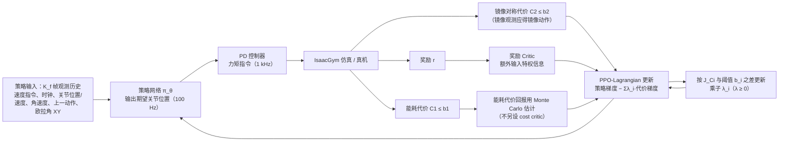

# ECO Energy Constrained Optimization with RL for Humanoid Walking

**ECO Energy Constrained Optimization with RL for Humanoid Walking** 收录于 [Robot Learning Paper Notebooks](https://imchong.github.io/Robot_Learning_Paper_Notebooks/index.html)（分类：03_High_Impact_Selection）。论文题为 *ECO: Energy-Constrained Optimization with Reinforcement Learning for Humanoid Walking*（arXiv:2602.06445，作者来自北京通用人工智能研究院 BIGAI 等）。ECO 把电机能耗与参考运动（镜像对称）从奖励中拿出来，写成约束，用 PPO-Lagrangian 训练，策略在仿真中训练、直接部署到 BRUCE 小型人形机器人上。

## 一句话定义

把电机能耗从「多目标奖励里的一堆加权项」里拆出来，改成 CMDP 下的显式不等式约束（再配合镜像对称 / 参考运动类约束），用 PPO-Lagrangian 在仿真里稳定求解，并在 BRUCE 上实现比 MPC、普通 PPO 显著更低能耗的稳健对称行走。

## 英文缩写速查

| 缩写 | 英文全称 | 简要说明 |
|------|----------|----------|
| RL | Reinforcement Learning | 通过与环境交互最大化长期回报来学习策略；本文用 PPO 作为 RL 内核 |
| CMDP | Constrained Markov Decision Process | 在 MDP 上加入代价函数 $C_i$ 与阈值 $b_i$ 的约束决策过程；ECO 的数学框架 |
| PPO | Proximal Policy Optimization | 带裁剪目标的策略梯度算法；PPO-Lag 与普通 PPO 基线都以它为底座 |
| PPO-Lag | PPO-Lagrangian | 用拉格朗日乘子 $\lambda_i \ge 0$ 把约束并入 PPO 目标；ECO 最终选用的约束求解器 |
| IPO / P3O / CRPO | Interior-Point / Penalized PPO / Constraint-Rectified Policy Optimization | 论文对比的其他三种约束 RL 方法（对数障碍、截断惩罚、原始交替更新） |
| MPC | Model Predictive Control | 基于模型滚动优化的控制；本文的模型基线（分层 MPC + 全身控制器） |
| PD | Proportional-Derivative | 比例-微分关节控制器；策略输出目标关节位置，PD 把它转成力矩 |
| MC | Monte Carlo | 用采样回报估计代价值函数，ECO 用它估计能耗代价而不训练 cost critic |
| Sim2Real | Simulation to Real | 把仿真中训练的策略部署到真机 BRUCE；论文含 sim-to-sim 与 sim-to-real 两类实验 |

## 为什么重要

- 人形机器人相对生物需要多得多的能量完成相似任务，能耗限制了续航、作业范围与可承受负载（论文引言）。
- 常见做法是在 PPO 奖励中加入能耗项并调权重；每个系数都要训练数小时到数天，且能耗与稳定性目标会相互拉扯，可能得到不收敛或失稳的策略。
- ECO 把能耗写成有物理意义的阈值（例如 60 J / 24 s），使调参围绕可解释的物理量进行，而不是调抽象的奖励权重。
- 论文的一个实用观察：在约束框架下，能耗降低会自发伴随更小的膝部弯曲、更轻的步伐与更少的机身晃动（见「实验与评测」），对长时间运行与带上肢操作的 loco-manipulation 有直接意义。

## 核心信息

| 字段 | 内容 |
|------|------|
| 分类 | 03_High_Impact_Selection |
| 论文 | ECO: Energy-Constrained Optimization with Reinforcement Learning for Humanoid Walking；arXiv 2026-02-06（v1）；页眉标注为 IEEE Transactions on Automation Science and Engineering 预印本（accepted Feb 2026） |
| 平台 | BRUCE：kid-size 人形，身高 70 cm，体重 4.8 kg，16 DoF（每腿 5、每臂 3）；腿部为液冷力控执行器，峰值力矩 10.5 N·m |
| 训练环境 | IsaacGym，8192 并行环境；仿真 1 kHz，策略 100 Hz |
| 深读笔记 | <https://imchong.github.io/Robot_Learning_Paper_Notebooks/papers/03_High_Impact_Selection/ECO_Energy_Constrained_Optimization_with_RL_for_Humanoid_Walking/ECO_Energy_Constrained_Optimization_with_RL_for_Humanoid_Walking.html> |
| arXiv | <https://arxiv.org/abs/2602.06445> |
| 项目页 | <https://sites.google.com/view/eco-humanoid>（页面列出 GitHub 链接 `bigai-ai/ECO-humanoid`，见「局限与风险」中的开源状态） |

## 流程总览

图依据：论文 §IV-A–E、Fig. 2（能耗代价的 Monte Carlo 估计见 §IV 末段）

## 核心原理

### 1. 问题表述（CMDP + 拉格朗日）

ECO 把行走问题写成「奖励最大化、两个代价不超阈值」的约束优化，并用拉格朗日乘子化为极小极大问题（论文式 19）：

$$
\max_{\pi_\theta}\ \min_{\lambda_1,\lambda_2 \ge 0}\ J_R(\pi_\theta) - \sum_{i=1}^{2} \lambda_i \big( J_{C_i}(\pi_\theta) - b_i \big)
$$

乘子按式 (20) 的思路更新：$\lambda_i \leftarrow \max\{0,\ \lambda_i - \beta_i (J_{C_i} - b_i)\}$，即代价超阈值时 $\lambda_i$ 增大，代价低于阈值时减小。论文用 Adam 更新乘子与学习率，初始 $\lambda_i = 0$，$\beta_i = 10^{-3}$。

### 2. 两个约束

- **能耗约束 $C_1$**：电机能耗近似为各关节 $|\tau_j \dot q_j|$ 之和的时间累积，用折扣和形式约束（$\gamma = 0.90$）：

$$
J_{C_1}(\pi_\theta) = \mathbb{E}\Big[\sum_{t} \gamma^t \sum_{j=1}^{n} \big|\tau_j^t \dot q_j^t\big|\Big] \le b_1
$$

  论文的 $b_1$ 按目标速度给出：0.1 m/s 为 60 J（约 2.5 W × 24 s），0.15 m/s 为 70 J，0.2 m/s 为 80 J。注意这是**电机机械功率的积分**：论文明确未计入连杆惯量、摩擦与发热损耗。

- **参考运动（镜像对称）约束 $C_2$**：令策略对镜像观测的输出应等于对原观测输出的镜像动作，用 stop-gradient 的平方误差定义：

$$
C_2 = \big\| \mathrm{sg}\big(\pi_\theta(s)\big) - \Psi_a\big(\pi_\theta(\Psi_o(s))\big) \big\|^2,\qquad J_{C_2} = \mathbb{E}\Big[\tfrac{1}{T}\sum_{t} C_2(s_t)\Big] \le b_2 = 0.05
$$

  其中 $\Psi_o$、$\Psi_a$ 分别为观测与动作的镜像映射。效果是：若策略学会在某时刻抬左腿，约束也会使其在对应时刻抬右腿，从而不必手写步态轨迹。

### 3. 奖励与代价的分工

奖励部分沿用类 Humanoid-Gym 的配置（速度跟踪、角速度跟踪、足部滞空时间、足部净空、姿态、基高、动作平滑等，共约 12 项，见论文 Tab. I），但**去掉了**关节位置跟踪、关节速度惩罚与关节力矩惩罚，因为能耗与参考运动已交给约束。能耗不再进入奖励加权和。

### 4. 策略与执行

- 观测：$K_f = 15$ 帧历史，每帧 $S = 40$ 维，包括速度指令、时钟 $(\sin, \cos)$、关节位置/速度、体角速度、上一动作与欧拉角 XY（偏航角因真机漂移而去掉）。
- 动作：腿部 10 个自由度（每腿 5 个）输出相对名义关节位置的偏移 $a$，臂部关节固定。
- 力矩：$\hat\tau = K_p (a + q^{\text{nom}} - q) + K_d (0 - \dot q)$，$K_p = [7, 10, 7, 10, 1.5]$，$K_d = [0.2, 0.4, 0.2, 0.4, 0.08]$，依次对应髋偏航、髋俯仰、髋滚转、膝俯仰、踝俯仰。
- 奖励 Critic 用特权信息（线速度、偏航、外力、摩擦、质量、接触指示等）训练；代价回报用 Monte Carlo 估计，不训练 cost critic，以减少网络参数。

### 5. 为何选 PPO-Lag

论文在相同约束设置下比较了 PPO-Lag、IPO、P3O、CRPO，选择 PPO-Lag（见「与其他工作对比」）。作者的解释是：拉格朗日乘子自适应，每个约束的权重随训练动态调整，不像 P3O / IPO 需要为每个约束手工给定系数 $\kappa$。

## 工程实践

| 项 | 论文给出的做法 / 数值 |
|----|----------------------|
| 仿真与训练 | IsaacGym，8192 环境，batch 为 8192 × 96 步、episode 24 s，2000 次策略迭代；RTX 4090 上约 4 h 收敛；真机使用训练 10 h 后的策略 |
| 约束阈值 | $b_1$：0.1 / 0.15 / 0.2 m/s 对应 60 / 70 / 80 J；$b_2 = 0.05$ |
| 阈值搜索 | 以普通 PPO 收敛时的约 100 J 为参考，对 20–100 J 做线性搜索；60 J 为作者认为的最佳折中；步长更细（如 10 J）可找到更低能耗但耗时更长 |
| 乘子学习率 | $\beta_1 = 10^{-3}$ 为默认；对 $10^{-3}$、$10^{-2}$、$10^{-1}$ 的敏感性实验中，三者最终都收敛到约 60 J |
| 域随机化 | 负载 ±0.5 kg、质心偏移 ±5 cm、地面摩擦 0.1–2.0、电机强度 0.9–1.1、关节摩擦与电枢惯量、动作延迟 0–10 ms、$K_p/K_d$ 缩放 0.9–1.1；另加初始欧拉角、关节位置/速度与角速度噪声（论文 Tab. II） |
| 外部扰动 | 训练中每 2 s 施加持续 1 ms 的力扰动（±100 N），每 4 s 施加速度冲击（最高 0.2 m/s、0.4 rad/s） |
| 真机部署调参 | 1) PD 增益需仔细调到仿真与真机的关节跟踪一致，否则策略行为发散；2) 踝关节 PD 增益过高时着地易因传感器噪声失稳，作者降低踝增益；3) 对关节速度的高频噪声与欧拉角零点漂移，在训练中注入与硬件匹配量级的噪声与偏置 |
| 调试指标 | 能耗代价曲线是否贴近阈值；$\lambda_i$ 是否趋于稳定；归一化 episode 长度是否接近 1；镜像代价是否低于 0.05 |
| 源码运行时序图 | **待核实，本页未绘制**。项目页列出 `bigai-ai/ECO-humanoid` 仓库，但本次无法访问该仓库（GitHub 返回 HTTP 403），因此未能确认训练 / 部署入口是否公开可运行；确认后应补 `sequenceDiagram` 与 frontmatter `code:` |

## 实验与评测

论文在 IsaacGym 训练、MuJoCo 与 Gazebo 中做 sim-to-sim 测试，并在 BRUCE 真机上做 sim-to-real。下列数字均取自论文表格或正文；与正文口径不一致处已注明。

### 约束算法比较（IsaacGym，0.1 m/s 跟踪，Fig. 3–4）

- **ECO（PPO-Lag）**：能耗稳定收敛到 60 J，归一化 episode 长度接近 1.0，镜像代价收敛到阈值 0.05。
- **P3O**：同样满足能耗与镜像约束，但收敛更慢；作者认为其线性惩罚在多约束下需为每个约束单独调 $\kappa$。
- **IPO**：$\kappa = 1$ 时无法满足能耗约束；$\kappa = 10$ 时约束满足，但策略过于保守，episode 变短。
- **CRPO**：能满足约束，但因在奖励与约束之间频繁切换，收敛不稳定。
- **普通 PPO + 能耗奖励**：对能耗奖励系数 $\mu_e$ 在 $-0.001$ 到 $-0.1$ 的 9 个取值扫描，没有一个能同时兼顾低能耗与稳定，低系数能耗降不下来，高系数导致失稳与频繁跌倒；镜像代价也随 $\mu_e$ 波动，步态常不对称。

### 仿真迁移（sim-to-sim，Tab. IV，0.1 m/s 目标，10 次×10 s 平均）

| 仿真器 | PPO 能耗 | ECO 能耗 | 速度 |
|--------|---------|---------|------|
| IsaacGym（PPO vs ECO） | 3.13 W | 2.20 W | 两者均约 0.10–0.11 m/s |
| MuJoCo（PPO vs ECO） | 2.82 W | 2.00 W | 两者均约 0.10 m/s |
| Gazebo（PPO vs ECO） | 3.15 W | 2.37 W | ECO 0.093 m/s |
| Gazebo（MPC） | 9.27 W | — | 0.108 m/s |

正文称在 sim-to-sim 中 ECO 能耗约为 MPC 的 1/3、PPO 的 1/1.4。0.2 m/s 目标下，MPC 在 Gazebo 中速度仅 0.152 m/s，论文归因于其 QP 求解器在有限时间内无法处理接触动力学。

### 真机（BRUCE，Tab. V，10 次×10 s 平均）

| 方法 | 速度 (m/s) | 能耗 (W) | 机身高度 (m) |
|------|-----------|----------|-------------|
| MPC | 0.124 ± 0.007 | 9.12 ± 5.00 | 0.348 ± 0.006 |
| PPO | 0.126 ± 0.009 | 3.91 ± 1.82 | 0.375 ± 0.003 |
| ECO | 0.122 ± 0.009 | 1.75 ± 0.85 | 0.379 ± 0.003 |

- 正文称 ECO 能耗约为 MPC 的 6 倍低、为 PPO 的 2.3 倍低，口径为单次实验累计能耗曲线（Fig. 10a）；表 V 的均值比值约为 5.2 倍与 2.2 倍。两种口径的差异（未核实原因，可能源于挑选的三组速度相近数据）应以原文图表为准。
- 论文同时报告 BRUCE 能抵抗多方向推力，并能穿越户外地形（Fig. 11，视频未在本页核对）。

### 扰动抑制（Fig. 6，Gazebo）

在 8 个方向施加不同持续时间的推力。ECO 比 MPC 更稳，尤其是矢状面方向；与 PPO 相当。ECO 训练时仅见过 0.001 s 的推力，但对更长推力仍有效，作者据此认为未对能耗过拟合而牺牲鲁棒性。

### 涌现行为（真机，Fig. 10b、12）

- 膝关节弯曲更小（左膝角度更接近伸直）。
- 着地时左膝力矩更低，论文将其解读为步伐更轻。
- 机身摆动频率更低、幅值更小。
- 未出现 heel-to-toe（脚跟到脚尖）过渡；作者认为在 BRUCE 硬件上这需要额外控制代价，并会抬腿更高、增加髋膝能耗。

### 约束数量与学习率敏感性

- 两约束（能耗 + 镜像）为最佳配置。增加到三、四、五个约束（加入足部接触速度、足部净空、自碰撞代价）时收敛变差；五约束时 IPO、P3O 与 ECO 均不能满足足部接触速度约束，所有方法都未能收敛自碰撞代价（作者认为从关节角度预测自碰撞较难）。
- 只保留能耗约束、去掉镜像约束时，步态明显不自然，论文以视频展示。
- 乘子学习率在 $10^{-3}$ 到 $10^{-1}$ 之间，最终能耗都收敛到约 60 J，但小学习率前期违约更久。

## 与其他工作对比

| 方法 | 能耗如何进入训练 | 调参负担（论文观点） | 论文中的表现 |
|------|------------------|----------------------|-------------|
| MPC（分层：高层 MPC + 全身控制器 [19]） | 模型基线，无能耗约束 | 依赖模型与 QP 求解 | 能耗最高（真机约 9 W）；仿真 0.2 m/s 跟踪失败 |
| PPO + 能耗奖励（Humanoid-Gym 基线） | 能耗奖励项，权重 $\mu_e$ | 需扫 9 个系数，且都不理想 | 能耗高于 ECO；稳定性与对称性随系数波动 |
| IPO | 对数障碍，系数 $\kappa$ | 对 $\kappa$ 敏感 | $\kappa=1$ 不满足约束；$\kappa=10$ 过保守 |
| P3O | 截断惩罚，逐约束系数 $\kappa$ | 多约束时需逐个调 | 能耗接近 ECO，但收敛慢 |
| CRPO | 原始方法，随机选一个违约约束更新 | 无约束专用系数 | 约束可满足，但收敛不稳 |
| **ECO（PPO-Lag）** | 拉格朗日乘子，Adam 自适应 | 只需给出物理阈值（如 60 J） | 真机能耗最低，步态稳定；多约束扩展仍困难 |

需注意：上述对比是作者在自己设定的训练预算与超参搜索范围内进行的（例如 IPO、P3O 只搜索了少量 $\kappa$ 取值），不宜直接当作这些算法的通用排名。与 Fu 等人（arXiv:2111.01674，能耗驱动步态）以及 Kim 等人 T-RO 2024 的四足多约束工作相比，ECO 的贡献主要在人形场景下把能耗作为主要约束，并报告了多约束失败的情形。

## 结论

**一句话总判：ECO 的核心动作是把能耗从奖励里「拆出来」：从多目标加权调参问题，改写成 CMDP 下的显式不等式约束问题。**

1. **真正起作用的是问题的重述方式**：能耗写成 $b_1$（如 60 J）的约束后，调参围绕可解释的物理阈值进行，不再依赖反复调节奖励权重。
2. **能耗与镜像对称一起约束才够用**：去掉镜像约束时步态明显不自然；能耗约束单独使用也无法保证稳定。
3. **算法选择有实际差别**：在作者的设定中，PPO-Lag 比 IPO、P3O、CRPO 更稳定；乘子自适应是其主要优势。
4. **实机结论的可信度来自硬件对照，但要看数字口径**：表 V 中 ECO 能耗为 1.75 W，相对 PPO 与 MPC 的降低幅度与正文倍数略有出入，应以原文图表为准。
5. **扩展到多约束仍是开放问题**：自碰撞、足部接触速度等约束在人形上难收敛；台阶等多模式地形需要模式感知约束，作者列为后续工作。

## 局限与风险

- **单一平台**：实验只在 BRUCE（70 cm、4.8 kg、16 DoF）上完成，换用其他人形或更重的机器人是否仍有效未验证。
- **地形与任务范围**：以平地行走为主，并在户外地形上作了演示；台阶等需要更高抬腿、更精确落脚的场景，作者认为能耗约束应随模式放松，论文未实现。
- **能耗度量口径**：约束用的是电机 $|\tau\dot q|$ 的积分，未计入连杆惯量、摩擦、发热与驱动电子损耗，也不等同于电池放电量或续航时间。
- **阈值依赖参考策略**：60 J 是以普通 PPO 收敛能耗（约 100 J）为参考做线性搜索得到的，不同速度要重新设定阈值（论文 Tab. III）。
- **约束数量上限**：论文实测两约束最稳定，加入更多约束后收敛变差，且自碰撞代价未能收敛。
- **未出现 heel-to-toe 步态**：这在论文中被解释为硬件限制，不代表该步态对所有人形都不高效。
- **Sim-to-real 工程要点**：PD 增益需要标定，踝关节增益过高时着地不稳；传感器噪声与偏置需要在训练中注入，否则真机可能发散。
- **镜像映射的正确性**：$\Psi_o$、$\Psi_a$ 写错会让对称约束把策略推向错误的步态，属于实现风险（论文未讨论映射的具体构造）。
- **开源状态（步骤 2.5 核查）**：论文正文未给代码链接；项目页 <https://sites.google.com/view/eco-humanoid> 列出 GitHub 链接 `bigai-ai/ECO-humanoid`。本次入库核查时仓库不可访问（HTTP 403），因此**仅记为「项目页宣称已有代码，待核实」**，尚未确认代码、权重或数据是否公开，也未确认是否可直接运行。复现前请先打开该仓库确认。

## 关联页面

- [PPO（方法页）](../methods/ppo.md)：ECO 的底层策略优化器，PPO-Lag 在其上加入拉格朗日项。
- [Safe RL](../methods/safe-rl.md)：约束 RL 与安全 RL 的上位方法族，包含 CPO、IPO、P3O 等对比对象。
- [Constrained Optimization](../concepts/constrained-optimization.md)：拉格朗日对偶与约束优化的基础概念。
- [Humanoid policy reward functions](../concepts/humanoid-policy-reward-functions.md)：ECO 把能耗从奖励中移出，可与人形奖励设计对照阅读。
- [Humanoid-Gym](../entities/humanoid-gym.md)：本文 PPO 基线所沿用的训练框架与奖励配置来源。
- [Isaac Gym](isaac-gym.md)：ECO 的训练仿真器。
- [Learning Symmetric and Low-Energy Locomotion 笔记](paper-notebook-learning-symmetric-and-low-energy-locomotion.md)：同样用对称与低能耗约束做行走，可对照其镜像损失设计。
- [paper-notebook-category-03-high-impact-selection](../overview/paper-notebook-category-03-high-impact-selection.md)：分类父节点。
- [humanoid-paper-notebooks-index.md](../overview/humanoid-paper-notebooks-index.md)：总索引。

## 参考来源

- [humanoid_pnb_eco-energy-constrained-optimization-with-rl-for.md](../../sources/papers/humanoid_pnb_eco-energy-constrained-optimization-with-rl-for.md)
- [arXiv PDF](https://arxiv.org/pdf/2602.06445)：2026-11-06 全文通读，共 16 页（含参考文献）；覆盖 §I 引言、§II 相关工作、§III 预备（MDP、CMDP、CRPO / IPO / P3O / PPO-Lag）、§IV 方法（状态、动作、约束、奖励、约束优化）、§V 仿真与基线、§VI 真机实验、§VII 讨论、§VIII 结论，以及 Tab. I–V 与 Fig. 1–12。PDF 中未见附录。
- [arXiv 摘要页](https://arxiv.org/abs/2602.06445)：作者与日期信息；页面无代码链接。
- [项目页](https://sites.google.com/view/eco-humanoid)：页面列出 GitHub 链接 `bigai-ai/ECO-humanoid`，本次未能访问该仓库，见「局限与风险」。
- 深读笔记：<https://imchong.github.io/Robot_Learning_Paper_Notebooks/papers/03_High_Impact_Selection/ECO_Energy_Constrained_Optimization_with_RL_for_Humanoid_Walking/ECO_Energy_Constrained_Optimization_with_RL_for_Humanoid_Walking.html>

## 推荐继续阅读

- [机器人论文阅读笔记：ECO](https://imchong.github.io/Robot_Learning_Paper_Notebooks/papers/05_Locomotion/ECO__Energy-Constrained_Optimization_with_RL_for_Humanoid_Walking/ECO__Energy-Constrained_Optimization_with_RL_for_Humanoid_Walking.html)
- [机器人论文阅读笔记：ECO Energy Constrained Optimization with RL for Humanoid Walking](https://imchong.github.io/Robot_Learning_Paper_Notebooks/papers/03_High_Impact_Selection/ECO_Energy_Constrained_Optimization_with_RL_for_Humanoid_Walking/ECO_Energy_Constrained_Optimization_with_RL_for_Humanoid_Walking.html)
- [ECO 项目页（含演示视频与代码入口）](https://sites.google.com/view/eco-humanoid)
- [Ray, Achiam, Amodei：Benchmarking Safe Exploration in Deep RL（PPO-Lag 原始引用，arXiv:1910.01708）](https://arxiv.org/abs/1910.01708)
- [Fu et al.：Minimizing Energy Consumption Leads to the Emergence of Gaits in Legged Robots（arXiv:2111.01674）](https://arxiv.org/abs/2111.01674)
- [Gu et al.：Humanoid-Gym（arXiv:2404.05695）](https://arxiv.org/abs/2404.05695)
