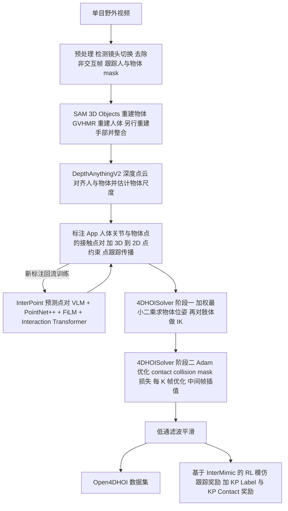
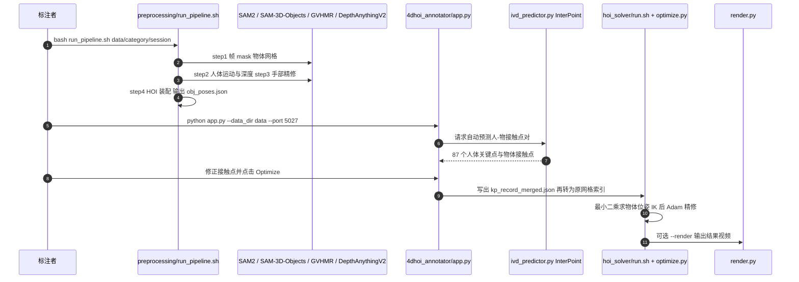

# Efficient and Scalable Monocular Human-Object Interaction Motion Reconstruction

**Efficient and Scalable Monocular Human-Object Interaction Motion Reconstruction** 收录于 [Robot Learning Paper Notebooks](https://imchong.github.io/Robot_Learning_Paper_Notebooks/index.html)（分类：14_Human_Motion），深读笔记已完成。本页依据 **arXiv 原文全文**（正文 + 补充材料）与官方仓库 README 撰写；深读笔记仅作交叉参考。

## 一句话定义

机器人要学操作离不开大规模、多样化的「人-物交互（HOI）」数据，但高精度动捕系统又贵又受限、采不到户外运动 / 工业作业这类真实场景。本文主张直接从普通单目互联网视频里抠出 4D HOI 数据：用稀疏接触标注把昂贵的逐帧密集标注降到「平均约 10 分钟、平均每条视频标注 6.24 个接触点」，再用 InterPoint 多模态预测器 + 4DHOISolver 两阶段优化把人、物、接触对齐成时空连贯且物理合理的轨迹，产出 Open4DHOI 数据集，并用 RL 动作模仿证明重建质量足以驱动仿真智能体复现交互动作。

## 英文缩写速查

| 缩写 | 含义 |
|---|---|
| HOI | Human-Object Interaction，人-物交互 |
| 4D | 3D 几何 + 时间维，即随时间变化的三维人 / 物状态 |
| Sparse Contact Annotation | 稀疏接触标注：只标注时间上不变的少量人-物接触点对，而非逐帧密集标注 |
| InterPoint | 本文的多模态接触点预测器（VLM + PointNet++ + FiLM + Interaction Transformer） |
| 4DHOISolver | 本文的两阶段优化求解器（最小二乘点对齐 + IK → Adam 梯度精修） |
| VLM | Vision-Language Model，视觉语言模型（InterPoint 中用 LLaVA-1.5-7B 提取 2D 语义） |
| FiLM | Feature-wise Linear Modulation，特征级线性调制，用于把 2D 语义注入 3D 点特征 |
| SMPL-X | 带手部与表情的参数化人体模型，本文人体关节定义与优化变量所依托的模型 |
| IK | Inverse Kinematics，逆运动学，用于把肢体调整到关键点位置 |
| MPJPE | Mean Per-Joint Position Error，平均关节位置误差（仿真跟踪评测） |
| CD-o | Chamfer Distance on object surface，物体表面倒角距离（物体跟踪评测） |
| BCE | Binary Cross-Entropy，二元交叉熵（人体关键点接触概率的监督损失） |

## 为什么重要

- **低成本扩交互数据**：人形灵巧操作 / loco-manipulation 极缺「人怎么用手与物体交互」的真实数据；本文从普通视频里抠 4D HOI，把标注成本降到分钟级，是搭「交互数据飞轮」的一条可扩展路径，与本模块 WHOLE、EmbodMocap 的「从野外视频还原具身数据」思路同源；
- **接触是第一性约束**：用接触 / 碰撞 / 掩码损失把重建约束成物理合理，再用接触引导奖励驱动 RL 模仿——这条「接触约束贯穿重建与控制」的链路，对人形动作跟踪 / 操作策略的奖励设计有直接借鉴；
- **重建即可仿真训练数据**：重建结果能直接喂给 RL 智能体在仿真里复现交互，呼应 [Kimodo](kimodo.md) / OMG 等「生成 / 重建动作作为下游策略数据源」的范式；
- **手物耦合的脆弱性提醒**：手部误差会放大到物体位姿，提示人形操作里手部估计精度的关键性。

## 流程总览

图依据：论文 §3.1–§3.5、§4 / Fig.2、Fig.5、Algorithm 1（DS 作为平滑结果输出至数据集依 §3.5 归纳）。

## 解决什么问题

机器人（尤其是灵巧操作 / 人形）要稳健地学会与物体交互，需要**大规模、多样、贴近真实**的 HOI 数据。但现状两难：

- **高精度动捕系统**（多相机 / 多传感器、受控环境）虽准，但**贵、受限于实验室**，物体种类少，户外运动、工业任务这类真实活动根本采不到；
- **互联网单目视频**内容海量、场景多样，却难以准确且可扩展地恢复人与物的相对位姿、接触关系与物理合理性；纯自动的位姿 / 深度对齐常得到物理不准确的接触（论文引用 [24, 36, 58]），而 Open3DHOI 需在 Blender 中手调物体位姿、PICO 标注接触区域，二者逐帧使用时都代价高且难保时序一致。

## 核心原理

论文把问题重新表述为：标注时间上**不变的人-物接触点对**（point pair），再用这些持久的点对应关系做快速优化重建。整体分三段：

**1. 4D 重建初始化（§3.1）**
- 输入：单目视频 + 人 / 物 mask 跟踪；先检测镜头切换并去除非交互帧。
- 机制：SAM 3D Objects 重建物体网格，GVHMR 重建全局人体运动，手部单独重建后整合进全身；DepthAnythingV2 得到深度点云，用投影对齐人体 / 物体网格并估计物体尺度。
- 输出：每帧粗略的人体 SMPL-X 运动与物体网格位姿。

**2. 标注 App 与 InterPoint（§3.2–3.3）**
- 接触定义：人体划分为 26 个主要部位（父节点）共 87 个关键点（子节点，例如前臂分前 / 后 / 左 / 右四点）；手部包含五指、掌心与手背对应点。
- 标注内容：(a) 在物体点云上选 3D 接触点 $p_i$ 并指定其对应人体关键点 $q_i$；(b) 选物体 3D 点 $p^{2D}_i$ 并点击其在图像上的 2D 投影 $q^{2D}_i$。随后用点跟踪模型（论文引用 CoTracker 类方法）在视频中传播 2D 点，只有稳定点变化时才需重新标注；静止物体可固定整段位姿。
- InterPoint：输入一帧图像与 1024 点下采样的物体点云，输出 87 个人体关键点的接触概率与物体上对应的接触点索引。VLM 给出 $E_h, E_o$ 语义嵌入，经 FiLM 调制 PointNet++ 点特征（$\hat f = f\odot(1+\gamma(E))+\beta(E)$），再由 Interaction Transformer（论文配置 L=6、H=8、d=256）与可学习 query 输出预测。
- 训练：人体侧用 BCE 损失；物体侧因正样本极稀疏（每帧仅约 2–3 个正项，相对 87×1024 对），改用双向对比损失 $\mathcal L_{k\to o}$ 与 $\mathcal L_{o\to k}$，正样本集合由空间邻域（半径 / KNN）定义。
- 数据飞轮：InterPoint 预测先给标注者做初始化，人工确认 / 修正后的标注回流训练，形成持续改进的 HITL 循环。

**3. 4DHOISolver 两阶段优化（§3.4）**
- 阶段一（快速几何对齐）：对 3D–3D 与 3D–2D 点对做加权最小二乘，解物体位姿 $(R_o, t_o)$，即最小化 $\frac12(\sum_i\|r^{3D}_i\|^2+\sum_j\|r^{2D}_j\|^2)$；再对肢体做 IK 快速调整。
- 阶段二（物理精修）：对人体姿态与物体位姿做 Adam 优化，损失为 $L = w_c L_{contact} + w_{coll} L_{collision} + w_m L_{mask}$。
  - 接触损失：$L_{contact}=\sum_i w_i d_i^2$，其中 $d_i=\|p^b_i-p^o_i\|_2$，权重 $w_i=\frac{(d_i+\epsilon)^2}{\sum_j (d_j+\epsilon)^2}$，使远距离点对获得更强拉力；
  - 碰撞损失：双向 mesh-to-mesh 穿透惩罚（引用 [17]）；
  - 掩码损失：渲染掩码与 GT 掩码的 MSE，并加入边缘距离变换加权（式 13–16）。
  - 梯度只沿关节树的运动链传播，避免未标注关节被扰动。
- 效率策略：每 $K$ 帧优化一次，中间帧线性插值，最后做低通滤波平滑（Algorithm 1）。
- 静态物体策略：选标注点最多的帧作为静态优化帧，之后物体位姿固定，只优化人体。

**输出**：每条序列的人体与物体位姿轨迹，汇总为 Open4DHOI 数据集。

## 数据集 Open4DHOI

- 规模：451 条序列、约 13.1 万帧、135 类刚体物体、133 类动作（§3.5、表 2）；其中 299 条（79k 帧）来自手机自采，152 条（52k 帧）来自 TikTok 抓取。
- 标注成本：论文报告每条视频约 10 分钟、平均标注 6.24 个接触点；对比单台 Azure Kinect（约 399 美元）与 Vicon 动捕系统（约 5 万美元）的成本量级，作者认为该方案无需额外采集设备。
- 动作标注：用 Qwen2.5-VL-72B 标注视频动作并人工复核；BEHAVE / OMOMO 的动作类别则由 Qwen2.5-72B 从文本描述抽取后人工过滤。

## 实验与评测

- **4DHOISolver（物体跟踪，表 3）**：在 BEHAVE 与 IMHD2 上以物体表面 CD-o 评测（逐帧 / 10 秒滑窗两种协议）。按表头列序，本方法在四列上均为最低：IMHD2 逐帧 4.67、10 秒 4.42；BEHAVE 逐帧 6.72、10 秒 5.95（列序与逐格数值由 PDF 文本抽取得到，未逐格对照原表）。对比基线为 PHOSA、CHORE、VisTracker、I'm HOI。
- **InterPoint（接触预测，表 4）**：在 Open4DHOI 上按 360 / 45 / 46 划分训练 / 验证 / 测试。本方法人体侧 Precision 0.514、Recall 0.532、F1 0.523，物体侧 Recall 0.476，交互点对 Recall 0.303（列序与基线逐格数值因抽取错乱未核实，论文称四项指标均优于 DECO、3D-AffordanceLLM、LEMON、InteractVLM）。数据规模实验（20% / 40% / 70% / 100%）显示三项指标随数据增加而提升，人体侧任务收敛更快。
- **HOI 仿真模仿（表 1）**：在 80 条序列（约 2.9 万帧，按动作分 12 个子集、每子集训一个策略）上比较奖励组合。按表行序 TR only → TR+LR → TR+LR+CR，MPJPE 依次为 151.82 → 156.54 → 125.76 mm，contact 依次为 43.94 → 39.53 → 26.76 mm，jitter 依次为 91.43 → 80.37 → 79.63（行列对应由文本抽取推断，未核实）。结论：接触奖励（CR）对接触误差降幅最明显，但 LR 单独加入会使 MPJPE 略升。
- **数据多样性（表 2）**：Open4DHOI 的运动多样性指标（MoMask 协议）为 3.465，动作类别 133，场景为野外（Wild），与 BEHAVE、OMOMO、InterCap、IMHD2、PICO、Open3DHOI 对比见下节。

## 与其他工作对比

- **相对 Open3DHOI / PICO**：前者依赖 Blender 中逐帧手调物体位姿，后者依赖接触区域标注并从模板库检索代理网格。本文把标注单位压缩为时间不变的接触点对，并用优化代替手调，在数据规模与成本上占优（表 2 与图 7）。
- **相对 CARI4D**：补充材料（§9.5）对同一输入视频做定性对比，两者使用相同的物体网格（SAM 3D Objects）；本文在人-物空间对齐与接触合理性上更好，减少物体悬浮与严重穿透（只有定性图，无定量表）。参见 [paper-cari4d](paper-cari4d.md)。
- **相对接触预测器**：LEMON、InteractVLM 预测稠密接触图，计算代价高；本文改用 87 关键点 × 物体点的稀疏离散输出，并以 Transformer 联合建模人与物。
- **相对 BEHAVE / OMOMO / InterCap 等室内数据集**：这些数据依赖多相机或动捕，场景受限；Open4DHOI 为野外单目视频，动作与物体更多样，但仅覆盖刚体。
- **仿真基座**：仿真策略基于 [InterMimic](paper-bfm-15-intermimic.md)，并在其奖励上增加 KP Label 与 KP Contact 两项接触奖励；与 [InterMimicGen](paper-intermimicgen.md) 等交互数据生成工作互补。

## 结论

**这篇的关键不是又一个重建算法，而是把 4D HOI 数据的单位成本从「逐帧密集标注」压到「约 10 分钟 / 条」，让互联网单目视频真的能当交互数据源用。**

1. **降成本靠稀疏点对，精度靠两段式优化补回来** — 标注的是时间不变的接触点对，其余由 4DHOISolver 的最小二乘对齐与 Adam 精修完成；稀疏标注不等于弱约束，这是该范式能成立的前提。
2. **接触是贯穿重建与控制的第一性约束** — 接触 / 碰撞 / 掩码损失约束重建，接触奖励再驱动 RL 模仿；对人形动作跟踪与操作的奖励设计可直接借鉴。
3. **验收用「仿真智能体能否复现」比重建误差更硬** — 论文用 RL 模仿 + MPJPE / contact / jitter 三指标证明数据可用，呼应 Kimodo / OMG 的「重建 / 生成动作即下游策略数据源」范式。
4. **主要失败模式是手物耦合的误差放大** — 手部估计误差会传导到物体位姿；数据飞轮依赖 InterPoint 初始化质量，标注者仍需修正复杂交互。
5. **代码与数据已可获取，但仿真验证仅到简化人形** — 仓库 README 列出了模块入口、Hugging Face 数据集与 InterPoint 检查点；论文的仿真实验仍基于球-棍型简化人形，离真机尚有 sim-to-real 距离。

## 局限与风险

- **适用边界（论文 §6 讨论）**：依赖「时间不变的交互点」假设，对滚动手内物体（如转核桃）等极端滑动接触，以及衣物等可形变物体，方法不适用。数据集仅含刚体物体（表 2 / §3.5）。
- **仿真验证边界**：RL 实验在 Isaac Gym 中用球-棍（sphere-and-stick）简化人形完成，未在真实全驱动人形上验证（论文 §6）。
- **单目深度与尺度误差**：深度与物体尺度由 DepthAnythingV2 与 SAM 3D Objects 估计；尺度不准时需人工调整，静态物体策略假设整段视频物体不动。
- **标注依赖人工**：InterPoint 初始化质量随数据增长提高，但复杂交互仍需人工修正；论文未报告完整标注者间一致性（未核实）。
- **开源状态（步骤 2.5 核查）**：项目页（wenboran2002.github.io/open4dhoi）链接 GitHub 仓库 `wenboran2002/open4dhoi_code`；仓库 README（2026-11-06 读取）列出 SAM2 / SAM-3D-Objects / GVHMR / Depth-Anything-V2 / SAM-3D-Body 的第三方依赖脚本、5 个模块入口、Hugging Face 数据集与 InterPoint 检查点链接，并声明需自行注册下载 SMPL-X 模型。**已开源**（代码 + 数据 + 检查点）；Hugging Face 数据集与检查点页面的实际文件未逐一核实（未核实）。
- **复现成本**：需要 3 个 conda 环境、多个第三方大模型权重与 SMPL-X 授权，单视频全流程依赖 GPU。

## 工程实践

**数据与重建流程（来自官方 README 与脚本入口）**

| 步骤 | 入口 | 作用 |
|---|---|---|
| 视频上传与 SAM2 点提示 | `python data_preparer/app.py --data_dir data --port 5020` | 上传视频、切镜头、标注人与物点提示 |
| 自动预处理 | `bash preprocessing/run_pipeline.sh data/<category>/<session>` | 4 步：帧 / mask / 物体网格、GVHMR 运动与深度、手部精修、HOI 装配（`obj_poses.json`） |
| 接触标注 | `python 4dhoi_annotator/app.py --data_dir data --port 5027` | 3D 点与关节标注，可调用 InterPoint 自动预测，按 Optimize 触发求解 |
| 优化与渲染 | `bash hoi_solver/run.sh <session> --render` | 将 `kp_record_merged.json` 转为原网格索引后运行 `optimize.py`，可选渲染 |
| 发布数据复现 | `bash hoi_solver/run.sh "<Open4DHOI session>" --render --gpu 0` | 直接对已发布会话做优化复现 |
| InterPoint 训练 / 评测 | `interpoint/` 目录（README 写为 `train.sh` / `evaluate.sh`） | 训练与评估接触点预测（入口脚本路径未核实） |

**关键参数（论文）**

- InterPoint：VLM 为 LLaVA-1.5-7B，输入 224×224，物体 1024 点，AdamW + 余弦退火，学习率 3e-5，batch 16，80 epochs，梯度裁剪 1.0，对比温度 τ=0.1，损失权重 $\lambda_h=1.0$、$\lambda_{k2o}=1.0$、$\lambda_{o2k}=0.3$。
- 4DHOISolver：3D–3D 接触距离阈值 0.1 m，每个人体部位最多保留 5 对；3D–2D 采用最远点采样选 5 个观测点；每 $K$ 帧优化一次，每帧 Adam 迭代 20 次，标注端一次优化约 5 秒。
- 仿真（Isaac Gym）：仿真步长 1/60 s，控制步长 1/30 s，1024 个环境，4 个子步；物体摩擦 0.6，静态物体质量 10000、动态物体质量 0.5；奖励 $R_{tr}=\exp(-(E_p+E_v))$，接触奖励 $R_{cr}$ 约束标注接触点对的全局距离。

**调试指标**：标注端看点对残差与 2D 点跟踪漂移；优化端看接触距离、穿透（collision）与掩码 IoU 的变化；仿真端以 MPJPE（相对参考运动）、contact 与 jitter（三阶差分）三项判断模仿质量。

**源码运行时序图** 对应上面的运行入口（依据官方 README 与 `preprocessing/run_pipeline.sh`、`hoi_solver/run.sh`、`4dhoi_annotator/app.py` 源码头部；InterPoint 训练入口未核实）：

关键复现路径：先跑通预处理得到 `motion/result_hand.pt` 与 `output/obj_poses.json`，再在标注 App 中完成接触点对，最后用 `hoi_solver/run.sh` 生成 `final_optimized_parameters/`；若只需复现论文优化，直接使用已发布的 Open4DHOI 会话目录即可跳过前两步。

## 与其他页面的关系

- 分类父节点：[paper-notebook-category-14-human-motion](../overview/paper-notebook-category-14-human-motion.md)
- 总索引：[humanoid-paper-notebooks-index.md](../overview/humanoid-paper-notebooks-index.md)
- 相关方法 / 实体：[GVHMR](gvhmr.md)（人体运动重建）、[SAM 3D Body](sam-3d-body.md)（手部重建备选）、[CARI4D 实体页](paper-cari4d.md)（同类野外 HOI 重建对比）、[InterMimic 实体页](paper-bfm-15-intermimic.md)（仿真模仿基座）、[OMOMO 数据集](omomo-dataset.md)（对比数据集）

## 参考来源

- [humanoid_pnb_efficient-and-scalable-monocular-human-object-in.md](../../sources/papers/humanoid_pnb_efficient-and-scalable-monocular-human-object-in.md)
- 论文原文（全文通读：正文 §1–§7 与补充材料 §8–§12 中的方法、实验、讨论与仿真细节；图表以 PDF 文本抽取为准，未逐图核对）：<https://arxiv.org/pdf/2512.00960>（arXiv v3，2026-03-18）
- 官方代码仓库（README 与 `preprocessing/run_pipeline.sh`、`hoi_solver/run.sh`、`4dhoi_annotator/app.py` 头部，2026-11-06 读取）：<https://github.com/wenboran2002/open4dhoi_code>
- 项目页（开源链接核查，2026-11-06）：<https://wenboran2002.github.io/open4dhoi/>
- 深读笔记：<https://imchong.github.io/Robot_Learning_Paper_Notebooks/papers/14_Human_Motion/Efficient_and_Scalable_Monocular_Human-Object_Interaction_Motion_Reconstruction/Efficient_and_Scalable_Monocular_Human-Object_Interaction_Motion_Reconstruction.html>

## 推荐继续阅读

- [arXiv 原文 2512.00960](https://arxiv.org/abs/2512.00960)（含补充材料与可视化附录）
- [官方代码仓库 open4dhoi_code](https://github.com/wenboran2002/open4dhoi_code)（含 Hugging Face 数据集与 InterPoint 检查点链接）
- [项目主页 Open4DHOI](https://wenboran2002.github.io/open4dhoi/)
- [机器人论文阅读笔记：Efficient and Scalable Monocular Human-Object Interaction Motion Reconstruction](https://imchong.github.io/Robot_Learning_Paper_Notebooks/papers/14_Human_Motion/Efficient_and_Scalable_Monocular_Human-Object_Interaction_Motion_Reconstruction/Efficient_and_Scalable_Monocular_Human-Object_Interaction_Motion_Reconstruction.html)
