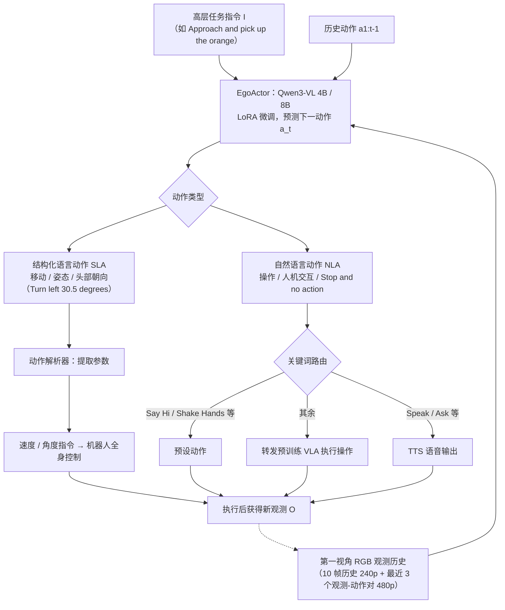

# EgoActor

**EgoActor: Grounding Task Planning into Spatial-aware Egocentric Actions for Humanoid Robots via Visual-Language Models**（arXiv:2602.04515，北京智源人工智能研究院 BAAI）收录于 [Robot Learning Paper Notebooks](https://imchong.github.io/Robot_Learning_Paper_Notebooks/index.html)（分类：08_Navigation）。论文提出 **EgoActing** 任务与 **EgoActor** 模型：以 Qwen3-VL 为底座，用 LoRA 微调成一个能直接输出人形机器人低层动作文本的 VLM。

## 一句话定义

EgoActor 把"高层语言指令 → 低层人形动作"的落地过程统一成一个 VLM：仅用第一视角 RGB 与指令，就能同时输出移动 / 头部姿态 / 操作 / 人机交互这四类动作原语，亚秒级推理，4B / 8B 双尺寸，覆盖仿真与真机环境。

## 英文缩写速查

| 缩写 | 英文全称 | 在本页中的含义 |
|------|----------|----------------|
| VLM | Vision-Language Model | 以图像与文本为输入、输出文本的多模态模型；EgoActor 的骨干是 Qwen3-VL |
| VLA | Vision-Language-Action model | 直接输出机器人动作的 VLM 变体；本文把操作类动作转交给预训练 VLA 执行 |
| SLA | Structured Language Action | 结构化语言动作，如 `Turn left 30.5 degrees`，用于移动与头部姿态 |
| NLA | Natural Language Action | 自然语言动作，如 `Ask ...`、`Grab the toy bear`，用于操作与人机交互 |
| LoRA | Low-Rank Adaptation | 低秩适配微调；本文对模型全部线性层做 LoRA，学习率 3e-4 |
| DAgger | Dataset Aggregation | 在线策略数据聚合模仿学习；本文用它收集 70 条真机成功轨迹 |
| VLN | Vision-and-Language Navigation | 视觉语言导航；本文的基线（NaVid、Uni-NaVid、NaVILA）属于此类 |

## 为什么重要

- 真机人形机器人需要在部分可观测、动态环境里同时做移动、看、操作与交互，而现有方法通常各自只解决一类任务（论文 §I）。
- EgoActor 尝试把这些环节压进**一次 VLM 前向推理**：不设分层规划器、不加额外传感器，只用单目 RGB 与语言指令（论文 §I、§VI）。
- 其数据路线（真机第一视角视频 + 轻量文字标注 + 仿真轨迹 + 空间推理 QA）说明这类 VLM 动作预测器可以随视频数据扩展，而不必依赖大规模遥操作（论文 §IV-C、§VI）。
- 列入 Paper Notebooks 策展清单，便于与全库 [机器人学习论文笔记总索引](../overview/humanoid-paper-notebooks-index.md) 及分类父节点交叉检索。

## 核心原理

**输入 → 机制 → 输出**

- **输入**：自然语言指令 $I$；历史第一视角观测 $O_{1:t}$（论文中为 RGB 图像）；历史动作 $a_{1:t-1}$；可用底层技能集合 $\Pi$（论文 §III-A）。
- **机制**：把下一步动作的选择写成条件概率的最大化，由 VLM 直接生成动作文本：

$$
a_t = \arg\max_{a \in \mathcal{A}} P(a \mid I, O_{1:t}, a_{1:t-1}, \Pi)
$$

  其中动作空间 $\mathcal{A}$ 不是离散的技能 ID，而是两类**语言化动作**：
  - **SLA**（移动与主动感知）：模板化、带方向与幅值，覆盖偏航 / 俯仰、前后 / 左右平移与竖直高度调整；过小的运动会被阈值滤除以降噪。
  - **NLA**（操作与人机交互）：不限定固定技能表，例如 `Ask Could you please guide me to a meeting room?`、`Say Hi`、`Stop and no action`（任务结束，等待新指令）。
- **输出**：一段由若干 SLA / NLA 组成的动作序列，每步之后再用新观测继续推理。

**数据格式**（论文 §IV-B、附录 VIII）：每个任务均匀采样 10 张历史观测（240p），并以最近 3 组观测-动作对（480p）作为关键锚点来预测下一个动作。这一格式让模型在单个训练样本内学习多步动作，并能从历史中推断"刚左转过，现在应右转避障"这类上下文决策。

**执行路由**（论文 §III-B-d）：SLA 解析参数后转为速度 / 角度指令；NLA 按关键词路由——含 `Speak` / `Ask` 等的交给 TTS，`Say Hi` / `Shake Hands` 等调用预设动作，其余转发给预训练 VLA 执行操作。

## 流程总览

图依据：论文 §III-A/B（任务定义、SLA/NLA 与 Action Parsing）、§IV-A/B（模型与数据格式）、Fig.2。

## 训练与数据

- **底座与微调**：Qwen3-VL（动态分辨率）；对全部线性层做 LoRA，学习率 3e-4；4B 与 8B 两个版本，在 16 张 A100 40GB 上训练 1 个 epoch（论文 §IV-A）。论文称两者在速度与性能之间存在权衡。
- **数据来源**（论文 §IV-C，括号内为论文报告的样本数）：EgoTaskQA 等互联网第一视角视频（约 16 万 + 7 千）；本地真机 398 段视频（约 15 万）；VLN-CE R2R 子集（6 万）；Habitat-Sim 仿真 EgoActing 轨迹 714 条（训练 509 / 验证 205，共 7.7 万样本）；MindCube 空间推理（4.4 万）；GQA（30 万）；RoboVQA / EgoPlan / ALFRED 规划数据（约 24 万）；无监督运动预测（1 万）；DAgger 真机在线轨迹（3,629 样本）。
- **运动动作提取**：沿用 NaVILA 的做法，用 MASt3R 估计相机位姿，每 1.5 秒切分一步动作（论文 §IV-C）。
- **Skill 设置**：操作由微调后的 GROOT-N 1.5 执行（附录 XI：40k 步、batch 50、约 700 条样本）；移动由 Unitree 官方行走策略执行。论文报告真机移动精度约 5 cm（前后 / 左右）与约 5 度（转向）。前进距离模型输出会乘以 1.2 倍以提高速度（论文 §IV-D）。
- **推理设置**：随机采样，temperature 0.2；基线按其原设置用贪心解码（论文 §V-A）。

## 实验与评测

评测涵盖真机（Unitree G1，配 Dex3-1 双手与 2 自由度头部，单目 RealSense D455 480p RGB，无深度；论文正文写作 G14，脚注链接为 G1，此处按脚注）与仿真（Habitat-Sim，205 条未见场景样本，3 次运行取平均）。

- **人机交互**（表 I、表 II）：单人场景下，两种 EgoActor 在接近、打招呼、询问位置、索要物品四类任务上多数达到 11/12–12/12；基线 NaVILA-7B、NaVid-7B、UniNaVid-7B 仅报告接近任务，成功率为 2/12、8/12、8/12。多人场景中 4B 在需要细粒度属性（服饰、配饰等）辨认时明显弱于 8B（论文称 8B 多数情形能识别目标并完成交互，具体逐格数值以原表为准）。
- **移动操作**（表 III，未见布局，苹果 / 瓶子 / 笔筒 / 粉色杯）：8B 对已见与未见物体的"接近 + 抓取 / 放置"大多成功；4B 的主要失败模式是在离目标仍较远时过早触发操作（论文 §V-C-b）。每个位置测试两次，样本量很小。
- **穿越性**（表 IV，门口进出，3 个已见 + 2 个未见房间，每房间左右起点各 4 次）：论文报告 EgoActor 比 NaVILA、NaVid、UniNaVid 更少与门框、障碍物碰撞。
- **仿真导航**（表 V，205 条未见场景样本）：严格阈值（如 <0.5 m、<1.0 m）下 EgoActor 4B / 8B 显著高于三个基线；在 <3.0 m 的常规 VLN 成功标准下，基线约 50%（论文称与其 VLN-CE R2R 报告值相当），EgoActor 更高，两个尺寸之间差距不大。
- **定性案例**（§V-E）：绕过未见的绳状障碍、回头确认障碍位置、靠近目标时主动抬头看清衣着颜色、按门口转角组合前进 + 转向 + 平移等类人运动。

## 结论

**EgoActor 的取舍是「一个 VLM 吃下整条链路」：不设分层规划器、不加额外传感器，只用第一视角 RGB 加语言指令，直接产出可执行的人形动作原语。**

- 关键设计在动作空间而非模型规模：把移动、头部姿态、操作、人机交互统一成四类可由 VLM 输出的原语，"任务规划落地"才被压缩成一次前向推理。
- 亚秒级推理与 4B / 8B 双尺寸表明它是奔着可部署去的在线策略，而非离线规划器；覆盖仿真与真机两类环境也说明其目标不是单一 benchmark。
- 输入侧只保留第一视角 RGB 与指令，这既是"egocentric"的卖点，也界定了可用范围：可获得的空间信息以当前视野为限，头部姿态因此被列为动作原语之一。
- 论文自陈的边界：它不是端到端系统，依赖外部高层规划器（如 LLM）、locomotion 策略与 VLA；长程多阶段任务中可能陷入局部最优的错误决策（论文 §VII）。
- 本页归入 08_Navigation 而非操作类，提示其重心是空间感知驱动的到达与交互落地。

## 局限与风险

- **系统边界**：论文承认 EgoActor 依赖外部组件可靠性——NLA 的执行依赖预训练 VLA（操作）与 GROOT-N 1.5，移动依赖 Unitree 行走策略；EgoActor 本身不是端到端执行系统（论文 §VII）。
- **长程上下文**：模型可能在多阶段任务里陷入"局部最优但错误"的决策模式（论文 §VII）。
- **动作语言的不可控性**：NLA 不限定固定技能表，开放性是优点，但新动作无法保证下游有对应执行器；关键词路由对措辞敏感（如 `Speak` / `Ask` 之外的说法）（论文 §III-B-d，推断）。
- **评测规模小**：真机每个条件样本量仅 6–12 次，且多人、穿越性实验主要观察成功率；仿真的 205 条样本来自论文自建的 Habitat-Sim 数据（论文 §V-C/D）。与基线的比较也是在论文作者的硬件与场景中完成，不构成跨平台的泛化结论。
- **部分失败模式**：4B 在多人属性辨认与远距离触发操作上较弱；仿真失败多来自模糊指令、画面模糊与少见场景（如教堂、历史遗迹）（论文 §V-C/D）。
- **数据与复现**：训练数据包含作者自采的真机视频与基于 GPT-4o 的标注（论文 §IV-C-f）；论文未在正文报告完整数据配比的敏感性分析（未核实）。
- **源码与权重开放状态（步骤 2.5）**：论文脚注称将开源代码、模型、数据集与评测；项目页（<https://baai-agents.github.io/RoboNoid/EgoActor/>，由 `baai-agents.github.io/EgoActor/` 跳转）列出了 GitHub 目录 `BAAI-Agents/RoboNoid/papers/EgoActor` 以及 Hugging Face 模型权重 `BAAI-Agents/EgoActor-8b-Qwen3VL` 与 `BAAI-Agents/EgoActor-4b-Qwen3VL`（入库日 2026-11-06 核查，两个 Hugging Face 页面可访问）。**本会话无法访问该 GitHub 仓库（返回 403，未授权），因此训练 / 推理入口是否可运行、数据集与评测脚本是否已发布，均未核实（未核实）。** 在核实前不写 `源码运行时序图`，也不写 `code:` frontmatter。

## 与其他工作对比

论文 §II 与附录 XVII 从三方面区分 EgoActor：

- **具身形态**：多数 VLM 具身智能体面向机械臂或简化仿真体，依赖预定义技能库；EgoActor 面向完整人形机器人，直接输出包含移动、姿态、头部、操作与交互在内的低层动作。
- **动作推理统一**：移动操作与导航框架通常把任务拆成分阶段子目标与各自控制器；EgoActing 在一个模型里联合推理异构动作类型。
- **任务泛化与真机**：VLN（R2R、Touchdown、NaVid、Uni-NaVid、NaVILA 等）与目标导航方法主要处理静态导航或找物体；EgoActor 把导航、操作、主动感知与人机交互放在同一闭环中。

与 [NaVILA](../entities/paper-notebook-navila-legged-robot-vision-language-action-model.md) 的关系：二者都用 VLM 把语言指令转为移动动作，但 NaVILA 输出中层动作交给 locomotion 策略，而 EgoActor 进一步把操作与人机交互纳入同一输出空间。

## 与其他页面的关系

- 分类父节点：[paper-notebook-category-08-navigation](../overview/paper-notebook-category-08-navigation.md)
- 总索引：[humanoid-paper-notebooks-index.md](../overview/humanoid-paper-notebooks-index.md)
- 相关方法：[VLA](../methods/vla.md)，[LoRA](../concepts/lora.md)，[DAgger](../methods/dagger.md)
- 同类导航基线：[NaVILA](../entities/paper-notebook-navila-legged-robot-vision-language-action-model.md)

## 参考来源

- [humanoid_pnb_egoactor.md](../../sources/papers/humanoid_pnb_egoactor.md)（Paper Notebooks 策展归档，含 arXiv 链接）
- 论文原文：[arXiv:2602.04515 PDF](https://arxiv.org/pdf/2602.04515)（v1，2026-02-04）。已通读正文全部章节（§I–§VI）、附录 VII–XVII，并略读附录 IX-A、XIV-A/B 的案例描述；参考文献列表未逐条核对。
- 项目页：<https://baai-agents.github.io/RoboNoid/EgoActor/>（核查日 2026-11-06，列出代码与权重链接）
- 深读笔记：<https://imchong.github.io/Robot_Learning_Paper_Notebooks/papers/08_Navigation/EgoActor__Grounding_Task_Planning_into_Spatial-aware_Egocentric_Actions_for_Hum/EgoActor__Grounding_Task_Planning_into_Spatial-aware_Egocentric_Actions_for_Hum.html>

## 推荐继续阅读

- [论文 arXiv 摘要页](https://arxiv.org/abs/2602.04515)
- [EgoActor 项目页](https://baai-agents.github.io/RoboNoid/EgoActor/)（含代码与 Hugging Face 权重链接）
- [机器人论文阅读笔记：EgoActor](https://imchong.github.io/Robot_Learning_Paper_Notebooks/papers/08_Navigation/EgoActor__Grounding_Task_Planning_into_Spatial-aware_Egocentric_Actions_for_Hum/EgoActor__Grounding_Task_Planning_into_Spatial-aware_Egocentric_Actions_for_Hum.html)
