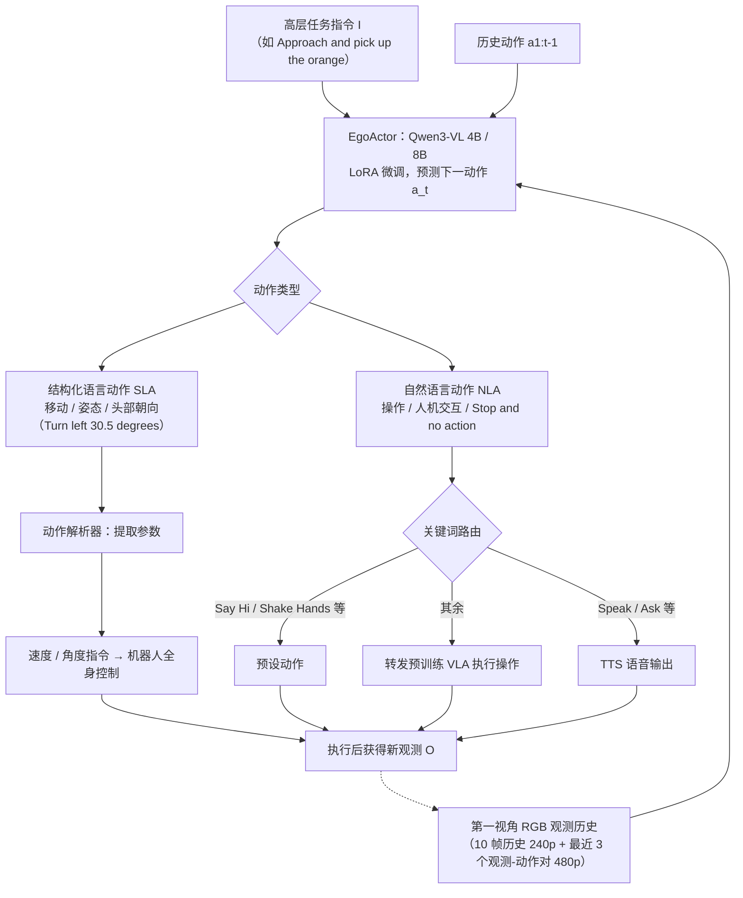

# EgoActor

**EgoActor: Grounding Task Planning into Spatial-aware Egocentric Actions for Humanoid Robots via Visual-Language Models** 收录于 [Robot Learning Paper Notebooks](https://imchong.github.io/Robot_Learning_Paper_Notebooks/index.html)（分类：08_Navigation）。本页为 **清单索引实体**，链向深读笔记与原始论文；详细机制待从笔记消化后补充。

## 一句话定义

EgoActor 把"高层语言指令 → 低层人形动作"的落地过程统一成一个 VLM：仅用第一视角 RGB 与指令，就能同时输出移动 / 头部姿态 / 操作 / 人机交互这四类动作原语，亚秒级推理，4B / 8B 双尺寸，覆盖仿真与真机环境。

## 英文缩写速查

| 缩写 | 英文全称 | 简要说明 |
|------|----------|----------|
| RL | Reinforcement Learning | 通过与环境交互最大化长期回报来学习策略 |
| WBC | Whole-Body Control | 协调全身关节满足多任务/约束的控制基础设施 |
| Sim2Real | Simulation to Real | 把仿真中学到的策略迁移落地真机的工程主线 |

## 为什么重要

- 列入 Paper Notebooks 策展清单，便于与全库 [机器人学习论文笔记总索引](../overview/humanoid-paper-notebooks-index.md) 及分类父节点交叉检索。
- 深读笔记提供比摘要更贴近实现的阅读路径，适合作为后续 ingest 深化起点。

## 流程总览

图依据：论文 §III-A/B（任务定义、SLA/NLA 与 Action Parsing）、§IV-A/B（模型与数据格式）、Fig.2。

## 核心信息

| 字段 | 内容 |
|------|------|
| 分类 | 08_Navigation |
| 深读笔记 | <https://imchong.github.io/Robot_Learning_Paper_Notebooks/papers/08_Navigation/EgoActor__Grounding_Task_Planning_into_Spatial-aware_Egocentric_Actions_for_Hum/EgoActor__Grounding_Task_Planning_into_Spatial-aware_Egocentric_Actions_for_Hum.html> |
| arXiv | <https://arxiv.org/abs/2602.04515> |

## 实验与评测

- 本页为 **策展清单索引** 摘要；量化 benchmark、消融与实机指标以 **深读笔记与论文 PDF** 为准（链接见 [参考来源](#参考来源)）。

## 结论

**EgoActor 的取舍是「一个 VLM 吃下整条链路」：不设分层规划器、不加额外传感器，只用第一视角 RGB 加语言指令，直接产出可执行的人形动作原语。**

- 关键设计在动作空间而非模型规模：把移动、头部姿态、操作、人机交互统一成四类可由 VLM 输出的原语，"任务规划落地"才被压缩成一次前向推理。
- 亚秒级推理与 4B / 8B 双尺寸表明它是奔着可部署去的在线策略，而非离线规划器；覆盖仿真与真机两类环境也说明其目标不是单一 benchmark。
- 输入侧只保留第一视角 RGB 与指令，这既是"egocentric"的卖点，也界定了可用范围：可获得的空间信息以当前视野为限，头部姿态因此被列为动作原语之一。
- 本页归入 08_Navigation 而非操作类，提示其重心是空间感知驱动的到达与交互落地。
- 适用边界：本页为清单索引实体，机制描述停留在摘要层；量化 benchmark、消融与实机指标以深读笔记与论文 PDF 为准（见[参考来源](#参考来源)）。

## 与其他页面的关系

- 分类父节点：[paper-notebook-category-08-navigation](../overview/paper-notebook-category-08-navigation.md)
- 总索引：[humanoid-paper-notebooks-index.md](../overview/humanoid-paper-notebooks-index.md)

## 参考来源

- [humanoid_pnb_egoactor.md](../../sources/papers/humanoid_pnb_egoactor.md)
- 深读笔记：<https://imchong.github.io/Robot_Learning_Paper_Notebooks/papers/08_Navigation/EgoActor__Grounding_Task_Planning_into_Spatial-aware_Egocentric_Actions_for_Hum/EgoActor__Grounding_Task_Planning_into_Spatial-aware_Egocentric_Actions_for_Hum.html>
- 论文：<https://arxiv.org/abs/2602.04515>
- [arXiv PDF](https://arxiv.org/pdf/2602.04515)：已通读方法部分（实验与附录以略读为准）：§I 引言、§III Framework Design、§IV Training Recipe。

## 推荐继续阅读

- [机器人论文阅读笔记：EgoActor](https://imchong.github.io/Robot_Learning_Paper_Notebooks/papers/08_Navigation/EgoActor__Grounding_Task_Planning_into_Spatial-aware_Egocentric_Actions_for_Hum/EgoActor__Grounding_Task_Planning_into_Spatial-aware_Egocentric_Actions_for_Hum.html)
