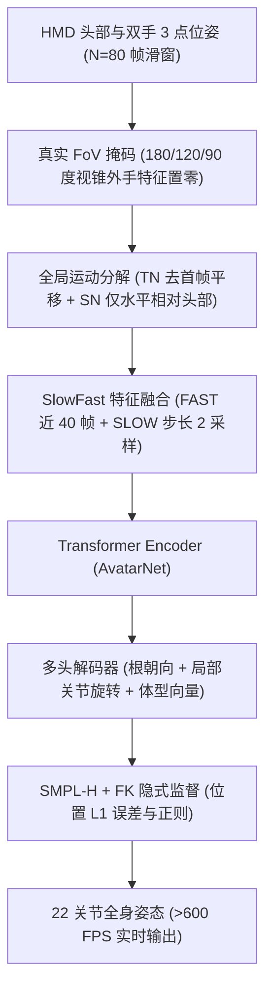
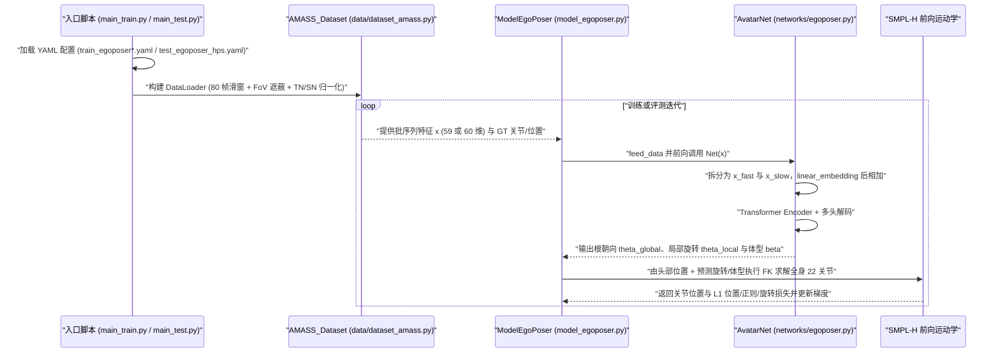

# EgoPoser

**EgoPoser: Robust Real-Time Egocentric Pose Estimation from Sparse and Intermittent Observations Everywhere** 收录于 [Robot Learning Paper Notebooks](https://imchong.github.io/Robot_Learning_Paper_Notebooks/index.html)（分类：14_Human_Motion）。本页已对照 arXiv PDF（v3，18 页，ECCV 2024）与官方代码仓库 `eth-siplab/EgoPoser` 通读核对。

## 一句话定义

EgoPoser 是一种面向头显三点稀疏输入（头与双手）的实时第一视角全身姿态估计方法，结合真实 FoV 手部遮挡建模、全局运动分解（TN + 仅水平 SN）、SlowFast 特征融合与隐式体型估计，摆脱对固定动捕原点、手全程可见与平均体型的理想假设。

## 英文缩写速查

| 缩写 | 英文全称 | 简要说明 |
|---|---|---|
| HMD | Head-Mounted Display | 头显设备，提供头部与双手 3 点 6-DoF 稀疏位姿输入 |
| FoV | Field of View | 头显相机视野，手超出水平/垂直视角时将手部特征置零 |
| TN / SN | Temporal / Spatial Normalization | 全局运动分解中的时间归一化（去首帧平移）与空间归一化（仅水平相对头部） |
| SlowFast | Slow-Fast Feature Fusion | 双路时序融合：FAST 取最近一半帧，SLOW 全窗口步长 2 采样 |
| SMPL-H | Skinned Multi-Person Linear with Hands | 含手部的参数化人体模型，本文取前 22 个全身关节构建 FK |
| FK | Forward Kinematics | 前向运动学，用于由预测关节旋转、体型与头部位置还原全局根位置 |
| MPJPE / MPJVE | Mean Per Joint Position / Velocity Error | 关节平均位置误差（cm）与速度误差（cm/s，衡量平滑性） |

## 为什么重要

- **「间歇/缺失观测下鲁棒」是真实部署的关键**：头显手部追踪在手出视野时会频繁丢失，其感知降级处理思路与人形遥操作和状态估计应对传感缺失的诉求直接对齐（本页推断，论文面向人体化身而非直接机器人控制）。
- **全局运动分解解决大场景退化**：消除坐标系原点耦合，直接针对训练集集中在原点附近、移到新房间或大场景就失效的顽疾，可与前作 [AvatarPoser](paper-notebook-avatarposer-articulated-full-body-pose-tracking.md) 直接对照。
- **SlowFast 在不拉高注意力开销下拉长上下文**：在不使 Transformer 自注意力计算量二次膨胀的前提下把 80 帧历史压缩到 40 帧输入，兼顾平滑性与 >600 FPS 实时性。

## 核心原理

### 输入与输出

- **输入**：HMD 给出头与双手的全局位置 $p$ 与朝向 $\Theta$，滑窗取最近 $\tau=80$ 帧；每次前向只输出窗口最后一帧，满足实时推理。
- **特征表示**：经归一化后的位置、朝向（6D 旋转）、线速度与角速度（论文正文记为 59 维输入，源码 YAML 中实际配置 `input_dim: 60`）。
- **输出**：全局根朝向 $\theta_{global}$、局部关节旋转 $\theta_{local}$ 与体型向量 $\beta \in \mathbb{R}^{16}$；经 SMPL-H 前向运动学得到前 22 个关节位置，全局根位置沿用 AvatarPoser 做法由头部位置与预测关节角反推。

### 真实 FoV 建模与全局运动分解

- **真实 FoV 遮挡**：按头部位姿判断每只手是否落在水平视角 $\alpha_h$、垂直视角 $\alpha_v$ 内（模拟 180°、120° Quest 2、90° HoloLens 2），视野外置零；保留空间关系与时间连续性，而非像 FLAG 那样以 $p=0.2$ 随机丢帧。
- **时间归一化（TN）**：窗口内关节减去首帧平移，移除绝对房间位置绑定。
- **空间归一化（SN）**：仅将手与头的**水平**平移相对头部表示，保留**竖直**高度作为下肢动作（坐/站/蹲）的强运动先验。论文 Table 4 验证连同竖直分量一起归一化会导致 MPJPE 从 4.45 恶化到 4.96 cm。

### SlowFast 融合与体型感知优化

- **SlowFast**：FAST 取最近 $\tau/2=40$ 帧逐帧嵌入，SLOW 在全 $\tau=80$ 帧上步长 2 采样得到 40 帧，融合后长度保持 40 帧送入 Transformer Encoder。实读 `networks/egoposer.py` 表明，`AvatarNet` 实际对 `x_fast` 与 `x_slow` 共用同一个 `linear_embedding` 并逐元素相加（而非论文示意图中的通道拼接）。
- **体型联合估计**：$\beta$ 无显式 GT 标签，经可微 SMPL-H FK 的关节位置误差 $\mathcal{L}_{pos}=\left\lVert FK(\theta,\beta)-FK(\theta_{GT},\beta_{GT})\right\rVert_1$ 隐式反向优化并加 $\beta$ 的 L1 正则；论文给出权重 $(\lambda_{ori}, \lambda_{rot}, \lambda_{pos}, \lambda_{\beta}) = (0.05, 1, 1, 0.01)$（源码默认 YAML 中为 `(0.02, 1, 1 或 20, 0.01)`）。

图依据：论文 §3.1–§3.5、Fig. 2，以及 `networks/egoposer.py`、`model_egoposer.py` 实读代码。

## 实验与评测

评测使用 MPJPE（cm）与 MPJVE（cm/s，越低越平滑）。

**1. HPS 大场景外推（Table 1，MPJPE，cm，仅在室内 AMASS 训练）**：

| 方法 | BIB_EG_Tour | MPI_EG | Working_Standing | UG_Computers | Go_Around |
|---|---|---|---|---|---|
| AvatarPoser | 22.53 | 16.54 | 19.08 | 23.24 | 19.50 |
| AvatarPoser-Improved（局部输入改造） | 11.48 | 13.86 | 12.42 | 11.42 | 12.56 |
| AGRoL-Improved | 15.04 | 13.94 | 13.86 | 12.71 | 13.13 |
| AvatarJLM-Improved | 14.80 | 14.72 | 13.75 | 10.28 | 11.19 |
| **EgoPoser** | **9.55** | **11.05** | **8.70** | **10.25** | **6.90** |

**2. 手部出视野仿真测试（Table 3，AMASS，MPJPE / MPJVE，cm 与 cm/s）**：

| 方法 | FoV 180° | FoV 120° | FoV 90° |
|---|---|---|---|
| Full Visibility（默认模型） | 24.75 / 183.84 | 38.99 / 144.42 | 41.24 / 95.66 |
| Random Masking（FLAG 式，$p=0.2$） | 7.09 / 49.91 | 13.29 / 64.09 | 14.84 / 58.33 |
| Improved RM | 6.52 / 47.50 | 11.88 / 57.44 | 12.83 / 52.98 |
| **Ours（真实 FoV 建模）** | **5.31 / 39.69** | **6.07 / 46.01** | **6.60 / 48.25** |

**3. 体型感知对比（Table 2，AMASS，175+ 受试者，身高 145–207 cm，cm）**：

| 策略 | MPJPE | MVE | 身高误差 | 臂长误差 | GP（地面穿透） | FF（脚悬浮） |
|---|---|---|---|---|---|---|
| 平均体型 | 6.36 | 6.74 | 7.67 | 7.42 | 3.87 | 5.38 |
| 数据增强 + T 姿态标定 | 5.26 | 4.69 | 1.36 | 1.24 | 2.06 | 1.67 |
| **联合估计（本文）** | **4.79** | **4.08** | **1.78** | **1.66** | **2.31** | **1.64** |

**4. 关键消融（Table 4–5、Fig. 8、Fig. 11）**：

- **全局运动分解（Table 4）**：仅均值归一化 ~6.25 cm；仅 SN 4.45；仅 TN 4.58；水平+竖直 SN 4.96；完整 TN + 仅水平 SN 达到 4.14 cm、MPJVE 25.95。
- **SlowFast（Table 5）**：40 帧输入 4.36 cm；80 帧直入 4.11 cm 但算力翻倍（0.65G vs 0.33G FLOPs）；80 帧步长 2 为 4.13 cm（MPJVE 30.02）；SlowFast 保持 0.33G FLOPs / 4.12M 参数，实现 4.14 cm 且 MPJVE 降至 25.95。
- **位置偏移与真机**：在 0–50 m 原点平移下误差稳定于 4.14 cm；Fig. 11 给出 Quest 2 实机定性演示，但未提供定量真机指标。

## 结论

**EgoPoser 通过「真实 FoV 遮蔽 + 全局运动分解 + SlowFast + 隐式体型优化」四重解耦，在不增加注意力计算复杂度的前提下，同时打破了稀疏三点姿态估计对「手全程可见」「固定原点动捕区」「统一平均体型」的三大理想假设。**

1. **真实 FoV 遮挡比随机丢帧更关键**：当视野收窄至 Quest 2（120°）与 HoloLens 2（90°）时，默认模型误差暴涨至 38.99–41.24 cm，而 FoV 感知训练将其压低至 6.07–6.60 cm，证明空间一致性丢帧先验远优于概率独立掩蔽。
2. **水平/竖直不对称归一化是精度核心**：水平位置相对头部实现空间平移不变性，而保留竖直高度为下肢弯曲状态提供了不可或缺的重力参考（消融差距 4.45 vs 4.96 cm）。
3. **源码实现存在与论文文字的细微偏差**：已开源的 MIT 仓库（`eth-siplab/EgoPoser`）中网络保留 `AvatarNet` 命名，SlowFast 实际采用共用 `linear_embedding` 相加而非拼接，且默认 YAML 超参（`input_dim: 60`、`batch_size: 64`、loss 权重）与论文正文数值不完全一致，复现需注意对齐。
4. **工程轻量且实时**：4.12M 参数、0.33G FLOPs 与 >600 FPS 推理吞吐为实时 XR 化身与轻量遥操作状态重构提供了直接可用的低延迟底座。

## 源码运行时序图

以下时序依据 `main_train.py`、`main_test.py`、`model_egoposer.py`、`networks/egoposer.py` 与 `data/dataset_amass.py` 核对整理：

## 工程实践

| 工程项 | 论文 / 官方仓库核对值 |
|---|---|
| 开源协议与入口 | MIT；`main_train.py`、`main_test.py` 配合 `options/*.yaml` |
| 训练与外推数据 | AMASS 子集（CMU、BMLrub、HDM05，90%/10% 划分）；HPS 户外大场景外推（需在 `test_egoposer_hps.yaml` 设 `spatial_normalization: false`） |
| 窗口与网络结构 | $\tau=80$ 帧窗口，SlowFast 压成 40 帧；`AvatarNet`（4.12M 参数，0.33G FLOPs，>600 FPS） |
| 优化器与超参差异 | Adam，lr `1e-4`（每 `2e4` iter 乘 0.5）；论文写 `input_dim=59 / batch=256 / weights=(0.05,1,1,0.01)`，仓库 YAML 默认为 `input_dim=60 / batch=64 / weights=(0.02,1,1 or 20,0.01)` |
| 调试与排错提示 | 手出视野时若 MPJVE 突跳检查 FoV 视野角与掩码配置；远离原点失效检查是否错误传入绝对水平位置；地面穿透（GP）或悬脚（FF）偏大检查体型向量 $\beta$ L1 正则 |

## 常见误区与局限

- **假设同楼层高度先验（论文 §4.6）**：因保留竖直绝对坐标作为动作先验，系统假设活动位于同一楼层；跨楼层或大地形起伏场景需重设原点或关闭竖直空间约束（如 `test_egoposer_hps.yaml` 中关闭 `spatial_normalization`）。
- **无物理约束后处理**：骨干仅使用朴素 Transformer 逐帧预测最后一帧，缺乏接触约束与时序物理平滑后处理，极端动作仍可能出现残余脚滑或轻度地面穿透。
- **下肢无直接观测且缺量化真机评测**：下肢姿态完全依赖头手运动学关联与先验推断；真机 Quest 2 仅提供定性演示，且 AMASS FoV 实验属于仿真遮挡而非真实端到端传感器延迟下的定量统计。
- **跨领域迁移需重新标定**：论文面向人体化身而非人形机器人控制，直接迁移至机器人遥操作或状态估计时需重新对齐连杆比例与通信延迟（本页推断）。

## 与其他工作对比

| 方法 | 输入表示 | 手部可见性假设 | 体型建模 | 核心定位与代价 |
|---|---|---|---|---|
| AvatarPoser | 全局位置 | 假设全可见 | 平均体型 | Transformer + IK；强依赖原点附近动捕区域 |
| AGRoL | 全局位置 | 假设全可见 | 平均体型 | 扩散模型，采样较慢且常依赖未来帧 |
| AvatarJLM | 全局位置 | 假设全可见 | 平均体型 | 关节级时空 Transformer，计算开销较大 |
| MANIKIN | 全局位置 | 假设全可见 | 平均体型 | 可微全身 IK，着重抑制穿透与物理误差 |
| FLAG | 随机遮蔽手 | 随机 $p=0.2$ 丢帧 | 平均体型 | 未建模头手相对 FoV 空间关系 |
| **EgoPoser** | 归一化局部表示 | 真实 FoV 置零 | 隐式联合估计 | 位置不变、抗间歇遮挡、跨体型且 >600 FPS（缺物理后处理） |

## 关联页面

- 分类父节点：[paper-notebook-category-14-human-motion](../overview/paper-notebook-category-14-human-motion.md)
- 总索引：[humanoid-paper-notebooks-index.md](../overview/humanoid-paper-notebooks-index.md)
- 前作对照：[AvatarPoser 笔记实体](paper-notebook-avatarposer-articulated-full-body-pose-tracking.md)
- 同类方法：[MANIKIN 笔记实体](paper-notebook-manikin-biomechanically-accurate-neural-inverse.md) · [FRAME 笔记实体](paper-notebook-frame-floor-aligned-representation-for-avatar-mo.md)
- 人体模型与状态估计：[SMPL-X 概念页](../concepts/smpl-x.md) · [State Estimation 概念页](../concepts/state-estimation.md)

## 参考来源

- [egoposer_reading.md](../../sources/papers/egoposer_reading.md)（arXiv:2308.06493 v3 全文与深读笔记归档）
- [humanoid_pnb_egoposer.md](../../sources/papers/humanoid_pnb_egoposer.md)（Robot Learning Paper Notebooks 原条索引归档）
- [eth_siplab_egoposer.md](../../sources/repos/eth_siplab_egoposer.md)（GitHub 官方仓库源码核对归档）
- 论文：<https://arxiv.org/abs/2308.06493>（v3，ECCV 2024）
- 源码仓库：<https://github.com/eth-siplab/EgoPoser>
- 项目主页：<https://siplab.org/projects/EgoPoser>

## 推荐继续阅读

- [机器人论文阅读笔记：EgoPoser](https://imchong.github.io/Robot_Learning_Paper_Notebooks/papers/14_Human_Motion/EgoPoser__Robust_Real-Time_Egocentric_Pose_Estimation_from_Sparse_Sensors/EgoPoser__Robust_Real-Time_Egocentric_Pose_Estimation_from_Sparse_Sensors.html)
- [EgoPoser 官方代码与配置（eth-siplab/EgoPoser）](https://github.com/eth-siplab/EgoPoser)
- [EgoPoser 项目主页（ETH SIPLAB）](https://siplab.org/projects/EgoPoser)
