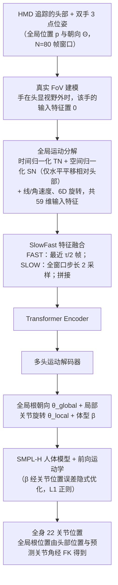

# EgoPoser

**EgoPoser: Robust Real-Time Egocentric Pose Estimation from Sparse and Intermittent Observations Everywhere** 收录于 [Robot Learning Paper Notebooks](https://imchong.github.io/Robot_Learning_Paper_Notebooks/index.html)（分类：14_Human_Motion），深读笔记已完成。本页是 **笔记摘要**，并补充了对原文 arXiv PDF（v3，全文 18 页通读）的方法、评测与局限整理；数值以论文表格为准，笔记页与 PDF 的细节以原文为准。

## 一句话定义

仅用头与手位姿做全身第一视角姿态估计是头显平台驱动化身的活跃方向，但现有方法过度依赖室内动捕空间（数据录制环境），且假设关节连续跟踪与统一体型。EgoPoser 在更真实的设定下做到鲁棒：手部位置/朝向只有进入头显视野（FoV）时才被跟踪——即稀疏且间歇的观测。它还有三点关键贡献：① 在间歇手部跟踪下仍鲁棒建模全身姿态；② 全局运动分解——独立于全局位置预测全身姿态；③ 高效的 SlowFast 模块设计，在捕捉更长运动时序的同时保持算力高效；并能跨不同用户体型泛化。ECCV 2024。

## 英文缩写速查

| 缩写 | 含义 |
|---|---|
| HMD | Head-Mounted Display，头显；本文唯一的输入来源（头与双手的三点位姿） |
| FoV | Field of View，头显相机视野；手在视野外时该手的输入特征置 0 |
| TN / SN | Temporal / Spatial Normalization，全局运动分解中的时间归一化与空间归一化 |
| SlowFast | 慢-快双路时序融合：FAST 取最近 τ/2 帧，SLOW 取全窗口步长 2 的采样 |
| SMPL-H | 含手指的 SMPL 人体模型；本文只用其前 22 个关节 |
| FK | Forward Kinematics，正向运动学；由预测关节角与头部位置求全局根位置 |
| 6D | 6D 旋转表示，用于保证神经网络输出旋转的连续性 |
| MPJPE / MPJVE | Mean Per Joint Position / Velocity Error，关节位置 / 速度平均误差（cm、cm/s） |

## 为什么重要

- **"间歇/缺失观测下鲁棒"是真实部署的关键**：头显手追踪在手出视野时会丢失，与人形状态估计在传感缺失时的鲁棒诉求一致（本页推断，论文本身面向人体化身，未讨论机器人）；
- **全局运动分解**直接针对"训练集集中在原点附近、换位置就失效"的问题，对全身估计的泛化有借鉴意义，可与 AvatarPoser（论文直接前作）对照；
- **SlowFast 长时序 + 高效**给出了一种在不增加注意力计算量的前提下拉长历史的结构，适合实时全身估计；
- 稀疏感知驱动全身，对人形遥操作/化身有直接价值（本页推断，需单独验证）。

## 流程总览

图依据：论文 §3.1–3.5、Fig. 2。

## 解决什么问题

现有第一视角全身姿态估计**假设太理想**：

- 依赖**室内动捕空间**采集的数据，全局位置输入使模型过拟合到数据集附近的位置；
- 假设手**始终可见**，而真实头显中手常出视野，形成**间歇**观测；
- 假设**统一（平均）体型**，导致穿地、穿透与悬浮等伪影。

EgoPoser 要：在**稀疏间歇**观测、**任意场景、任意体型**下鲁棒实时估计全身姿态。

## 核心机制

1. **间歇观测鲁棒**：按真实 FoV 而非随机丢帧模拟手部丢跟踪，手出视野也能稳健估全身姿态；
2. **全局运动分解**：用时间/空间归一化把全局信息转为位置不变的表示，提升泛化；
3. **SlowFast 模块**：长时序 + 算力高效；
4. **跨体型泛化**：估计体型参数 β，摆脱统一体型假设（ECCV 2024）。

## 核心原理

### 输入与输出

- **输入**：HMD 给出头与双手的全局位置 $p$ 与朝向 $\Theta$，取最近 $\tau=80$ 帧作窗口；每个时刻只输出窗口最后一帧的全身姿态，以满足实时性。
- **特征**：归一化后的位置、朝向（6D 旋转）、线速度与角速度，共 59 维。
- **输出**：全局根朝向 $\theta_{global}$、局部关节旋转 $\theta_{local}$、体型 $\beta \in \mathbb{R}^{16}$；经 SMPL-H 与 FK 得到前 22 个关节位置。全局根位置由头部位置与预测关节角经 FK 推出（沿用 AvatarPoser 做法）。

### 真实 FoV 建模

训练时根据头部位姿与手相对头部的位置，判断每只手是否落在水平视角 $\alpha_h$、垂直视角 $\alpha_v$ 的视野内；视野外则该手的输入特征置 0。论文模拟了 180°（鱼眼）、120°（Quest 2）、90°（HoloLens 2）三种视野。相较 FLAG 的随机遮蔽（概率 $p=0.2$，不考虑手与头的空间关系），这种建模同时保留了时间连续性。

### 全局运动分解

- **时间归一化 TN**：每个关节减去窗口首帧的平移，得到窗口内的相对轨迹。
- **空间归一化 SN**：只把手与头的**水平**平移相对头部表示，**竖直**分量保留，作为运动先验。消融中，对竖直位置也做减法（horiz.+vert.，MPJPE 4.96）明显差于仅水平归一化（4.45）。

### SlowFast 特征融合

窗口含 $\tau$ 帧时，FAST 分支取最近 $\tau/2$ 帧逐帧嵌入，SLOW 分支在全窗口上以步长 2 取 $\tau/2$ 帧；两者拼接后序列长度为 $\tau/2=40$。Transformer 自注意力代价随序列长度二次增长，因此在保留全窗口上下文的同时缩短了输入。

### 体型感知优化

β 不被直接监督，而是通过可微 SMPL 的前向运动学得到的关节位置误差隐式优化：

$$\mathcal{L}_{pos}=\left\lVert FK(\theta,\beta)-FK(\theta_{GT},\beta_{GT})\right\rVert_1$$

并对 β 施加 L1 正则，使不影响关节位置与骨长的分量趋近于 0。总损失权重为 $\lambda_{ori}=0.05$、$\lambda_{rot}=1$、$\lambda_{pos}=1$、$\lambda_{\beta}=0.01$。论文另给出一种需要 T 姿态标定的替代方案（数据增强 + 身高与臂长比例缩放），正文采用的是无标定的联合估计。

## 工程实践

| 项 | 论文设置 / 数值 |
|---|---|
| 训练数据 | AMASS 的 CMU、BMLrub、HDM05 子集，沿用 AvatarPoser 切分（90% 训练 / 10% 测试） |
| 外推评测 | HPS 大场景数据（真值取自 Guzov et al. 的联合优化结果） |
| 优化器 | Adam，batch 256，学习率 $1\times10^{-4}$，每 $2\times10^{4}$ 次迭代乘 0.5 |
| 输入窗口 | $\tau=80$ 帧，SlowFast 融合后 40 帧 |
| 训练硬件 | 单张 GTX 3090（PyTorch） |
| 推理速度 | 摘要称超过 600 fps（论文 Fig. 7 给出参数量与 FLOPs 对比） |
| 调试指标 | MPJPE（cm）、MPJVE（cm/s，平滑性）、MVE、身高与臂长误差、GP（地面穿透）、FF（脚悬浮） |
| 调试提示 | 手出视野时 MPJVE 跳变大，先检查 FoV 掩码与视野角设置；远离原点时性能下降，检查是否误把全局位置直接输入网络；GP / FF 偏大时检查体型估计 |
| 开源状态 | 项目页 <https://siplab.org/projects/EgoPoser> 列出 code 链接 <https://github.com/eth-siplab/EgoPoser>。截至本次入库，沙箱访问该 GitHub 仓库返回 403，**仓库内容、许可证与权重未核实（未核实）** |
| 源码运行时序图 | **不适用**（仓库未能访问核实，无法对齐训练 / 推理入口；核实后补充） |

## 实验与评测

评测指标为 MPJPE / MPJVE；默认假设手全程可见，以便与前作公平比较。主要结果如下。

**HPS 大场景外推（Table 1，MPJPE，cm，越低越好）**：模型只在室内 AMASS 子集上训练。

| 方法 | BIB_EG_Tour | MPI_EG | Working_Standing | UG_Computers | Go_Around |
|---|---|---|---|---|---|
| AvatarPoser | 22.53 | 16.54 | 19.08 | 23.24 | 19.50 |
| AvatarPoser-Improved（局部输入改造） | 11.48 | 13.86 | 12.42 | 11.42 | 12.56 |
| AGRoL | 28.95 | 19.41 | 17.67 | 20.90 | 14.16 |
| AGRoL-Improved | 15.04 | 13.94 | 13.86 | 12.71 | 13.13 |
| AvatarJLM | 41.27 | 12.91 | 17.26 | 21.31 | 11.57 |
| AvatarJLM-Improved | 14.80 | 14.72 | 13.75 | 10.28 | 11.19 |
| **EgoPoser** | **9.55** | **11.05** | **8.70** | **10.25** | **6.90** |

EgoPoser 在这 5 段序列上 MPJPE 与 MPJVE 均为最低（MPJVE 分别为 49.39 / 35.60 / 46.49 / 38.29 / 45.10）。"-Improved" 为作者把输入改为相对首帧的局部表示后的版本，说明局部表示本身就能显著改善前作。

**手部出视野（Table 3，AMASS，MPJPE / MPJVE，cm 与 cm/s）**

| 方法 | FoV 180° | FoV 120° | FoV 90° |
|---|---|---|---|
| Full Visibility（默认模型） | 24.75 / 183.84 | 38.99 / 144.42 | 41.24 / 95.66 |
| Random Masking（FLAG 式，$p=0.2$） | 7.09 / 49.91 | 13.29 / 64.09 | 14.84 / 58.33 |
| Improved RM | 6.52 / 47.50 | 11.88 / 57.44 | 12.83 / 52.98 |
| **Ours（真实 FoV 建模）** | **5.31 / 39.69** | **6.07 / 46.01** | **6.60 / 48.25** |

视野越小，位置误差越大；默认模型在 180° / 120° 下 MPJVE 偏高，原因是手反复进出视野造成预测跳变（论文解释）。

**体型感知（Table 2，AMASS，真实 β，cm）**

| 策略 | MPJPE | MVE | 身高误差 | 臂长误差 | GP | FF |
|---|---|---|---|---|---|---|
| 平均体型 | 6.36 | 6.74 | 7.67 | 7.42 | 3.87 | 5.38 |
| 数据增强 + T 姿态标定 | 5.26 | 4.69 | 1.36 | 1.24 | 2.06 | 1.67 |
| **联合估计（本文）** | **4.79** | **4.08** | **1.78** | **1.66** | **2.31** | **1.64** |

测试集含 175 名以上受试者，身高 145–207 cm。

**消融**

- 全局运动分解（Table 4，MPJPE）：仅均值归一化约 6.25 cm；仅空间归一化（水平位置）4.45；仅时间归一化 4.58；对水平与竖直位置都做空间归一化 4.96；完整方法（时间归一化 + 仅水平空间归一化）4.14 cm，MPJVE 25.95。
- SlowFast（Table 5）：输入长度 40 为 4.36 cm；长度 80 为 4.11 cm 但 FLOPs 翻倍（0.65G vs 0.33G）；80 帧步长 2 为 4.13 cm（0.33G）；本文设计 4.14 cm、MPJVE 25.95（优于步长 2 的 30.02），FLOPs 0.33G、参数量 4.12M。
- 位置偏移（Fig. 8）：在 CMU / BMLrub / HDM05 上加 0、2、5、10、50 m 偏移。以全局输入的 AvatarPoser、AGRoL、AvatarJLM 误差随偏移显著上升；局部表示方法（CoolMoves、FinalIK）与本文保持稳定，本文图注报告 MPJPE 4.14 cm、MPJVE 25.95 cm/s。

**真机**：Fig. 11 给出 Quest 2 实机录制（Velt 采集）的定性结果，未报告定量真机指标。

## 与其他工作对比

| 方法 | 输入表示 | 手部可见性 | 体型 | 论文给出的主要特点 / 代价 |
|---|---|---|---|---|
| AvatarPoser | 全局位置 | 假设全可见 | 平均体型 | Transformer + IK；全局输入易过拟合，偏离原点后退化 |
| AGRoL | 全局位置 | 假设全可见 | 平均体型 | 扩散模型；依赖未来输入帧，采样慢，难以实时 |
| AvatarJLM | 全局位置 | 假设全可见 | 平均体型 | 关节级时空 Transformer；计算开销大 |
| MANIKIN | 全局位置 | 假设全可见 | 平均体型 | 可微全身 IK，减少地面穿透 |
| FLAG | 随机遮蔽手 | 随机丢帧 | 平均体型 | 未考虑手与头的空间关系 |
| **EgoPoser** | 归一化局部表示 | 按真实 FoV 置 0 | 联合估计 | 位置不变；参数量与 FLOPs 更小（Fig. 7），推理 >600 fps |

HPS 与 AMASS 的定量对比见上节。论文结论是：在这些设定下 EgoPoser 取得当前最优，代价是仍以朴素 Transformer 为骨干、没有后处理。

## 局限与风险

- **适用边界（论文 §4.6）**：竖直全局位置作为输入，因此假设用户在同一楼层活动；换楼层需重新定义原点。
- **骨干与后处理**：论文只用朴素 Transformer 作骨干，且没有任何后处理，姿态的物理可行性（穿透、滑步）不被显式约束。
- **数据与场景**：训练数据以室内动捕（AMASS 子集）为主，HPS 只是外推测试；真机仅 Quest 2 的定性演示，缺少量化真机指标。
- **观测限制**：下肢没有直接观测，腿部由头与手的全局运动推断，运动异常或长时间遮挡时误差会增大（本页推断）。
- **默认假设**：与前作对比的主表假设手全程可见；手部遮挡结果是在 AMASS 上的仿真视野模型，并非真实头显的遮挡统计。
- **迁移风险**：论文面向人体化身，未涉及人形机器人控制；用于人形遥操作或状态估计需单独验证延迟、遮挡与标定误差（本页推断）。

## 结论

**EgoPoser 一次性拆掉了第一视角姿态估计的三条理想假设——连续跟踪、室内动捕场地、统一体型——真正的价值是让「手出视野」这种常态不再是失效条件。**

- 三个机制各对应一条假设：真实 FoV 建模应对手部丢跟踪，**全局运动分解**让姿态预测不依赖全局位置（因而不绑定录制场地），联合体型估计摆脱统一体型前提。
- SlowFast 是「时序长度 vs 算力」的折中：观测缺口要靠更长的运动历史来补，又不能牺牲实时性；论文消融中，本文设计的 MPJPE 与 80 帧步长 2 方案相当（4.14 vs 4.13），但 MPJVE 更低，且计算量只有 80 帧朴素输入的一半。
- 适用边界要认清：输入始终只有头与手的稀疏位姿，下肢没有任何直接观测，腿部由全局运动推断；输入含竖直位置，换楼层需重设原点；无后处理，物理可行性未保证。
- 对人形的迁移价值在**传感缺失下的鲁棒状态估计**与遥操作/化身链路（本页推断）；全局运动分解这一点可与 AvatarPoser、FRAME 对照着看。
- 开源状态：项目页列出 code 链接，仓库内容未核实（未核实）；量化结果见上节表格，可直接对照论文 Table 1–5。

## 关联页面

- 分类父节点：[paper-notebook-category-14-human-motion](../overview/paper-notebook-category-14-human-motion.md)
- 总索引：[humanoid-paper-notebooks-index.md](../overview/humanoid-paper-notebooks-index.md)
- 前作：[AvatarPoser 笔记实体](paper-notebook-avatarposer-articulated-full-body-pose-tracking.md)（同一作者组，三点输入全身估计）
- 同类对照：[MANIKIN 笔记实体](paper-notebook-manikin-biomechanically-accurate-neural-inverse.md)（可微全身 IK，同作者组）
- 同类对照：[FRAME 笔记实体](paper-notebook-frame-floor-aligned-representation-for-avatar-mo.md)（头显化身动捕的局部/地面对齐表示）
- 人体模型：[SMPL-X 概念页](../concepts/smpl-x.md)（本文使用的是 SMPL-H，二者同属参数化人体模型家族）
- 状态估计背景：[State Estimation 概念页](../concepts/state-estimation.md)

## 参考来源

- [humanoid_pnb_egoposer.md](../../sources/papers/humanoid_pnb_egoposer.md)
- 深读笔记：<https://imchong.github.io/Robot_Learning_Paper_Notebooks/papers/14_Human_Motion/EgoPoser__Robust_Real-Time_Egocentric_Pose_Estimation_from_Sparse_Sensors/EgoPoser__Robust_Real-Time_Egocentric_Pose_Estimation_from_Sparse_Sensors.html>
- 论文：<https://arxiv.org/abs/2308.06493>
- [arXiv PDF](https://arxiv.org/pdf/2308.06493)（v3，2024-09-06 标记）：本页已通读全文，含 §1–§5、Tab. 1–5、Fig. 1–11 与参考文献。会议（ECCV 2024）信息取自笔记页与摘要，PDF 正文未标注。
- 项目主页：<https://siplab.org/projects/EgoPoser>（列出 code 链接；仓库本次未能访问核实）

## 推荐继续阅读

- [机器人论文阅读笔记：EgoPoser](https://imchong.github.io/Robot_Learning_Paper_Notebooks/papers/14_Human_Motion/EgoPoser__Robust_Real-Time_Egocentric_Pose_Estimation_from_Sparse_Sensors/EgoPoser__Robust_Real-Time_Egocentric_Pose_Estimation_from_Sparse_Sensors.html)
- [EgoPoser 项目主页（SIPLAB）](https://siplab.org/projects/EgoPoser)
- 前作 AvatarPoser（ECCV 2022）见上文关联页面的笔记实体；本文的全局输入基线即来自该工作。
